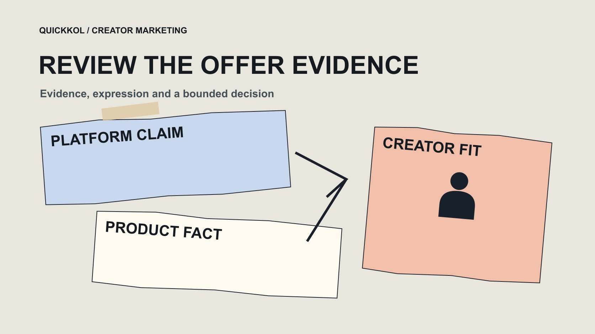
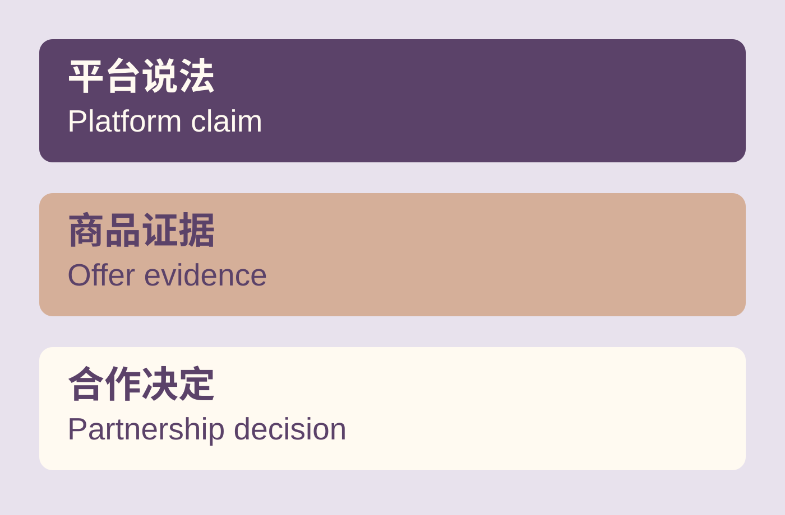

# ClickBank Reviews for Creator Partnerships

Status: local review draft; confirm the publication date before release.

When reading ClickBank reviews, identify whether the subject is the platform, a product or an affiliate arrangement. Check experience, incentives and current terms before using a review to inform a creator offer.

QuickKOL editorial graphic; not actual account metrics or a platform interface.

ClickBank reviews should not become one verdict about every product on the platform. Identify the review’s object, date, actual experience and possible commission relationship, then check the seller and official policies for facts relevant to creator work. Platform service, product quality, customer support and affiliate earnings are different questions. This article has not purchased or tested a particular offer and invents no customer ratings; it explains turning public reviews into answerable checks before a brand continues a content-partnership discussion.

## Identify what the review actually concerns

A review titled ClickBank may discuss account operation or only introduce one course or physical product. Attach an object to each statement instead of allowing the platform name to carry every meaning.

The [ClickBank offer-review guide](https://www.quickkol.com/blog/clickbank-brand-affiliate-offer-review/#answer) separates sellers, products and affiliates. This article adds a review-evidence question: who is evaluating what, and how does that information relate to this creator assignment?

For example, an account of a support wait does not directly establish a product effect, while satisfaction with a product does not prove that every affiliate can profit. Both may deserve attention without replacing one another.

Retain the URL, date and meaning. Where a review does not identify the version or process involved, list the gap rather than inventing a complete experience or using a vague statement to accuse a seller publicly. A precise subject turns a broad positive or negative reaction into a question the relevant party can actually address. It also prevents the brand from rejecting or endorsing an unrelated offer because it shares the same platform.

## Distinguish first-hand experience from retelling

Check whether the reviewer explains what was actually obtained, used or completed. A screenshot, retold selling point and first-hand use are different evidence; confident tone does not establish a test.

This article claims no first-hand offer trial. A brand's own assessment should be equally clear: reviewing public information, receiving a sample and completing an experience are distinct states.

[FTC’s influencer-disclosure guide](https://www.ftc.gov/business-guidance/resources/disclosures-101-social-media-influencers) emphasizes, in its United States context, that an experience which never happened should not be described as real. When commissioning a review, supply a genuine opportunity to use the product and factual references instead of requesting a first-person success story copied from a sales page.

Even real experience needs its version, conditions and timing. One successful use describes that occasion without guaranteeing the same result for every buyer. Without first-hand work, identify the piece as an information review rather than disguising an introduction as testing. This preserves useful research while preventing a claim of expertise or use that the author cannot support.

## Examine the incentive behind a recommendation

A review may involve an affiliate link, fee, gift or another relationship. That does not automatically make an opinion wrong, but the relationship should be understood rather than treating a commercial recommendation as wholly independent.

A commissioned creator should likewise know their role. Introducing a product, recommending purchase and participating in promotion can involve different expressive responsibilities and arrangements; one word, collaboration, should not hide them all.

The [creator-content and affiliate-role map](https://www.quickkol.com/blog/affiliate-creator-content-partnership-ads-role-map/#answer) distinguishes production, publishing, advertising and commission. Ask which action might benefit the reviewer instead of merely noticing whether the platform name appears.

Where the relationship is unexplained, retain the question and seek appropriate evidence rather than alleging that the author was paid to lie. Verification should clarify context, not treat every incentive as proof of dishonesty. This makes it possible to use a review's relevant observations while remaining explicit that its recommendation may come from a particular commercial position and does not become the brand's own independently verified finding.

## Check an old review against current terms

A publication date and an experience date may differ, and products or terms can change. Record the period discussed before checking what actually applies to this assignment.

[ClickBank’s commission-type guide](https://support.clickbank.com/en/articles/10535287-how-do-i-know-how-much-or-what-type-of-commission-a-seller-offers) distinguishes revenue share from CPA and explains that particular rates depend on seller and affiliate arrangements. A listing average or someone else's settlement does not guarantee the same income for this creator.

If a review merely calls commission high, ask which product, model, period and conditions it concerns. Without those facts, a subjective description should not enter the brand budget or the creator's earnings plan as a confirmed amount.

This is not investment or personal financial advice. The partnership discussion needs to separate actual agreement from unknowns so historical experience, promotional figures and future payment do not become one supposed fact. Updating the terms check is particularly important when a search result keeps circulating long after the arrangement it describes has changed.

## Read returns alongside the commission model

[ClickBank’s return and subscription-cancellation policy](https://support.clickbank.com/en/articles/10535349-clickbank-s-return-and-subscription-cancellation-policy), updated in August 2026, distinguishes revenue-share reversals from CPA circumstances and describes seller support responsibilities. One sentence about returned commission should not be applied to every model.

Specific product, transaction and policy conditions still require checking. This article promises no particular case treatment and does not turn one complaint into a finding that the entire system failed.

The brand needs to understand what a customer receives, who supplies support and how the creator will explain it accurately. Cancellation, returns and platform policy do not prove product effectiveness or justify exaggerated recommendations.

When reading a review, record whether it describes a request, approval, actual refund or another state. Mixing stages can make either a positive or negative judgment lose its object. The relevant follow-up is a precise question about the described process rather than a generalized claim that every buyer or affiliate will experience the same result.

## Use different sources for different questions

Seller material helps check the product promise and delivery, platform policy explains relevant rules and genuine reviews can supply experience leads. They need not prove everything about one another; each should answer an appropriate question.

Where a review contains an anomaly or contradiction, retain wording and context and ask the responsible party. Repeating several unverified retellings should not become independent cross-verification merely because they appear on different pages. If several articles cite one original post, they may still represent only one experience. Retain that relationship rather than treating wide circulation as a larger body of independent evidence.

Avoid selecting only material that confirms an existing impression. Positive experiences can be conditional, while negative experiences may concern a particular version. Preserve those differences instead of pursuing a one-sided verdict.

Keep confirmed facts, user statements and unresolved explanations separate in the final record. A scoped verification note often informs a creator-partnership decision better than a star rating. It tells the next person what remains to check and prevents a copied opinion from acquiring the status of a verified brand finding through repetition alone.

Reviews are leads; send claims to sources able to answer them without making one experience represent every offer.

## Hypothetical case: reviews of a design-template bundle

Imagine a brand considering a creator promotion for a design-template bundle. One review calls it easy to use while another reports incompatible files. No actual product or customer outcome is represented here.

The team checks the versions, software conditions and experience described, then asks the seller about current files and support. One person's ease of use should not become compatibility with every application.

If a recommendation is commissioned, arrange actual use and a defined assignment while retaining the commercial relationship. Confirm commission, brand fees and return conditions from their own records rather than deriving future earnings from a review's tone.

The decision may be to continue discussion or obtain more information first. It follows current facts and gaps without requiring a declaration that every ClickBank product is worth buying or that the entire platform is unreliable. The example turns conflicting reviews into specific checks rather than forcing the brand to choose which broad opinion to repeat.

## Turn verification into a creator brief

Give the creator confirmed product facts, experience conditions, claims that must not be expanded and unresolved questions. Do not ask them simply to copy a review's praise or complaint.

Explain what the viewer should understand and which actual details need demonstration. The brand owns its product reference, the creator owns their genuine contribution and platform status does not replace their work agreement.

With insufficient evidence, revise the task into an information introduction or wait for appropriate experience before making a recommendation. A deadline should not turn reading a page into personally testing a product.

Retain the approved version and an owner for later updates. Review research should make the assignment more accurate instead of filling a film with other people's opinions while leaving the creator's actual knowledge unclear. That gives the brand a concrete result from research: a supported task, a visible limit and a decision about what is still needed before publication.

## Give reviews a bounded partnership conclusion

ClickBank reviews can provide useful leads without replacing the particular product, current terms and creator experience. Each statement needs a suitable object and source.

Establish who is saying what before examining relationships, timing and facts. Do not reject every incentivized recommendation or endorse every offer merely because a platform has policies.

The brand can request evidence, continue a proposal or pause while identifying which condition would change that choice. Update affected conclusions when a new version or fact appears.

That fits the practical aim of creator marketing: a real person explaining a specific product through supported work, rather than an experience-free verdict replacing every judgment for the brand and viewer. The final review should leave a clear next question and a responsible source, not a falsely comprehensive claim that one article has settled the quality and commercial potential of everything sold through the platform.

## Objects to verify in a review

| Claim | Appropriate check | Limit |
| --- | --- | --- |
| Useful | Version and actual use | Not everyone’s result |
| High commission | Model and arrangement | Not a personal earnings promise |
| Return issue | Transaction state and policy | Not a system-wide verdict |
| Independent recommendation | Relationship and source context | Unknown is not an accusation |
| Suitable partnership | Product, work and assignment | Not a platform-wide score |

No particular offer was purchased or tested. This editorial framework supplies no customer rating, earnings forecast or case-treatment guarantee.

## Turn reviews into answerable questions

Check before using a review in a creator proposal.

- [ ] Identify platform, product or arrangement.
- [ ] Retain experience and publication dates.
- [ ] Separate first-hand use from retelling.
- [ ] Check incentives and current terms.
- [ ] Separate facts, statements and unknowns.
- [ ] Choose the next step from specific evidence.

## Research date and limitations

Sources reviewed November 19, 2026. Methods, tables and decision rules are editorial recommendations. Hypothetical examples are not actual client results or industry benchmarks. Source geography and periods are specified where relevant.

## Start creator research with a clear task

Use QuickKOL to interpret a brief, discover relevant creators and research their work and contact routes. Verify data, commercial terms and outcomes at their source.

[Explore QuickKOL](https://www.quickkol.com/#capabilities)

## Sources

- [FTC’s influencer-disclosure guide](https://www.ftc.gov/business-guidance/resources/disclosures-101-social-media-influencers)
- [ClickBank’s commission-type guide](https://support.clickbank.com/en/articles/10535287-how-do-i-know-how-much-or-what-type-of-commission-a-seller-offers)
- [ClickBank’s return and subscription-cancellation policy](https://support.clickbank.com/en/articles/10535349-clickbank-s-return-and-subscription-cancellation-policy)
