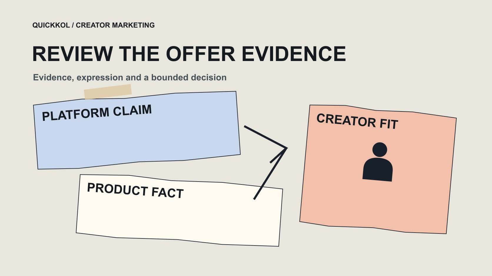
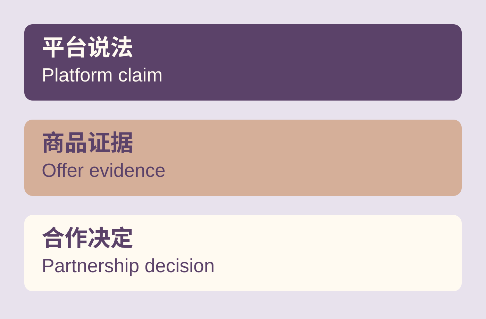

# ClickBank 评价怎样转成合作核验

状态：本地审阅稿；正式发布日期待确认。

读 ClickBank 评价时，先辨认评价的是平台、某个商品还是推广合作。品牌再核对体验、佣金关系与当前条款，不让一篇评价替全部 Offer 作决定。

QuickKOL 编辑图形；不呈现真实账号指标或平台界面。

ClickBank reviews 不能被压成对平台上所有商品的统一好坏结论。先确认评价对象、日期、实际体验与可能佣金关系，再到对应卖家和官方政策核对影响达人合作的事实。平台服务体验、商品质量、客户支持与推广收益是不同问题。本篇没有购买或实测任何具体 Offer，也不编造用户评分；重点是品牌怎样把公开评价转成可回答的核验问题，再决定是否继续讨论内容合作。

## 先确定评价在说哪个对象

一篇标题写 ClickBank 的评价，正文可能讲账户操作，也可能只介绍某个课程或实体商品。先为每项主张写明对象，不让平台名称包办全部含义。

[ClickBank 品牌 Offer 审阅指南](https://www.quickkol.com/zh/blog/clickbank-brand-affiliate-offer-review/#answer)区分卖家、商品与推广者。本篇在此基础上处理评价材料：谁在评价什么，以及这些信息与这次达人任务有什么关系。

例如对客服等待的描述，不直接证明某个商品效果；对商品满意，也不自动证明全部推广者都能获利。两者可以值得查看，但不能互相代替。

保留具体 URL、日期与原意。若评价没有指明商品版本或所涉过程，就把缺口列出来，不自行补成一个完整经历，也不把模糊评价用于公开指责某位卖家。

## 亲身体验与转述分别标明

查看评价是否说明实际取得、使用或完成了什么。截图、卖点转述与作者亲身使用，是不同证据；不能因为文章语气肯定就假定发生过测试。

本篇不声称我们试过任何 Offer。品牌自己的评估也应同样清楚：看过公开资料、取得样品、完成体验，各自对应不同状态。

[FTC 的达人披露指南](https://www.ftc.gov/business-guidance/resources/disclosures-101-social-media-influencers)在美国语境下强调不能描述没有发生的体验。创作者准备评价内容时，品牌应提供真实使用机会与事实，而不是要求照着宣传页写一段第一人称成功经历。

即便体验真实，也保留版本、条件与时间。一次顺利使用可以说明该次情况，不足以保证所有购买者都会有相同结果；没有亲身体验时，就不要把资料介绍伪装成实测。

## 查看评价与推荐背后的激励

评价可能有联盟链接、品牌费用、赠品或其他关系。存在关系不自动证明意见错误，但关系应被适当理解，不能把商业推荐当成完全独立结论。

为品牌工作准备的创作者也应明确自己扮演什么角色。介绍商品、推荐购买与参与推广，可能带来不同表达责任和约定，不用一句“合作”隐藏全部条件。

[达人内容与联盟角色图](https://www.quickkol.com/zh/blog/affiliate-creator-content-partnership-ads-role-map/#answer)帮助区分制作、发布、广告和佣金安排。阅读评价时同样要问，这位作者从哪项行为可能获得什么，而不是仅看是否写了平台名字。

若关系没有说明，保留疑问并寻找适当来源，不直接断言作者收钱作假。核验的目标是理解资料背景，而不是把任何激励都当作失信证据。

## 用当前条款核对旧评价

评价日期与经历日期可能不同，商品和条款也可能已经更新。记录作者所谈时期，再查看对这次合作真正有效的资料。

[ClickBank 的佣金类型说明](https://support.clickbank.com/en/articles/10535287-how-do-i-know-how-much-or-what-type-of-commission-a-seller-offers)区分收入分成与 CPA，并说明具体费率需要按卖家与推广者安排核对。列表平均值或别人的结算，不是这位创作者将取得同样收入的保证。

如果评价只说佣金很高，就继续问对应产品、类型、时期与条件。没有这些事实，不能将一句主观判断填进品牌预算或创作者收益计划。

本文不提供投资或个人财务建议。合作讨论只需把实际约定与未知分开，避免把历史经验、宣传数字与未来付款写成同一件事。

## 把退款与佣金类型一起理解

[ClickBank 的退货与订阅取消政策](https://support.clickbank.com/en/articles/10535349-clickbank-s-return-and-subscription-cancellation-policy)在 2026 年 8 月更新，区分收入分成退款回冲与 CPA 情况，并说明卖家的客户支持责任。不能只摘一句退款会扣佣金，就应用于所有类型。

具体商品、交易与政策条件仍需核对。文章不承诺任何个案一定如何处理，也不把一条投诉直接认定为整个系统失效。

品牌需要知道消费者会得到什么、由谁支持，以及创作者准备怎样准确介绍。退订、退款与平台政策不是商品效果证明，也不应被当成可以随意夸大推荐的理由。

审阅一篇评价时，记录它谈的是申请、批准、实际退款还是其他状态。把不同阶段混写，可能使正面或负面判断都失去准确对象。

## 让多种来源回答不同问题

卖家资料适合核对商品承诺与交付，平台政策说明相关规则，真实评价可以提供具体经历线索。它们不需要完全互相证明，关键是各自回答适合的问题。

评价中有异常或矛盾时，保留原话与背景，向适当负责人核实。不要把多个未经证实的转述重复计数后，称为独立交叉验证。若多篇文章都引用同一个原始帖子，它们仍可能只有一个经历来源。保留这种关系，避免将传播广度误认成独立证据数量。

同样避免只挑符合既有印象的材料。正面经历可能有条件，负面经历也可能涉及特定版本；研究应保留这些差异，而不是追求一边倒的结论。

最终将已确认事实、用户陈述与未解决解释分开。一个有范围的核验记录，往往比一个简单星级更能支持是否继续达人合作的决定。

评价是线索；把主张送到能回答相应问题的来源，不用一项经历代表全部商品。

## 假设案例：设计模板包的评价

假设品牌准备与创作者推广设计模板包，看到一篇正面评价说上手方便，另一篇抱怨文件不兼容。这里没有实际商品或客户结果。

团队先确认两篇文章所谈版本、软件条件与体验，再向卖家核对当前文件与支持说明。不能把一个人的方便感受扩成适用于全部软件的事实。

若创作者要制作推荐，安排真实使用与明确任务，保留商业关系。佣金、品牌费用与可能退货按各自资料确认，不从评价语气推算未来收益。

最终可以继续讨论，也可以先补资料。决定对应当前事实与缺口，不需要宣布整个 ClickBank 平台全部值得买或全部不可靠，才能结束研究。

## 将核验结果转成创作者 Brief

把已经确认的商品事实、体验条件、不可扩写的主张与待解决问题交给创作者。不要直接要求照抄评价中的赞美或投诉。

说明希望观众理解什么，以及需要展示哪些实际细节。品牌负责产品资料，创作者负责自己的真实贡献，平台状态不替代双方工作约定。

资料不足时，可以调整为信息介绍，或等待合适体验后再制作推荐。不能为了赶进度，让“看过网页”变成“已经亲自测试”。

保留批准的版本与后续更新负责人。评价研究的价值，在于让任务更准确，而不是让成片堆满其他人的意见，却没有说明创作者实际知道什么。

## 给评价一个有范围的合作结论

ClickBank reviews 可以提供有价值线索，但不能替代具体商品、当前条款与创作者体验。每项主张应有适合对象和来源。

先确认谁在说什么，再处理关系、时间与事实。不要因推荐有激励就一概否定，也不因平台有政策就一概认可所有 Offer。

品牌可以据此决定补资料、继续提案或暂缓，并说明哪个条件会改变决定。未来有新版本或新事实时，更新相应结论即可。

这更符合达人营销的实际目标：让真实的人以有依据内容解释具体商品，而不是用没有亲身经验的统一好坏评价，替品牌和观众完成全部判断。

## 读评价时的核验对象

| 主张 | 适当核对 | 保留限制 |
| --- | --- | --- |
| 好用 | 版本与实际体验 | 不是所有人结果 |
| 佣金高 | 类型与具体约定 | 不是个人收益承诺 |
| 退款问题 | 交易状态与政策 | 不扩成全部系统结论 |
| 推荐独立 | 关系与来源背景 | 未知不直接指控 |
| 适合合作 | 商品、作品与任务 | 不是平台通用评分 |

未购买或测试具体 Offer；编辑核验框架不提供客户评分、收入预测或个案处理保证。

## 把评价变成可回答的问题

在将评价用于达人提案前核对。

- [ ] 标明平台、商品或合作对象。
- [ ] 保留经历与发布日期。
- [ ] 区分亲身体验与转述。
- [ ] 核对激励和当前条款。
- [ ] 分别记录事实、陈述与未知。
- [ ] 以具体资料决定下一步。

## 研究日期与使用边界

资料核验于 2026 年 11 月 19 日。文中方法、表格和决策规则为编辑建议，标为假设的示例不是实际客户结果或行业基准。外部资料的适用地区与时期按各段说明。

## 从任务开始达人研究

用 QuickKOL 理解 Brief、发现相关达人并研究作品与联系路径；数据、合作条件和结果仍需核验。

[了解 QuickKOL](https://www.quickkol.com/#capabilities)

## 来源

- [FTC 的达人披露指南](https://www.ftc.gov/business-guidance/resources/disclosures-101-social-media-influencers)
- [ClickBank 的佣金类型说明](https://support.clickbank.com/en/articles/10535287-how-do-i-know-how-much-or-what-type-of-commission-a-seller-offers)
- [ClickBank 的退货与订阅取消政策](https://support.clickbank.com/en/articles/10535349-clickbank-s-return-and-subscription-cancellation-policy)
