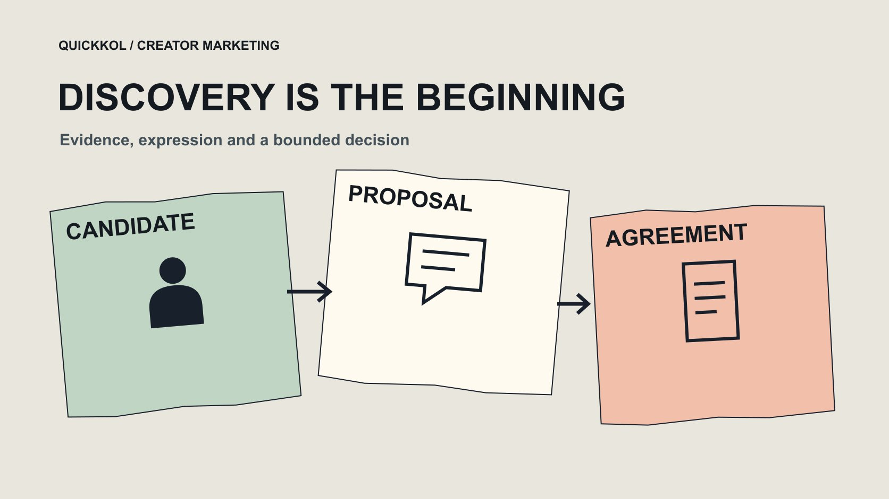
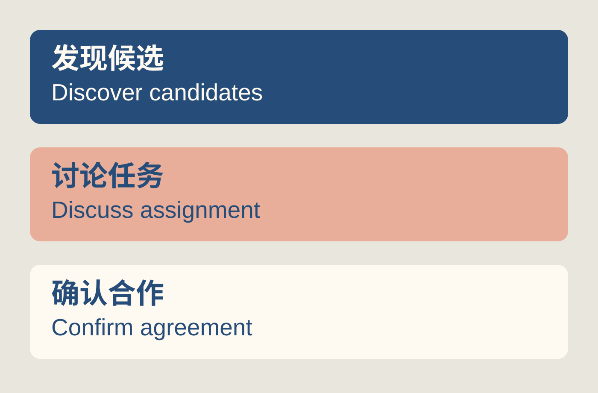

# Creator Marketplace: From Discovery to Agreement

Status: local review draft; confirm the publication date before release.

A marketplace helps people meet; a complete proposal helps them decide. Separate interest, information requests, acceptance and delivery so an opportunity becomes a defined partnership.

QuickKOL editorial graphic; not actual account metrics or a platform interface.

A creator marketplace is a market or platform feature helping brands and creators discover, contact and discuss opportunities, not an automatically completed partnership agreement. A project should let the creator understand the task, product facts, payment model, publication and intended use, with negotiable conditions visible. Saving, applying, receiving a message and expressing interest should not each be recorded as accepting every term. Check the actual account and project rules, then proceed from the work both parties clearly confirm.

## Separate marketplace discovery from an actual partnership

A platform may display profiles, work and contact opportunities without establishing suitability for a particular assignment. Review actual contributions instead of treating recommendation order as a complete quality ranking.

[Meta’s creator-marketplace announcement](https://about.fb.com/news/2024/02/creator-marketplace-for-brands-and-creators-to-collaborate-on-instagram/) in 2024 describes discovery, portfolios and project communication before creation after agreement. It is a dated feature account, not proof that all current markets and accounts share the same entry.

The [marketplace order-scope method](https://www.quickkol.com/blog/collabstr-marketplace-order-checklist/#answer) helps review procurement arrangements. This article addresses the earlier question of whether a proposal can receive an accurate response: what did the creator receive, and which state did the brand record as a partnership?

Finding a relevant candidate is only a beginning. Explain why this person is being approached and which real contribution is needed rather than allowing the profile page to replace a purposeful question. The marketplace provides a connection route, while the proposal still needs enough information for a person to decide whether the work fits their experience, interests and available conditions.

## Answer what the creator needs to know in the proposal

Identify the brand, product, audience question and contribution required. Specify production, personal appearance, creator-channel publication and other uses separately rather than putting every expectation inside collaborate with us.

Supply appropriate factual references, identifying what still needs experience or verification. Creators can propose expression based on their work without promising a final recommendation before using the product.

Make timing, feedback and required conditions visible. A location, additional team or several versions should be stated before someone accepts a simple task and discovers it has expanded.

A proposal can leave matters open for discussion, provided they are marked clearly. Visible unknowns are easier to answer than hidden conditions and help the brand receive comparable, feasible responses. The proposal need not become a lengthy generic questionnaire: its purpose is to supply the information capable of changing whether this creator can take on this assignment and what they would need to do it accurately.

## Different projects need not share a payment model

[TikTok One’s project-type guide](https://ads.tiktok.com/resources/help/article/types-of-projects-for-tiktok-one-creators?lang=en), updated in November 2026, distinguishes flat-fee content from different performance-based arrangements. A shared collaboration platform does not establish one payment and acceptance model.

State the model for this project, who pays, what work it concerns and which amounts or conditions are confirmed. A platform overview cannot supply missing terms for a particular assignment.

The creator can ask for facts relevant to their contribution without deriving inevitable results from another person's earnings screenshot. Fixed fees, possible commission and platform rewards should not be added unconditionally either.

This article supplies no standard quote or income prediction. A proposal needs an understandable payment question rather than earn money as a substitute for discussing production, publication and use. It should be possible for a creator to explain which part they are accepting and which condition remains unresolved, without having to infer the commercial arrangement from a broad project label alone.

## Record interest and scope acceptance as different states

Distinguish a discovered candidate, sent invitation, information request, willingness to discuss and actual confirmation. States organize next steps rather than interpret silence as permission.

When a creator expresses interest, establish what information remains needed. Do not immediately add the name to confirmed-client material or treat an open-project application as acceptance of every later addition.

Platforms have their own states and operating rules, which should be read in the actual interface. The editorial state table here supports handoff without claiming a one-to-one match with every button.

Define the confirmation route and owner so several people do not each assume someone else completed the agreement. An actual response and scope help production understand progress better than a green marker alone. This also makes a pause easier to interpret: a missing product reference, unavailable date and decision to decline are different states requiring different next actions rather than one undifferentiated failure label.

If several teams contact the same creator, name a primary owner and consolidate actual responses. Repeated invitations are not additional partnerships and should not allow two teams to commit conflicting conditions independently. The creator should know which version is the current proposal.

A platform opportunity can begin discussion without replacing explicit confirmation of the particular work.

## Allow clear clarification, revision or refusal

Acceptance is not the only useful response. A creator may need product information, propose another expression, explain an unavailable date or decide the subject does not fit their work; the brand should address the actual reason.

If revising, update task, timing and fees before both parties confirm. An original application state should not push a changed assignment forward, and a stated boundary should not automatically become a difficult-to-work-with label.

The brand can likewise explain insufficient evidence or a changed need, retaining the reason. Not proceeding need not become a comprehensive judgment about ability, audience or honesty.

Room for a precise response improves proposal quality. The brand learns what is missing, while the creator confirms work they actually want to do instead of accepting vague expectations and repeatedly repairing them later. It can also reveal a better assignment than the original request, because a relevant creator may understand which explanation fits their actual experience more clearly than the first draft of the brief does.

## Confirm relationships, experience and use with the proposal

[FTC’s influencer-disclosure guide](https://www.ftc.gov/business-guidance/resources/disclosures-101-social-media-influencers) emphasizes actual experience and material relationships in its United States context. A proposal should allow genuine use and explain the commercial arrangement behind the work.

Discuss production, publication and advertising use separately. Platform contact or file sharing does not automatically answer how an image, sound or personal likeness may be used across every channel.

The actual agreement confirms scope; this article does not replace a legal interpretation. If another version, continuing use or a new publishing account is needed, state it before acceptance rather than adding it quietly after approval.

The appropriate brand owner supplies facts while the creator retains actual experience. Commercial collaboration should support accuracy instead of requiring confident claims about an untried product or unsupported effect. Confirming these points at proposal stage gives the eventual review a clear reference and helps prevent an avoidable disagreement from appearing only after time has already been spent filming.

## Hypothetical case: move from interest to a defined task

Imagine a brand finding someone skilled at tool explanations in a creator marketplace and sending a short invitation. The person replies with interest and asks whether personal-channel publication and advertising reuse are required.

This is not an actual platform case. The brand adds the product question, experience arrangement, publishing identity and use request before both discuss fees, feedback and timing. The first response remains interest rather than being rewritten as acceptance of every condition.

If the creator wants file production only, discuss whether that fits. If the brand needs a personal recommendation, confirm experience and willingness instead of using an application state to replace the person's choice.

The final record identifies work, relationship and open conditions. A broad invitation becomes a feasible assignment without invented platform guarantees, earnings or campaign results to prove the process worked. The example demonstrates the value of information in a proposal, not a claim that every marketplace uses identical rules or requires the same sequence of actions.

## Hand over actual confirmation rather than enthusiasm

Give production the final task version, response and owner. Forwarding the creator is very interested should not leave later colleagues to invent product, fee or permission terms.

Assign a next step to unfinished conditions. A tight deadline should not turn an unknown into confirmation, and a tidy table does not require every state to match.

The [Popular Pays assignment-acceptance method](https://www.quickkol.com/blog/popular-pays-creator-proposal-acceptance/#answer) further distinguishes content approval from use confirmation. Whatever supplier is involved, accurate proposal records help later teams assess what was actually completed.

Review which information reduced repeated communication and which question appeared too late. Contact volume can be recorded without becoming the same number of accepted, published or commercially successful partnerships. This keeps the marketplace's practical contribution visible while preserving the work that people still need to do after the connection. A useful handoff tells someone what can proceed now and which condition must return to its owner before another stage begins.

## Make a marketplace opportunity understandable to both parties

A creator marketplace helps find relevant people and opportunities; a clear proposal helps both parties decide whether to continue and which work to pursue.

Separating discovery, interest, acceptance and delivery prevents platform activity from becoming a supposed confirmed partnership. The creator can also confirm the assignment, expression and boundaries.

Retain actual project type, product facts and intended use rather than making one entry's rules universal across platforms. When work changes, update the parts both parties truly need to confirm.

Creator marketing then remains connected to genuine contribution: discover with evidence, contact with purpose and establish bounded work. Outcomes need actual information rather than advance guarantees from a candidate match or message. The marketplace is useful when it enables a conversation that becomes clearer, not when its status labels are asked to stand in for decisions and responsibilities the people involved have not yet resolved.

## Proposal states and next steps

| State | Meaning | Next step |
| --- | --- | --- |
| Discovered | A research lead exists | Review relevant work |
| Interested | Willing to learn more | Clarify conditions |
| Needs information | A decision point remains open | Assign source and owner |
| Confirmed | Specified scope agreed | Hand over the assignment |
| Delivered | Agreed material supplied | Review within scope |

Editorial states, not a map of every platform button or a substitute for actual project rules and agreements.

## Make the proposal answerable

Confirm before invitation and production handoff.

- [ ] Explain why this creator is relevant.
- [ ] Separate production, publication and use.
- [ ] Supply facts and experience arrangements.
- [ ] State payment model and open points.
- [ ] Record the actual response and scope.
- [ ] Assign next steps to unconfirmed conditions.

## Research date and limitations

Sources reviewed November 19, 2026. Methods, tables and decision rules are editorial recommendations. Hypothetical examples are not actual client results or industry benchmarks. Source geography and periods are specified where relevant.

## Start creator research with a clear task

Use QuickKOL to interpret a brief, discover relevant creators and research their work and contact routes. Verify data, commercial terms and outcomes at their source.

[Explore QuickKOL](https://www.quickkol.com/#capabilities)

## Sources

- [Meta’s creator-marketplace announcement](https://about.fb.com/news/2024/02/creator-marketplace-for-brands-and-creators-to-collaborate-on-instagram/)
- [TikTok One’s project-type guide](https://ads.tiktok.com/resources/help/article/types-of-projects-for-tiktok-one-creators?lang=en)
- [FTC’s influencer-disclosure guide](https://www.ftc.gov/business-guidance/resources/disclosures-101-social-media-influencers)
