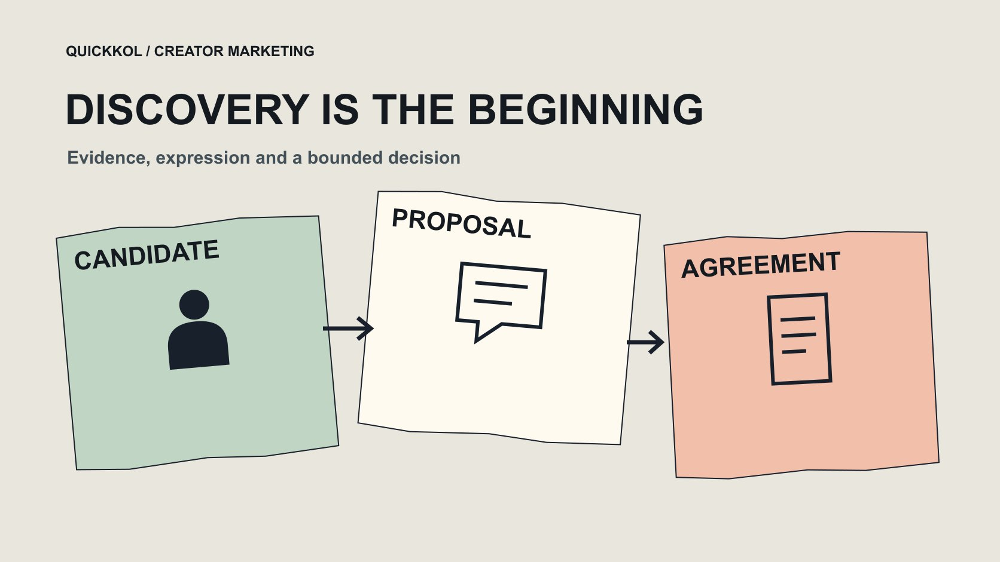
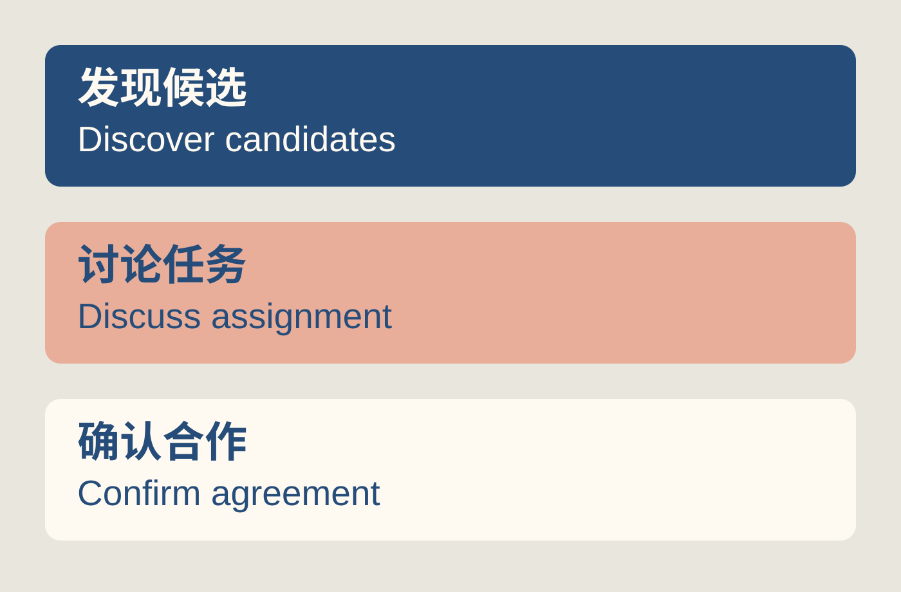

# 达人市场怎样从发现走到明确合作

状态：本地审阅稿；正式发布日期待确认。

达人市场帮助双方相遇，完整提案才帮助双方作决定。把有兴趣、需要资料、接受与实际交付分开，让平台机会变成范围明确的合作。

QuickKOL 编辑图形；不呈现真实账号指标或平台界面。

Creator marketplace 是帮助品牌与创作者发现、接触和讨论机会的市场或平台功能，不等于一份自动完成的合作协议。品牌发出项目后，应让创作者能够看懂任务、商品事实、费用形式、发布与使用要求，并明确哪些条件仍可讨论。收藏、申请、收到消息或有兴趣，各自不应被写成已接受全部范围。具体平台入口与规则需按实际账号和项目核对，最终以双方清楚确认的工作为准。

## 把市场发现与实际合作分开

平台可以显示候选资料、作品与联系机会，但展示不等于适合某个具体任务。品牌仍需查看创作者实际贡献，而不是把推荐顺序当成完整质量排名。

[Meta 的创作者市场公告](https://about.fb.com/news/2024/02/creator-marketplace-for-brands-and-creators-to-collaborate-on-instagram/)在 2024 年介绍发现、作品集与项目沟通，再进入双方达成一致后的制作。这是有日期功能说明，不证明当前全部地区和账号都具有相同入口。

[达人市场订单范围方法](https://www.quickkol.com/zh/blog/collabstr-marketplace-order-checklist/#answer)帮助核对采购安排。本篇更早处理提案能否被准确回应：创作者究竟收到了什么，品牌把什么状态记成了合作。

研究到合适候选只是开始。一个清楚邀请应说明为什么联系这个人，以及品牌需要什么真实贡献，不让平台里的资料页代替有目的的合作问题。

## 提案回答创作者的关键问题

说明品牌、商品、观众问题与希望创作者完成的任务。把制作、本人出镜、个人频道发布和其他用途分别写明，不用“合作一下”承载全部期待。

为商品事实提供适当参考，注明哪些仍需体验或核验。创作者可以基于真实作品提出表达建议，不必在未使用商品时先承诺最终推荐。

让时间、反馈和所需条件可见。需要特定场地、其他团队成员或多个版本时，提前说明，避免对方接受一个简单任务后才发现工作已经扩大。

提案可以保留待讨论事项，但要明确标出。清楚的未知比暗含条件更容易回应，也更有助于品牌获得可比较、可实际执行的答复。

## 不同项目不一定使用相同付款模式

[TikTok One 的项目类型说明](https://ads.tiktok.com/resources/help/article/types-of-projects-for-tiktok-one-creators?lang=en)在 2026 年 11 月区分固定费用内容与不同表现型安排。不能因为都出现在合作平台，就默认具有同一种费用和验收关系。

品牌应说明这次实际采用什么模式，由谁付款、对应什么工作，以及金额和条件哪些已经确认。平台概览不替具体项目补齐缺少条款。

创作者可以询问与自己贡献有关的事实，不需要用另一位达人的收入截图估算必然结果。固定费用、潜在佣金与平台奖励也不能无条件相加。

文章不提供统一报价或收入预测。提案需要可理解的付款问题，而不是用“有机会赚钱”代替制作、发布与使用范围的实际讨论。

## 有兴趣与接受范围用不同状态记录

品牌可以区分候选已发现、邀请已发出、对方需要资料、愿意继续讨论与实际确认。状态帮助安排下一步，不用于把沉默解释成许可。

创作者表示有兴趣时，确认还缺什么信息。不要立刻把名字写入已合作案例，也不将申请一个开放项目当作接受所有后续新增条件。

平台有自己的状态与操作规则，使用时按实际页面理解。本篇的编辑状态表帮助团队交接，不声称它与每个平台的按钮逐项相同。

明确确认方式与负责人，避免多人分别认为另一个人已经完成约定。记录实际答复和范围，比只保留一个绿色标记更能让后续制作理解合作到了哪一步。

若多人同时联系同一创作者，指定主负责人并汇总实际答复。重复邀请不是额外合作，也不应让两个团队分别承诺冲突条件。

平台机会可以进入讨论，但不能替代双方对具体工作的明确确认。

## 允许清楚补充、调整或婉拒

提案合理回应不只有接受。创作者可能需要商品资料、提出不同表达、说明档期不合，或认为不适合自己的作品；品牌应按实际原因处理。

需要调整时，更新任务、时间与费用，再由双方确认。不要用原申请状态推动一个已经改变的任务，也不把对方提出边界自动记成难以合作。

同样，品牌可以说明资料尚不足或任务已变化，保留具体原因。未继续合作不必成为对个人能力、受众或诚信的全面评价。

这种回应空间会改善提案质量。品牌更容易知道缺少什么，创作者也能确认自己真正愿意完成的工作，而不是在含混期待下先答应再不断补救。

## 关系、体验与用途随提案确认

[FTC 的达人披露指南](https://www.ftc.gov/business-guidance/resources/disclosures-101-social-media-influencers)在美国语境下强调真实体验与重要关系。提案应给创作者机会实际体验，也要说明作品属于怎样的商业安排。

制作、发布与广告使用分别讨论。平台允许接触或共享文件，不自动回答某张图、某段声音或本人形象在所有渠道可以怎样使用。

具体范围由真实约定确认，本篇不代替合同法律判断。若任务需要其他版本、长期使用或新的账号发布，提前说清，不在成片通过后悄悄增加。

品牌事实由适当负责人提供，创作者保留实际感受。商业合作应支持准确内容，而不是要求对方为未体验商品或没有依据效果作肯定承诺。

## 假设案例：从兴趣回复到明确任务

假设品牌在创作者市场找到一位擅长工具解释的人，发送简短合作消息。对方回复感兴趣，同时询问是否需要个人账号发布，以及是否包含广告复用。

这不是实际平台案例。品牌补充商品问题、实际体验安排、发布身份与使用需求，再由双方讨论费用、反馈和时间。原回复保留为有兴趣，不改写成全部条件已接受。

若创作者只愿意制作文件，可以继续讨论是否符合任务；若品牌必须需要个人推荐，则确认体验与意愿，不用平台申请代替本人选择。

最终记录清楚作品、关系与待确认项。提案从一条泛泛邀请变成可实际执行的工作，不需要编造平台保证、收入或合作成果来证明流程有效。

## 让交接保留实际确认而非热度

把最终任务版本、答复与负责人交给制作人员。不要只转发“对方很有兴趣”，让后续团队自行补齐商品、费用或许可。

如果还有条件未完成，安排明确下一步。项目时间紧不应让未知自动变成已确认，也不需要为保持表格整齐把所有状态设成一样。

[Popular Pays 任务验收方法](https://www.quickkol.com/zh/blog/popular-pays-creator-proposal-acceptance/#answer)进一步讨论内容通过与用途确认。无论采用哪个供应商，前期提案的准确记录都能帮助后期判断实际完成了什么。

复盘关注提案哪些信息减少了反复沟通，以及哪些问题出现太晚。平台联系量可以记录，但不代表相同数量的已接受、已发布或已产生业务结果的合作。

## 让市场机会成为双方能理解的合作

Creator marketplace 的价值，在于帮助找到相关的人和机会；清楚提案则帮助双方判断是否继续，以及继续什么工作。

把发现、兴趣、接受和交付分开，品牌就不会把平台热度误当作确定合作。创作者也有机会确认任务、表达和边界。

保留实际项目类型、商品事实与用途，不把一个入口的规则推广成全部平台标准。任务变化后，更新双方真正需要确认的部分。

这样达人营销仍围绕真实贡献展开：有依据地发现，有目的地联系，再形成范围明确的工作。最终效果需要实际资料支持，不能由候选匹配或一条消息提前保证。

## 提案状态与下一步

| 状态 | 实际含义 | 下一步 |
| --- | --- | --- |
| 发现 | 存在研究线索 | 查看相关作品 |
| 有兴趣 | 愿意继续了解 | 补齐任务条件 |
| 需资料 | 某项判断未完成 | 指定来源与负责人 |
| 已确认 | 指定范围已明确 | 交接实际任务 |
| 已交付 | 提供约定材料 | 按范围审阅 |

编辑状态表，不对应每个平台全部按钮，也不代替实际项目规则或协议。

## 让提案可以被准确回应

在发送邀请与交接制作前确认。

- [ ] 说明为什么联系这位创作者。
- [ ] 区分制作、发布与用途。
- [ ] 提供商品事实与体验安排。
- [ ] 明确付款模式与待讨论项。
- [ ] 记录真实答复与范围。
- [ ] 给未确认条件安排下一步。

## 研究日期与使用边界

资料核验于 2026 年 11 月 19 日。文中方法、表格和决策规则为编辑建议，标为假设的示例不是实际客户结果或行业基准。外部资料的适用地区与时期按各段说明。

## 从任务开始达人研究

用 QuickKOL 理解 Brief、发现相关达人并研究作品与联系路径；数据、合作条件和结果仍需核验。

[了解 QuickKOL](https://www.quickkol.com/#capabilities)

## 来源

- [Meta 的创作者市场公告](https://about.fb.com/news/2024/02/creator-marketplace-for-brands-and-creators-to-collaborate-on-instagram/)
- [TikTok One 的项目类型说明](https://ads.tiktok.com/resources/help/article/types-of-projects-for-tiktok-one-creators?lang=en)
- [FTC 的达人披露指南](https://www.ftc.gov/business-guidance/resources/disclosures-101-social-media-influencers)
