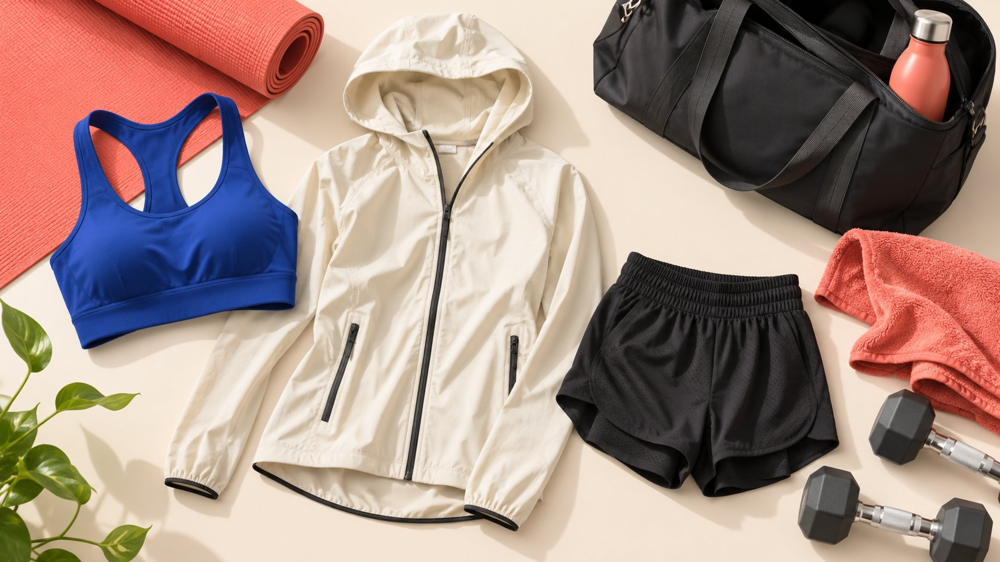
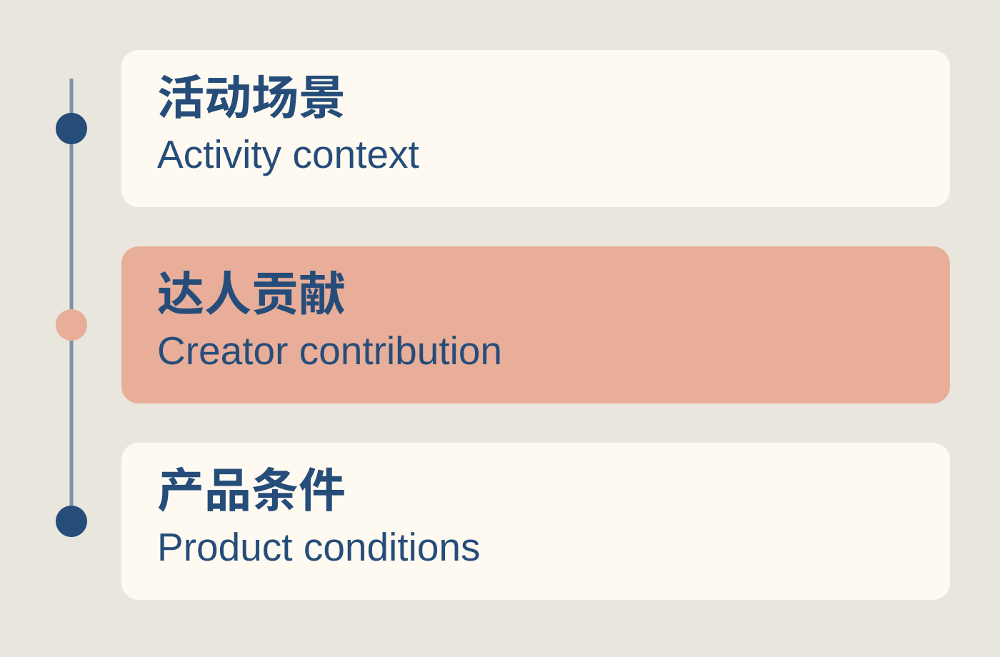

# Fitness Apparel Brands: Map Creator Use Cases

Status: local review draft; confirm the publication date before release.

Not every apparel creator needs the same movement shot. Allocate explanations across real use contexts, review coverage and gaps, then identify the contribution another creator should add.

Fitness apparel brands can start by mapping the use contexts viewers need to understand, then assign a specific contribution to each. Preparation, activity and leaving the venue may raise different questions; a content portfolio should explain relevant differences instead of repeating one movement with every creator. Retain the actual style, personal experience and filming conditions, marking uncovered areas clearly. This guide organizes creator work rather than prescribing exercise, promising body or apparel outcomes, or presenting a use-case list as a worldwide brand ranking.

## Map audience questions before collecting names

Begin with questions people have when considering the product, rather than a target number of creators. Understanding a pocket, a layering difference or the transition from venue to everyday clothing may require different explanations.

Turn each question into a context with an action, setting and product role. These categories are an editorial plan, not a claim that all consumers use clothing through identical stages.

The [movement-evidence method](https://www.quickkol.com/blog/activewear-apparel-brands-movement-evidence/#answer) helps an individual piece retain its conditions. This article instead examines repetition and gaps across a body of work; portfolio coverage and the clarity of one shot are different questions.

Discovery can then seek someone with relevant experience who wants to explain the issue. List size is no longer the objective itself but follows the contributions actually required. The brand can identify why an additional creator would matter before spending time collecting another profile that duplicates work already planned. That gives both research and outreach a more concrete purpose.

## Separate preparation, activity and transition contexts

Preparation might concern storage, layers and belongings; an activity context might show where a garment sits during an ordinary action; transition might explain a choice after adding another layer.

These are optional directions rather than a mandatory three-stage formula. Select according to the product and audience question instead of forcing a piece for an irrelevant context.

For each assignment, state what the footage should help someone understand. The same garment in a gym and on a street does not automatically produce two useful explanations; a changed setting should add information.

Creators can suggest contexts closer to their experience. The brand confirms product facts and purpose before both parties choose the expression, rather than treating an internal matrix as an unchangeable performance script. A smaller set of distinct, useful explanations can serve the brief better than a broad collection of locations whose only difference is the background behind the same repeated line.

## Assign contributions without grouping by appearance

Select creators through actual experience, expression and willingness to do the work. Body shape, gender or an identity label should not establish suitability for a sport, lifestyle or product.

Someone skilled in structural explanation might discuss a pocket, while someone with styling experience addresses a transition look. These are assignment roles, not invented capability scores for actual people.

The [creator fitting-conversation method](https://www.quickkol.com/blog/gym-apparel-creator-fit-session-brief/#answer) helps confirm what the wearer is willing to share. Experience should actually occur instead of requiring someone to perform specialist expertise merely to fill the portfolio.

If one person can make several related contributions, discuss combined production; if different work needs different people, separate it. Division should help the explanations succeed rather than fix each creator inside a stereotype. This also gives an outreach message something meaningful to say: the brand can point to a relevant contribution instead of claiming that the candidate represents an entire category of bodies or consumers.

When one person covers several contexts, confirm experience and production time first. Preparation may be shared, but a statement made in one setting does not automatically become first-hand observation in another. Each expression still needs conditions that actually occurred, and a creator can confirm that one context fits their work while declining another without invalidating the original contribution.

Let each context add an explanation rather than treating a changed background as new evidence.

## Retain product references within each context

Connect each piece with its particular style and conditions. Do not combine one top's fit explanation, another trouser's care instructions and a third version's destination into one supposed fact set.

[Nike’s dual-sizing guide](https://www.nike.com/size-fit/mens-dual-sizing) uses body measurements, illustrating why a team should establish what a reference measures. It is a brand-specific example, not proof that letters match across brands or every style within a range.

Layers, adjustments and accessories on screen can also affect interpretation. Record what the explanation needs without requiring unrelated personal measurements to be public.

When the product or context changes, update affected references. Pieces can share a theme without sharing every product fact or applicable condition merely because they were commissioned together. Accurate linkage matters more than increasing the number of selling points. It lets a later editor understand which statements can accompany which footage instead of assuming that all garments in the campaign support the same description.

## Keep experience boundaries in contextual demonstrations

A garment appearing during an action establishes what occurred in that filming context, not injury reduction, improved performance or long-term durability. A setting cannot replace missing substantiation.

[FTC’s influencer-disclosure guide](https://www.ftc.gov/business-guidance/resources/disclosures-101-social-media-influencers) calls for actual experience and supported expression in its United States context. Allow the creator to retain conditions and make the real commercial relationship understandable.

Subjective feelings can be expressed as personal observations without becoming certain outcomes for everyone. If an objective performance statement is needed, the product owner should supply appropriate support before deciding how it belongs in the piece.

A broader portfolio does not automatically strengthen each conclusion. Different creators observing different contexts still need separate interpretation rather than being combined into an undesigned scientific test. Coverage helps a viewer encounter useful questions, while proof of a performance effect remains another matter. Keeping the two separate lets the brand create varied work without overstating what the collection establishes.

## Plan repeated wear and care separately

Where several contexts use one sample, confirm washing, replacement or other state changes. The record explains conditions rather than requiring an unannounced durability test.

[Patagonia’s wool-care guide](https://www.patagonia.com/stories/guides/care-repair/how-to-wash-merino-wool/story-168066.html) emphasizes the particular label and fabric, so advice for one garment type should not become a washing rule for every sports item.

The brand supplies references for the actual style while the creator or production partner confirms what was done. If sample history is unknown, retain that uncertainty instead of merging pre-wash and post-wash footage into one continuous experience.

Care can become a separate explanatory assignment with defined references and images. Do not request an unconfirmed method at the last moment to make the portfolio look complete. A useful collection can acknowledge that care was not examined, while directing the viewer to an appropriate product reference. That is more accurate than implying that every stage of ownership was covered simply because several use settings were filmed.

## Check repetition and gaps through a hypothetical portfolio

Imagine three pieces explaining belongings during preparation, a pocket during activity and an outer layer when leaving. The assignment concerns product use, not exercise instruction.

Review finds that the first two merely repeat the pocket is convenient without adding different information. The team can combine repetition, change a piece to demonstrate retrieval or remove unnecessary work.

This is not a client project and assumes no views, sales or engagement benchmark. Creators confirm actual experience, the brand supplies matching style references and commercial relationships are explained in context.

The portfolio retains uncovered care or other questions. Unfilmed matters should not be reported as validated; add an appropriate contribution later if needed instead of concealing the gap with more setting footage. The example shows how coverage planning can reduce duplication as well as identify missing work, so a portfolio's usefulness is not measured merely by how many creators or locations it contains.

## Review what the portfolio helped people understand

First review which question each piece answered and which explanation gaps remain, then examine available engagement and business evidence. Retain distinct formats and delivery conditions rather than adding totals and calling the sum unique viewers.

If one piece receives more response, examine what people responded to before asking every creator to reproduce its setting. Popular performance and explanation coverage are different dimensions.

Record questions capable of changing the next round: which detail needs a closer shot, which contribution remains absent and which fact the brand must supply. Do not continue buying repeated assets merely to preserve the initial matrix.

Evaluate creators against their actual assignments. Someone responsible for explaining construction should not fail because they did not achieve another styling piece's objective. A portfolio review works when it respects those different contributions while also asking whether their combination helps the viewer understand something that repeated interchangeable posts would leave unclear.

## Organize apparel partnerships through complementary contributions

A content portfolio for fitness apparel brands should follow actual questions. Context, creator and product references need to correspond so the work adds complementary value instead of merely increasing account numbers.

Retain experience, necessary conditions and uncovered scope so later colleagues understand what each asset can explain. When revising, update the specific task rather than imposing one generalized request on every creator.

The brand can use this preparation to discover and approach relevant people before discussing scope, use and fees together. A matrix prepares the conversation without replacing creator willingness or an actual agreement.

When every contribution has an explainable purpose, apparel creator marketing becomes clearer: viewers receive relevant information, creators perform genuine work and the brand can identify what to add next instead of repeating blindly. The practical output is a set of distinct explanations and a visible gap list, with future performance left to observation rather than promised by the plan.

## Use contexts and creator contributions

| Context | Possible task | Retain |
| --- | --- | --- |
| Preparation | Explain belongings and storage | Actual product and question |
| Activity | Show relevant construction | Action and experience conditions |
| Transition | Explain layering choices | Featured versus supporting items |
| Care | Commission a separate accurate explanation | Specific label and support |
| Uncovered | Decide whether to add work | Unknown is not validated |

Optional editorial contexts, not mandatory use stages, exercise guidance or a performance-testing standard.

## Check whether the work is complementary

Use before commissioning the portfolio.

- [ ] List real audience questions.
- [ ] Match contexts with specific information.
- [ ] Discover creators by actual contribution.
- [ ] Retain styles and experience conditions.
- [ ] Identify repetition and uncovered scope.
- [ ] Update the portfolio through next-step needs.

## Research date and limitations

Sources reviewed November 19, 2026. Methods, tables and decision rules are editorial recommendations. Hypothetical examples are not actual client results or industry benchmarks. Source geography and periods are specified where relevant.

## Start creator research with a clear task

Use QuickKOL to interpret a brief, discover relevant creators and research their work and contact routes. Verify data, commercial terms and outcomes at their source.

[Explore QuickKOL](https://www.quickkol.com/#capabilities)

## Sources

- [Nike’s dual-sizing guide](https://www.nike.com/size-fit/mens-dual-sizing)
- [FTC’s influencer-disclosure guide](https://www.ftc.gov/business-guidance/resources/disclosures-101-social-media-influencers)
- [Patagonia’s wool-care guide](https://www.patagonia.com/stories/guides/care-repair/how-to-wash-merino-wool/story-168066.html)
