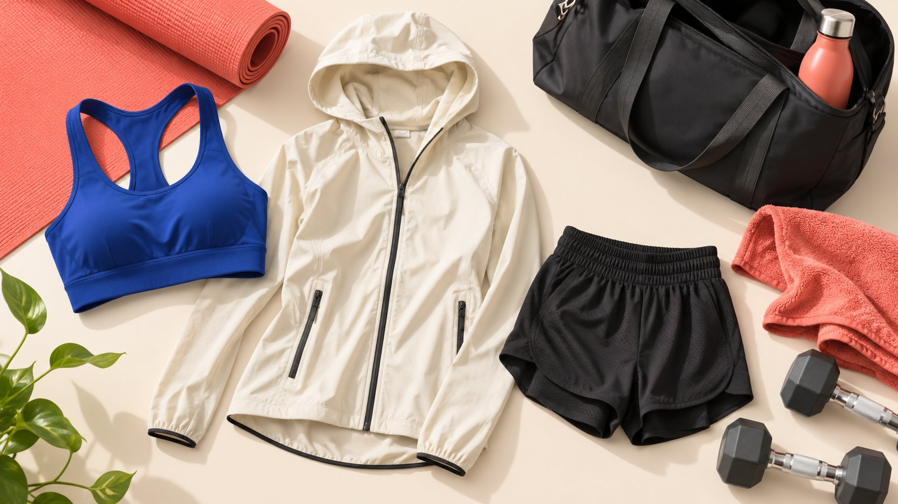
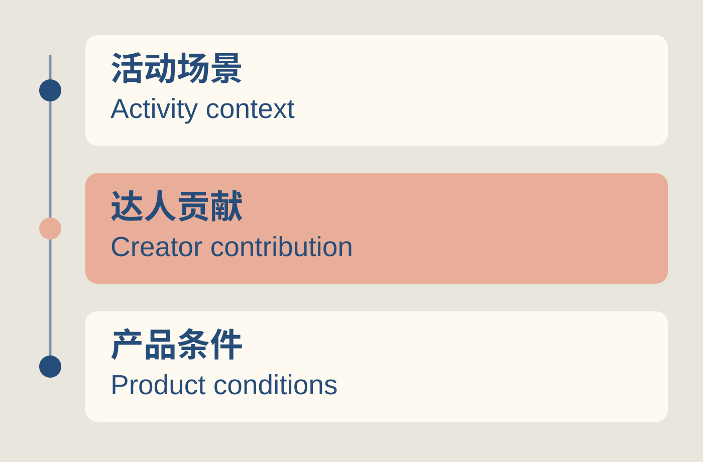

# 运动服合作怎样覆盖实际使用场景

状态：本地审阅稿；正式发布日期待确认。

运动服合作不必让所有达人拍同一种动作。按真实使用情境分配不同解释任务，检查作品组合覆盖了什么、遗漏了什么，再讨论需要补充的创作者。

Fitness apparel brands 选择达人内容时，可以先画出观众需要理解的使用情境，再为每个情境安排具体贡献。准备、训练中与离开场地后的问题可能不同；作品组合应解释相关差异，而不是让所有人重复同一个动作。保留实际款式、个人体验与拍摄条件，未覆盖部分明确标注。本篇讨论品牌如何组织达人内容，不提供运动处方、身体效果或服装性能保证，也不把情境清单当成全球品牌排名。

## 先明确观众问题

从观众准备选择商品时的问题开始，而不是先凑一个人数目标。需要知道口袋怎样使用、叠穿后哪里变化，还是衣服从场地转到日常如何搭配，可能是不同解释任务。

把每个问题写成一个情境，说明实际动作、环境与商品角色。这里的分类是编辑计划，不宣称所有消费者都按同样步骤使用商品。

[运动服动作证据方法](https://www.quickkol.com/zh/blog/activewear-apparel-brands-movement-evidence/#answer)帮助单条作品保留具体条件；本篇则看整组内容是否重复或遗漏。组合层面的决定与某个镜头是否清楚，是不同问题。

这样发现达人时，可以寻找有相应经验、愿意解释那个问题的人。名单大小不再是目标本身，而是由实际需要的贡献决定。

## 把准备、活动与过渡分成可解释情境

准备情境可能讨论收纳、穿着层次与物品安排，活动情境可能展示衣服在某个普通动作中的位置，过渡情境可能解释加一层衣服后的使用选择。

这些只是可选方向，不是固定三段公式。品牌根据商品与观众问题选择，不需要为一个不相关的情境硬凑作品。

对每项安排，写清镜头要帮助理解什么。相同服装出现在健身房和街头，并不自动构成两种有价值解释；环境变化应带来实际信息。

创作者可以提出更贴近经验的情境。品牌确认产品事实与任务目的，双方再决定怎样表达，而不是把一张内部矩阵当成不能调整的表演脚本。

## 按贡献分工，不按外貌分组

选择创作者时看实际经验、表达与愿意承担的工作。不要凭体型、性别或某种身份就假定他适合特定运动、生活方式或商品。

一位擅长讲结构的人可以解释口袋，另一位擅长造型的人可以讨论过渡搭配。这里描述任务角色，不给真实个人编造能力分数。

[达人试穿沟通方法](https://www.quickkol.com/zh/blog/gym-apparel-creator-fit-session-brief/#answer)帮助先确认穿着者愿意分享的范围。需要的体验应真实发生，不能为了填满组合而要求人表演不具备的专业经验。

若一个人能完成多个相关任务，可以讨论合并制作；若任务需要不同贡献，也可以分开。分工应帮助内容成立，而不是让每位创作者被固定在一个刻板标签里。

同一人跨情境制作时，先确认有没有实际经验与制作时间。可以复用准备工作，但不能把在一个场景说过的话自动当成另一个场景的亲身观察；每项表达仍要对应真实发生的条件。

让每个情境增加实际解释，不把更换背景当成新增证据。

## 商品资料随情境保留

每项内容对应具体款式与条件。不要把一个上衣的版型说明、另一条裤子的护理与第三个版本的购买入口拼成同一套事实。

[Nike 的双尺码说明](https://www.nike.com/size-fit/mens-dual-sizing)以身体尺寸为表格对象，提醒团队先核对引用资料在测量什么。这是品牌资料例子，不证明跨品牌字母或同系列各款都一致。

镜头中的叠穿、调整与配件也会影响理解。记录对解释必要的部分，不要求创作者公开无关个人尺寸。

当商品或情境改变，更新受影响资料。组合中不同作品可以共享主题，但不能因为一起制作就自动共享全部产品事实和适用范围。准确关联比增加更多卖点更重要。

## 让场景展示保留体验边界

衣服出现在某个动作里，可以说明这次拍摄发生了什么，不自动证明减少受伤、提升表现或长期耐用。不要用场景替代缺少的性能依据。

[FTC 的达人披露指南](https://www.ftc.gov/business-guidance/resources/disclosures-101-social-media-influencers)在美国语境下要求真实体验与有支持的表达。品牌应允许创作者保留条件，也要让观众理解实际商业关系。

主观感受可以清楚表达为个人观察，不扩成所有人的确定结果。若需要客观性能结论，先由产品负责人提供适当依据，再判断适合怎样进入作品。

一组内容的覆盖更广，也不会让单条结论自动变强。不同创作者在不同情境下观察，仍需要分别解释，不能直接合成为未经设计的科学测试。

## 给重复穿着与护理单独安排

若多个情境需要同一件样品，确认是否有清洗、替换或其他状态变化。记录是为了解释内容条件，不是要求团队开展未经说明的耐久测试。

[Patagonia 的羊毛护理说明](https://www.patagonia.com/stories/guides/care-repair/how-to-wash-merino-wool/story-168066.html)提醒按具体标签与面料处理，不能把一类衣物的建议推广成全部运动服的洗护规则。

品牌提供适用于实际款式的资料，创作者或制作伙伴确认自己执行过什么。不知道样品经历时，保留未知，避免把清洗前后混成同一次连续体验。

如果需要护理内容，可以作为单独解释任务安排，明确资料与画面。不要为了让组合显得完整，临时要求创作者试一种没有确认适用的方法。

## 用假设组合检查重复与空白

假设品牌计划三条内容：准备时解释随身物品，活动时展示某个口袋，离开时解释外套搭配。任务是让观众理解商品使用，不提供运动建议。

审阅发现，前两条都只重复“口袋很方便”，并没有展示不同信息。团队可以合并重复部分，把另一条改成具体取放动作，或取消不必要内容。

这不是实际客户项目，也没有预设观看、销售或互动基准。创作者确认真实经验，品牌提供对应款式资料，所有商业关系按实际语境说明。

组合表保留未覆盖的护理或其他问题。没有拍过就不写成已经验证，后续若确有需要，再安排适当贡献，而不是用更多场景镜头掩盖资料空白。

## 复盘组合帮助观众理解了什么

先看各条作品完成了什么问题，是否仍有解释缺口，再看可得互动与业务资料。不同作品形式与分发条件需要各自保留，不把总数直接相加当成独立观众。

如果某条反应较多，先了解观众回应的内容，而不是立即要求所有创作者复制同一种场景。热门表现与解释覆盖是不同维度。

记录可以改变下一轮的问题：哪个细节值得更近镜头，哪类达人贡献仍缺少，哪个商品事实需要品牌补充。不要为了维持原矩阵而继续采购重复素材。

评价创作者时，回到各自约定任务。一个负责清楚说明结构的人，不应因没有承担另一条造型作品的目标而被判定失败。

## 用互补贡献组织运动服合作

Fitness apparel brands 的内容组合应由实际问题驱动。情境、创作者与商品资料相互对应，作品才有互补价值，而不是仅增加账号数量。

保留真实体验、必要条件与未覆盖范围，让后续团队知道每条素材能说明什么。需要修改时，更新具体任务，而不让全部创作者承担同一个泛化要求。

品牌可以据此发现与外联合适的人，再由双方讨论范围、使用与费用。矩阵帮助准备，不代替创作者意愿或实际协议。

当每一项贡献都能解释为何存在，运动服达人营销会更清楚：观众获得相关信息，创作者完成真实工作，品牌也更容易决定下一步该补什么，而不是盲目重复。

## 使用情境与达人贡献

| 情境 | 可讨论任务 | 需要保留 |
| --- | --- | --- |
| 准备 | 解释物品与收纳 | 实际商品与问题 |
| 活动 | 展示相关结构 | 动作与体验条件 |
| 过渡 | 说明叠穿选择 | 主推与搭配区别 |
| 护理 | 另行安排准确说明 | 具体标签与依据 |
| 未覆盖 | 决定是否需要补充 | 未知不写成验证 |

可选编辑情境，不是固定使用步骤、运动指导或性能测试标准。

## 检查内容是否互补

用于制作组合前的任务讨论。

- [ ] 列出真实观众问题。
- [ ] 让情境对应具体信息。
- [ ] 按实际贡献发现达人。
- [ ] 保留款式与体验条件。
- [ ] 标出重复与未覆盖部分。
- [ ] 用下一步需求更新组合。

## 研究日期与使用边界

资料核验于 2026 年 11 月 19 日。文中方法、表格和决策规则为编辑建议，标为假设的示例不是实际客户结果或行业基准。外部资料的适用地区与时期按各段说明。

## 从任务开始达人研究

用 QuickKOL 理解 Brief、发现相关达人并研究作品与联系路径；数据、合作条件和结果仍需核验。

[了解 QuickKOL](https://www.quickkol.com/#capabilities)

## 来源

- [Nike 的双尺码说明](https://www.nike.com/size-fit/mens-dual-sizing)
- [FTC 的达人披露指南](https://www.ftc.gov/business-guidance/resources/disclosures-101-social-media-influencers)
- [Patagonia 的羊毛护理说明](https://www.patagonia.com/stories/guides/care-repair/how-to-wash-merino-wool/story-168066.html)
