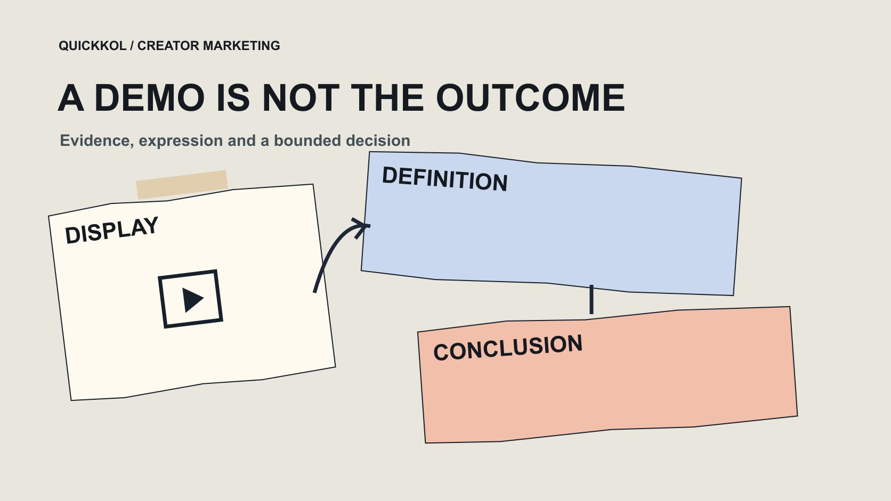
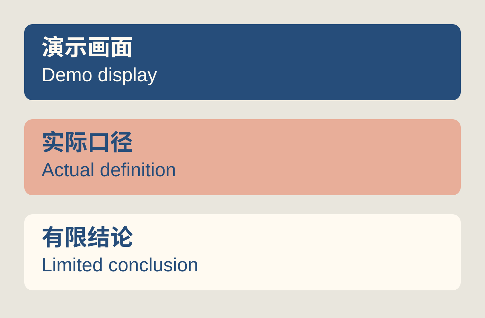

# Free Follower Demos: Read the Evidence

Status: local review draft; confirm the publication date before release.

A free-follower demonstration can show a display without proving source, interest or business outcomes. Preserve what was shown separately from native records and claims still needing evidence.

QuickKOL editorial graphic; not actual account metrics or a platform interface.

A free Instagram followers for free demonstration should not pass directly into a creator-campaign performance report. A screenshot shows what was displayed; a native record helps check account and metric. Neither automatically proves genuine interest, a particular campaign source or purchasing outcomes. This article teaches brands to interpret a demonstration already received, without service trials or claiming instructions. State the smallest fact it supports before listing the evidence still missing.

## Define the question the demonstration claims to answer

A video of a changing counter can imply that a service produces growth, that the number represents real people or that the brand will achieve an outcome. These are different conclusions and should not be accepted together merely because the footage is continuous.

Preserve accompanying text and speech, identifying the claim actually made. If a colleague added high-quality audience while forwarding it, retain that interpretation separately from the original.

The [free-follower offer-literacy method](https://www.quickkol.com/blog/free-instagram-followers-offer-claim-literacy/#answer) examines conditions and wording. This article concentrates on demonstration evidence: what is actually shown, which interpretations go beyond it and how the owner should record it to prevent misuse.

The educational purpose is not to prove that every demonstration is defective. It is to stop persuasive presentation from becoming a supposedly verified creator-marketing result. The team need not connect an unconfirmed service to obtain more convincing footage. Existing material can already be described accurately, with a limited conclusion and a clear statement of the evidence not supplied.

## Separate the display from the underlying record

Screenshots, recordings, animations and exported reports are different forms. Label what was received and preserve date, visible account, unit and scope rather than inferring origin from a familiar-looking interface.

A counter-like display may show only one moment or a selected excerpt. That does not establish manipulation of the image; it acknowledges that the team does not yet know how it was obtained, whether it is complete or whether it connects to an underlying record.

Even when a native record is supplied, first check the account and metric. Traceability improves when a real record can be identified, but that does not explain the motivation behind every action inside it.

Unrelated private information is not a remedy for those gaps. The minimum necessary evidence might be a clear account, metric definition, period and source explanation. The recipient needs to understand its supported scope rather than assume reliability increases with the number of files collected. A large evidence folder can still contain several versions of the same unverified display.

## A count change does not establish every explanation

If before-and-after values differ, record the observed difference with the conditions of each observation. Do not immediately rename it independent new viewers delivered by the service.

Account scope, abbreviation, observation time and concurrent activity can affect the comparison. Even if those conditions align, evidence is still needed to explain the source of change. Sequence alone does not establish causation.

Quantity also cannot supply geography, interest, purchasing capacity or continuing viewing. Each claim needs suitable information rather than one growth arrow carrying every task.

Without conditions, the conclusion can remain material received showing a count change, with source and explanation unverified. It may be less impressive than a marketing statement, but it accurately tells the owner which claims have not become facts. Keeping that wording also protects later reports: someone reusing the demonstration will see its evidence status rather than an apparently authoritative success label stripped of the conditions the first reviewer never obtained.

A more persuasive display does not necessarily provide more complete evidence for its claim.

## Platform enforcement does not certify the demonstration

[Meta’s inauthentic-engagement announcement](https://about.fb.com/news/2019/04/preventing-inauthentic-behavior-on-instagram/) described action against fake likes, views and follower services in 2019. This historical material explains a platform position; it does not certify any present supplier demonstration.

A number remaining visible on an account therefore does not establish that the platform verified genuine interest behind it. Platform action against inauthentic activity also cannot become a promise that the brand can identify every anomaly.

Free does not alter that logic. A zero price supplies no evidence about action sources or audience choice and does not turn a demonstration into a platform-approved partnership method.

Educational guidance should explain fact and inference together: the platform publicly opposes inauthentic engagement, while the support for a particular claim depends on the actual material received. An institutional name or familiar interface cannot lend authority that the evidence itself lacks. This prevents both overconfidence in a supplier and overconfidence in the reviewer's ability to classify the underlying accounts.

## Do not exchange account access for more demonstration footage

Sometimes a sender says the account must be connected before they can demonstrate results. The question has then moved from interpreting information to authorizing access. An ordinary researcher should not perform that operation merely to complete an evidence file.

[Meta’s Instagram security guide](https://about.fb.com/news/2021/07/keeping-instagram-safe-and-secure/) discusses login activity, recovery details and two-factor protection. It is dated guidance; the owner should confirm actual handling through current official routes.

The brand can reject submission of credentials or codes as a research prerequisite and avoid presenting unclear demonstration operations as normal partnership steps. Authorized people handle existing concerns; an educational article need not reproduce a claiming sequence.

Declining access means that verification route will not be used, not that account theft has been established. Preserve the actual reason for declining to protect both the account and the factual boundary. A reviewer does not need to speculate about hidden motives in order to decide that an unnecessary permission request is outside the scope of the project.

## Distinguish voluntary activity from procured indicators

[FTC’s fake-influence-indicator Q&A](https://www.ftc.gov/business-guidance/resources/consumer-reviews-testimonials-rule-questions-answers) explains, in its United States context, that real people choosing to follow a brand differ from fake indicators, and the relevant purchase provision includes a knew-or-should-have-known condition. This is not automatic classification of every number.

If a demonstration uses real people, establish what that phrase is intended to mean. The existence of a real account does not automatically prove that its action expresses genuine interest in the brand or product.

Conversely, a demonstration concerning growth does not make a normal creator introduction followed by voluntary audience response a fake-indicator purchase. Examine the actual activity rather than assign a label from the keyword.

This article determines no supplier's or creator's liability. Specific commercial facts and market rules belong with an appropriate owner. The educational purpose is to prevent a limited observation becoming either certification or accusation. It should help colleagues know which questions remain open without inviting them to treat a general rule description as an individual finding.

## Write an accurate summary of a hypothetical demonstration

Imagine material first displaying 120, later 180, and claiming this proves viewers will purchase. These numbers are an educational illustration, not service results or an industry benchmark.

The display difference can be recorded as 60, alongside whether account, time and source were checked. Without the conditions, 60 cannot be described as confirmed independent prospective customers or used to calculate a purchasing rate.

If a record of a genuine content invitation is also provided, check its scope against the count. A plausible narrative supplies an explanation to examine without becoming causal evidence merely because the story is complete.

The summary should preserve display content, checked records, sender explanation, missing evidence and present decision. A colleague reading it should know what can be cited and what remains a claim. This makes the demonstration usable as an educational example without allowing a hypothetical arithmetic difference to be copied into a commercial deck as an observed outcome from a real campaign.

## Translate the review into buying and reporting rules

Where evidence is insufficient, the brand can decide not to use the demonstration for shortlist scores, renewal judgements or outcome publicity. Specify the affected use instead of declaring all data invalid.

The [free-follower offer review method](https://www.quickkol.com/blog/free-instagram-follower-offer-risk-triage/#answer) helps prioritize handling. Access questions go to the owner, data questions retain definitions, and content review can continue against the actual task. One issue should not replace another.

If more information arrives, update the corresponding state while retaining versions. A new explanation should not silently overwrite the earlier record, especially when the demonstration has already been copied into several documents.

Give users clear limits: which checked fact can be cited, which marketing conclusion must not be adopted and who approves a change. A research note without a sharing rule can still allow the same material to be overinterpreted in the next report. The useful output therefore connects evidence status to actual document use, rather than assuming everybody will remember a caveat that appeared only in an original email.

## Close the discussion with the supported scope

The educational answer to free Instagram followers for free is to identify what is missing between a demonstration and an outcome, rather than prove the service effective. Without purchasing evidence, do not claim purchases; without source evidence, retain an unknown source.

A genuine creator partnership can centre on useful content, a clear invitation and voluntary audience choice without relying on a free-follower demonstration as its value proposition. Work quality and commercial terms deserve independent discussion.

Retain only information needed for the partnership, avoiding unrelated personal collection. Once the decision is sufficiently supported, absolute certainty need not be pursued through wider investigation or access requests.

Give the owner a limited conclusion they can responsibly cite: what was shown, what was checked, what remains unknown and what that means for the present decision. The demonstration then becomes correctly understood material rather than misused proof. The same discipline also makes it easier to explain the decision to the creator without implying a personal accusation the review never established.

## Demonstration material and supported conclusions

| Material received | Can record | Does not establish |
| --- | --- | --- |
| Counter screenshot | Displayed value and visible conditions | Independent people or genuine interest |
| Continuous recording | Visible change in the recording | Complete cause of the change |
| Native report | Account, metric and period | Purchasing or incremental effect |
| Supplier explanation | Claim the sender made | Independent verification |
| Additional checking | New evidence actually obtained | Every unknown resolved |

Educational evidence framework; no follower-service recommendation, safety certification or infallible detection guarantee.

## Keep evidence states distinct

Do not merge display, explanation and verification.

- [ ] Label the form of material received.
- [ ] Retain the original claim and forwarding changes.
- [ ] Check account, definition, period and source.
- [ ] Reject unnecessary access as a research prerequisite.
- [ ] Identify conclusions without supporting evidence.
- [ ] Specify reporting uses that will not rely on it.

## Research date and limitations

Sources reviewed November 19, 2026. Methods, tables and decision rules are editorial recommendations. Hypothetical examples are not actual client results or industry benchmarks. Source geography and periods are specified where relevant.

## Start creator research with a clear task

Use QuickKOL to interpret a brief, discover relevant creators and research their work and contact routes. Verify data, commercial terms and outcomes at their source.

[Explore QuickKOL](https://www.quickkol.com/#capabilities)

## Sources

- [Meta’s inauthentic-engagement announcement](https://about.fb.com/news/2019/04/preventing-inauthentic-behavior-on-instagram/)
- [Meta’s Instagram security guide](https://about.fb.com/news/2021/07/keeping-instagram-safe-and-secure/)
- [FTC’s fake-influence-indicator Q&A](https://www.ftc.gov/business-guidance/resources/consumer-reviews-testimonials-rule-questions-answers)
