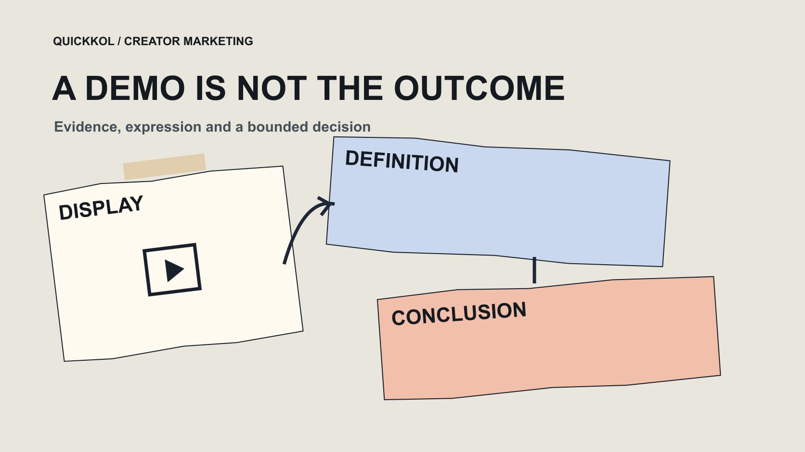
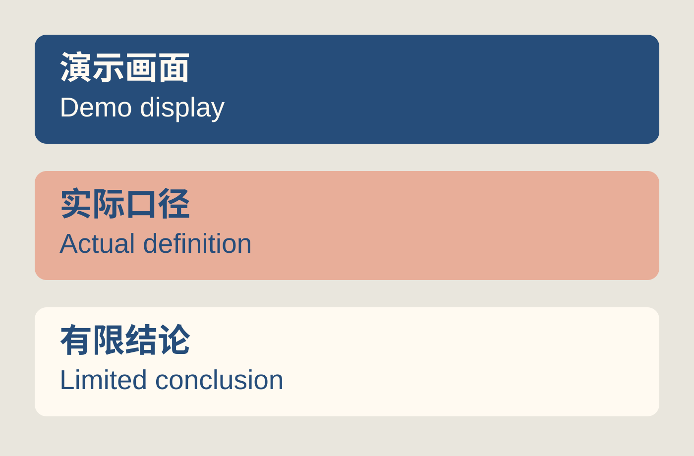

# 免费涨粉演示怎样辨认证据

状态：本地审阅稿；正式发布日期待确认。

免费涨粉演示可以展示画面，却未必证明来源、兴趣或商业结果。品牌应把展示内容、原生记录与待验证主张分别保存。

QuickKOL 编辑图形；不呈现真实账号指标或平台界面。

Free Instagram followers for free 的演示，不应直接进入达人合作效果报告。截图证明它显示了什么，原生记录帮助核对账号和指标；两者都不自动证明关注出于真实兴趣、来自指定活动，或会产生购买。本文教品牌阅读已经收到的演示，不提供服务试用或领取方法。先写清演示支持的最小事实，再列出仍缺少的证据。

## 先明确演示正在回答什么

一段计数变化视频，可能在暗示服务能够带来增长、数字是真实的人，或者品牌能获得效果。这些结论并不相同，不能因为画面连续就一起接受。

先保存演示配套的文字与语音，写明对方到底作出哪项主张。若是品牌同事在转发时增加了“高质量受众”之类解释，也应与原始内容分开。

[免费粉丝承诺阅读方法](https://www.quickkol.com/zh/blog/free-instagram-followers-offer-claim-literacy/#answer)处理领取条件与文字。这里聚焦演示证据本身：它实际显示了什么，哪些解释超出了画面，负责人需要怎样记录才能不误用。

教育复核的目标不是证明每个演示都有问题。它是让团队不再把有说服力的展示，当成已经完整验证的达人营销结果，也不为得到更多展示而主动接入未经确认的服务。

## 展示层与原始记录层分开

截图、录屏、动画和导出的报告，是不同形式。先标注收到的是什么，保留日期、可见账号、单位与范围，不凭一个熟悉的界面外观判断来源。

一个看起来像计数器的画面，可能只展示某个时点或选定片段。这里不是认定画面被修改，而是承认团队尚未了解它如何取得、是否完整，以及能否回到对应记录。

即使对方提供原生记录，也先核对它对应哪个账号与指标。找到真实记录能改善可追溯性，却不会自动说明其中每一项互动的动机。

不要要求无关私人资料来填补这些空白。最小必要证据可能只是清楚的账号、指标定义、时期与来源说明，接收者应知道它能支持的范围，而不是认为文件越多就越可靠。

## 数字变化能说明什么

若演示前后数字不同，可以记录观察到的差值，同时注明两次观察的条件。不要把差值直接改名为服务带来的独立新观众。

账号范围、公开缩写、观察时间或同期活动的不同，都可能影响比较。即使这些条件一致，也仍需证据解释变化的来源；时间先后并不单独证明因果。

更不能从数量推导地域、兴趣、购买能力或长期观看。每项主张都需要与其适配的资料，不应让一个增长箭头承担全部任务。

如果演示没有提供条件，结论可以停留在“收到一份显示计数变化的材料，来源与解释未核验”。这句话可能不够吸引人，却能准确告诉负责人，目前哪些营销说法还没有进入事实范围。

展示更有说服力，不代表主张已获得更完整的证据。

## 平台反对虚假互动不等于演示已认证

[Meta 的虚假互动治理说明](https://about.fb.com/news/2019/04/preventing-inauthentic-behavior-on-instagram/)在 2019 年介绍对虚假点赞、观看和粉丝服务的行动。这份历史资料说明平台立场，不是为任何当前供应商演示提供认证。

因此不能因为一个数字仍显示在账号上，就断定平台已经验证它具有真实兴趣。也不能因为平台会处理不真实活动，就承诺品牌可以识别所有异常。

“免费”不改变这条逻辑。零价格没有提供行为来源或观众意愿的证据，也没有让一段演示变成平台允许的真实合作方式。

教育说明应把事实与推断放在一起解释：平台公开反对虚假互动，而某一具体演示是否能支持某个结论，仍需就其资料判断，不靠机构名称或界面外观借用权威。

## 不要为了看更多演示交出账号

有时对方说，必须先连接账号才能展示效果。此时问题已从阅读资料，变成新的权限决定，不能由普通研究者为了补齐证据代为执行。

[Meta 的 Instagram 安全说明](https://about.fb.com/news/2021/07/keeping-instagram-safe-and-secure/)提出检查登录活动、恢复资料与双重验证等保护措施。它是带日期的指导，实际处理应由账号所有者通过当前官方路径确认。

品牌可以说明不接受以提交凭证或验证码作为研究前提，也不将演示过程中的不明操作写成正常合作步骤。已有风险由有权人员处理，不在教育文章里复现领取流程。

拒绝提供访问，意味着这条核验路线不采用，不等于已经证明对方盗号。保留准确的拒绝理由，就能同时保护账号和事实边界，而不需要给未知动机补上指控。

## 区分自愿行为与购买指标

[FTC 的虚假影响力指标问答](https://www.ftc.gov/business-guidance/resources/consumer-reviews-testimonials-rule-questions-answers)在美国语境下说明，真实的人选择关注品牌，与虚假指标不同；相关购买条款包含知道或应当知道的条件。这不是对每个数字的自动鉴定。

演示若使用“真人”一词，仍需理解它实际要表达什么。存在一个真实账号，不会自动证明该动作表达了对品牌或产品的真实兴趣。

也不能仅凭演示涉及增长，就把创作者正常介绍品牌、观众自愿回应的合作视为虚假采购。先核对实际行为，不按关键词给个人或项目定性。

本文不判断某位供应商或创作者的责任。团队若面对具体商业事实与市场规则，应交给合适负责人处理；教育材料的作用，是避免把有限观察扩大成认证或指控。

## 用假设演示写一段准确摘要

假设一段材料先显示 120，之后显示 180，并声称这证明观众会购买。这里的数字只为演练，不是实际服务结果或行业基准。

可以记录画面显示的变化为 60，同时说明账号、时间与来源是否已核对。若缺少条件，就不能把 60 写成确定新增的独立潜在客户，更不能直接算出购买率。

若对方另提供真实内容邀请的记录，仍要核对它与计数的对应范围。一个合理的故事可以提出解释，但不会仅因叙述完整就成为因果证据。

摘要应保留这些层次：展示内容、已核对记录、对方解释、尚缺证据和当前决定。下一位同事看到它，应能知道哪些内容可以引用，哪些还只能作为待核实的主张。

## 把复核结果用于采购与报告

如果证据不足，品牌可以决定不把演示用于筛选评分、续约判断或结果宣传。这个决定应指出受影响的用途，而不是笼统写“所有数据无效”。

[免费涨粉邀约复核方法](https://www.quickkol.com/zh/blog/free-instagram-follower-offer-risk-triage/#answer)帮助安排优先级。涉及访问时交给账号所有者，涉及数据时保留口径，涉及内容时继续审阅真实任务，不让不同问题互相替代。

对方后来补充资料，可以更新对应状态并保留版本。新的解释不应悄悄覆盖旧记录，尤其当旧演示已经被复制进多个内部文件。

也给使用者明确界限：允许引用哪段已核实的事实，哪些营销结论不得采用，以及谁负责批准更改。只有一份研究笔记，却没有流转规则，仍可能让同一段演示在下一份报告里被过度解读。

## 用证据范围结束演示讨论

Free Instagram followers for free 的教育答案，不是替服务证明有效，而是教团队识别演示与结果之间缺少什么。没有购买证据，就不声称购买；没有来源依据，就保留来源未知。

真实的达人合作可以围绕有用内容、清楚邀请与观众自愿选择展开，不需要把一段免费涨粉演示作为价值依据。作品质量与商业条件应独立讨论。

记录只保存合作所需资料，避免收集无关个人信息。若决定已经明确，也无需为了获得绝对确定而继续扩大调查或索取访问。

最终让负责人收到一份可引用的有限结论：看到了什么、核对了什么、还不知道什么，以及这对本次合作决定意味着什么。演示因此成为被正确理解的资料，而不是被误用的证明。

## 演示材料与可支持的结论

| 收到什么 | 可以记录 | 仍不能证明 |
| --- | --- | --- |
| 计数截图 | 画面中的值与可见条件 | 独立人数与真实兴趣 |
| 连续录屏 | 记录中可见变化 | 变化的全部原因 |
| 原生报告 | 对应账号、指标和时期 | 购买与增量效果 |
| 供应商解释 | 对方提出的主张 | 主张已独立核验 |
| 补充核验 | 实际获得的新依据 | 所有未知已消失 |

教育向证据框架，不推荐涨粉服务，也不提供安全认证或百分百识别保证。

## 阅读演示时保留五种状态

不要把展示、解释与验证合并。

- [ ] 标明收到的材料形式。
- [ ] 保存原始主张与转述差异。
- [ ] 核对账号、定义、时期和来源。
- [ ] 拒绝把访问作为研究前提。
- [ ] 记录缺少证据的具体结论。
- [ ] 说明哪些报告用途暂不采用。

## 研究日期与使用边界

资料核验于 2026 年 11 月 19 日。文中方法、表格和决策规则为编辑建议，标为假设的示例不是实际客户结果或行业基准。外部资料的适用地区与时期按各段说明。

## 从任务开始达人研究

用 QuickKOL 理解 Brief、发现相关达人并研究作品与联系路径；数据、合作条件和结果仍需核验。

[了解 QuickKOL](https://www.quickkol.com/#capabilities)

## 来源

- [Meta 的虚假互动治理说明](https://about.fb.com/news/2019/04/preventing-inauthentic-behavior-on-instagram/)
- [Meta 的 Instagram 安全说明](https://about.fb.com/news/2021/07/keeping-instagram-safe-and-secure/)
- [FTC 的虚假影响力指标问答](https://www.ftc.gov/business-guidance/resources/consumer-reviews-testimonials-rule-questions-answers)
