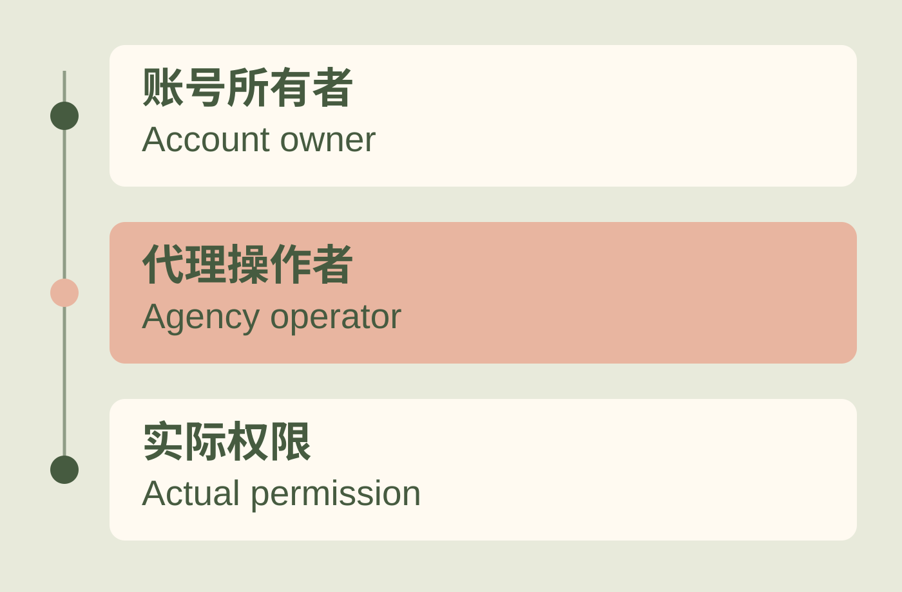

# Free-Follower Websites: Who Can Authorize Access?

Status: local review draft; confirm the publication date before release.

When an agency encounters a free-follower website, distinguish the account owner, everyday operator and third-party service. Ability to operate an account does not establish authority to delegate new access.

For a website for Instagram followers for free offer, an agency should first establish who owns the account, which work is authorized and what new access the website requests. Permission to schedule or publish does not automatically include connecting a follower service, sharing credentials or adding a data use. This is permission education, without website recommendations or claiming steps. Its purpose is to keep technical ability distinct from authority that actually covers the action.

## Identify the parties before discussing the website

One creator project may involve a brand, agency, creator, publisher and external tools. Identify which account belongs to each role instead of using we manage the account to include everybody.

An agency operating the brand account does not thereby control a creator's personal profile. A creator publishing for a brand does not make the brand the account owner. Partnership facts and account-management relationships need separate confirmation.

The [free-follower website preflight method](https://www.quickkol.com/blog/free-instagram-followers-website-preflight/#answer) addresses general access questions. This article concentrates on agency-client authority: who can request an action, who explains its purpose and who can actually decide.

This is a project-recording method, not an interpretation of a particular contract. Where the current arrangement does not cover a new operation, retain an unconfirmed state instead of deriving unlimited authority from a broad service description. A clear role map lets the team pause the uncertain action without implying that every other agreed publishing task must also stop. It also avoids asking the wrong party to provide a permission they never controlled.

## Everyday capability does not establish new authority

Someone may already be able to publish, inspect information or adjust scheduling. That capability describes what a system permits; it does not automatically describe every future use the client has approved.

Place the existing task beside the proposed new action. Publishing reviewed content and involving another service in account handling are different assignments requiring different reasons and risk discussions.

We did it before is not current confirmation. An earlier project, another account or a different client's practice should not become the authority record for this partnership automatically.

If a team member is uncertain about scope, ask someone able to decide rather than expand access to satisfy a growth target. Recording that question is not blame; it aligns responsibility with the actual decision. It also prevents the final handoff from saying the client approved an action when the only evidence is that an operator found a button they could press. System capability and informed project authorization belong in different fields.

## Translate the website’s request into an actual action

Read the existing material and record whether the request concerns a public handle, contact details, an account connection, credentials or another operation. Different requests should not all become fill in some information.

Public information differs from account access, and a connection presented through a platform-related interface should not become an endorsement of growth effectiveness. Check the recipient, purpose and scope instead of relying on familiar colours or branding.

Where wording is unclear, identify the missing conditions without continuing through the process as a research exercise. This article lists no websites, compares no claiming speeds and supplies no instructions for bypassing prompts.

The brand needs an explainable decision. Even a technically familiar request should answer why the access is relevant to the creator project and whether that task requires it. That question can be resolved from the proposed work and supplied information; a demonstration of how easy the connection looks does not establish that the permission is necessary or authorized.

Ability to operate does not establish approval for another service, shared access or a new information use.

## Keep account protection with an authorized owner

[Meta’s Instagram security guide](https://about.fb.com/news/2021/07/keeping-instagram-safe-and-secure/) introduced protective approaches involving login activity, recovery details and two-factor authentication in 2021. Confirm actual handling through current official help rather than treat the historical announcement's menus as fixed routes for every account today.

If credentials, codes or recovery information may have been exposed, involve the account owner first. Project members should not continue copying them into chats, shared sheets or demonstration material; educational review does not require retaining secrets.

An agency can provide known facts and a timeline without impersonating the owner to make a new decision in the name of helping. Creator-account and brand-account concerns belong with their respective authorized people.

After protection work, record what was actually confirmed. Changed security settings do not certify historical engagement or approve a previously unagreed data use. A useful record distinguishes protective action taken, access state confirmed and campaign-evidence questions still open, allowing the next person to continue the appropriate task rather than assuming everything was resolved together.

## Free does not change the authenticity question

[Meta’s inauthentic-engagement announcement](https://about.fb.com/news/2019/04/preventing-inauthentic-behavior-on-instagram/) discussed action concerning fake likes, views and follower services in 2019. It states a platform position without establishing a particular website's current behaviour or guaranteeing complete detection.

Both agency and client should understand that free is a pricing statement, not a judgement about action source or nature. Approval of a cost does not authorize manufactured engagement, and absence of a cost does not make the activity genuine automatically.

If the brand wants to reach a relevant audience, discuss contribution, a clear invitation and appropriate distribution rather than treat third-party top-ups as an ordinary production attachment.

No account label is needed to make that point. Educational material can state that the team will not rely on unverified indicators as commercial proof, applying the principle to supplier claims and the brand's own reporting alike. This avoids a double standard in which an agency rejects unsupported promises from outside while presenting equally unsupported growth conclusions to its client.

## Client consent does not verify the claimed result

A client may have authority to decide on an arrangement, but consent itself cannot establish service effectiveness or data authenticity. Resolving permission leaves the evidence question to be handled separately.

[FTC’s fake-influence-indicator Q&A](https://www.ftc.gov/business-guidance/resources/consumer-reviews-testimonials-rule-questions-answers), in its United States context, distinguishes voluntary real following from fake indicators and explains the knew-or-should-have-known condition of the relevant purchase provision. Client approved is not a substitute for understanding actual facts and rules.

Likewise, hiring a creator with questionable followers should not automatically be written up as a violation. Review the specific question rather than derive a legal conclusion about the entire partnership from an account observation.

The agency record can state authority unconfirmed, source unverified and content task still open for discussion simultaneously. Those states support different decisions more accurately than a single pass or fail. They also let a reviewer identify which owner can supply the missing confirmation instead of sending every unresolved question back to the same creator or treating one approval as a universal answer.

## Practise the boundary with a hypothetical agency task

Imagine an agency authorized to schedule brand-reviewed content. A team member then receives a free-follower website offer asking to connect the account to another service.

The original assignment describes existing publication work, not the additional service. The member records request, purpose and account, then refers it to someone able to decide instead of treating operational capability as client consent.

If the sender supplies only a changing-counter screenshot, another owner can handle the evidence explanation. Separating permission and result verification shows the team that an answer in one area can leave the other unresolved.

This is a hypothetical exercise, not a client case or connection tutorial. It illustrates how a new access request enters an existing creator project and how work can continue without expanding authority or making accusations. The team may keep performing already agreed tasks while the new request remains unconfirmed, provided that doing so does not depend on the access issue that requires protective attention.

## Hand the decision to someone able to continue

The [multi-account version-handoff method](https://www.quickkol.com/blog/multiple-social-accounts-creator-version-control/#answer) helps establish who handles what. For this educational review, add the actual request, existing authority, new use and present decision rather than retaining only client contacted.

Record confirmation against a specific account and operation. Unrelated personal information is unnecessary, and credentials should not be stored in the file to prove that somebody can access the account.

If a service is later no longer used, confirm actual access state and information handling separately. Stopping payment, stopping use and deleting information held by another party should not be reported as one action already completed in every respect.

Retain history within the partnership's appropriate needs and explain changes in new versions. The next owner should understand what is allowed, what is on hold and which question needs the account owner or another relevant role. This is a practical record of decisions, not a claim that one administrative handoff resolves all data, security and audience-authenticity questions. It tells people where responsibility continues.

## Make permission literacy part of partnership communication

The educational point of website for Instagram followers for free is to help each operator know which decisions belong to them and which need explicit account-owner or client authority.

Brand and agency can state in advance that creators will not be asked to surrender credentials, that unclear growth arrangements are not prerequisites for production and that unknown indicators will not substitute for real delivery. This is a working agreement rather than suspicion directed at a participant.

Use the same recording method when an offer arrives. Experienced members should not bypass confirmation through habit, and junior members should not carry decisions that belong to an accountable owner.

Finish with an executable answer: who may decide, what that decision covers and which facts remain unverified. Permission education then supports the creator partnership instead of remaining a safety reminder everybody assumes someone else has read. The record also makes it possible to decline an unnecessary action clearly while preserving legitimate collaboration and a respectful explanation to everyone involved.

## Account operation and authority

| Matter | Confirm | Do not assume |
| --- | --- | --- |
| Account ownership | Actual owner and account | Agency owns the creator account |
| Existing operation | Specific approved work | Every later use is approved |
| New service request | Recipient, purpose and access | Technical feasibility means authority |
| Data claim | Source, period and definition | Consent verifies authenticity |
| Further handling | Actual state and owner | Stopping use deletes all retained data |

Educational project framework, not contract interpretation, website certification or an account-operation tutorial.

## When an agency receives a new access request

Clarify roles before discussing the action.

- [ ] Identify account owner and everyday operator.
- [ ] Describe the existing assignment and authority.
- [ ] Translate the website request into a new action.
- [ ] Let authorized people prioritize access risk.
- [ ] Separate permission confirmation from outcome evidence.
- [ ] Record decision, scope and next owner.

## Research date and limitations

Sources reviewed November 19, 2026. Methods, tables and decision rules are editorial recommendations. Hypothetical examples are not actual client results or industry benchmarks. Source geography and periods are specified where relevant.

## Start creator research with a clear task

Use QuickKOL to interpret a brief, discover relevant creators and research their work and contact routes. Verify data, commercial terms and outcomes at their source.

[Explore QuickKOL](https://www.quickkol.com/#capabilities)

## Sources

- [Meta’s Instagram security guide](https://about.fb.com/news/2021/07/keeping-instagram-safe-and-secure/)
- [Meta’s inauthentic-engagement announcement](https://about.fb.com/news/2019/04/preventing-inauthentic-behavior-on-instagram/)
- [FTC’s fake-influence-indicator Q&A](https://www.ftc.gov/business-guidance/resources/consumer-reviews-testimonials-rule-questions-answers)
