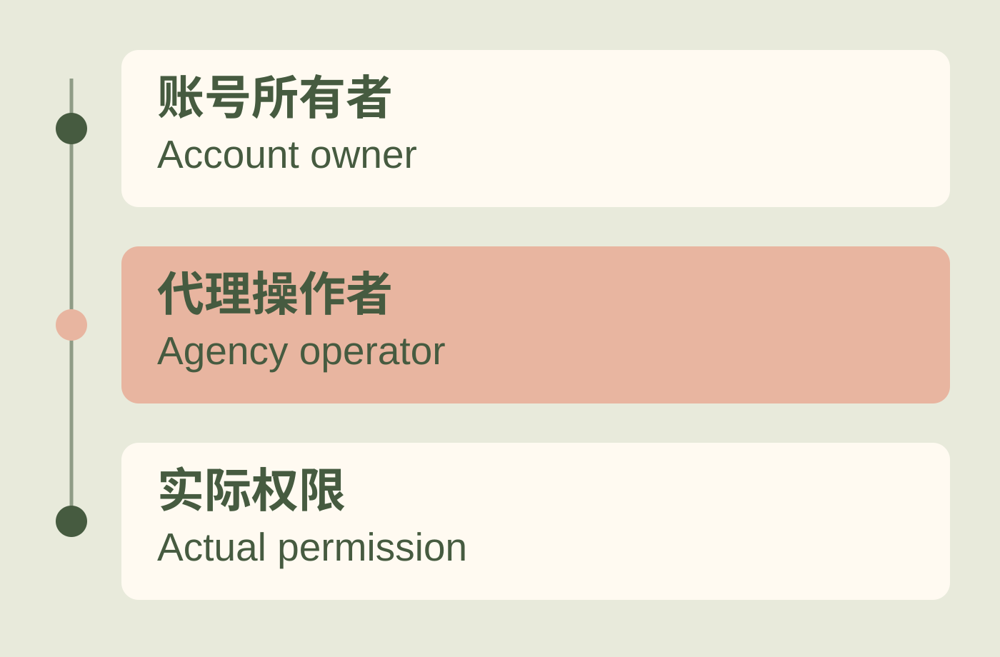

# 免费涨粉网站：谁有权授权

状态：本地审阅稿；正式发布日期待确认。

代理团队看到免费涨粉网站时，先区分账号所有者、日常操作者与第三方服务。能操作账号，不代表获准把新权限交给另一家公司。

面对 website for Instagram followers for free 这类邀约，代理团队应先确认谁拥有账号、谁获准完成什么工作，以及网站提出了哪些新要求。客户允许排期或发布，不自动等于允许接入涨粉服务、分享凭证或新增数据用途。本文是权限教育，不提供网站推荐与领取流程；重点是让品牌和达人知道，一项操作能力与一项有效授权不能混写。

## 先把参与者分成清楚的角色

同一个达人项目，可能同时涉及品牌、代理、创作者、发布者与外部工具。把每个角色对应哪个账号写清，避免用“我们管理这个账号”涵盖所有人。

代理负责品牌账号，不代表有权操作创作者的个人主页；创作者为品牌发布作品，也不代表品牌拥有其账号。合作事实与账号管理关系需要分别确认。

[免费涨粉网站预检方法](https://www.quickkol.com/zh/blog/free-instagram-followers-website-preflight/#answer)讨论一般访问问题。本篇聚焦代理与客户之间的授权边界：是谁可以提出请求，谁能解释用途，谁实际有权决定。

这是一种项目记录方法，不替具体合同作法律解释。如果现有安排没有覆盖新操作，先保留未确认状态，而不是从一句宽泛服务描述里推导出无限权限。

## 日常操作能力不等于新增授权

一个人可能已经能发布、查看资料或调整排期。这样的实际能力，只说明系统允许某些操作，不会自动说明客户批准了每一种未来用途。

把已有任务与拟新增动作并排写出。例如，原任务是发布已审稿内容，而新动作是将账号交给另一项服务处理；两者需要的理由和风险讨论不同。

也不要以“之前做过”代替当前确认。旧项目、旧账户或另一位客户的做法，不能直接成为这次合作的授权记录。

若团队成员不确定自己的范围，应找能决定的人核对，而不是为了完成一个增长目标自行扩大权限。记录这项问题，不是责怪操作者，而是让责任与实际决定相符，避免项目结束后才发现各方理解不同。

## 把网站请求翻成具体动作

先阅读现有资料，记录对方要求的是公开账号名、联系方式、账号连接、凭证，还是其他处理。不同要求不能统一写成“填一些信息”。

公开资料与账号访问不同，平台界面的某种连接也不应被当成增长效果背书。需要核对实际接收者、用途与范围，而不是只看页面是否使用熟悉的颜色或标志。

如果文字含糊，就说明缺少哪些条件，不为研究而继续进入流程。本文不会列出网站、比较领取速度，或教读者如何绕过提示完成连接。

品牌需要的是一项可以解释的决定。即使某项请求看起来技术上常见，也仍应回答它为什么与本次达人项目有关，以及是否需要为这件事交出相应访问。

可以操作，不等于已经获准新增服务、共享访问或改变资料用途。

## 把账号保护交给实际有权的人

[Meta 的 Instagram 安全说明](https://about.fb.com/news/2021/07/keeping-instagram-safe-and-secure/)在 2021 年介绍登录活动、恢复资料与双重验证等保护思路。具体处理应通过当前官方帮助核对，不把旧公告菜单当成所有账户今天的固定路线。

若凭证、验证码或恢复信息可能暴露，先由账号所有者处理，不让项目成员把它们继续放进聊天记录、共享表或演示资料。教育复核也不需要保存这些秘密。

代理可以提供已知事实与时间线，但不应因为希望帮忙就冒用账号所有者作新决定。创作者账号与品牌账号的问题，各自找对应有权人员。

保护工作完成后，记录实际确认了什么。安全设置变化不能认证历史互动来源，也不能让原本未获同意的数据用途自动变成批准状态。

## 免费并不改变互动治理原则

[Meta 的虚假互动治理说明](https://about.fb.com/news/2019/04/preventing-inauthentic-behavior-on-instagram/)在 2019 年讨论对虚假点赞、观看和粉丝服务的行动。它说明平台立场，但不能证明某一具体网站今天的行为，也不提供完全识别的保证。

代理和客户都应知道，免费是价格说法，不能替代对来源与行为的判断。允许某项费用，也不等于允许人为制造互动；没有支付费用，也不意味着互动自动真实。

如果品牌真正希望扩大相关受众，可以讨论内容贡献、清楚邀请和适当分发，而不是把第三方补量当成一项普通制作附件。

这里不需要给任何账号贴标签。教育材料只需说明团队不依赖未经核验的指标作商业证明，并让每位参与者理解，这项原则同时适用于供应商说法和品牌自己的报告。

## 客户同意不能替代核验

客户可能有权决定是否采用一项安排，但一份同意本身不能证明服务有效或数据真实。权限问题解决后，证据问题仍需要单独处理。

[FTC 的虚假影响力指标问答](https://www.ftc.gov/business-guidance/resources/consumer-reviews-testimonials-rule-questions-answers)在美国语境中，区分真实自愿关注与虚假指标，并解释相关购买条款的知道或应当知道条件。不能用“客户批准”替代对实际事实与规则的理解。

同样，也不应把聘用某位拥有可疑粉丝的达人自动写成违规。已有疑问应按范围复核，不从一个人的账号现象直接推导整个合作的法律结论。

代理的记录可以同时说明“授权未确认”“来源未核验”和“某项内容任务仍可讨论”。这些状态各自服务不同决定，比一个笼统的通过或失败更能准确表达现状。

## 用假设代理任务演练授权边界

假设代理已获准排期品牌审核过的内容。随后，一位成员收到免费涨粉网站邀约，对方希望把账号连接到另一项服务。

原任务只说明既有发布安排，没有说明新增服务。成员应记录请求、用途与相关账号，交给有权决定的人，而不是把“能操作账号”视为客户已经同意。

如果对方只提供一个计数变化截图，另一位负责人可以处理证据说明。权限决定与结果核验分开，让团队知道即使某一方面有答案，另一问题仍可能未解决。

这个例子不是实际客户案例，也没有教读者连接服务。它说明一个新的访问请求怎样进入已有达人项目，而项目人员如何在不扩大权限、不制造指控的前提下继续工作。

## 把决定交接给能继续执行的人

[多人账号版本交接方法](https://www.quickkol.com/zh/blog/multiple-social-accounts-creator-version-control/#answer)帮助明确谁处理什么。对于这类教育复核，再增加实际请求、已有授权、新增用途和当前决定四项记录，避免仅留下“已联系客户”。

确认应记录到具体范围，例如对哪一个账号、哪一项工作作出的决定。没有必要收集无关私人信息，也不要在文件里保存凭证来证明有人拥有访问能力。

如果后来停止使用某项服务，仍需单独确认实际访问状态与资料处理。停止付费、停止使用和删除对方保存的数据，不应被写成同一件事已经全部完成。

历史记录保留到合作需要的合理范围，新的版本说明变更原因。下一位负责人应该能理解目前允许什么、暂停什么，以及哪个问题还需要账号所有者或其他相应角色回答。

## 把权限教育写进合作沟通

Website for Instagram followers for free 的教育重点，是让每位操作者知道哪些决定属于自己，哪些必须回到账号所有者和客户的明确范围。

品牌与代理可以事先说明，不要求创作者交出账号凭证，不把不明涨粉安排当作完成制作任务的前提，也不以未知指标替代真实交付。这是清楚的工作约定，不是对某一参与者的怀疑。

团队若收到相关邀约，就使用相同记录方式处理，不让资深成员凭习惯跳过确认，也不让新成员独自承担本应由负责人决定的事项。

最终保留一个可执行的答案：谁有权决定、决定覆盖什么、哪些事实仍未核验。这样权限教育才真正服务达人合作，而不是停留在一张所有人都以为别人已经看过的安全提醒。

## 账号操作与授权的分工

| 事项 | 要确认什么 | 不能默认 |
| --- | --- | --- |
| 账号归属 | 实际所有者与对应账号 | 代理拥有创作者账号 |
| 已有操作 | 批准的具体工作 | 所有后续用途已同意 |
| 新服务请求 | 接收者、用途与访问 | 技术可行就有授权 |
| 数据主张 | 来源、时期与定义 | 客户同意就是真实 |
| 后续处理 | 实际状态与负责人 | 停止使用等于所有资料已删除 |

教育向项目框架，不是具体合同解释、网站安全认证或账号操作教程。

## 代理收到新访问请求时

先明确角色，再讨论动作。

- [ ] 列出账号所有者与日常操作者。
- [ ] 写清已有任务及授权范围。
- [ ] 把网站要求翻成具体新动作。
- [ ] 由有权人员优先处理访问风险。
- [ ] 将权限确认与结果证据分开。
- [ ] 记录决定、范围与下一位负责人。

## 研究日期与使用边界

资料核验于 2026 年 11 月 19 日。文中方法、表格和决策规则为编辑建议，标为假设的示例不是实际客户结果或行业基准。外部资料的适用地区与时期按各段说明。

## 从任务开始达人研究

用 QuickKOL 理解 Brief、发现相关达人并研究作品与联系路径；数据、合作条件和结果仍需核验。

[了解 QuickKOL](https://www.quickkol.com/#capabilities)

## 来源

- [Meta 的 Instagram 安全说明](https://about.fb.com/news/2021/07/keeping-instagram-safe-and-secure/)
- [Meta 的虚假互动治理说明](https://about.fb.com/news/2019/04/preventing-inauthentic-behavior-on-instagram/)
- [FTC 的虚假影响力指标问答](https://www.ftc.gov/business-guidance/resources/consumer-reviews-testimonials-rule-questions-answers)
