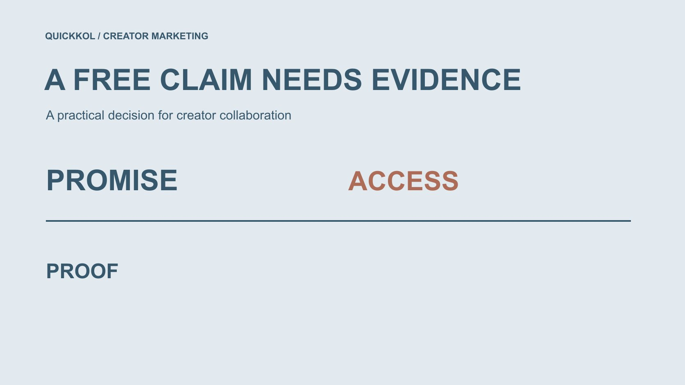
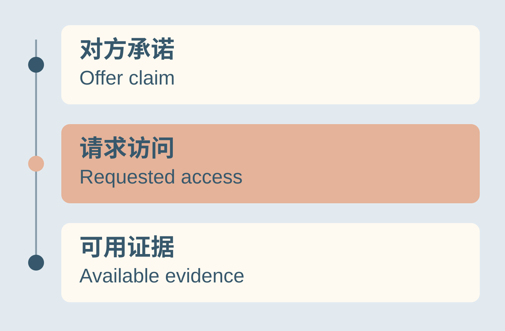

# Get Free Instagram Followers? Assess the Evidence

Status: local review draft; confirm the publication date before release.

When a free-follower offer reaches a brand, examine the promise, account access and evidence separately. Protect authorized access while distinguishing risk signals, unknowns and established facts.

QuickKOL editorial graphic; not actual account metrics or a platform interface.

A get free Instagram followers offer calls for review against the partnership task rather than a claiming exercise. Free is a pricing claim, not evidence of safe account access, genuine audience interest or a number suitable for judging a creator. Let an authorized owner address access risk first, preserve original information and check its source. A suspicious signal can justify holding a decision without proving that an individual creator fabricated activity.

## Establish how the offer entered the partnership

Record who received the offer, which account it concerns, what is requested and whether it relates to the current creator project. A marketing message received by the brand should not silently become something the creator is expected to do.

Sometimes a supplier sends it; sometimes a creator forwards an uncertain claim. Forwarding is not adoption, and receipt is not approval. Preserve the actual state before discussing a fair response.

The [free-follower offer-literacy method](https://www.quickkol.com/blog/free-instagram-followers-offer-claim-literacy/#answer) helps separate written conditions. This article builds on that by prioritizing handling: when to involve the account owner first, which questions need evidence and which figures cannot presently support a partnership evaluation.

Trying the service is not necessary to investigate the existing claim. Public or authorized material can already raise useful questions without turning an unconfirmed message into a new account operation or unapproved data-processing activity. The first output should be a clear description of the situation, rather than a test order made in the name of research.

## Rewrite the promise as a checkable claim

Record separately what the sender says will happen, what they require and which information is supposed to prove it. Do not compress everything into real followers when real has not been defined.

A larger counter, accounts from a market, interest in a product and purchasing outcomes are different claims. A counter screenshot can support only what it actually displays, not every condition at once.

Preserve the original wording beside your interpretation so internal forwarding does not accidentally add a guarantee. Claims without source, period or account scope remain unverified rather than being completed with plausible assumptions.

This step does not certify a website's legality or prove it safe. It lets the next owner see whether the team has a limited checkable statement or a collection of undefined marketing terms. That distinction matters when a supplier's phrase is copied into a proposal: the copied wording should not acquire the brand's endorsement simply because it now appears in a familiar document.

## Give access concerns priority with the account owner

If an offer requests credentials, verification codes or unclear permissions, involve someone actually authorized to assess them. A convenient operation and authority to consent are different questions.

[Meta’s Instagram security guide](https://about.fb.com/news/2021/07/keeping-instagram-safe-and-secure/) introduced login-activity checks, recovery information and two-factor authentication in 2021. This article follows the protective principle without presenting the historical menus as fixed instructions for every current account.

If information may already have been exposed, use current official help and let the account owner establish the situation. Do not continue circulating passwords, codes or recovery details through chat, reports or research screenshots.

Record access concerns separately from engagement authenticity. Removing a connection or improving security does not certify historical follower sources; conversely, an unverified growth question does not establish that the account was compromised. The two issues can require different owners and evidence. Keeping them separate allows immediate protective work to proceed without making a broader accusation that the available information cannot support.

Handle account protection and engagement review separately; no single signal is a complete factual finding.

## Read platform enforcement material within its boundary

[Meta’s inauthentic-engagement announcement](https://about.fb.com/news/2019/04/preventing-inauthentic-behavior-on-instagram/) described a lawsuit concerning fake likes, views and followers in 2019 and stated the platform's opposition to inauthentic activity. It is a dated official statement.

It cannot prove that every present anomaly will be detected or diagnose a particular account for the brand. Platform enforcement should not become a claim that every account remaining visible is a genuine interested viewer.

A zero price does not change the authenticity question. Source, authorization and the nature of the action still need explanation; absence of payment does not prevent measurement distortion.

Brand education can clearly reject reliance on manufactured indicators while preserving the evidence boundary. It need not list or link suppliers, and it need not exaggerate detection ability to demonstrate concern for data quality. A proportionate message says what the team will not use as evidence and what it would need to verify, rather than promising an infallible system for distinguishing every account.

## Distinguish voluntary following from fake indicators

[FTC’s fake-influence-indicator Q&A](https://www.ftc.gov/business-guidance/resources/consumer-reviews-testimonials-rule-questions-answers), in its United States rule context, distinguishes real people choosing to follow from fake indicators and explains a knew-or-should-have-known condition for the relevant purchase provision. It also does not treat hiring a creator who happens to have fake followers as an automatic violation of that provision.

A brand can therefore invite a suitable creator to introduce useful content while real viewers decide whether to follow. That is different from procuring manufactured influence indicators.

Growth resembling the brand's desired result still does not prove voluntary interest. Retain the actual activity, distribution and information scope instead of selecting the conclusion first.

This is education, not a legal determination about an individual business or creator. A relevant owner should evaluate specific markets and facts rather than turn United States staff answers into a universal safe-harbour guarantee. The practical lesson is to examine the activity and evidence, not to treat either a marketing label or a visual anomaly as the complete legal or factual answer.

## Check explanatory conditions when an anomaly appears

Preserve original counts, source and observation time, checking that they concern the same account, metric and comparable window. Sampling differences or abbreviated displays can produce an apparently abrupt change.

Then inspect project context: other publications, paid distribution, public activity or outside attention. These supply possible explanations without automatically establishing any cause, and unknown information should not become zero.

Treat unexplained likes, followers and views within their separate scopes. Do not add unlike questions together to create a supposed fraud probability without a validated method.

Where necessary, hold the decision that depends on the figure while continuing content review supported by other evidence. Labelling a data limitation does not determine that the creator did something wrong. It states that current evidence cannot support a particular conclusion. This distinction allows a fair project response: the team can protect its evaluation without publicly or privately escalating an observation into an allegation that has not been established.

## Ask a proportionate, answerable review question

State the decision, period and source involved in the request. Ask for an explanation of scope or an appropriate authorized record without demanding unrelated viewers' private identities.

Keep not obtained, sender explanation and verified record as different states. An explanation can aid understanding without automatically becoming a proven fact after forwarding.

The [campaign-baseline explanation method](https://www.quickkol.com/blog/free-ig-followers-campaign-baseline-reset/#answer) reminds teams to preserve the original comparison basis. A new observation reference or reporting window should not overwrite earlier records or independently certify that the data has become clean.

Write the result as a next action: which evidence remains needed, who handles the access issue and which evaluation will not use the uncertain figure. If the existing information is sufficient to decide against adopting an offer, further investigation need not expand merely to obtain a complete answer. The purpose is a responsible partnership decision, not exhaustive surveillance of a creator or an open-ended attempt to classify every follower.

## Practise prioritization with hypothetical messages

Imagine message A requesting account credentials, message B displaying only an increased counter and message C proposing that a creator explain useful brand content while viewers choose for themselves. They raise different questions.

A receives priority with the account owner for access protection; no information is submitted as a research exercise. B needs source, time and metric explanation rather than being treated as proof of genuine interest. C can lead to a discussion of real content and conditions without guaranteeing follows or purchases.

These are hypothetical messages, not actual suppliers or safety certifications. Their handling follows the requests made and facts supported.

Educational material should teach colleagues to make that distinction rather than memorize an absolute slogan. The same keyword does not imply the same permissions, risks or evidence. Separating the questions creates a record the next owner can use without assuming that every growth-related conversation has already been approved, or that every unresolved claim establishes misconduct by the person who forwarded it.

## Deliver a limited conclusion and accountable owner

The final record identifies offer status, access concerns, data scope and the present decision. Declining an unclear service does not require accusing anyone; continuing genuine content work does not endorse an unverified metric.

A brand can include the educational reminder in project onboarding so creators know they will not be asked to claim free followers or substitute an uncontrollable counter for real delivery. Keep the message specific and factual rather than threatening.

After review, retain evidence needed for the partnership and appropriately handled. Authorized people execute permission-related work, while content changes and reporting have their own owners.

Document what would change that decision, rather than leaving the hold unexplained. The brand-side answer to get free Instagram followers is to understand the access and evidence questions behind the promise. Let real viewers decide, judge partnerships through checkable information and preserve unknowns as unknowns. A responsible outcome is an explainable decision and a clear next owner, rather than either a larger counter or an unsupported declaration that every suspicious account has been identified.

## Priorities for a free-follower offer

| Observation | First action | Boundary |
| --- | --- | --- |
| Credentials or unclear access requested | Involve the authorized account owner | Does not establish past data authenticity |
| Only a counter demonstration | Check source, time and definition | Does not prove interest or purchase |
| Unexpected change | Preserve records and alternative explanations | An anomaly does not establish individual misconduct |
| Genuine content proposed | Discuss actual task and terms | No guarantee of follows or outcomes |

Educational editorial framework, not a service recommendation, legal opinion or infallible detection method.

## Educational review after an offer arrives

Begin with existing information rather than trying the service.

- [ ] Record recipient, account and actual request.
- [ ] Separate promise, access and evidence.
- [ ] Let the authorized owner prioritize account risk.
- [ ] Check period, source and alternative explanations.
- [ ] Label unknowns separately from established facts.
- [ ] Identify the present decision and next owner.

## Research date and limitations

Sources reviewed November 19, 2026. Methods, tables and decision rules are editorial recommendations. Hypothetical examples are not actual client results or industry benchmarks. Source geography and periods are specified where relevant.

## Start creator research with a clear task

Use QuickKOL to interpret a brief, discover relevant creators and research their work and contact routes. Verify data, commercial terms and outcomes at their source.

[Explore QuickKOL](https://www.quickkol.com/#capabilities)

## Sources

- [Meta’s Instagram security guide](https://about.fb.com/news/2021/07/keeping-instagram-safe-and-secure/)
- [Meta’s inauthentic-engagement announcement](https://about.fb.com/news/2019/04/preventing-inauthentic-behavior-on-instagram/)
- [FTC’s fake-influence-indicator Q&A](https://www.ftc.gov/business-guidance/resources/consumer-reviews-testimonials-rule-questions-answers)
