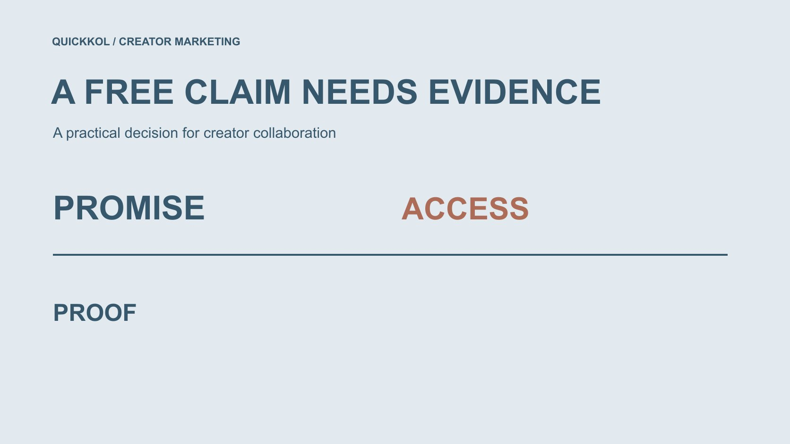
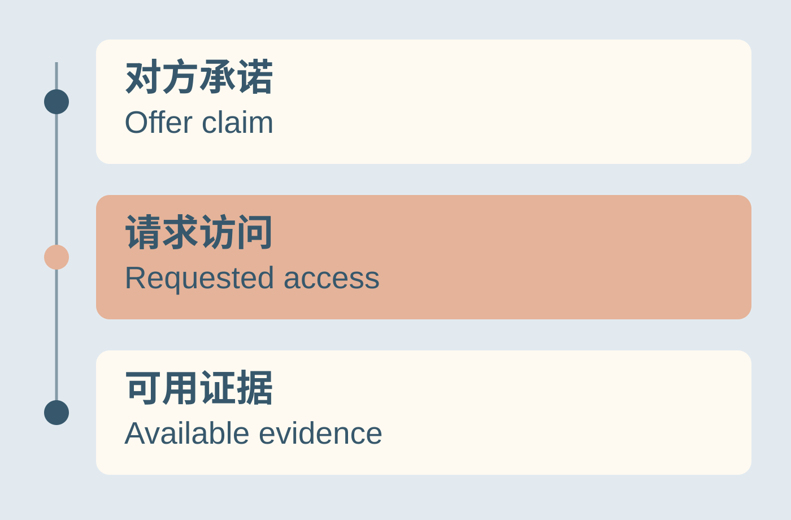

# 免费涨粉承诺怎样分级复核

状态：本地审阅稿；正式发布日期待确认。

品牌收到免费涨粉邀约时，分别核对承诺、账号访问与可用证据，优先保护账号，并区分风险信号、未知与已证实事实。

QuickKOL 编辑图形；不呈现真实账号指标或平台界面。

看到 get free Instagram followers 的邀约，品牌首先要做的不是领取，而是把它放回合作任务中审查。免费描述价格说法，不证明账号访问安全、关注出于真实兴趣，或数字能用于评价达人。先由有权人员处理访问风险，再保留原始资料并核验来源；可疑信号可以支持暂缓决定，却不等于已证明某位创作者造假。

## 先确认邀约怎样进入合作

记录谁收到邀约、涉及哪个账号、对方要求什么，以及它是否与当前达人项目有关。品牌自己收到的营销消息，不应未经说明就转成创作者必须执行的任务。

有时消息来自供应商，有时是创作者转发一个不确定的说法。转发不等于采用，收到也不等于批准。先保留实际状态，才能公平讨论后续处理。

[免费粉丝承诺阅读方法](https://www.quickkol.com/zh/blog/free-instagram-followers-offer-claim-literacy/#answer)帮助拆分文字条件。本篇在此基础上安排处理优先级：哪些情况需要先找账号所有者，哪些问题需要补充证据，哪些数字目前不适合进入合作评价。

不必为了调查而尝试服务。记录现有公开或获准资料已经能够提出很多问题，避免让一个尚未确认的邀约变成新的账号操作或未经批准的数据处理。

## 把承诺写成可以核对的句子

分别记录对方说会发生什么、需要你提供什么，以及用什么资料证明。不要把这些部分压缩成一句“有真实粉丝”，因为真实的含义可能没有被说明。

例如，数字变大、账号来自某个地区、观众对产品有兴趣和形成购买结果，是不同主张。一个计数截图最多支持它实际显示的内容，不能同时证明所有条件。

保存对方原话与自己的解释，避免在内部流转时无意增加保证。没有交代来源、时期或账号范围的说法，应标为未核验，而不是补上看起来合理的假设。

这一步并不鉴定某个网站是否合法，也不替对方证明安全。它让后续负责人看到：眼前到底是一项可核对的有限主张，还是一串尚未说明条件的营销词。

## 账号访问问题优先交给所有者

如果邀约要求账号凭证、验证码或不明权限，先由实际有权的人评估，不让普通项目成员代为同意。操作方便与拥有授权，是两个问题。

[Meta 的 Instagram 安全说明](https://about.fb.com/news/2021/07/keeping-instagram-safe-and-secure/)在 2021 年介绍了登录活动检查、恢复资料与双重验证等保护措施。本文沿用其保护思路，不宣称当年的菜单就是所有当前账号的固定路径。

若资料可能已暴露，使用当前官方帮助处理，由账号所有者确认实际情况。不要在聊天、报告或研究截图里继续传播密码、验证码或恢复信息。

访问问题与互动真实性分别记录。移除一个连接或改善安全设置，不代表历史粉丝来源已经获得认证；反过来，一条尚未证实的增长疑问，也不自动证明账号已经被盗。

保护账号与复核互动分别处理；任何单一信号都不是完整的事实结论。

## 平台治理资料说明原则与边界

[Meta 的虚假互动治理说明](https://about.fb.com/news/2019/04/preventing-inauthentic-behavior-on-instagram/)在 2019 年介绍针对虚假点赞、观看和粉丝服务的诉讼，并说明平台反对不真实活动。这是带日期的官方立场资料。

它不能证明今天每一种异常都会被发现，也不能替品牌诊断某个具体账号。不要把“平台有治理”改写成“留下来的账号全都是真实观众”。

免费也不会改变互动是否真实的问题。价格可能是零，来源、授权和行为性质却仍需要说明；没有付钱，不等于数据就不会失真。

品牌教育材料可以清楚指出不应依赖人为制造的指标，同时保留事实边界。无需列出或链接服务供应商，也不需要用夸大检测能力的说法来证明自己重视数据质量。

## 区分自愿关注与虚假指标

[FTC 的虚假影响力指标问答](https://www.ftc.gov/business-guidance/resources/consumer-reviews-testimonials-rule-questions-answers)在美国规则语境中，区分真实的人自愿关注与虚假指标，并说明相关购买规定包含知道或应当知道的条件。它也没有把聘用恰好拥有假粉的达人自动视为该条款违规。

因此品牌可以邀请合适创作者介绍有用内容，让真实观众自行决定是否关注；这与采购人为制造的影响力数字不是同一种行为。

但是某次增长看起来符合品牌愿望，并不能证明它来自自愿兴趣。仍需保留实际活动、分发与资料范围，不能先选结论再寻找支持。

本文是教育说明，不对个别企业或创作者作法律判断。涉及具体市场与事实时，由相应负责人进一步评估，不将美国问答写成全球统一免责保证。

## 异常出现后先核对解释条件

保存原始计数、来源与观察时间，核对是否同一个账号、同一种指标和相近窗口。取样差异或计数缩写，可以产生看起来突兀的变化。

再检查实际项目背景：是否有其他内容、付费分发、公开活动或媒体关注。它们提供可能解释，不自动证明任何一种原因，未知也不应记为零。

来源不明的点赞、粉丝和观看分别处理。不要把多个不同范围的疑问相加，生成一个没有验证方法的“造假概率”。

必要时暂缓依赖该数字的合作判断，同时继续完成已经有依据的内容审阅。标注数据限制并不是认定创作者有问题，而是说明当前证据不足以支持某个特定结论。

## 提出对方能够回答的复核请求

请求应说明涉及哪项决定、哪个时期和什么来源。可以请对方解释资料口径或提供适当获准记录，不要求提供无关观众的私人身份。

保留“没有取得”“对方解释”“已核验记录”等不同状态。一段解释可以帮助理解，但不应在转发后自动成为已经证明的事实。

[活动基线说明方法](https://www.quickkol.com/zh/blog/free-ig-followers-campaign-baseline-reset/#answer)提醒团队保留原始比较依据。新的观察点或更换报告窗口，都不应覆盖旧记录，也不能单独证明数据已恢复为所谓干净状态。

把结果写成下一步：继续补充哪项证据、由谁处理账号问题、哪个评价暂不使用。若已经足以决定不采用某项邀约，也不必为了得到完整答案而扩大调查范围。

## 用三个假设消息演练分级

假设消息甲要求登录凭证；消息乙只展示一个增加的计数；消息丙提出让创作者解释品牌内容，由观众自行选择。三者需要的问题并不相同。

甲优先交给账号所有者处理访问风险，不为研究而提交资料。乙需要说明来源、时间与指标，不能靠演示确认真实兴趣。丙可以继续讨论真实内容任务与条件，但也没有自动保证关注或购买。

这些不是实际供应商案例，也不是对某一服务安全性的认证。对三个消息的处理，依据它们实际提出的要求和能够支持的事实。

教育材料应让同事理解这种区分，而不是记住一个绝对判断口诀。关键词相同不代表风险、权限和证据相同；把问题拆开，才能给下一位负责人一份可继续使用的记录。

## 交付有限结论与明确负责人

最终记录说明邀约状态、访问问题、数据范围与当前决定。拒绝采用某项不明服务，不需要同时指控任何人；继续真实内容合作，也不等于认可未经核验的指标。

品牌可以把教育提醒加入项目入门资料，让创作者知道不会要求领取免费粉丝，也不会以不受其控制的计数替代真实交付。提醒应该具体、尊重事实，而不是威胁式说明。

复核完成后，只保留合作需要且可适当处理的证据。权限处理由有权人员执行，内容调整与数据报告各有负责人。

也说明什么新证据会改变决定，不让暂缓变成无法解释的状态。Get free Instagram followers 的品牌侧答案，是看清免费承诺背后的访问与证据问题。让真实观众自行决定，以可核验资料判断合作，并给未知保留位置。

## 免费涨粉邀约的处理优先级

| 看到什么 | 先处理什么 | 结论边界 |
| --- | --- | --- |
| 请求凭证或不明权限 | 交给有权账号所有者 | 不推断历史数据真实性 |
| 仅有计数演示 | 核对来源、时间与定义 | 不能证明兴趣或购买 |
| 出现异常变化 | 保留记录并检查其他解释 | 异常不是个人造假结论 |
| 提出真实内容合作 | 讨论实际任务与商业条件 | 不保证关注与结果 |

教育向编辑框架，不是服务推荐、法律意见或百分百识别方法。

## 收到邀约后的教育复核

从已有资料开始，不以尝试服务作为调查前提。

- [ ] 记录收件人、账号与实际要求。
- [ ] 把承诺、访问与证据分开。
- [ ] 让有权所有者优先处理账号风险。
- [ ] 核对时期、来源和其他解释。
- [ ] 把未知与已证实事实分别标注。
- [ ] 明确当前决定与下一位负责人。

## 研究日期与使用边界

资料核验于 2026 年 11 月 19 日。文中方法、表格和决策规则为编辑建议，标为假设的示例不是实际客户结果或行业基准。外部资料的适用地区与时期按各段说明。

## 从任务开始达人研究

用 QuickKOL 理解 Brief、发现相关达人并研究作品与联系路径；数据、合作条件和结果仍需核验。

[了解 QuickKOL](https://www.quickkol.com/#capabilities)

## 来源

- [Meta 的 Instagram 安全说明](https://about.fb.com/news/2021/07/keeping-instagram-safe-and-secure/)
- [Meta 的虚假互动治理说明](https://about.fb.com/news/2019/04/preventing-inauthentic-behavior-on-instagram/)
- [FTC 的虚假影响力指标问答](https://www.ftc.gov/business-guidance/resources/consumer-reviews-testimonials-rule-questions-answers)
