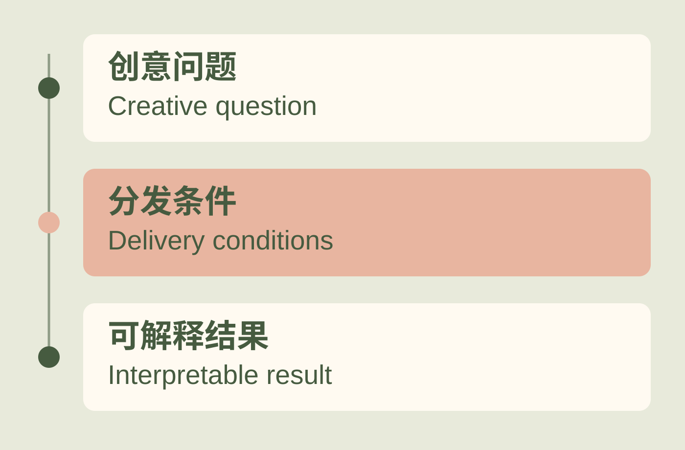

# Instagram Free Likes: Keep Tests Credible

Status: local review draft; confirm the publication date before release.

Free likes cannot validate a creator concept. Separate the creative hypothesis, actual distribution, observed measures and unresolved explanations before deciding what to change.

When researching Instagram free likes, a brand should not treat added reactions as validation of a creator concept. A like is an action; a concept review first needs an audience question, distribution conditions and observations relevant to the next decision. Exchanged, gifted or purchased actions change those conditions and cannot independently establish comprehension, preference or buying. This educational guide offers a review method rather than a service recommendation or an accusation against a person based on unusual numbers.

## Write the creative question before choosing a number

First decide which question the creator piece should answer. A brand may want viewers to understand a use step, recognize a product distinction or explore a subject further. A single like total cannot answer all those questions.

Frame the hypothesis as an expressive choice that can be discussed: for example, whether showing an action before explaining its reason makes the explanation easier to follow than opening with background. Identify the observations that would inform the next version.

Do not write more engagement as the objective and add a story afterwards. Almost any increased action can then be called success without telling the creator what to retain.

This is an editorial research recommendation, not a laboratory standard. Its value is keeping production, distribution and review attached to the same practical question, rather than letting an attractive number retrospectively determine what the work meant. Record the question before release so it remains available when an unexpectedly strong or weak result makes another explanation tempting.

## Distinguish audience reactions from concept evidence

A like can express enjoyment, support, courtesy or another motive; it does not reveal each person's reasoning. A small number of specific questions may tell the team more about a comprehension gap than a larger action total.

For example, a question about why one component must be fitted first can identify something worth explaining. It cannot establish a comprehension rate for every viewer. Preserve the question and its position in the work instead of expanding an individual response into a population fact.

The [free-likes comparison-bias guide](https://www.quickkol.com/blog/free-instagram-likes-comparison-distortion/#answer) addresses quantities and comparison conditions. Here the further question is whether the measure answers the original creative question at all. Even identically defined numbers may not prove which explanation was clearer.

Attach an interpretation boundary to feedback so the creator can act on it. Suggesting an additional close-up is more specific than saying the entire audience disliked the first version, and it stays closer to the information actually observed. The team can value qualitative evidence while being explicit about whose response it represents.

## Added likes change the process being observed

[Meta’s inauthentic-engagement announcement](https://about.fb.com/news/2019/04/preventing-inauthentic-behavior-on-instagram/) discusses the sale of fake likes, views and followers in 2019. It supplies dated platform-governance context, not a universal tool for determining whether a particular account is authentic.

If reactions unrelated to an ordinary encounter with the content are added during a test, the result should no longer be described as performance under the original conditions. Even actions from real people can involve different motivations when an exchange task or additional reward is introduced.

This does not make every increase fake, nor does it mean only organic distribution has value. Paid promotion can have a defined purpose, provided its delivery and participation conditions remain visible.

Stop using added actions to complete the test target, retain the conditions that occurred and redefine which observations still address the question. Do not quietly remove the questionable portion and call the remainder an untouched experiment. A changed process may still produce useful material, but the account of that material must change with it.

## Record the actual delivery and content version

Retain the content version, publication time, observation period and known delivery arrangements for each review. A changed opening, subtitle, voiceover or product demonstration can make two files different expressions.

Also record known brand reposting, advertising, collaboration publication or other promotion. Where information is unavailable, mark it unknown rather than inferring an advertising arrangement from a high or low view total.

[Meta’s Insights API overview](https://developers.facebook.com/docs/insights/overview) explains that measures, objects and access permissions have specific scopes. Information obtained through different interfaces or accounts should not be treated as identical simply because field names look similar.

Keep an appropriately scoped record capable of explaining the decision; research does not require every viewer's identity or the transfer of account credentials. Establishing where information came from often resolves a definition disagreement more effectively than requesting broader access. This record also lets a later reviewer identify which comparison remained possible after a version or distribution change, instead of assuming the conditions were constant throughout the campaign.

## Keep Trial Reels within their stated limits

[Meta’s Trial Reels explanation](https://about.fb.com/news/2024/12/trial-reels-try-content-non-followers-first-see-what-perfoms-best/) describes showing a reel to non-followers first, viewing some metrics after approximately a day and optional later sharing. It also notes that followers can still encounter the work through messages or other routes.

That is not a promise to divide an audience randomly into perfectly equivalent groups, nor is it a confidential test. Using the feature does not establish that audience differences or every alternative explanation have been removed.

The [Trial Reels concept-test method](https://www.quickkol.com/blog/trial-reels-creator-concept-test-design/#answer) helps a team state in advance what it wants to learn. Check the features actually available to the account instead of treating every timing detail or control in a historical announcement as universal current functionality.

A brand can identify an expression worth exploring further without turning one relative result into a permanent distribution rule for all future work. Nor should the learning exercise impose a guaranteed view count on a creator who cannot control platform delivery. Keep the practical opportunity to learn alongside the limits of the comparison.

Establish the question and observation conditions before deciding what the evidence supports; adding actions does not complete validation.

## Choose a next revision instead of a false winner

When the available information cannot establish which version is better, describe the conclusion as unresolved. Adding an operational close-up does not require declaring the entire piece a failure first.

Identify the feedback the revision addresses, the question it should resolve and the observations planned for the next review. Handling a limited question is usually easier to explain than changing the person, setting, subject and promotion simultaneously and then crediting one element.

Include the creator in interpretation. A question in the comments may concern shot selection or unclear product information; the brand should supply the relevant facts before deciding whether another shoot is necessary.

Retain what changed and what stayed the same so later colleagues understand the purpose of the revision. An absence of a definitive winner does not make the work worthless. Knowing which evidence should be improved next can itself be a useful production outcome, especially when the alternative would be buying a visible reaction that cannot resolve the underlying uncertainty.

## Hypothetical example: assess an explanatory opening

Imagine a homeware brand asking a creator to explain a container's locking lid. The first version opens with background, and some comments ask how to close it. A second version will start with a close-up of the action. This is an editorial example, not a client test.

The team retains the original questions and their context, framing the next question as whether showing the action first helps address that particular uncertainty. It also preserves the observation window, delivery and product version rather than changing every condition during revision.

Someone proposes adding free likes so the second version looks more popular. The brand should explain that this action cannot establish whether the step is clearer and would make the intended observations harder to interpret.

If the second version still receives limited relevant feedback, the conclusion remains limited. The team can continue improving or stop without inventing a comprehension rate, conversion outcome or opening formula guaranteed to work. A modest recorded learning decision is more defensible than a manufactured winner.

## Do not turn a suspicious signal into a personal verdict

A sudden increase in likes can justify asking for context, but it cannot independently identify the source, purchaser or motive. An account may have experienced promotion, wider circulation, a reporting correction or a change that remains unexplained.

Separate visible facts from interpretations: record what was observed, which conditions are missing and who should clarify them next. Do not circulate an unverified accusation or describe a third-party score as a platform-confirmed finding.

If an additional-engagement arrangement is actually established within the workflow, first address the record and decision scope, then have the appropriate owner review contractual or platform matters. The educational framework here does not replace an investigation or applicable requirements.

This protects creators and the credibility of brand analysis. The purpose of review is a better-supported next step, not a quick label attached to a person because one value looks unusual. A careful note can acknowledge the concern while remaining explicit that concern, explanation and verified fact are different stages.

## Bring the learning back to the creator assignment

The review should return to the assignment: which question was explained, which feedback remains ambiguous and who will revise the next version. A like total may remain in the record without replacing every answer.

Hand over evidence together with the decision so later colleagues understand why a shot was retained or why a conclusion is not yet possible. Changes in market, account or product conditions also require the earlier conclusion to be qualified again.

The educational point of Instagram free likes is avoiding the purchase of an illusion that a concept has been validated. Creator-marketing judgment needs truthful expression, explainable distribution and a defined learning objective working together.

In the next brief, state the audience question, evidence scope and outcomes that cannot be promised. This gives the creator room to produce a better explanation and the brand a grounded basis for deciding whether to continue. The practical deliverable is a clearer collaboration decision, with its uncertainty visible, rather than a reaction total designed merely to make the report look complete.

## Evidence boundaries in concept review

| Evidence | Can inform | Cannot establish alone |
| --- | --- | --- |
| Like action | A reaction was recorded | Understanding or purchase |
| Specific question | One viewer’s uncertainty | Population comprehension |
| Version record | What expression changed | Guaranteed effectiveness |
| Delivery information | Known exposure conditions | Random assignment |
| Next revision | What to learn next | Future performance guarantee |

Editorial educational framework, not a detection tool, experimental certification or industry benchmark.

## Retain six conditions before reviewing

Use this to prepare a bounded creative discussion.

- [ ] State the audience question and expressive hypothesis.
- [ ] Retain the actual published version.
- [ ] Record the window and known delivery.
- [ ] Separate actions, understanding and purchasing evidence.
- [ ] Leave unknown causes unresolved.
- [ ] Define an evidence-based next revision.

## Research date and limitations

Sources reviewed November 19, 2026. Methods, tables and decision rules are editorial recommendations. Hypothetical examples are not actual client results or industry benchmarks. Source geography and periods are specified where relevant.

## Start creator research with a clear task

Use QuickKOL to interpret a brief, discover relevant creators and research their work and contact routes. Verify data, commercial terms and outcomes at their source.

[Explore QuickKOL](https://www.quickkol.com/#capabilities)

## Sources

- [Meta’s inauthentic-engagement announcement](https://about.fb.com/news/2019/04/preventing-inauthentic-behavior-on-instagram/)
- [Meta’s Insights API overview](https://developers.facebook.com/docs/insights/overview)
- [Meta’s Trial Reels explanation](https://about.fb.com/news/2024/12/trial-reels-try-content-non-followers-first-see-what-perfoms-best/)
