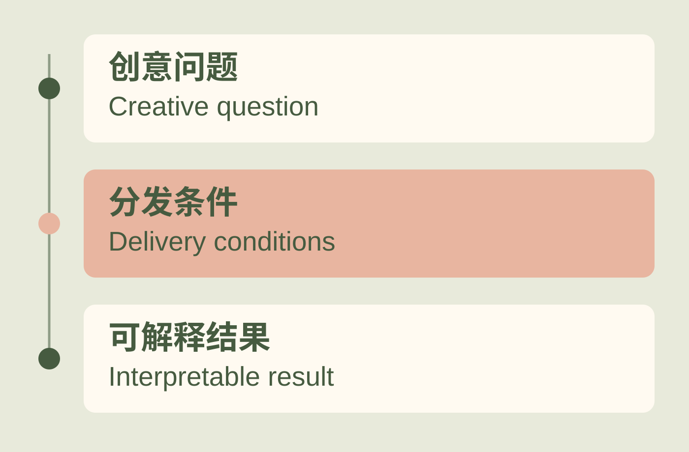

# 免费点赞为何不能验证创意

状态：本地审阅稿；正式发布日期待确认。

免费点赞不能替品牌确认达人创意有效。把表达假设、真实分发、观察指标与无法排除的解释分开，才能决定下一版值得改什么。

搜索 Instagram free likes 时，品牌不应把外加的点赞当成达人创意得到验证。点赞是一项动作，创意测试则需要先明确观众应理解什么、内容如何分发，以及哪些观察能支持下一步判断。互赞、赠送或购买来的动作会改变观察条件，也不能独自证明理解、偏好或购买。本篇提供教育向的测试审阅方法，不推荐涨赞服务，也不凭异常数字指控个人。

## 把创意问题写在数字之前

先决定这次达人作品希望解决什么问题。品牌可能想知道观众是否理解一个使用步骤，是否看清产品差别，或是否愿意继续了解某个话题。不同问题不能用同一个点赞总数代答。

把假设写成可以讨论的表达选择，例如先展示操作再解释原因，是否比先介绍背景更容易理解。说明准备观察什么反馈，以及反馈如何影响下一版。

不要把目标写成“获得更多互动”后再补一个故事。那样无论哪些动作增加，都容易被宣布成功，却无法告诉创作者到底保留什么。

这一步是编辑研究建议，不是实验室标准。它的价值在于让制作、投放和复盘围绕同一个具体问题，而不是让一个好看的数字临时决定作品含义。

## 区分观众反应与概念证据

点赞可能表达喜欢、支持、礼貌或其他含义，不能读取每位观众的真实动机。少量具体问题有时比一个更大的动作总数更能说明观众理解到哪一步。

例如观众问“这个部件为什么要先安装”，可以提示解释仍有缺口，但不能据此推算所有观看者的理解率。保留原问题与作品位置，避免把个别回应扩成总体事实。

[免费点赞比较偏差文章](https://www.quickkol.com/zh/blog/free-instagram-likes-comparison-distortion/#answer)讨论数量与比较条件；这里更进一步追问，当前指标是否回答了原来的创意问题。即便两个数字口径相同，也未必能够证明哪段讲解更清楚。

给反馈附上解释边界，让创作者能够采取行动。例如建议补充一个近景，比说观众全部不喜欢原稿更具体，也更符合实际看到的资料。

## 外加点赞怎样改变观察

[Meta 的虚假互动治理说明](https://about.fb.com/news/2019/04/preventing-inauthentic-behavior-on-instagram/)在 2019 年讨论了销售虚假点赞、观看与粉丝的行为。这是有日期的平台治理背景，不是识别某个账号真伪的万能工具。

如果测试期间加入与内容自然接触无关的点赞，就不能继续把结果描述为原条件下的创意表现。即便动作来自真人，交换任务或额外奖励也可能改变他们参与的原因。

这并不意味着每项增长都是虚假，也不意味着只有纯自然分发才有价值。付费推广可以有明确用途，只是需要如实记录投放与参与条件。

品牌应停止用新增动作补齐测试目标，保留发生过的条件，并重新界定哪些观察还能回答问题。不能把有疑点的部分悄悄删掉，再把剩余资料称为未经干预的实验。

## 先记录实际分发与版本

每次审阅保留作品版本、发布时间、观察期与已知分发安排。开头、字幕、配音或产品展示改变，都可能让两个文件不再是同一个表达。

同样记录是否有品牌账号转发、广告、联合发布或其他推广。没有资料的地方写未知，不凭观看数高低推断某项投放一定存在。

[Meta 的 Insights API 概述](https://developers.facebook.com/docs/insights/overview)说明指标、对象与访问权限具有具体范围。团队从不同接口或账号拿到的资料，不应因为名称相近就自动视为完全相同。

保存能解释决策的适当记录即可，不需要索取全部观众身份或把账号凭证交给研究人员。明确资料来自哪里，通常比扩大访问范围更能解决口径争议。

## Trial Reels 也需要解释边界

[Meta 的 Trial Reels 说明](https://about.fb.com/news/2024/12/trial-reels-try-content-non-followers-first-see-what-perfoms-best/)介绍了先向非粉丝展示的方式，以及约一天后查看部分指标、可选后续分享等安排。平台说明还提醒，粉丝仍可能通过私信或其他入口看到内容。

这不是把观众随机分成完全相同两组的承诺，也不是保密测试。不能因为使用了这个入口，就宣布已经排除受众差异或所有其他解释。

[Trial Reels 概念测试方法](https://www.quickkol.com/zh/blog/trial-reels-creator-concept-test-design/#answer)适合帮助团队提前写清要学习什么。仍应核对当前账号实际可用功能，不把历史公告的每个时间与按钮写成全部账号的现状。

品牌可以据此发现值得继续探索的表达，但不能把某次相对表现扩成未来所有作品的固定分发规律，更不能给达人增加无法控制的观看保证。

先确认问题与观察条件，再决定资料能够支持什么；增加动作不等于完成验证。

## 用下一版修改代替虚假的胜负

如果目前没有足够资料判断哪版更好，可以把结论写成待继续验证。决定增加一个操作特写，不需要先宣布整条作品失败。

说明修改针对哪条反馈、希望解决什么问题，以及下一次准备怎样观察。一次只处理有限问题，通常比同时换人物、场景、主题和投放后宣称某个元素有效更容易解释。

创作者应参与解释。评论中的疑问可能与镜头选择有关，也可能与产品资料不清有关；品牌需要先提供事实，再决定是否要求重拍。

保留未变部分与变化部分，可以让后续团队理解改稿目的。没有明确胜负并不等于工作没有价值，清楚知道下一步应补什么证据，本身就是有用的制作结果。

## 假设演示：判断一个开头是否清楚

假设家居品牌请达人解释容器的锁盖步骤。第一版先讲背景，部分评论问如何合上；第二版计划先给手部近景。这是编辑示例，不是实际客户测试。

团队记录原评论与对应位置，将下一版问题写成“先展示操作能否减少该步骤的疑问”。同时保留观察期、分发与产品版本，避免在改稿时顺便换掉全部条件。

有人提议补一批免费点赞，让第二版看起来更受欢迎。品牌应指出，这个动作不能回答步骤是否讲清，也会让原来准备观察的反馈更难解释。

如果第二版仍只有有限反馈，结论就保留有限。可以决定继续优化或暂时停止，而不是虚构理解率、转化或一个保证成功的开头公式。

## 不要用可疑信号给个人定性

突然增加的点赞可以成为询问背景的理由，但不能独自确认来源、采购者或动机。账号可能经历推广、传播、统计修正，或目前无法解释的变化。

把可见事实与解释分开：记录观察到了什么，缺少哪些条件，下一步准备向谁核实。不要公开传播未经核验的指控，也不把第三方评分写成平台已确认事实。

若确实发现流程中的额外互动安排，先处理记录与决策范围，再由适当负责人确认合同或平台事项。文章中的教育框架不代替具体调查与适用规则。

这样既保护创作者，也保护品牌分析的可信度。审阅的目标是让下一步更有依据，而不是依靠一个异常值快速给某个人贴标签。

## 把创意学习带回达人合作

复盘最终应回到作品任务：什么问题得到说明，哪些反馈仍有歧义，下一版由谁修改。点赞总数可以保留，但不要让它替代全部答案。

把证据与决定一起交接，让后续团队理解为什么保留某个镜头，或为什么暂时不能判断。不同市场、账号与产品的条件变化后，旧结论也需要重新限定。

Instagram free likes 的教育重点，是不要用额外动作购买“已经验证”的错觉。达人营销需要真实表达、可解释分发和明确学习目标共同支持判断。

下一次准备 Brief 时，先把观众问题、资料范围与不可承诺结果写清楚。创作者才有空间完成更好的解释，品牌也能据实决定是否继续合作。

## 创意审阅的证据边界

| 资料 | 可以帮助判断 | 不能单独确认 |
| --- | --- | --- |
| 点赞动作 | 某次反应被记录 | 理解或购买 |
| 具体问题 | 某位观众的疑点 | 总体理解率 |
| 版本记录 | 表达改变了什么 | 改变必然有效 |
| 分发资料 | 已知触达条件 | 等同随机分组 |
| 后续修改 | 准备继续学习什么 | 未来表现保证 |

编辑教育框架；不是平台检测工具、随机实验认证或行业基准。

## 复盘前保留六项条件

用来准备一次有范围的创意讨论。

- [ ] 写明观众问题与表达假设。
- [ ] 保留实际发布版本。
- [ ] 记录观察期与已知分发。
- [ ] 区分动作、理解与购买证据。
- [ ] 将未知原因保留为未知。
- [ ] 给出有依据的下一版任务。

## 研究日期与使用边界

资料核验于 2026 年 11 月 19 日。文中方法、表格和决策规则为编辑建议，标为假设的示例不是实际客户结果或行业基准。外部资料的适用地区与时期按各段说明。

## 从任务开始达人研究

用 QuickKOL 理解 Brief、发现相关达人并研究作品与联系路径；数据、合作条件和结果仍需核验。

[了解 QuickKOL](https://www.quickkol.com/#capabilities)

## 来源

- [Meta 的虚假互动治理说明](https://about.fb.com/news/2019/04/preventing-inauthentic-behavior-on-instagram/)
- [Meta 的 Insights API 概述](https://developers.facebook.com/docs/insights/overview)
- [Meta 的 Trial Reels 说明](https://about.fb.com/news/2024/12/trial-reels-try-content-non-followers-first-see-what-perfoms-best/)
