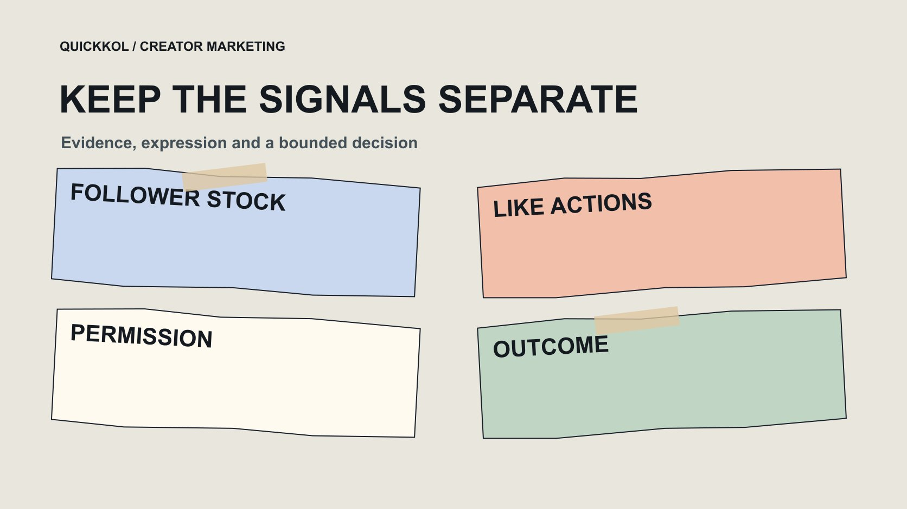
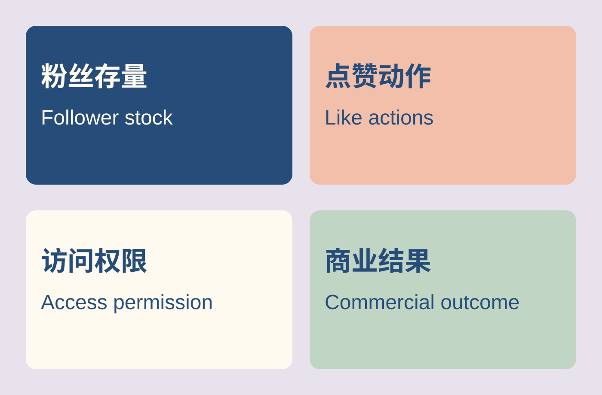

# Free Likes and Followers: Separate the Evidence

Status: local review draft; confirm the publication date before release.

Separate follower stocks, like actions, account permissions and commercial outcomes so free-engagement claims cannot combine unlike evidence into a credibility verdict.

QuickKOL editorial graphic; not actual account metrics or a platform interface.

Free Instagram likes followers combines unlike things in one promotional phrase: followers at a moment, like actions on content and potentially requested account access. These cannot simply be added together or converted into an automatic verdict about a creator’s credibility. A brand should define each field’s object, unit, period and source, then separate observation, interpretation and verified fact. This is educational data literacy, offering no engagement service, perfect-detection promise or accusation based on a single number.

## Attach an object and time to every label

Begin by making every field answer whose what, at which time. An account's follower count, the likes on one reel and new follows during a month are different records and should not all be called engagement.

Record the source interface, observation time and known definition. If a screenshot lacks a date, object or scope, retain the gap rather than guessing from its layout that it represents a complete period.

The [creator-metrics decision tree](https://www.quickkol.com/blog/social-media-metrics-creator-decision-tree/#answer) connects a decision question with the evidence required. This guide adds a small shared dictionary so production, procurement and review colleagues do not use one word while discussing different things.

The dictionary need not be elaborate. Field, object, unit, period, source and limitation are enough columns to make many comparisons explainable. A definition not yet confirmed should remain marked for verification. This makes the record usable even when a team cannot obtain every desired measure, because readers can see the difference between a known value and a label whose meaning is still unresolved.

## Treat follower totals as stocks at a moment

A follower total at one moment describes the scale of an account relationship. Alone, it does not identify active viewers, people in the intended market or prospective buyers of the sponsored product.

The difference between two totals describes a net change, but does not automatically reconstruct every addition and removal. Identical net growth can arise alongside different inflows, outflows and observation conditions.

The [follower-baseline review method](https://www.quickkol.com/blog/free-ig-followers-campaign-baseline-reset/#answer) explains retaining times and sources. Distinguish public figures, appropriately authorized backend information and third-party estimates when using it; a precise-looking display is not a complete explanation.

Such evidence can inform a limited question, such as whether the account scale changed enough to require context. It should not independently label a person fake or become the projected number of customers for a brand assignment. Keeping that limit visible is particularly useful when a promotional claim tries to convert a promised follower quantity directly into an audience-quality or revenue claim without supplying any evidence between those steps.

## A like is an action, not a complete audience profile

A like record and an account follower total concern different objects and units. One action on a piece does not establish that the person followed the account, completed the content, understood it or accepted a recommendation.

One person can also interact with several publications. Adding actions across pieces therefore does not automatically yield a unique-person count. Any deduplication claim needs the relevant fields and a supported method.

[Meta’s Insights API overview](https://developers.facebook.com/docs/insights/overview) explains that measures relate to objects and permission scopes. Confirm the definition of the field actually obtained rather than moving a name into another spreadsheet and carrying its original interpretation along unchanged.

Actions can be valuable to a brand, but their value needs a decision question. They may justify further investigation of content response without replacing checks on audience origin, product experience or purchasing outcomes. A reviewer should be able to explain exactly which statement the action supports, and should leave the other statements open until a suitable source becomes available.

## Access concerns capability and responsibility

When a free service requests a login, verification code or broader access, the issue is no longer merely a data quantity: it concerns account control and authorization. Possessing a screenshot does not give a third party permission to operate the account.

[Meta’s Instagram security guide](https://about.fb.com/news/2021/07/keeping-instagram-safe-and-secure/) provides protective context on login activity, recovery information and two-factor authentication. Published in 2021, it should not become a step-by-step claim about the current menus of every account.

Brands and agencies should establish the owner, the person able to authorize specific access, the purpose and the duration. Do not request unrelated permissions to complete one report field, or treat the technical ability to log in as evidence of client approval.

The owner can review actual security conditions through official routes; this article does not ask readers to try a questionable service. Clarifying access first prevents a supposedly free quantity from turning into an account-control arrangement that nobody has explicitly discussed.

## Commercial outcomes require a separate evidence chain

A brand may care about inquiries, orders or continuing a partnership, but these outcomes need their own sources. Adding followers and likes, multiplying by an assumed price and calling the result actual revenue does not establish a transaction.

If link, code or order information exists, retain the window, attribution rules and treatment of cancellations and returns. The purpose here is evidence separation, not a revenue formula suitable for every business.

Without outcome data, the team can still describe completed work, audience feedback and questions awaiting verification. Do not turn engagement into orders to fill a sales column, or turn unknown earnings into a statement that the work had no value.

Creators can be accountable for the assignment they completed, while the brand supplies commercial facts in its possession. Clear responsibilities reduce the chance that an uncontrollable number replaces a complete partnership evaluation. They also make it possible to ask a precise follow-up question instead of requesting a larger collection of unrelated figures.

Fields can be reviewed together without becoming additive or proving each other merely by sharing a table.

## Do not combine unlike concerns into an automatic accusation

Arbitrarily assigning points to growth speed, like totals and missing information does not create a validated detection system merely because a total score appears. Its method, intended scope and possible errors would first need support.

[Meta’s inauthentic-engagement announcement](https://about.fb.com/news/2019/04/preventing-inauthentic-behavior-on-instagram/) addresses a real governance issue, but does not establish that every unusual pattern comes from purchased activity. Platform context and a factual finding about a person should be expressed separately.

[FTC’s fake-influence-indicator Q&A](https://www.ftc.gov/business-guidance/resources/consumer-reviews-testimonials-rule-questions-answers) also distinguishes conduct, knowledge conditions and circumstances in its United States regulatory context. It should not be reduced to a claim that working with a creator automatically makes a brand liable.

A review record can distinguish observed, awaiting explanation and verified states. Without completed verification, do not circulate a definitive accusation. Send matters requiring further review to the appropriate owner rather than allowing an educational table to replace an investigation. The separation improves both fairness to the creator and the precision of the brand's next request for information.

## Practise with a hypothetical separated record

Imagine a team receiving material showing ten thousand account followers, three hundred likes on a publication and a service promise to supply more engagement. These are hypothetical quantities, not benchmarks or actual account information.

Record ten thousand as an account stock at a moment, three hundred as actions on a piece at an observed time and the service offer as an unverified promotional claim. Without further evidence, unique people, origin and commercial outcomes remain unknown.

If access is requested, create a separate permission issue and establish the owner and authorization scope. Do not place the access promise and the quantities into one authenticity score, or connect the service to finish the exercise.

Conclude narrowly: the supplied material cannot establish actual reach, sales or the origin of engagement, and specified context is needed next. This makes no authenticity finding about a person. Its usefulness lies in turning a confusing bundle into answerable questions, each assigned to an appropriate source rather than forced into a single unsupported verdict.

## Share definitions and verification states across the team

Procurement, creative and analysis colleagues should use the same field definitions. When a source or observation period changes, update the record so an old interpretation does not silently survive in the new report.

Identify the evidence owner and the person responsible for the next step. The creator then knows which object needs clarification, while the brand knows which commercial facts must come from its own team. This reduces repeated requests for entire backend collections.

If a field remains unavailable, remove an unsuitable comparison or retain the limitation. Do not invent a value to make a table symmetrical, and do not treat missing information as evidence of personal wrongdoing.

Hand over the dictionary with the verification states. A new colleague should see not only a number but what it can support, what it cannot support and which further check would actually change the collaboration decision. This keeps a modest educational record connected to practical action rather than turning documentation into a substitute for judgment.

## Return the free-engagement phrase to a partnership decision

The brand ultimately needs to decide whether to contact someone, request context, adjust an assignment or pause. Each decision should correspond to the available evidence rather than a credibility score assembled from unlike things.

The educational point of free Instagram likes followers is understanding what those words describe separately. Even when promotion bundles them together, the team can preserve the distinct meanings of stocks, actions, permissions and outcomes.

Do not suspect every ordinary increase, or automatically treat an attractive total as genuine influence. Retain questions, cross-check sources and use a limited conclusion when evidence is insufficient.

This fits creator-marketing work: understand the work and assignment first, obtain appropriate evidence and make a bounded partnership judgment. It does not depend on manufactured engagement or a nonexistent promise of perfect detection. The next useful step is the one that resolves a relevant uncertainty, not the one that merely produces another impressive number for the same undefined field.

## What four evidence types support

| Type | Confirm first | Retain the limit |
| --- | --- | --- |
| Follower stock | Account and moment | Not active audience |
| Like action | Content, window and field | Not a purchase |
| Access permission | Owner and approved scope | Not data-quality proof |
| Commercial outcome | Transaction or business source | Not inferred directly from actions |
| Concern | Observation and missing context | Not a verified accusation |

Educational editorial dictionary, not a detection model, legal conclusion or complete platform field list.

## Separate first, then decide

Use when reviewing an engagement claim or creator record.

- [ ] Attach an object to each field.
- [ ] Retain unit, period and source.
- [ ] Distinguish stocks from actions.
- [ ] Handle access authorization separately.
- [ ] Find appropriate facts for outcomes.
- [ ] State unknowns and the next verification.

## Research date and limitations

Sources reviewed November 19, 2026. Methods, tables and decision rules are editorial recommendations. Hypothetical examples are not actual client results or industry benchmarks. Source geography and periods are specified where relevant.

## Start creator research with a clear task

Use QuickKOL to interpret a brief, discover relevant creators and research their work and contact routes. Verify data, commercial terms and outcomes at their source.

[Explore QuickKOL](https://www.quickkol.com/#capabilities)

## Sources

- [Meta’s Insights API overview](https://developers.facebook.com/docs/insights/overview)
- [Meta’s Instagram security guide](https://about.fb.com/news/2021/07/keeping-instagram-safe-and-secure/)
- [Meta’s inauthentic-engagement announcement](https://about.fb.com/news/2019/04/preventing-inauthentic-behavior-on-instagram/)
- [FTC’s fake-influence-indicator Q&A](https://www.ftc.gov/business-guidance/resources/consumer-reviews-testimonials-rule-questions-answers)
