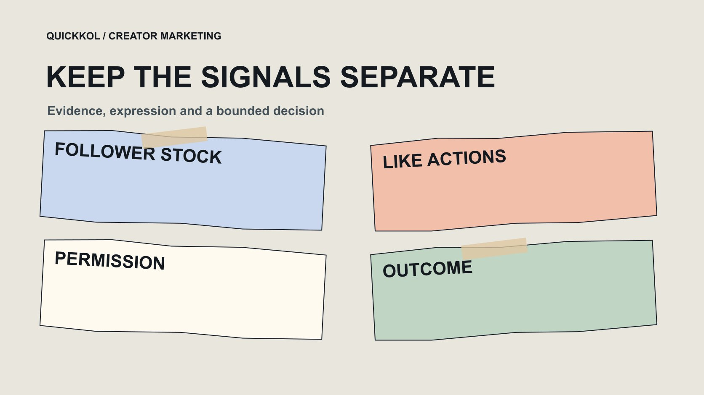
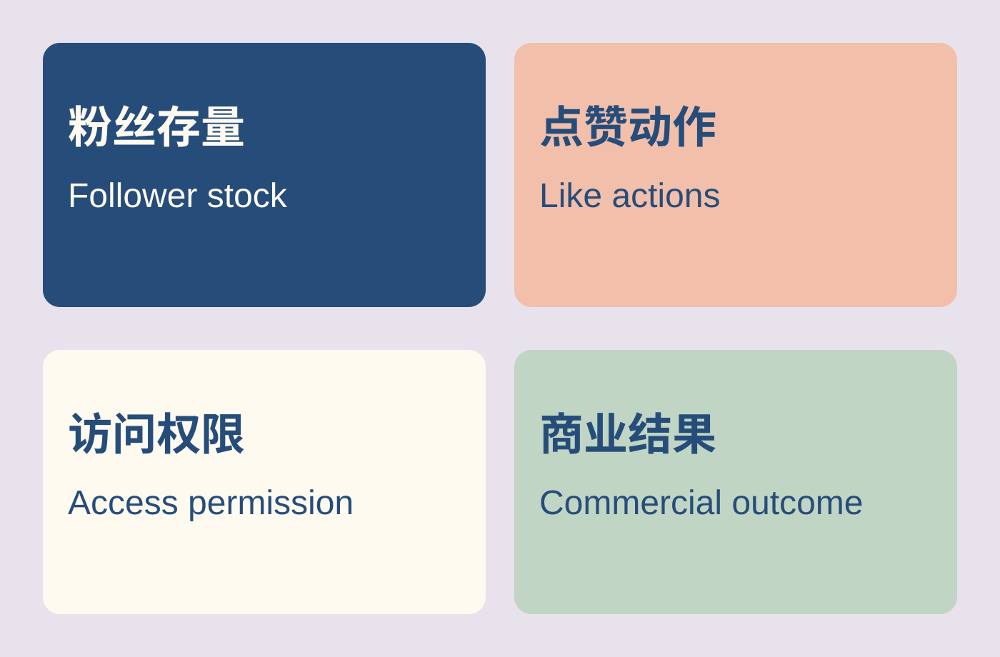

# 免费点赞与粉丝怎样分别复核

状态：本地审阅稿；正式发布日期待确认。

把粉丝存量、点赞动作、账号权限与商业结果分成不同证据，避免免费互动宣传把不相同的事实拼成一个可信度结论。

QuickKOL 编辑图形；不呈现真实账号指标或平台界面。

Free instagram likes followers 把不同东西放在同一句宣传里：某时点的粉丝数、某条内容的点赞动作，以及可能要求的账号访问。它们不能直接相加，也不能合成一个自动判定达人可信度的分数。品牌应先为字段写清对象、单位、时期与来源，再区分观察、解释和已核验事实。本篇是教育向数据辨读，不提供刷量入口，不承诺百分百识别，也不据单项数字指控个人。

## 为每个名词补上对象与时间

先让每个字段回答“谁的什么，在什么时候”。账号粉丝数、某条 Reel 点赞数与最近一个月新增关注，不是同一类记录，不能只用“互动”统称。

记录来源界面、观察时间与已知定义。若截图缺少日期、对象或范围，就保留缺口，而不是凭布局猜测它代表某个完整时期。

[达人数据决策树](https://www.quickkol.com/zh/blog/social-media-metrics-creator-decision-tree/#answer)可以帮助从问题找到需要的证据。本篇在此基础上给团队建立简洁词典，避免制作、采购和复盘人员使用同一个词却讨论不同事情。

词典不需要很复杂。字段、对象、单位、时期、来源、限制六列，就足以让多数比较先停在可以解释的层面；没有确认的定义应显式标为待核验。

## 粉丝数量是一项有时点的存量

一个时点的粉丝总数描述账号关联规模，不能独自说明有多少人正在观看、来自目标市场，或愿意购买合作商品。

两次总数之差可以描述净变化，但不能自动还原所有新增与减少事件。即便净增长相同，背后的流入、流出与观察条件也可能不同。

[粉丝基线复核方法](https://www.quickkol.com/zh/blog/free-ig-followers-campaign-baseline-reset/#answer)讨论怎样保留时间与来源。使用时仍要区分公开数字、获准后台资料与第三方估计，不把精确显示误认成完整解释。

这类资料适合支持有限问题，例如账号规模是否发生了需要询问的变化。它不适合单独给个人贴上虚假标签，也不应直接成为这次品牌合作预计销售人数。

## 点赞是动作，不是完整的人群画像

点赞记录与账号粉丝数有不同对象和单位。某条内容获得一个动作，不等于这个人订阅了账号，也不等于他看完、理解或接受了推荐。

同一个人可能参与多条内容，因此跨作品累加动作时，也不能直接把总数叫作独立人数。是否能够去重，需要相应字段与方法支持。

[Meta 的 Insights API 概述](https://developers.facebook.com/docs/insights/overview)说明指标与对象、权限范围相关。团队应核对实际获取字段的定义，而不是把一个名称搬到另一张表里后继续沿用原解释。

对品牌来说，动作有价值，但价值需要放在问题里理解。它可以成为继续研究内容回应的线索，不能自动替代观众来源、产品体验或购买结果的核验。

## 访问权限是能力与责任问题

某个免费服务要求登录、验证码或更多访问时，讨论的已不只是数据数量，而是账号控制与授权。拥有一个指标截图，不会自动赋予第三方操作账号的权利。

[Meta 的 Instagram 安全说明](https://about.fb.com/news/2021/07/keeping-instagram-safe-and-secure/)提供登录活动、恢复资料与双重验证等保护背景。它发表于 2021 年，不应被写成所有账号当前菜单的逐项教程。

品牌与代理应确认账号属于谁、谁能批准具体访问、用途与期限是什么。不为补齐一个报告字段而索取不相关权限，更不把能够登录等同于客户已经授权。

账号所有者可在官方入口核对实际安全状态；文章不要求读者尝试可疑服务。先明确访问问题，才能避免把一个所谓免费数字变成未被讨论的控制权安排。

## 商业结果需要另外的事实链

品牌可能关心询问、订单或继续合作，但这些结果需要各自来源。不能把粉丝与点赞相加后乘一个假设价格，再把结果称为真实收入。

若有链接、优惠码或订单资料，要保留窗口、归属规则、取消与退款处理方式。这里只建立证据区分，不提供一个适合所有业务的收益公式。

没有结果资料时，仍可描述作品完成、观众反馈与待核验问题。不要为填满销售栏而把互动写成订单，也不要把未知收益直接写成没有价值。

创作者可以对自己完成的任务负责，品牌则应提供自己掌握的商业事实。双方把不同责任说清楚，才不容易让一个不可控数字取代完整的合作评价。

字段可以并列审阅，但不能因为放在同一张表中就自动相加或互相证明。

## 不要把不同疑点拼成自动指控

把增长速度、点赞数量与资料缺口随意赋分，不能因为有了总分就变成经过验证的检测系统。需要先知道评分方法、适用范围和错误可能。

[Meta 的虚假互动治理说明](https://about.fb.com/news/2019/04/preventing-inauthentic-behavior-on-instagram/)讨论了真实存在的治理问题，但不证明每一个异常模式都来自购买行为。平台治理背景与对某人的事实认定应分别表达。

[FTC 的虚假影响力指标问答](https://www.ftc.gov/business-guidance/resources/consumer-reviews-testimonials-rule-questions-answers)还在美国规则语境中区分了相关行为、认知条件与情况。不能将它简化成“品牌用了某个达人，便自动违法”。

审阅记录可写明已观察、待解释与已证实三种状态。没有完成核验时，不公开传播定性结论；需要进一步处理的事项交给适当负责人，而不是让教育表格代替调查。

## 用假设记录练习分列

假设团队收到一张材料：账号显示一万粉丝、某作品显示三百点赞，另有服务承诺赠送互动。这些是假设数字，不是行业基准或实际账号资料。

先把一万记录为某时点的账号存量，三百记录为某作品在特定观察时刻的动作，再把服务承诺记为未经核验的宣传。没有资料时，独立人数、来源与商业结果均保持未知。

如果服务还要求访问，另开权限事项，确认所有者与授权范围。不要把访问承诺和数字放进同一个真实性得分，也不实际接入服务来完成练习。

最后写下一条有限结论：已有材料不能确定真实触达、销售或互动来源，下一步需要补充哪些具体背景。这个结论没有替任何个人作真伪判定。

## 让团队共用词典与状态

采购、创作与分析人员应使用同一份字段说明。更换数据来源或观察期时，更新记录，不让旧定义在新版报告里继续悄悄生效。

把资料所有者与下一步负责人写清楚。创作者知道需要核对哪个对象，品牌也知道哪些商业事实应由内部提供，减少反复索取整套后台资料。

若一个字段最终仍不可得，可以删除不适合的比较或保留局限。不需要为了让表格对称而估造一个数，也不应将缺失资料视为个人有问题的证据。

交接时同时保留词典和结论状态。新同事看到的不只是数字，还能理解它支持什么、不支持什么，以及哪项后续核验真正会改变合作决定。

## 把免费互动词转回合作判断

品牌最终需要决定是否联系、补充资料、调整任务或暂缓合作。每个决定应对应当前证据，而不是对应一个拼凑出来的可信度分数。

Free instagram likes followers 的教育重点，是这些名词分别描述什么。即便宣传将它们捆绑，团队仍能保持存量、动作、权限与结果的独立含义。

不要把正常增长一概怀疑，也不要把漂亮总数自动当成真实影响力。保留疑问、交叉核验来源，并在证据不足时使用有限结论。

这种表达更符合达人营销的实际工作：先理解作品与任务，再取得适当资料，最后作有范围的合作判断。它不依赖刷量，也不需要承诺一种不存在的百分百识别能力。

## 四种资料分别支持什么

| 类型 | 先确认 | 保留限制 |
| --- | --- | --- |
| 粉丝存量 | 账号与时点 | 不是活跃人群 |
| 点赞动作 | 内容、窗口与字段 | 不是购买事实 |
| 访问权限 | 所有者与批准范围 | 不是数据质量证明 |
| 商业结果 | 交易或业务来源 | 不能从动作直接推算 |
| 疑点 | 观察与待核验背景 | 不是已证实指控 |

教育向编辑词典，不是检测模型、法律结论或平台官方字段全集。

## 先分列，再决定

审阅一份互动宣传或达人数据时使用。

- [ ] 给字段补上对象。
- [ ] 保留单位、时期与来源。
- [ ] 区分存量与动作。
- [ ] 将访问授权单独处理。
- [ ] 为商业结果找相应事实。
- [ ] 写明未知和下一步核验。

## 研究日期与使用边界

资料核验于 2026 年 11 月 19 日。文中方法、表格和决策规则为编辑建议，标为假设的示例不是实际客户结果或行业基准。外部资料的适用地区与时期按各段说明。

## 从任务开始达人研究

用 QuickKOL 理解 Brief、发现相关达人并研究作品与联系路径；数据、合作条件和结果仍需核验。

[了解 QuickKOL](https://www.quickkol.com/#capabilities)

## 来源

- [Meta 的 Insights API 概述](https://developers.facebook.com/docs/insights/overview)
- [Meta 的 Instagram 安全说明](https://about.fb.com/news/2021/07/keeping-instagram-safe-and-secure/)
- [Meta 的虚假互动治理说明](https://about.fb.com/news/2019/04/preventing-inauthentic-behavior-on-instagram/)
- [FTC 的虚假影响力指标问答](https://www.ftc.gov/business-guidance/resources/consumer-reviews-testimonials-rule-questions-answers)
