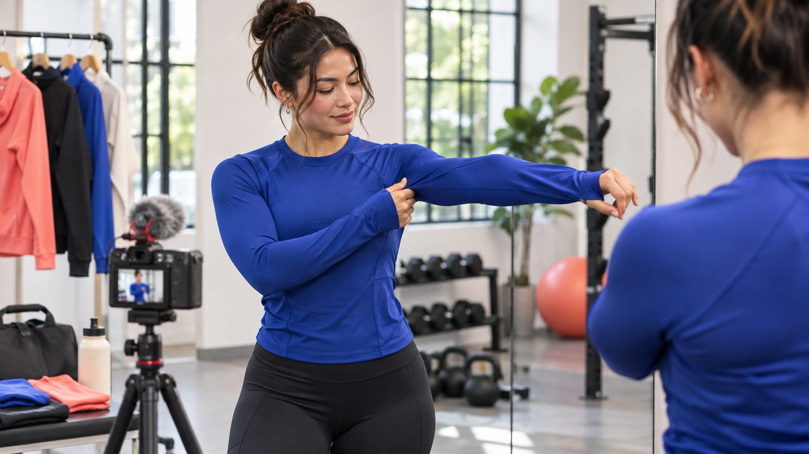
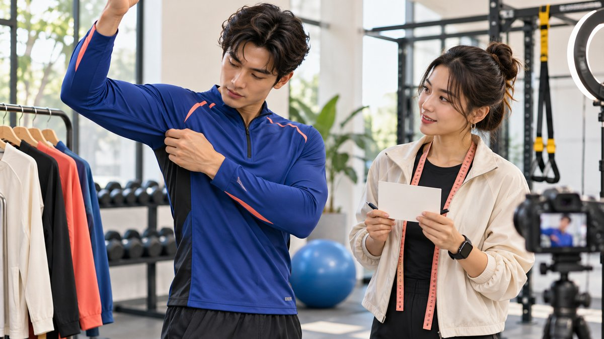

# Gym Apparel Brands: Plan a Creator Fit Conversation

Status: local review draft; confirm the publication date before release.

Separate a creator fitting conversation from public endorsement. Let the wearer confirm questions, conditions and sharing boundaries before turning actual feedback into a content assignment.

When gym apparel brands arrange creator fittings, first establish whether the session concerns private product feedback, camera rehearsal or content intended for publication. These can relate without being interchangeable: receiving a sample, sharing a feeling or agreeing to try it on does not automatically endorse every claim or authorize every image. Prepare accurate product and sizing references, let the wearer explain actual experience and boundaries, then agree which observations belong in creator content. This guide offers no body judgment, health outcome or universal fit guarantee.

## Give the session a defined purpose

Explain what the brand wants to learn before inviting the creator. The purpose might be understanding how the wearer describes a cut, identifying a construction detail needing explanation or preparing questions for future filming, rather than immediately requesting an endorsement line.

Separating private feedback from public work supports a more honest conversation. The creator knows which comments inform internal improvement, and the brand does not treat one fitting as a completed endorsement.

The [creator fit-record method](https://www.quickkol.com/blog/gym-clothing-brands-kol-fit-test/#answer) addresses a reviewable demonstration. This article comes earlier, examining agreement on the conversation's scope; if filming follows, define the shots and deliverables separately.

Give the creator an opportunity to confirm interest and required conditions. A specific question avoids the ambiguity of come try it and we will film something while you are here, and helps select appropriate participants. It also prevents a useful feedback session from being judged against an unstated expectation that it should produce a publishable recommendation before anyone has discussed one.

If a second session is needed, identify the unresolved question it addresses rather than restarting every topic or silently expanding the previously agreed sharing boundary.

## Use sizing references without judging a body

Confirm the style and label, then explain whether the reference contains body measurements, garment measurements or the brand's recommendation. Identical letters in different records should not automatically receive identical meanings.

[Nike’s dual-sizing guide](https://www.nike.com/size-fit/mens-dual-sizing) explicitly uses body measurements in its chart. This is a specific manufacturer's reference, not a universal rule or a direct statement of every garment's finished width.

Ask what the creator is willing to share instead of requesting unrelated body information for filming. Product cut and personal preference can be discussed without making value judgments about appearance, weight or identity.

If the sizing reference is unclear, the brand should check with its product owner rather than ask the wearer to prove suitability by guessing. Retain facts needed for the assignment without building an unrelated body-data collection. The conversation should help explain how this person experienced this product under these conditions, leaving other people's sizing choices to an appropriate reference and their own needs.

## Let the wearer describe specific experience

Let the creator describe looseness, adjustment needs and the movements or layers affecting the experience in their own words. The brand can ask for detail without immediately converting every sentence into a selling point.

Separate preference from observable facts. Finding a cuff tight is one person's experience; its visible position is a particular wearing condition. Neither automatically establishes how everyone will experience the garment.

Allow an unresolved answer. A short fitting, a different sample state or an unfamiliar use setting can limit what the wearer knows; retain that limit instead of demanding an immediate positive review.

Preserve the meaning of feedback internally. If it later becomes public content, have the creator confirm the expression rather than clipping half a sentence into an unconditional endorsement. A useful conversation can identify a question for another session, even when it does not yield a concise quotation suitable for an advertisement. The absence of that quotation does not make the feedback unhelpful.

Retain the wearer’s conditions and meaning before agreeing which observations belong in public content.

## Agree the conversation and camera choices separately

If filming is needed, explain its purpose, who will review it and which details the creator can confirm. People present for private feedback should not automatically receive or publish all material.

Discuss the setting and actual actions so the wearer can choose a demonstration they can naturally perform. A supposedly more persuasive shot should not require an unwanted angle, movement or clothing change.

The [gym wardrobe-continuity method](https://www.quickkol.com/blog/gym-fashion-creator-wardrobe-continuity/#answer) explains recording a filming state. Continuity should serve accurate expression rather than prevent the wearer from requesting an adjustment; document the corresponding change to clothing or camera work.

These are collaboration recommendations, not a legal conclusion about every contract. Specific use still needs an explicit agreement, and receiving a finished film does not establish permission for any new purpose. Addressing this before the camera starts gives production a clearer task and lets useful feedback remain a conversation instead of an unexpected requirement to perform an advertisement. It also reduces unnecessary reshoots caused by assumptions nobody confirmed.

## Assign product facts and care conditions

The brand should confirm material, construction and care information instead of asking the creator to identify composition by touch. Similar-looking samples need not share labels or instructions.

[Patagonia’s wool-care guide](https://www.patagonia.com/stories/guides/care-repair/how-to-wash-merino-wool/story-168066.html) emphasizes the particular garment label and fabric conditions. It provides an example of product-specific reference material, not one washing method for every gym garment.

If another fitting is planned, retain whether the sample was washed, adjusted or replaced. The purpose is explaining conditions of the experience, not presenting care as an unsupported durability test.

The product owner answers factual questions while the creator describes first-hand experience. Both can acknowledge unknowns instead of making one meeting prove every performance claim or letting footage replace absent product support. Clear responsibility makes the session more useful: the wearer need not improvise technical answers, and the brand receives feedback connected to an identifiable product state rather than a generalized claim about an entire clothing category.

## Reconfirm expression before a public endorsement

[FTC’s influencer-disclosure guide](https://www.ftc.gov/business-guidance/resources/disclosures-101-social-media-influencers) discusses actual experience, support and material relationships in its United States context. Turning private fitting feedback into a public recommendation should not remove the experience conditions and commercial background together.

Have the creator confirm that the final expression still reflects their experience. A brand can correct a product fact without rewriting a reservation into an outcome that never happened.

Gifting a sample, lending one and purchasing production are different arrangements whose actual relationship needs clarity. This article does not automatically treat any as a publishing commitment; confirm obligations through the real agreement.

If a recommendation is unsuitable, retain internal feedback or adjust the assignment. Not every valuable wearing conversation must become public praise, and a genuine limit may help improve product explanation. Separating these outcomes also makes a future invitation clearer: the creator can understand whether the brand wants feedback, a demonstration or an endorsement instead of discovering that the three have been silently combined.

## Hypothetical case: move from cuff feedback to a content question

Imagine a brand asking a creator to try a blue top and discuss the cuff during ordinary movements. They first agree that the session is private feedback, with public content undecided.

The creator finds the cuff tighter with a particular layer but experiences it differently when worn alone. The brand retains the conditions and product version instead of turning half the comment into comfortable with anything or treating one person's view as every customer's experience.

If filming follows, discuss the action, usable images and commercial context separately. The appropriate owners confirm sample state and product facts.

This editorial example contains no client conclusion or fit benchmark. It shows a fitting conversation producing a better explanation question without needing to produce an endorsement, body assessment or performance certification immediately. The next assignment can be more precise because the initial discussion preserved what the wearer actually meant, including the condition that made the feedback useful.

## Use feedback states to plan the next step

After the session, separate explained points, questions needing product information, matters needing more experience and material unsuitable for publication. States organize work rather than score the creator.

Assign owners and reasonable timing to follow-up. Participating in one fitting should not automatically create unlimited repeat sessions or ongoing record-maintenance duties.

Share only necessary information. Body or personal details unrelated to the explanation should not enter a public handover, and a larger production team should not automatically expand the sharing scope.

Even without filming, record which question the conversation helped clarify. That supports a decision about continuing the partnership instead of misclassifying unpublished feedback as an incomplete sponsorship. The record can be brief while remaining actionable: it identifies the unresolved product question, the person able to answer it and whether a later creative assignment is actually planned. This keeps a useful conversation from becoming an ambiguous obligation after everyone has left the fitting room.

## Use the fitting conversation to support a genuine contribution

Gym apparel brands need to understand how a wearer describes a product as well as obtain attractive footage. Private feedback, filming and endorsement each have a scope that should be clear before work starts.

Match sizing references to their actual object, retain conditions around feelings and confirm the intended use. One meeting need not yield every conclusion, and a creator should not guarantee suitability for every body.

Hand over specific questions, shareable evidence and next steps instead of an unconditional positive quotation. That can support a later explanation, revision or product-team answer.

With actual experience and clear arrangements together, a fitting is more likely to inform useful creator-marketing work. Whether to publish, how to express the experience and what future outcomes occur still need their own evidence and agreement. The practical success of the session is a clearer understanding of the product question and the contribution the creator is willing and able to make.

## Fitting-conversation boundaries

| Item | Confirm first | Do not infer |
| --- | --- | --- |
| Invitation | Private feedback or filming | Trying on is endorsement |
| Sizing | Reference unit and object | Letters match across brands |
| Experience | Personal conditions and meaning | One person represents everyone |
| Footage | Purpose and sharing scope | Attendance grants every use |
| Follow-up | Owner and actual work | Unlimited repeat duty |

Editorial collaboration recommendations, not a body assessment, laboratory test, legal contract conclusion or universal fit standard.

## Agree the conversation before choosing content

Confirm together before inviting a creator fitting.

- [ ] State the question for the session.
- [ ] Separate feedback and filming.
- [ ] Prepare accurate product and size references.
- [ ] Retain the wearer’s meaning and conditions.
- [ ] Confirm publishable footage and expression.
- [ ] Assign follow-up questions.

## Research date and limitations

Sources reviewed November 19, 2026. Methods, tables and decision rules are editorial recommendations. Hypothetical examples are not actual client results or industry benchmarks. Source geography and periods are specified where relevant.

## Start creator research with a clear task

Use QuickKOL to interpret a brief, discover relevant creators and research their work and contact routes. Verify data, commercial terms and outcomes at their source.

[Explore QuickKOL](https://www.quickkol.com/#capabilities)

## Sources

- [Nike’s dual-sizing guide](https://www.nike.com/size-fit/mens-dual-sizing)
- [Patagonia’s wool-care guide](https://www.patagonia.com/stories/guides/care-repair/how-to-wash-merino-wool/story-168066.html)
- [FTC’s influencer-disclosure guide](https://www.ftc.gov/business-guidance/resources/disclosures-101-social-media-influencers)
