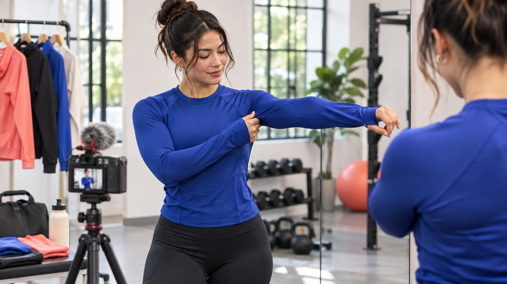
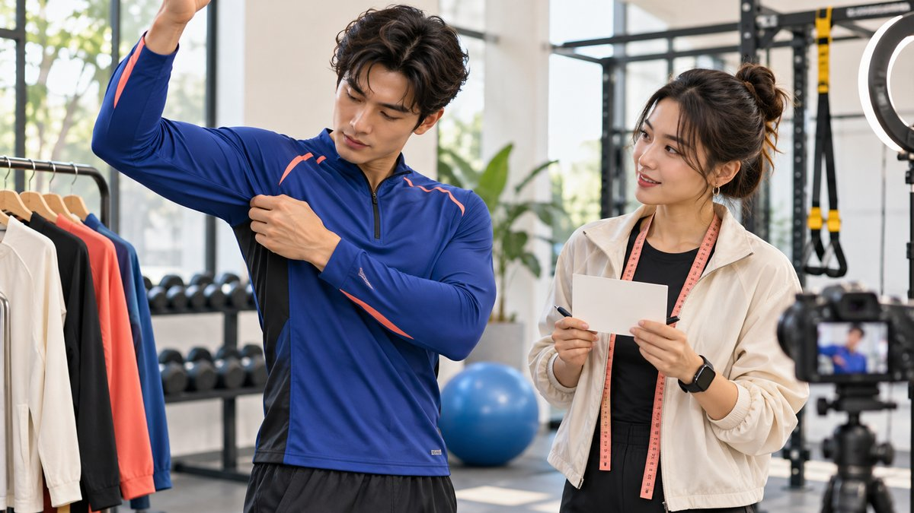

# 健身服品牌怎样安排达人试穿沟通

状态：本地审阅稿；正式发布日期待确认。

把达人试穿沟通与公开推荐分开。先让穿着者确认问题、场景与可分享范围，再将真实反馈变成可以继续讨论的内容任务。

Gym apparel brands 与达人安排试穿时，先确认这是私人商品反馈、镜头排练，还是准备公开的内容。三者可以有关联，但收到样衣、说过感受或同意试穿，都不自动等于认可全部卖点或允许公开所有画面。品牌应准备准确商品与尺码资料，让穿着者说明真实感受和表达边界，再约定哪些观察适合转成达人作品。本篇不作身体评价、健康效果或普遍合身保证。

## 先给这次会面一个明确目的

邀请前说明品牌希望了解什么。可以是确认穿着者怎样理解版型、讨论某个结构是否需要解释，或为未来拍摄准备问题，不必直接要求一段推荐口播。

把私人反馈与公开内容区分，可以让双方更诚实地讨论。创作者知道哪些意见用于内部改善，品牌也不会把一次试穿自动当成已经完成的背书。

[达人试穿记录方法](https://www.quickkol.com/zh/blog/gym-clothing-brands-kol-fit-test/#answer)讨论如何做可复核展示；本文位于更早一步，关注双方怎样确认沟通范围。若最终需要拍摄，再另行说明镜头与交付安排。

给创作者机会确认是否愿意参加，以及需要哪些条件。一个明确问题比“来试一下，顺便拍点内容”的模糊邀请更能避免误会，也更容易安排合适人员。

若需要第二轮，说明要解决哪个未完成问题。复访不必从全部项目重新开始，也不应把已确认的分享边界悄悄扩大。

## 用商品资料解释尺码，不评价身体

确认样品款式与标签，解释引用的是身体尺寸、成衣尺寸还是品牌自己的推荐。相同字母在不同资料中，不应被自动视为同样含义。

[Nike 的双尺码说明](https://www.nike.com/size-fit/mens-dual-sizing)明确其表格采用身体尺寸。这是某个具体品牌资料的例子，不是所有品牌的统一规则，也不能从该表直接推断每件衣服的实际宽度。

询问创作者愿意分享什么，避免为拍摄索取无关身体信息。商品版型与个人偏好可以讨论，不需要对外貌、体重或身份作价值判断。

若尺码资料不清，品牌先向产品负责人核对，不让穿着者靠猜测证明衣服合适。记录这次需要的事实即可，不建立与合作无关的人体资料档案。

## 让穿着者描述具体感受

先让创作者用自己的语言说明哪里宽松、哪里需要调整、哪种动作或叠穿条件影响感受。品牌可以追问细节，不必立即把每句话改成卖点。

把主观偏好与可见事实分开。例如觉得袖口紧，是某人的感受；画面里袖口位置，是特定穿着状态。两者都不能自动证明所有人会得到同样体验。

也允许没有明确结论。试穿时间短、样品状态不同或创作者不熟悉某种使用场景时，保留限制，不要求快速给出好评。

反馈原意应保留在内部记录里。后续要转成公开内容时，再让创作者确认表达，不能截取半句话让一个有条件意见变成无条件认可。

先保留穿着者的具体条件与原意，再确认哪些观察适合进入公开作品。

## 私人沟通与镜头选择分别确认

如果需要拍摄，提前说明画面用途、哪些人会查看，以及创作者可以确认哪些细节。私人反馈时在场的人，不应默认都能取得或公开全部素材。

讨论拍摄环境与实际动作，让穿着者选择能够自然完成的展示。不要为了所谓更有说服力的镜头，要求不愿意的角度、动作或衣着变化。

[健身造型连续方法](https://www.quickkol.com/zh/blog/gym-fashion-creator-wardrobe-continuity/#answer)讨论怎样保留拍摄状态；连续性应服务准确表达，而不是成为限制穿着者提出调整的理由。修改衣服或镜头后，记录相应变化即可。

这些是合作安排建议，不是替所有合同作法律判断。具体使用仍需双方明确约定，收到一个成片不代表任何新用途都已经获准。

## 把商品事实与护理条件交给负责人

品牌负责核对材质、结构与护理资料，不让创作者仅凭触摸猜测成分。样品外观相近，也不代表标签与要求完全相同。

[Patagonia 的羊毛护理说明](https://www.patagonia.com/stories/guides/care-repair/how-to-wash-merino-wool/story-168066.html)提醒按具体衣物标签与面料条件处理。这是某类商品资料的例子，不是所有健身服都应该采用相同洗护方法。

如果计划再次试穿，保留样品是否清洗、调整或更换等状态。目的在于解释本次感受条件，不是把护理过程包装成未经支持的耐久测试。

商品负责人回答客观资料，创作者说明亲身体验。双方都可以承认未知，避免把一次会面变成必须立即证实所有性能的场合，或让镜头替代缺少的产品依据。

## 公开推荐需要重新确认表达

[FTC 的达人披露指南](https://www.ftc.gov/business-guidance/resources/disclosures-101-social-media-influencers)在美国语境下讨论实际体验、依据与重要商业关系。私人试穿意见转成公开推荐时，不能把体验条件与合作背景一起删去。

创作者应确认最后表达仍对应自己的感受。品牌可以纠正商品事实，却不应把保留意见改成发生过某个并未发生的结果。

赠送样品、借用样品和购买制作服务是不同安排，需要说明实际关系。文章不将其中任何一种自动解释为已承诺发布；是否有义务仍按真实约定确认。

若最终不适合推荐，可以保留为内部反馈或调整合作任务。不是每一次有价值的穿着沟通都必须变成公开好评，真实限制也可以帮助品牌改进商品说明。

## 假设案例：从袖口反馈走到内容问题

假设品牌请创作者试穿蓝色上衣，想了解袖口在日常动作中的感受。双方先确认这是私人反馈，尚未确定公开作品。

创作者认为某种叠穿时袖口偏紧，但单独穿着感受不同。品牌记录条件与产品版本，不将半句话改成“任何穿法都舒服”，也不认为这个意见代表全部消费者。

如果后续决定拍摄，就另行讨论展示什么动作、哪些画面可用及如何说明商业关系。样品状态与商品事实由对应负责人确认。

这是编辑示例，没有实际客户结论或合身基准。它说明一次试穿沟通可以产生一个更好的解释问题，而不必直接产生推荐、身体评价或性能认证。

## 用反馈状态安排下一步

会后将问题分成已说明、需要商品资料、需要再体验与不适合公开。状态帮助安排工作，不是对创作者评分。

为需要补充的事项安排负责人和合理时间。创作者不应因为参与一次试穿，就被默认承担无限次重试或长期资料维护。

共享记录时只保留必要内容。与商品解释无关的身体或私人信息不应进入公开交接，也不因制作团队扩大而自动扩大分享范围。

如果最终没有拍摄，仍可记录这次沟通帮助改善了哪个问题。明确结果使双方更容易判断是否继续合作，而不是让未发布内容被误记为未完成的赞助任务。

## 让试穿沟通服务真实达人贡献

Gym apparel brands 的达人合作不只需要好看画面，也需要理解穿着者如何描述商品。私人反馈、拍摄与公开推荐各有范围，应在工作开始前说清。

让尺码资料对应实际对象，让感受保留条件，让使用范围得到明确确认。品牌无需从一次会面取得所有结论，也不应要求创作者为所有身体保证合适。

交接具体问题、可分享资料与下一步，比一份没有条件的好评更有用。它能支持后续解释、改稿或产品团队答复。

当真实体验与清楚安排共同存在，试穿才更容易转成有价值的达人营销内容。是否发布、怎样表达与未来效果，仍需要各自证据和实际约定。

## 试穿沟通与公开内容的边界

| 事项 | 先确认 | 不要自动推断 |
| --- | --- | --- |
| 邀请 | 私人反馈或拍摄 | 试穿就是背书 |
| 尺码 | 资料单位与对象 | 字母跨品牌相同 |
| 感受 | 本人条件与原意 | 一人代表所有人 |
| 画面 | 用途与可分享范围 | 在场即获全部使用 |
| 后续 | 负责人和实际工作 | 无限重试义务 |

编辑合作建议，不是身体评估、实验室测试、合同法律结论或普遍合身标准。

## 先确认沟通，再决定内容

邀请创作者试穿前一起确认。

- [ ] 说明这次要解决的问题。
- [ ] 区分反馈与拍摄安排。
- [ ] 准备准确商品与尺码资料。
- [ ] 保留穿着者原意与条件。
- [ ] 确认可公开的画面与表达。
- [ ] 给后续问题安排负责人。

## 研究日期与使用边界

资料核验于 2026 年 11 月 19 日。文中方法、表格和决策规则为编辑建议，标为假设的示例不是实际客户结果或行业基准。外部资料的适用地区与时期按各段说明。

## 从任务开始达人研究

用 QuickKOL 理解 Brief、发现相关达人并研究作品与联系路径；数据、合作条件和结果仍需核验。

[了解 QuickKOL](https://www.quickkol.com/#capabilities)

## 来源

- [Nike 的双尺码说明](https://www.nike.com/size-fit/mens-dual-sizing)
- [Patagonia 的羊毛护理说明](https://www.patagonia.com/stories/guides/care-repair/how-to-wash-merino-wool/story-168066.html)
- [FTC 的达人披露指南](https://www.ftc.gov/business-guidance/resources/disclosures-101-social-media-influencers)
