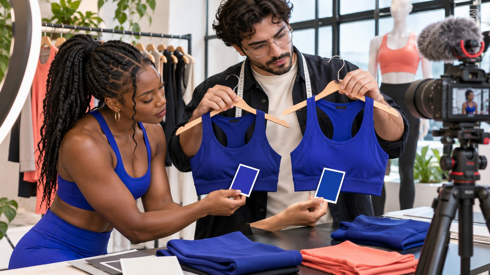
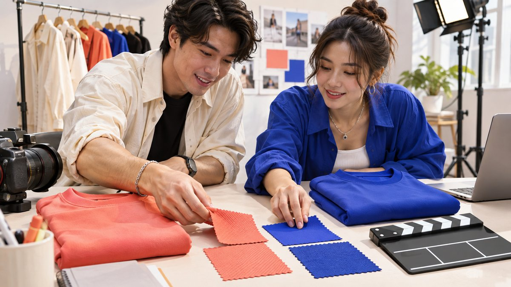

# Gym Wear Brands: Keep Product Versions Clear

Status: local review draft; confirm the publication date before release.

Do not identify apparel colour and size by appearance alone. Keep product options, the version actually worn and edit states aligned so captions, images and destinations describe the same item.

When gym wear brands commission creator content, align the style, colour, size and actual filmed sample before checking final captions and product destinations. A shared range does not make every version identical, and similar appearance does not prove product identity. Retain a traceable version record and recheck which facts survive grading and editing. This guide concerns product accuracy in creator marketing, without a universal cross-brand size rule or a guarantee that screen colour exactly matches the physical garment.

## Move from a style to its actual product options

Establish how the brand identifies the item. A style name can cover several colours and sizes, so the collaboration record needs to return to the actual option rather than only a range name.

[Shopify’s product-variant guide](https://help.shopify.com/en/manual/products/variants/add-variants) uses size and colour combinations to explain versions. It is a useful product-identity example, not proof that every merchant uses the same system or an instruction to modify a store backend.

Prepare a clear creator reference retaining the product owner's name or identifier and the name viewers encounter. An internal shorthand can map to a public name without being silently substituted for it.

This establishes the factual basis for later content. The creator need not memorize an inventory system; they need to know which item they are explaining, while production can connect footage to the right version. A small accurate reference is more useful than a broad catalogue that leaves the filming team uncertain about which nearly identical item was actually supplied.

## Record what was actually worn rather than only planned

The shooting plan might say a blue medium, but confirm what was worn on the day. A replacement, adjustment or mixed supporting item can make the footage differ from the original plan.

Retain enough physical reference to identify the sample and its shots without publishing every personal measurement. A label, brand confirmation and wearer statement can each establish different facts.

The [wardrobe-continuity method](https://www.quickkol.com/blog/gym-fashion-creator-wardrobe-continuity/#answer) preserves a filming state; here the question is which product option that state represents. Visual continuity does not establish that sample identity never changed.

If planned and actual versions differ, update the record before editing further. Do not preserve an incorrect size caption to keep documents tidy, or ask a creator to guarantee product information the brand has not checked. This makes the final expression answerable to what happened, rather than letting the earliest version of the plan outrank evidence from the actual session. It also lets a later editor distinguish a genuine product change from a harmless change in framing.

## Separate size labels from measurement explanations

[Nike’s dual-sizing guide](https://www.nike.com/size-fit/mens-dual-sizing) explicitly uses body measurements. It illustrates why the team should ask what a reference describes instead of assuming that centimetres or letters identify finished garment dimensions.

A creator saying which size they wore can describe personal experience without becoming advice that everyone with a similar height, body type or gender should choose it.

If sizing is explained, the brand supplies a current reference for the particular style and market. Comparability between ranges or regional versions requires confirmation; one brand's chart should not fill gaps for another.

Retain preference alongside label facts. A wearer preferring looseness does not change the label but can affect the experience described. Clear conditions are more dependable than an unverified universal recommendation. This also protects a later cut-down: removing the preference sentence may leave a size statement sounding like advice for everyone, so review the meaning of the shorter version rather than only whether the number was copied correctly.

## Do not rely on one editing preset for product colour

[Adobe’s photo-colour guide](https://helpx.adobe.com/lightroom/mobile/adjust-light-and-color/adjust-colors.html) describes adjustments including white balance, temperature, tint and saturation. These can change an image's rendering, so a more attractive colour is not automatically a more accurate physical match.

Production should check the actual product and an appropriate reference rather than grading one blue into another sold version while retaining the first name. Screens and viewing conditions also differ, so do not promise exact equivalence.

The brand can identify details important to purchasing understanding, the creator retains natural expression and the editor avoids letting an overall style change key product facts. A clearer shot may be preferable to excessive recolouring.

This is neither a requirement to use one software product nor a colour certification. The review question is whether the final colour description and product name remain supported by an actual reference. That question can be answered through a proportionate review without pretending every viewer's device displays the garment identically or that one preset settles product accuracy.

Confirm the actual product option before reviewing capture and edits; a swatch does not guarantee identical screen rendering.

## Keep captions and destinations on the same version

Check colour and size across the finished piece, title, description and purchasing destination. Updating one location can leave an old option elsewhere, creating information that looks natural but contradicts itself.

The [creator product-information path method](https://www.quickkol.com/blog/instagram-creator-commerce-question-to-product/#answer) examines the connection from content to product. Here confirm that the version a viewer encounters along that route still corresponds to the actual demonstration.

If a colour is unavailable, explain the condition or adjust the invitation instead of assuming another colour's destination preserves every recommendation. The brand owner confirms market and inventory facts.

Likewise, a model image, creator footage and product swatch are not identical kinds of evidence. Each serves a purpose, and captions should accurately identify what viewers are seeing. A viewer should not need to infer an unannounced substitution from a tiny product-page difference after being invited by a confident spoken description. Keeping the version explicit is part of the explanation rather than a detail to repair after publication.

## Recheck applicability before reusing assets

A brand may want the same footage on a page for another colour or size. First establish whether image and wording remain accurate instead of assuming shared construction makes every use appropriate.

[FTC’s influencer-disclosure guide](https://www.ftc.gov/business-guidance/resources/disclosures-101-social-media-influencers) emphasizes actual experience and supported expression in its United States context. Moving a wearer's account of one version onto another may change the conditions represented and needs review.

Confirm the asset-use arrangement too. This article does not determine a particular contract's legal meaning; the parties need to agree the accounts, period and purposes permitted.

Material suitable for reuse can be retained with a clear scope. Where it is unsuitable, arrange different work or revise appropriately rather than recolouring footage to make an unexperienced version appear personally worn. Product accuracy and permission are both necessary questions, but one does not answer the other: an authorized file can still carry a misleading version description, while an accurate description does not itself authorize a new use.

## Hypothetical case: avoid mixing two blue options

Imagine a brand offering dark-blue and bright-blue tops, with the creator actually wearing a bright-blue medium. The record says only blue, leading editing and product-page colleagues to select different versions.

This is an editorial example, not an actual incident report. The team adds the official colour name, size and physical reference, checks shots, captions and destination, and retains the earlier description as superseded.

If grading makes the blues hard to distinguish, return to the sample and reference instead of allowing visual preference to determine identity. The creator confirms that the experience still concerns the version worn.

The handover records which assets apply to which option and which versions remain unfilmed. A colour never worn does not become a claimed experience through editing. The example shows why a seemingly small label can affect the meaning of the complete recommendation, even when nobody intended to change the product being described.

## Give changes an owner and a clear record

When a sample, public name or destination changes, assign product facts to the product owner and affected assets to production. Each creator should not independently interpret an internal naming revision.

Record the reason, applicable version and confirmation time. Different screenshots can then be explained by their states instead of deleting an earlier record to conceal the change.

Give the creator an appropriate opportunity to confirm changes, particularly where experience, appearance or voiceover meaning is affected. A corrected product name should not quietly expand into a new endorsement.

With scope clear, the team can distinguish a caption update, destination correction and necessary additional filming. Not every small change requires recreating all material, but convenience does not justify retaining a known error. The record supports proportionate action by identifying which statement became inaccurate and which footage remains usable, rather than forcing the entire campaign into an unexplained replacement cycle.

Mark superseded files when sharing work so another editor does not select them again. An archive can preserve traceability while the working reference clearly identifies the version currently intended for use.

## Let the specific version support credible creator work

Creator assets for gym wear brands need the identity of the item being shown, not merely a range name. Colour, size, physical sample and final piece each have evidence to align at important handoffs.

Retain personal experience conditions instead of inferring every viewer's fit from a label. Check colour rendering without treating an editing preset as physical certification. Review use without extending one permission across every version.

The brand can then make a clearer assignment, and later colleagues know which assets belong with which product route. A follow-up question can concern a specific object rather than a vague complaint that the campaign looks inconsistent.

Version accuracy guarantees neither sales nor partnership performance, but reduces avoidable information confusion. A credible contribution comes from actual demonstration, truthful expression and brand facts supporting one another, rather than treating similar appearance as proof of sameness. That gives the content a reliable basis for publication and any later appropriately agreed adaptation.

## Map versions in creator assets

| Reference | Confirm | Misreading |
| --- | --- | --- |
| Style | Specific product identity | A range is one version |
| Colour | Name, sample and final image | Similar means identical |
| Size | Label and reference object | A letter fits everyone |
| Caption and destination | Match actual demonstration | One correction fixes everything |
| Reuse | Confirm facts and permission separately | Authorized means applicable everywhere |

Editorial accuracy framework, not universal sizing, colour certification or asset authorization.

## Connect the shot with the right item

Check before delivery and reuse.

- [ ] Confirm the style and official option names.
- [ ] Record the actual sample used.
- [ ] Separate labels from personal experience.
- [ ] Check whether grading changes product meaning.
- [ ] Review captions and destination together.
- [ ] Retain scope for changes and reuse.

## Research date and limitations

Sources reviewed November 19, 2026. Methods, tables and decision rules are editorial recommendations. Hypothetical examples are not actual client results or industry benchmarks. Source geography and periods are specified where relevant.

## Start creator research with a clear task

Use QuickKOL to interpret a brief, discover relevant creators and research their work and contact routes. Verify data, commercial terms and outcomes at their source.

[Explore QuickKOL](https://www.quickkol.com/#capabilities)

## Sources

- [Shopify’s product-variant guide](https://help.shopify.com/en/manual/products/variants/add-variants)
- [Nike’s dual-sizing guide](https://www.nike.com/size-fit/mens-dual-sizing)
- [Adobe’s photo-colour guide](https://helpx.adobe.com/lightroom/mobile/adjust-light-and-color/adjust-colors.html)
- [FTC’s influencer-disclosure guide](https://www.ftc.gov/business-guidance/resources/disclosures-101-social-media-influencers)
