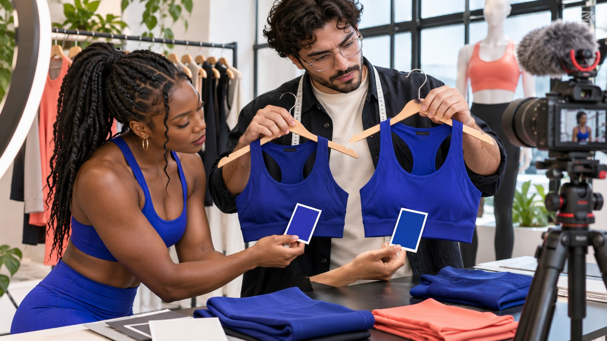
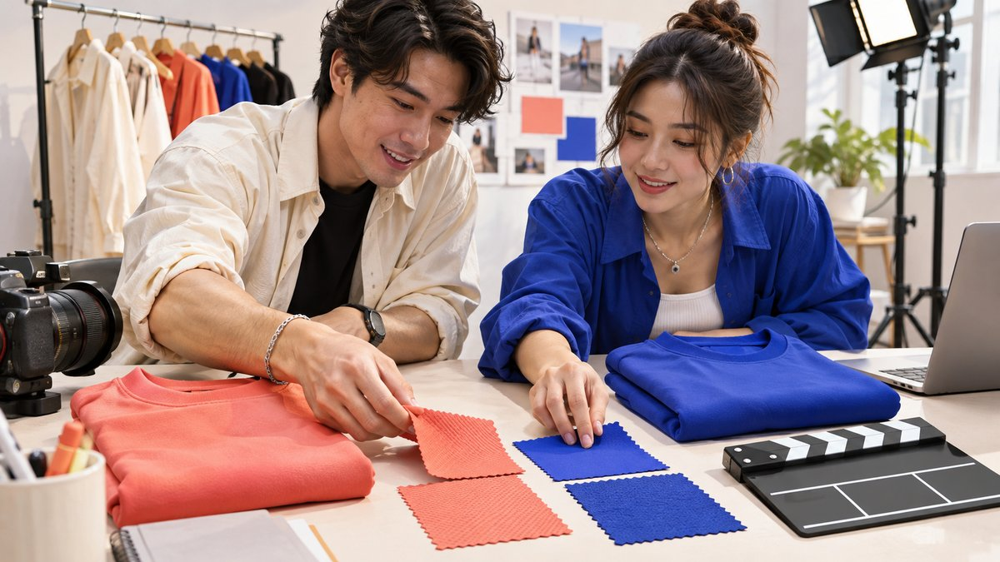

# 健身服达人素材怎样对应颜色尺码

状态：本地审阅稿；正式发布日期待确认。

同一款健身服的颜色与尺码不能只靠画面猜。为达人素材保留准确商品选项、实际穿着版本与剪辑状态，让标题、图像和购买入口说同一件商品。

Gym wear brands 制作达人内容时，应把款式、颜色、尺码和实际拍摄样品对应起来，再核对成片字幕与商品入口。同一系列不代表每个版本相同，画面看起来相似也不能证明商品身份。为素材保留可追溯的版本记录，调色与剪辑时再次确认哪些事实仍成立。本文关注达人营销的商品准确性，不提供跨品牌统一尺码或屏幕颜色完全等同实物的保证。

## 从款式进入具体商品选项

先确认品牌如何识别这件商品。款式名称可能对应多种颜色与尺码，合作文件需要能回到实际选项，而不是只写一个系列名。

[Shopify 的商品变体说明](https://help.shopify.com/en/manual/products/variants/add-variants)以尺码和颜色组合解释不同版本。这是商品身份的可用例子，不代表所有商家都使用相同系统，也不是要求读者改动商店后台。

为达人准备清楚的参考记录，保留商品负责人使用的名称或标识，以及观众看到的名称。内部简称与公开名称不同，可以对应，但不能悄悄混用。

这一步为后续内容建立事实基础。创作者不必背下库存系统，只需知道自己正在解释哪件商品，制作人员也能将镜头与正确版本对应。

## 记录实际穿着，而不是默认计划已执行

拍摄计划可以写蓝色中码，但当天实际穿着仍需确认。替换样品、临时调整或混用配套单品，都可能让成片与原计划不同。

保留足以识别的实物记录和对应镜头，不要求公开创作者全部个人尺寸。实际标签、品牌确认与穿着者说明可以各自提供不同事实。

[健身造型连续方法](https://www.quickkol.com/zh/blog/gym-fashion-creator-wardrobe-continuity/#answer)帮助保留拍摄状态；这里更关注状态对应哪个商品选项。造型看起来连续，不证明样品身份从未改变。

如果发现计划与实际不同，先更新记录再继续剪辑。不为了维持文件整齐而把错误尺码留在字幕，也不要让创作者为品牌尚未核对的商品信息作保证。

## 尺码标签与尺寸解释分别处理

[Nike 的双尺码说明](https://www.nike.com/size-fit/mens-dual-sizing)明确表格采用身体尺寸。它说明团队需要先问资料在描述什么，而不是看到厘米或字母就认定是成衣尺寸。

创作者说自己这次穿某码，可以对应个人实际穿着，不应直接推广为所有相似身高、体型或性别的人都应该选择同码。

若要解释商品尺码，品牌提供当前款式与市场适用资料。不同系列或地区版本是否可比，需要实际确认，不能用一个品牌表替另一个品牌填空。

个人偏好与标签事实同时保留。例如穿着者偏好宽松，不改变标签本身，但会影响体验描述。把这种条件讲清楚，比给每位观众一个未经核验的通用建议更可靠。

## 颜色呈现要核对实际商品

[Adobe 的照片颜色说明](https://helpx.adobe.com/lightroom/mobile/adjust-light-and-color/adjust-colors.html)介绍白平衡、色温、色调与饱和度等调整。它们可以改变照片呈现，因此颜色看起来更漂亮不等于更准确对应实物。

制作团队应按实际商品与合适参考核对，不把一种蓝色调成另一个现售版本，再沿用原名称。屏幕和观看条件也有差异，不作完全一致保证。

品牌可以说明哪些细节对购买理解重要，创作者保留自然表达，剪辑人员避免让整体风格改变关键商品事实。必要时选择更清楚的镜头而不是过度修色。

这不是要求所有读者使用某个软件，也不是提供颜色认证。文章关注审阅问题：成片中的颜色描述与商品名称，是否仍能被实际参考支持。

先确认实际商品选项，再检查拍摄与编辑呈现；布样不是屏幕完全一致的保证。

## 字幕与商品入口需要同一版本

在成片、标题、说明与购买入口中核对颜色和尺码。只改了一处，其他地方仍可能保留旧选项，形成看似自然却互相矛盾的信息。

[达人商品信息路径方法](https://www.quickkol.com/zh/blog/instagram-creator-commerce-question-to-product/#answer)讨论从内容到商品的完整关系。这里要确认观众沿路径看到的版本，是否仍对应画面中的实际展示。

若某颜色暂时不可售，可以说明实际条件或调整邀请，不默认用另一个颜色入口代替后仍能沿用全部推荐。市场与库存事实由品牌负责人确认。

同样不要把模特图、创作者实拍和商品色卡混当成完全相同证据。它们有各自用途，字幕应准确说明观众正在看到什么。

## 素材复用前再次核对适用范围

品牌可能希望把同一段素材用于另一种颜色或尺码的商品页。先判断画面与说法是否仍准确，不因服装结构接近就默认全部可复用。

[FTC 的达人披露指南](https://www.ftc.gov/business-guidance/resources/disclosures-101-social-media-influencers)在美国语境下强调实际体验与有依据表达。把某人对实际穿着版本的感受移到另一个版本上，可能改变原话所代表的条件，需要重新核对。

同时确认素材使用安排。文章不替具体合同作法律结论；实际允许哪些账号、时期与用途，需要由合作方明确约定。

适合复用的内容可以保留，但附上清楚范围。不适合的部分另作拍摄或调整，不用后期改色让一个未体验版本看起来像创作者实际穿过。

## 假设案例：两种蓝色怎样避免混用

假设品牌有深蓝与亮蓝两种上衣，创作者实际穿亮蓝中码。制作记录只写“蓝色”，剪辑和商品页人员因此选用了不同版本。

这是编辑示例，不是实际错误报告。团队补上正式颜色名称、尺码与实物参考，再核对对应镜头、字幕和目的地，把旧描述保留为已替换记录。

如果调色让两种蓝色难以区分，先回到实际样品与参考，不让视觉偏好决定商品身份。创作者确认体验仍对应自己穿过的版本。

最终交接保留哪些素材可用于哪个选项，以及尚未拍摄的版本。没有亮相的颜色不被写成已体验，也不通过后期修改制造不存在的穿着事实。

## 给变更一个负责人和清楚记录

样品、公开名称或购买入口变化时，安排商品负责人确认事实，制作负责人更新受影响内容。不要让每位创作者独自判断内部命名变更。

记录修改原因、适用版本与何时确认。后续出现不同截图时，可以说明它们对应的状态，而不是删除旧记录来掩盖变化。

也给创作者适当确认机会，特别是体验、本人出镜或配音的含义被改变时。商品名称修正不应悄悄扩展为新的背书内容。

范围清楚后，团队能判断是字幕更新、目的地调整还是确需补拍。不必为每个小变更重做全部素材，也不能为省事而保留已知错误。

共享文件时标明旧版已被替换，避免另一个剪辑人员再次取用。保留归档可以追溯，但对外工作入口应清楚指出当前采用哪版。

## 让具体版本支持可信达人内容

Gym wear brands 的达人素材需要准确到正在展示的商品，而不是停留在系列名称。颜色、尺码、实物与成片各有资料，应在关键交接点对应。

保留个人体验条件，不用标签推断全部人群；核对颜色呈现，不用编辑预设认证实物；检查用途，不把一次许可扩成任何版本都能复用。

品牌据此向创作者提出更清楚任务，后续团队也知道哪些素材可以进入哪些商品路径。需要补充时，问题能够落到具体对象。

准确版本并不保证销量或合作效果，但能减少本可避免的信息混乱。达人营销的可信贡献，来自实际展示、真实表达和品牌事实互相支持，而不是看起来相近就默认相同。

## 达人素材的版本对应

| 资料 | 确认事项 | 常见误读 |
| --- | --- | --- |
| 款式 | 具体商品身份 | 系列等于单一版本 |
| 颜色 | 名称、样品与成片 | 相近即相同 |
| 尺码 | 标签与资料对象 | 字母代表所有人 |
| 字幕入口 | 对应实际展示 | 只改一处就完成 |
| 复用 | 事实与许可各自确认 | 获准即全部适用 |

编辑准确性框架，不是统一尺码、色彩认证或素材使用授权。

## 把镜头对应到正确商品

在交付与复用前核对。

- [ ] 确认款式与正式选项名称。
- [ ] 记录当天实际样品。
- [ ] 区分标签与个人体验。
- [ ] 检查调色是否改变商品含义。
- [ ] 同步核对字幕和目的地。
- [ ] 为变更与复用保留明确范围。

## 研究日期与使用边界

资料核验于 2026 年 11 月 19 日。文中方法、表格和决策规则为编辑建议，标为假设的示例不是实际客户结果或行业基准。外部资料的适用地区与时期按各段说明。

## 从任务开始达人研究

用 QuickKOL 理解 Brief、发现相关达人并研究作品与联系路径；数据、合作条件和结果仍需核验。

[了解 QuickKOL](https://www.quickkol.com/#capabilities)

## 来源

- [Shopify 的商品变体说明](https://help.shopify.com/en/manual/products/variants/add-variants)
- [Nike 的双尺码说明](https://www.nike.com/size-fit/mens-dual-sizing)
- [Adobe 的照片颜色说明](https://helpx.adobe.com/lightroom/mobile/adjust-light-and-color/adjust-colors.html)
- [FTC 的达人披露指南](https://www.ftc.gov/business-guidance/resources/disclosures-101-social-media-influencers)
