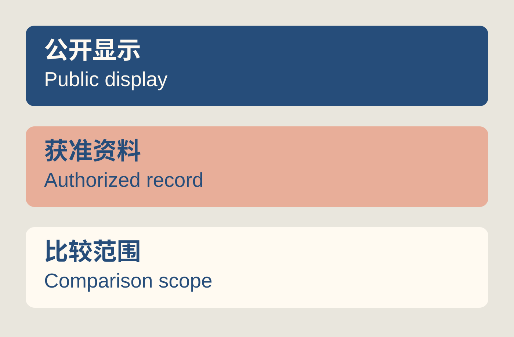

# Hide Instagram Likes Without Losing Review Context

Status: local review draft; confirm the publication date before release.

Before a creator publication, distinguish public-count visibility from personal activity controls, then confirm the actual setting and review record so a display choice does not become a partnership dispute.

How to hide Instagram likes first requires separating two choices: hiding the public count on your own content, or hiding counts you see on other people’s posts. Meta’s historical explanation describes both, but the owner should confirm the current controls in the official app. In creator marketing, agree display preferences and appropriate review evidence beforehand. Hiding a count does not mean deleting engagement, concealing every like activity or removing commercial context, and cannot automatically establish better or worse performance.

## Establish the reason for changing the display

A creator may want attention on the work or simply a different personal viewing experience. Clarify the desired change without assuming a psychological condition or treating the display choice as evidence of content quality.

The brand needs to understand the sponsored publication's presentation and the evidence available for review, rather than control every aspect of the creator's personal app use.

Raise the question during the brief so different expectations about public totals do not appear only after release. Keep discussion specific to the piece and its observation arrangements instead of turning it into general approval of all account settings.

Where no business reason requires a particular display, retain the creator's choice. A clearly agreed preference is easier to execute than a last-minute demand because a screenshot looks different from what someone imagined. It also respects the actual scope of the partnership, leaving unrelated browsing preferences with the account owner rather than treating the collaboration as permission to manage their entire experience.

## Confirm own-post and viewing preferences separately

[Meta’s like-count control announcement](https://about.fb.com/news/2021/05/giving-people-more-control/), published in May 2021, distinguishes public counts on one's own pieces from counts seen while viewing others' posts, and describes choices before or after publication.

This is a dated source for the concept, not a complete current menu map for every account. Do not guarantee a button position from an old screenshot or assume an account is restricted because an entry differs.

The owner should make the choice in the official app. Establish the object being changed, read the actual option and check the preview or resulting visibility, without transferring credentials to the brand.

If the matching control is unavailable, consult current official help and actual account availability. Do not try a third-party tool to reproduce an article's route, or mistake a viewing preference for confirmation that one's own count is hidden from everyone. The useful procedure is understanding and checking the selected control, not blindly repeating a historical sequence of taps.

## Count visibility and personal activity are different controls

[Meta’s Friends activity-control announcement](https://about.fb.com/news/2025/08/new-instagram-features-help-you-connect/) in 2025 describes the Friends tab in Reels and controls for hiding one's own like and comment activity or muting activity bubbles. Its object differs from the public like total on one piece.

Hiding the count on your own publication therefore should not be interpreted as ensuring nobody can ever see what you liked. Changing activity display does not mean the other person's publication count changes either.

Use accurate wording such as public-count display on this piece rather than all likes hidden. That reduces handoff confusion and avoids a comprehensive privacy guarantee the evidence does not establish.

This guide does not require inspection of a creator's private browsing or engagement history. Discuss only settings relevant to the commissioned publication; the owner manages other aspects of their experience through the actual official controls. The distinction matters because a vague privacy request can otherwise expand a narrow campaign question into unrelated monitoring, while still failing to clarify which display the brand intended to review.

## Agree the review evidence before publication

If a brand genuinely needs a measure, explain its purpose, object and observation window, then discuss what the creator can appropriately provide. Do not treat a public screenshot as the only valid evidence or assume full backend access is necessary.

[Meta’s Insights API overview](https://developers.facebook.com/docs/insights/overview) explains that metrics depend on objects and permission scopes. Confirm public display and authorized evidence availability separately; an invisible total does not establish that every backend record has been deleted.

The [hidden-like reporting guide](https://www.quickkol.com/blog/hide-instagram-likes-kol-reporting-audit/#answer) further discusses representing missing fields in a report. This article focuses on agreement before release so the team knows what it expects to receive and what may remain unavailable.

The arrangement can be simple: one piece, a defined period, required fields and their source. If review later adds a requirement, discuss the scope again instead of imposing an unexplained data duty after delivery. Clear preparation reduces pressure to change personal settings merely because the team did not plan its evidence request in time.

Agree display choices and evidence scope first; an invisible public count is not a conclusion about outcomes or motives.

## A display choice does not replace commercial context

Hiding a like count does not change whether the work involves payment, gifting or another partnership. Information needed to understand the relationship should not disappear because the interface shows one fewer number.

[FTC’s influencer-disclosure guide](https://www.ftc.gov/business-guidance/resources/disclosures-101-social-media-influencers) emphasizes clear material relationships in its United States context. Confirm the relevant market and format rather than treating an account setting as the entire disclosure arrangement.

During review, check product facts, actual experience and commercial context together. A display preference can be documented separately without becoming a reason to rewrite the creator's experience.

Nor should the brand request additional engagement to make the public presentation appear more popular. Expression and relationships need clarity, while count visibility is another bounded question that can be addressed alongside them. Keeping these tasks separate prevents a technical preference from obscuring the substantive information viewers need, and keeps campaign feedback focused on work the creator and brand can actually confirm.

## Do not promise a performance effect from hiding

Meta's historical announcement describes differing responses to hidden counts. It does not support a claim that hiding necessarily increases reach, relieves pressure for everyone or makes every viewer focus more closely on the work.

Likewise, if performance changes after hiding, the setting should not automatically receive all causal credit. Content, distribution, audience and observation periods may differ, so retain alternative explanations.

If the team wants to learn about the effect of display choices, define its question and observable evidence first, acknowledging conditions it cannot exclude. A routine before-and-after comparison is not automatically a causal finding.

Creators can choose a suitable public presentation while brands retain limited observations. Neither an algorithm guarantee nor a psychological promise is needed to justify the choice, and the creator should not bear certain responsibility for an uncontrollable change. A useful review distinguishes the choice made from the outcome observed, then identifies what more would be needed before linking them.

## Hypothetical case: agree the choice before release

Imagine a homeware creator preferring not to show the sponsored piece's public like count, while the brand planned to review a public-page screenshot. They identify the evidence expectation difference before filming.

This editorial example contains no actual account outcome. The creator checks the piece's available display control in the official app; the brand explains the aggregate and observation period it needs, and both confirm what can appropriately be supplied.

Production retains product facts and the commercial relationship rather than changing the recommendation because a count is hidden. If a field proves unavailable, mark it accordingly instead of entering zero or estimating from another piece.

The handover records the display choice, evidence arrangement and owner. The partnership can then be reviewed without mistaking a personal preference for refusal to cooperate after release, or demanding the entire account to fill one field. Preparing the distinction early preserves a workable relationship while keeping the eventual report honest about its limitations.

## Retain the actual timing of a display change

If the display changes after publication, record when the choice was made and which state earlier screenshots show. Observation time and setting-change time differ; a later interface should not retrospectively explain every old record.

The owner confirms the actual action while the brand updates its evidence note. Historical screenshots need not be deleted for consistency, and a later preference should not be presented as having existed since release.

The [Instagram view-comparison method](https://www.quickkol.com/blog/instagram-views-creator-format-comparison/#answer) emphasizes retaining format and delivery conditions. Display state is one contextual item, not a replacement for content version, observation window or the field's actual definition.

If visibility is restored later, the owner should again check the available control. This process concerns traceable communication without promising a permanent menu or requiring continuous monitoring of private settings. A short record of the relevant change is enough to prevent contradictory screenshots from becoming an unnecessary dispute about the creator's intentions or the integrity of the entire campaign. Include the observation time and the display being checked so a later reader understands the screenshot's actual scope.

## Keep the hidden-like question within its proper scope

In a creator partnership, how to hide Instagram likes requires a defined object, an actual choice and an evidence arrangement. Own-post counts, viewing preferences and personal activity controls each have their own scope.

Brands and creators can clarify expectations before release and review appropriate evidence afterwards. Where a public figure is unavailable, retain the limit instead of inferring performance or motive from the gap.

Commercial context, actual experience and responsibility for account access remain separate matters. A display switch cannot remove those tasks or guarantee an effect.

Leave control with the owner and make evidence requests specific to reduce unrelated disputes. The intended outcome is still a clear, truthful, reviewable creator assignment rather than a uniform judgment about everyone's personal display preferences. The practical next step is confirming what this piece will show and what its review will use, with the rest of the account experience kept outside the commissioned task.

## Three distinct hiding questions

| Object | Concern | Does not replace |
| --- | --- | --- |
| Own-post count | The total shown to others | All activity privacy |
| Viewing other posts | Personal viewing preference | The other account’s settings |
| Friends activity | Like/comment activity display | Post-count control |
| Partnership review | Appropriate source and window | Full account access |
| Commercial context | Relationship and actual experience | An interface switch |

Editorial distinctions; confirm current controls in the actual official account. No comprehensive privacy or performance guarantee.

## Confirm display and evidence before release

Apply to this assignment without expanding into whole-account management.

- [ ] Define which object is being hidden.
- [ ] Have the owner check actual official controls.
- [ ] Separate count and activity display.
- [ ] Agree required fields and window.
- [ ] Retain commercial context and actual experience.
- [ ] Record change timing and evidence limits.

## Research date and limitations

Sources reviewed November 19, 2026. Methods, tables and decision rules are editorial recommendations. Hypothetical examples are not actual client results or industry benchmarks. Source geography and periods are specified where relevant.

## Start creator research with a clear task

Use QuickKOL to interpret a brief, discover relevant creators and research their work and contact routes. Verify data, commercial terms and outcomes at their source.

[Explore QuickKOL](https://www.quickkol.com/#capabilities)

## Sources

- [Meta’s like-count control announcement](https://about.fb.com/news/2021/05/giving-people-more-control/)
- [Meta’s Friends activity-control announcement](https://about.fb.com/news/2025/08/new-instagram-features-help-you-connect/)
- [Meta’s Insights API overview](https://developers.facebook.com/docs/insights/overview)
- [FTC’s influencer-disclosure guide](https://www.ftc.gov/business-guidance/resources/disclosures-101-social-media-influencers)
