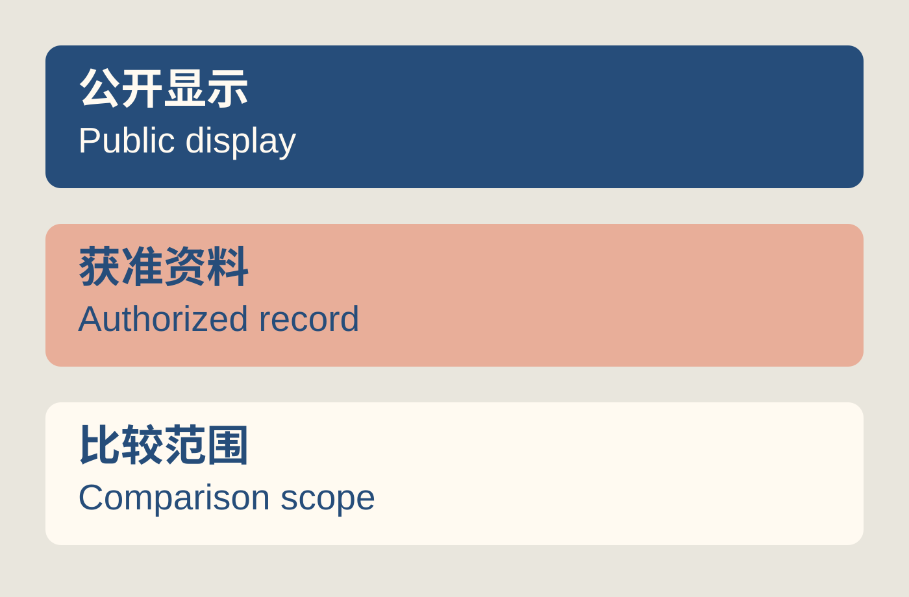

# 隐藏点赞后怎样保留合作复盘

状态：本地审阅稿；正式发布日期待确认。

发布达人合作前，先说清隐藏的是公开总数还是个人互动活动，再核对实际账号中的设置与审阅资料，避免把显示偏好变成合作争议。

How to hide Instagram likes 首先要区分两件事：隐藏自己作品向他人显示的点赞总数，或不在自己的浏览界面看到别人作品的总数。Meta 的历史说明介绍了这两种选择，但当前菜单应由账号所有者在官方应用中确认。对达人营销，还需提前约定公开显示偏好与适当复盘资料；隐藏总数不等于删除互动、隐藏所有点赞活动，或取消商业关系说明，也不能自动证明表现改善或变差。

## 先确认为什么要改变显示

创作者可能希望观众更关注作品，也可能只想调整自己的浏览体验。先把需要的变化说清楚，不替对方假设心理状态，也不把显示选择当作作品好坏的证据。

品牌需要知道的，是合作发布将呈现什么、哪些资料可用于复盘，而不是要求控制创作者全部个人使用习惯。

在 Brief 阶段提出这个问题，可以避免发布后才发现双方对公开总数有不同期待。讨论应具体到作品与观察安排，不需要变成对账号所有设置的普遍审批。

若没有业务理由要求某种显示，保留创作者选择即可。一个清楚约定的显示偏好，比临时因截图不符合想象而要求改设置更容易执行，也更尊重实际合作范围。

## 自己作品与浏览偏好分别确认

[Meta 的点赞显示控制说明](https://about.fb.com/news/2021/05/giving-people-more-control/)发表于 2021 年 5 月，区分自己作品的公开总数与浏览他人作品时看到的总数，并介绍发布前后可作相应选择。

这是功能概念的有日期来源，不是所有账号今天的完整菜单图。不要根据旧截图给出保证相同按钮位置，也不因为某个入口不同就认定账号被限制。

确认动作应由账号所有者在官方应用完成。先确定正在处理哪个对象，阅读实际选项，再核对预览或发布后的可见状态；不需要把凭证交给品牌。

如果找不到对应功能，先查看当前官方帮助与账号可用情况。不要为完成文章里的路径去尝试第三方工具，也不要把别人的浏览偏好误认为自己的作品已经向所有人隐藏了总数。

## 总数显示与个人活动不是同一设置

[Meta 的 Friends 互动控制公告](https://about.fb.com/news/2025/08/new-instagram-features-help-you-connect/)在 2025 年介绍 Reels 的 Friends 标签页，以及隐藏自己的点赞、评论活动和静音活动提示等控制。它讨论的对象不同于某条作品的公开点赞总数。

因此，隐藏自己的作品总数，不应被解释为其他人永远看不到你点过什么；调整活动显示，也不等于对方作品的总数改变。

合作团队应使用准确描述，例如本条内容公开总数的显示，而不是笼统写“全部点赞隐藏”。这能减少交接误会，也避免提供不存在的全面隐私保证。

本篇不要求检查创作者私人浏览与互动记录。只有与本次发布相关的设置需要讨论；其他账号体验仍由所有者在实际官方入口中管理。

## 发布前约定可交付资料

品牌如果确实需要某项数据，应说明用途、对象与观察窗口，讨论创作者可以适当提供什么。不把公开截图当成唯一有效资料，也不默认要取得全部后台访问。

[Meta 的 Insights API 概述](https://developers.facebook.com/docs/insights/overview)说明指标依赖对象与权限范围。公开显示与获准资料的可用性需要分别确认，不能因为看不到总数就推断后台一切信息都被删除。

[隐藏点赞报表审阅指南](https://www.quickkol.com/zh/blog/hide-instagram-likes-kol-reporting-audit/#answer)进一步讨论缺失字段如何在报告里表达。本篇侧重发布前约定，让团队知道会拿到什么，哪些仍可能不可得。

约定可以简单：某条作品、特定时期、所需字段与资料来源。复盘若临时增加需求，重新讨论适当范围，而不是让创作者在交付后承担没有说明过的数据义务。

先约定显示选择与资料范围；公开总数不可见，不是结果或动机的结论。

## 显示偏好不能替代商业说明

隐藏点赞总数不改变内容是否属于付费、赠品或其他合作。观众理解关系所需的说明，不能因为界面少了一个数字就省略。

[FTC 的达人披露指南](https://www.ftc.gov/business-guidance/resources/disclosures-101-social-media-influencers)在美国语境下强调重要关系应清楚表达。具体市场与形式需相应确认，不能只把某个账号设置当作全部披露安排。

品牌审稿时，将商品事实、真实体验与商业背景一起核对。显示偏好可以单独记录，不应变成要求创作者修改实际体验的理由。

同样不要为了让公开画面显得更受欢迎而要求额外互动。合作的表达与关系需要清楚，数字是否公开则是另一个有范围的问题，两者可以同时处理。

## 不要承诺隐藏后表现一定改变

Meta 的历史公告说明人们对隐藏总数有不同感受。这不支持品牌宣称隐藏必然提升触达、减轻每个人压力，或证明所有观众更专注作品。

同样不能因为隐藏后某条作品表现变化，就把原因全部归给设置。内容、分发、受众与观察期都可能不同，需要保留解释边界。

若团队希望学习显示选择的影响，先明确问题与可观察资料，并承认无法排除的其他条件。不把普通前后比较自动称为已经建立因果。

创作者可以选择适合自己的公开呈现，品牌也可以保留有限观察。无须用算法保证或心理效果承诺来证明这个选择合理，更不应让达人为不可控制的变化承担确定责任。

## 假设案例：在合作发布前确认选择

假设一位家居创作者希望合作作品不公开点赞总数，品牌原本计划截取公开页面复盘。双方在拍摄前发现了资料预期差异。

这是编辑示例，没有实际账号效果。创作者在官方应用核对本条内容的实际显示选项，品牌说明需要哪项汇总及观察期，双方确认可适当提供的范围。

制作仍保留商品事实与商业关系，不因为总数隐藏而改变推荐内容。若某项资料最终不可得，就在报告里标明，不填零，也不借别条作品推算。

交接说明显示选择、资料安排与负责人。这样合作可以正常审阅，而不必在发布后把个人偏好误解成拒绝配合，或要求交出整个账号来补一个字段。

## 变更设置时保留实际时间

如果发布后才改变显示，记录何时作出选择，以及此前截图对应什么状态。观察时间与设置变化时间不同，不能用后来的界面反向解释所有旧记录。

账号所有者确认实际动作，品牌更新自己的资料说明。无需为了统一历史截图而删除原记录，也不要伪造某个设置从发布开始就一直存在。

[Instagram 观看口径比较方法](https://www.quickkol.com/zh/blog/instagram-views-creator-format-comparison/#answer)提醒团队保留形式与分发条件。显示记录只是其中一项背景，不应让它取代作品版本、观察窗口或实际指标定义。

后续需要恢复显示时，同样由所有者核对实际可用控制。这个流程关注可追溯沟通，不承诺任何菜单永远不变，也不要求团队持续监控创作者私人设置。

## 把隐藏点赞问题留在准确范围

How to hide Instagram likes 在达人合作中，需要明确对象、实际选择和资料安排。自己作品总数、浏览偏好与个人活动控制各有范围。

品牌与创作者可以在发布前说清期待，之后用适当资料复盘；看不到公开数字时，保留局限，而不是从缺口推断表现或动机。

商业背景、真实体验与账号访问责任仍分别处理。一个显示开关既不能取消这些事项，也不能保证某种效果。

把控制权留给所有者，把需要的资料说具体，团队就能减少无关争论。最终要完成的仍是一项清楚、真实、可审阅的达人内容合作，而不是对每个人的个人显示偏好作统一评价。

## 三个容易混淆的隐藏问题

| 对象 | 关心什么 | 不能替代 |
| --- | --- | --- |
| 自己作品总数 | 他人看到的总量显示 | 全部活动隐私 |
| 浏览他人作品 | 自己的浏览偏好 | 对方账号设置 |
| Friends 活动 | 点赞评论活动呈现 | 作品总数控制 |
| 合作复盘 | 适当来源与窗口 | 整个账号访问 |
| 商业背景 | 关系与真实体验 | 界面开关 |

编辑区分，当前可用控制须在实际官方账号中确认；不保证完整隐私或效果。

## 发布前确认显示与资料

用于这次合作，不扩展为全部账号管理。

- [ ] 确定隐藏哪一种对象。
- [ ] 由所有者核对官方实际选项。
- [ ] 区分总数与活动显示。
- [ ] 约定需要的字段与窗口。
- [ ] 保留商业关系与真实体验。
- [ ] 记录变更时间和资料限制。

## 研究日期与使用边界

资料核验于 2026 年 11 月 19 日。文中方法、表格和决策规则为编辑建议，标为假设的示例不是实际客户结果或行业基准。外部资料的适用地区与时期按各段说明。

## 从任务开始达人研究

用 QuickKOL 理解 Brief、发现相关达人并研究作品与联系路径；数据、合作条件和结果仍需核验。

[了解 QuickKOL](https://www.quickkol.com/#capabilities)

## 来源

- [Meta 的点赞显示控制说明](https://about.fb.com/news/2021/05/giving-people-more-control/)
- [Meta 的 Friends 互动控制公告](https://about.fb.com/news/2025/08/new-instagram-features-help-you-connect/)
- [Meta 的 Insights API 概述](https://developers.facebook.com/docs/insights/overview)
- [FTC 的达人披露指南](https://www.ftc.gov/business-guidance/resources/disclosures-101-social-media-influencers)
