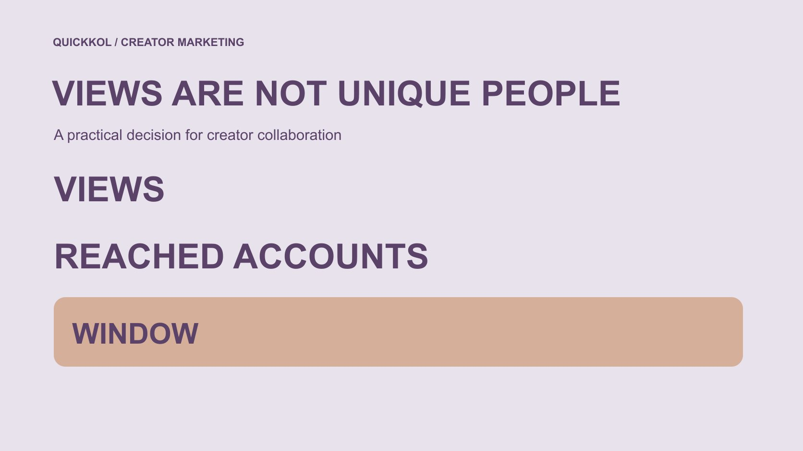
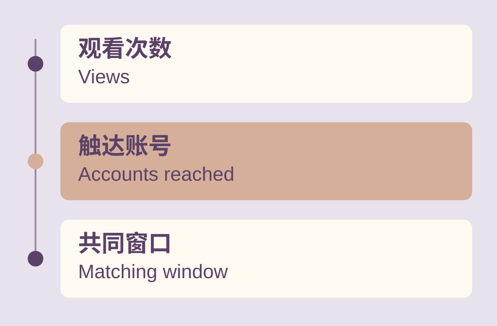

# IG Views: Compare Creator Formats Carefully

Status: local review draft; confirm the publication date before release.

Before comparing creator IG views, retain field definition, content format and distribution state. Viewing actions, accounts reached and business outcomes are not interchangeable.

QuickKOL editorial graphic; not actual account metrics or a platform interface.

Before IG views enter a creator comparison, establish what the field counts in this report, which content it concerns and which period it covers. A shared views label does not make Reels, photographs, Stories, public counters and tool exports identical records, nor do viewing actions automatically represent independent people. Build a comparable group before judging whether the work fulfilled its task instead of substituting one universal view threshold for the partnership decision.

## Define why the brand is comparing views

The brand might be deciding which explanation to produce again, which form suits a question or whether to add distribution. Different decisions require different information and comparison conditions.

The [social-metrics decision method](https://www.quickkol.com/blog/social-media-metrics-creator-decision-tree/#answer) helps establish the question first. If the goal concerns understandable product explanation, ranking view totals cannot directly measure understanding.

Place the assignment beside the counter: demonstrate operation, explain conditions, answer a question or supply event context. Views provide distribution context rather than proof that all those jobs were completed.

This also shapes the request. Start with relevant work and an appropriate window instead of asking the creator for every account record. A clear purpose lets the count serve the decision, rather than the largest available number determining what the team asks. It gives reviewers a reason to retain a lower-viewed piece when it contains a useful explanation, while leaving open whether another form would distribute that explanation more effectively.

## Separate the current field from historical labels

[Meta’s Reels-replay announcement](https://about.fb.com/news/2023/11/new-ways-to-create-content-on-instagram/) said in November 2023 that Reels Plays had been updated to include Initial Plays and Replays. This dated example shows how a definition change itself can affect a count.

An old Plays report and a tool's present Views field therefore should not be joined solely because their names sound similar. Retain actual definition, retrieval time and tool explanation to establish whether the basis changed.

Some Instagram help pages were inaccessible during this research, so this article did not verify one complete current definition for every account and format. Execution requires the actual report explanation rather than treating a historical announcement as a current operating manual.

If the definition is missing, put that limitation into the comparison. A team should not acknowledge uncertainty about a field and then calculate an apparently precise improvement while omitting the conditions readers need. The appropriate result can be a description of separately observed values without asserting that they measure an identical action.

## Check the action and deduplication basis separately

First establish whether the metric counts plays, displays, replays or another action, then check any explicit deduplication scope. A field labelled accounts reached should also be read through the definition supplied with that record, not completed from habit.

Accounts do not necessarily correspond one-to-one with people, and repeated actions are not different viewers. Aggregation across work, accounts or platforms needs an identified deduplication basis rather than addition presented as a total population.

Where a ratio needs a denominator, retain its unit and period. Missing reach is not zero, and follower stock from another period should not silently replace audience information for the review window.

A brand can present several metrics side by side, each answering its own question. There is no need to compress every action into an ambiguous audience-size ranking and then use it as a promised partnership value. Separate columns are often more honest and more useful than a score whose components no longer describe comparable observations.

Similar labels and equal quantities do not establish matching units, deduplication or observation conditions.

## Do not assume native and tool records are identical

[Meta’s Insights API overview](https://developers.facebook.com/docs/insights/overview) describes obtaining particular metrics for a specific object, with permissions and access levels involved. A tool displaying some information does not establish access to every native field or every account.

Before comparison, label public-page information, authorized creator-supplied analytics and tool exports. If the tool adds estimates or aggregation, retain that explanation instead of treating uniform table formatting as identical origin.

The brand need not implement an interface or surrender access tokens. Ask the supplier of information to explain field, source, window and available scope, then decide whether comparison is justified.

If two records for one piece differ, check those conditions before deciding somebody supplied incorrect information. A tool and a native report may each accurately describe a different scope. The gap needs explanation rather than one larger value overwriting the other. This keeps the review focused on meaning and avoids turning a formatting preference into a supposed factual correction.

## Build a comparable group before crossing formats

Organize work by form, assignment, publication timing and distribution state before deciding what belongs together. Not every figure needs to enter the same ranking.

A short demonstration and photograph-based explanation can serve different jobs. If the aim is understanding a condition of use, review whether each explains the essential facts, then examine distribution context separately. Equal view totals do not establish equal value.

Within a form, check length, content stage and observation period too. Lifetime accumulation on an older publication is not an automatically fair comparison with a shorter window on new work.

Retain a not directly comparable label with its reason. This does not abandon measurement; it limits the comparison to the question it can answer. Revise the conclusion when more consistent records arrive rather than filling the table with an unsourced universal benchmark. A defined comparison group is also easier to hand over, because another analyst can see why an apparently similar piece was excluded and whether that reason still applies.

## Retain trial and regular distribution states

[Meta’s Trial Reels explanation](https://about.fb.com/news/2024/12/trial-reels-try-content-non-followers-first-see-what-perfoms-best/) describes showing content to non-followers first and notes that some followers can encounter it through other routes. It is therefore neither a private review mode nor a randomized audience experiment.

When comparing a creator's trial with a regular publication, record actual state and whether it was subsequently shared more broadly. Identical content does not establish identical viewing opportunity or audience conditions.

The [Trial Reels result-interpretation method](https://www.quickkol.com/blog/instagram-trial-reels-result-interpretation/#answer) examines those boundaries further. A brand can use the observations to raise the next creative question without using two view totals to prove a version superior for every audience.

Where the partnership includes advertising reuse, confirm actual delivery records and asset permission separately. Technical distribution, commercial approval and creator delivery are different matters. A visible promotion option should not become an agreement the team never obtained. Keeping these states together with the view record helps a reviewer explain which work was actually distributed and which additional use remains a proposal.

## Use hypothetical work to explain why a ranking may be inappropriate

Imagine a Reel and a set of photographs each recording 1,000 actions under a field labelled views. These values are an exercise, not platform averages or client results.

Without definitions for both forms, the team can only record the values separately. Even after definitions are explained, assignment and observation conditions matter; do not announce equal performance first.

The brand can still inspect factual accuracy, clarity of essential visuals and whether an appropriate destination supports the next action. Without connecting evidence, every concurrent website order should not be attributed to these pieces.

The example demonstrates judgement rather than complex arithmetic. Equal quantities with different units and conditions do not become comparable by giving them the same column heading. Resolve meaning before choosing a calculation. This protects a creator whose work fulfilled a different task and helps the buyer identify what additional observation would genuinely improve the comparison instead of asking for a larger but equally ambiguous total.

## Deliver the comparison as a limited recommendation

A conclusion should state the comparison group, basis and exclusions together. It may recommend further investigation of an explanatory structure without promising more views or sales.

If a figure's origin remains unclear, specify which judgements will not rely on it. Factual mistakes can still be corrected and properly completed production can still be acknowledged; one unknown metric need not cover every part of partnership performance.

Preserve the records and versions actually cited rather than silently replacing the review window with later lifetime totals. When information is added, state which conclusions change and which remain uncertain.

The next brief owner needs to know what to retain, what to examine and who confirms it. Where stakeholders want a single winner, explain which common decision the candidates actually share before proposing a score. A convenient ranking cannot create comparability that the observations lack. A ranking without reasons is difficult to turn into creator-content improvement or an explanation of different assignments. An evidence-backed recommendation can be modest while remaining actionable, because it identifies the specific decision supported and the observation that would justify another change.

## Finish with definitions rather than a universal threshold

The brand-side value of IG views is context about how work was viewed, rather than an unsupported pass mark for every creator. Different goals, forms and distribution conditions need different explanations.

This article supplies no universal cross-format view benchmark and does not rename public counters independent people. Actual fields and permissions depend on current records; historical announcements explain why definition changes matter.

QuickKOL can help brands interpret a task and research relevant creators' work. Data, permission and outcomes still need verification at their source; product positioning cannot establish real-time measurement of every account.

Hand over the question, definition, observation window, content assignment and next action together. Views can then provide a limited but useful basis rather than an apparently precise partnership conclusion nobody can explain. The final test is whether another reviewer can understand what was counted and why it matters for this assignment, including which stronger claims the available evidence does not support.

## Definitions needed for a creator-view comparison

| Dimension | Record | Avoid |
| --- | --- | --- |
| Field | Actual name and definition | Merging similar labels |
| Content | Form, task and version | Universal cross-format ranking |
| Period | Release time and review window | Mixing lifetime and short-window counts |
| Source | Native, public or tool | Uniform display means identical scope |
| Distribution | Trial, regular and actual ad state | Count differences prove causation |

Editorial comparison framework; a universal current field definition was not verified for every account. Inspect the actual record explanation.

## Before using views in a review

Connect the figure to the assignment.

- [ ] Define the decision it supports.
- [ ] Retain field and source explanation.
- [ ] Distinguish actions and deduplication scope.
- [ ] Group by form and observation window.
- [ ] Record trial and paid-distribution states.
- [ ] Deliver a limited recommendation and open questions.

## Research date and limitations

Sources reviewed November 19, 2026. Some Instagram help pages returned access limits, so no universal current view definition across accounts, formats and tools is claimed. Meta’s 2023 announcement illustrates a historical definition change; execution requires the actual report. Methods are editorial recommendations and numerical examples are hypothetical, not client outcomes.

## Start creator research with a clear task

Use QuickKOL to interpret a brief, discover relevant creators and research their work and contact routes. Verify data, commercial terms and outcomes at their source.

[Explore QuickKOL](https://www.quickkol.com/#capabilities)

## Sources

- [Meta’s Reels-replay announcement](https://about.fb.com/news/2023/11/new-ways-to-create-content-on-instagram/)
- [Meta’s Insights API overview](https://developers.facebook.com/docs/insights/overview)
- [Meta’s Trial Reels explanation](https://about.fb.com/news/2024/12/trial-reels-try-content-non-followers-first-see-what-perfoms-best/)
