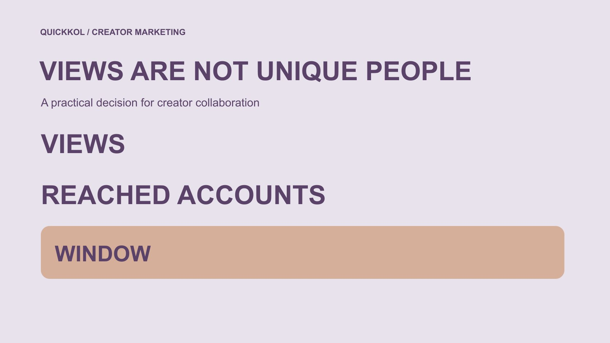
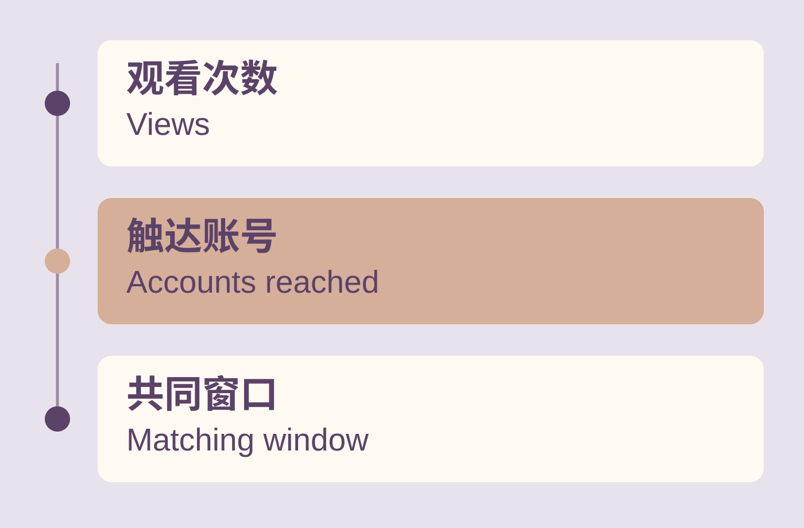

# Instagram 观看数怎样跨内容比较

状态：本地审阅稿；正式发布日期待确认。

品牌比较达人作品的 IG views 时，先保留字段定义、内容格式与分发状态。观看动作、触达账号和商业结果不能互相替代。

QuickKOL 编辑图形；不呈现真实账号指标或平台界面。

IG views 的数字进入达人比较前，先问这份报表中的字段具体计算什么、针对哪条内容、覆盖哪个时期。不要仅凭“观看”二字，把 Reel、照片、Story、公开计数与工具导出当作同一种资料；观看动作也不能自动当成独立人数。品牌应先建立可比较组，再讨论内容是否完成任务，而不是用一个统一观看门槛替代合作判断。

## 先说明品牌为什么比较观看

品牌可能需要判断哪段解释值得继续制作、哪种形式更适合某项问题，或是否应该追加分发。不同决定，需要的资料和比较条件不同。

[社交指标决策方法](https://www.quickkol.com/zh/blog/social-media-metrics-creator-decision-tree/#answer)帮助先确定问题。若目的是看产品说明是否容易理解，就不能只按观看总量排序，再把排名当成理解程度的直接证据。

把拟购或已交付作品的任务放在计数旁：演示操作、解释条件、回应疑问或提供活动背景。观看可以提供传播背景，但不是这些任务全部完成的证明。

这也影响资料请求。团队可以先核对相关作品和适当窗口，而不要求创作者提供所有账号资料。清楚的比较目的，让计数为决定服务，而不是让报表中最大的数字决定团队应该问什么。

## 把当前字段与历史名称分开

[Meta 的 Reels 重播指标说明](https://about.fb.com/news/2023/11/new-ways-to-create-content-on-instagram/)在 2023 年 11 月表示，Reels Plays 更新为包含首次播放与重播。这个带日期的例子说明，指标定义改变本身就可能影响数量。

因此旧报告上的 Plays 与今天某个工具写的 Views，不应仅按名称相近直接拼接。保存实际定义、取得时间与工具说明，确认是否存在口径变化。

本文研究时，部分 Instagram 帮助页读取受限，没有核验出适用于所有当前账户和格式的完整统一定义。执行时需要查看实际报表说明，而不是套用历史公告作当前操作手册。

如果定义缺失，就把这项限制写进比较。不能一边承认字段不清楚，一边继续用它计算看起来精确的提升比例，并省略读者最需要知道的条件。

## 观看动作与去重范围分别确认

先看指标是否计算播放、展示、重播或其他动作，再看有没有明确的去重范围。标为触达账号的字段，也应按这份资料的实际定义理解，不凭习惯补全。

账号与人不是必然一一对应，重复动作也不等于不同观众。跨作品、跨账户或跨平台汇总，更需要知道系统是否已经去重，而不是直接相加成总人数。

如果某项比率需要一个分母，就保留它的单位与时期。缺失的触达不能当零，另一个时期的粉丝数也不能悄悄替代相应窗口的观众资料。

品牌可并列展示不同指标，让它们各自回答问题。不必为了做出单一排名，将所有动作压成一个含义模糊的“受众规模”，再把这个数字写进合作价值承诺。

相似名称与相同数量不保证单位、去重范围或观察条件一致。

## 分开核对原生页与工具导出

[Meta 的 Insights API 概述](https://developers.facebook.com/docs/insights/overview)说明，接口围绕具体对象取得特定指标，并涉及权限与访问层级。工具能够显示某些资料，不代表它能提供全部原生字段或所有账号的数据。

比较前记录资料来自公开页面、创作者获准分享的后台，还是工具导出。若工具另做估计或汇总，也应保留说明，不把外观统一的表格当成完全相同来源。

这里不要求品牌编写接口或交出访问令牌。只需让提供资料的人说明字段、来源、窗口和可用范围，接收者据此决定是否能比较。

同一条作品的两份数据不同，先核对这些条件，不急于判断谁提供错误。工具与原生记录可能各自正确地描述不同范围，差异需要解释，而不是用一个较大数字覆盖另一个。

## 先在相近形式里建立比较组

可以先按内容形式、任务、发布时间与分发状态组织作品，再决定哪些项目适合放在一起。不是所有数字都有必要进入同一个排名。

例如，短片演示与照片说明可能承担不同任务。若目标是理解一种使用条件，先审阅两者是否讲清关键事实，再分别看各自传播背景，而不是假定总观看相同就价值相同。

同一形式内也要检查时长、内容阶段和观察期。发布后的累计总量，与新稿较短窗口的数量，不是自然公平的比较。

保留不宜直接比较的标记，并说明原因。这不是放弃衡量，而是把比较限制到它能回答的问题；后续若取得更一致资料，再更新结论，不需要先用无来源的统一行业门槛填满表格。

## 保留试用与常规分发状态

[Meta 的 Trial Reels 说明](https://about.fb.com/news/2024/12/trial-reels-try-content-non-followers-first-see-what-perfoms-best/)介绍先向非粉丝展示的安排，也说明部分粉丝可能通过其他路径看到内容。因此它不是私密审稿模式，也不应被当作随机分组实验。

比较同一创作者的试用内容与常规发布时，记录实际状态和后续是否向更多人分享。内容相同，不代表观看机会与受众条件相同。

[Trial Reels 结果解读方法](https://www.quickkol.com/zh/blog/instagram-trial-reels-result-interpretation/#answer)进一步讨论这些边界。品牌可以用资料提出下一步创意问题，却不能仅凭两个观看总数，证明某一版本对所有受众都更好。

如果合作还包括广告复用，也分别确认实际投放记录与作品许可。技术分发、商业批准与创作者交付是不同事项，不要因为看到了一个推广选项，就在报告里补上一份从未取得的同意。

## 用假设作品比较说明为什么不排名

假设一条 Reel 与一组照片都记录了 1,000 次某个标为观看的动作。数字仅用于演练，不是平台平均值或客户结果。

若报表没有交代两种格式的定义，团队只能分别记录所见值。即使口径已经解释，也要看任务与观察条件，不应先宣布两份作品表现一样。

品牌可继续检查解释是否准确、必要画面是否清楚，以及观众下一步是否有合适去处。没有连接证据时，不把同期网站订单全部归到这两份作品。

这个例子展示的不是复杂计算，而是拒绝错误等式的能力。相同数量、不同单位与条件，不能通过把表头改成同一个名称就变得可比。先解决意义，才决定是否需要计算。

## 把比较结果交付为有限建议

结论应同时说明比较组、依据与不适用范围。例如可以建议继续研究某类讲解结构，但不必承诺它必然获得更多观看或销售。

如果一项数字来源尚不清楚，就明确哪些判断暂不依赖它。内容中的事实错误可以继续修正，正确完成的制作也可以确认，不让一个未知指标覆盖全部合作表现。

保存实际引用的记录和版本，不将后来的累计总量悄悄覆盖原复盘窗口。补充资料时说明哪些结论因此改变，哪些仍保持不确定。

负责下一期 Brief 的人，需要知道要保留什么、测试什么和由谁确认。若负责人希望选出单一胜者，先说明候选作品究竟共享哪项决策条件，再考虑评分。排名方便，不会让原本不同口径的观察自动可比。只有排名没有理由，就难以将数据变成实际达人内容改进，也难以解释为何不同作品获得不同安排。

## 用明确口径而不是统一门槛完成复盘

IG views 的品牌侧价值，在于帮助理解作品被观看的背景，而不是为每位达人设一个没有依据的统一及格数。目标、格式与分发不同，数字需要的解释也不同。

本篇没有提供跨格式通用观看基准，也没有把公开计数写成独立人数。实际字段与权限以当前资料为准，历史公告只用于说明为什么定义变化值得保留。

QuickKOL 可以帮助品牌理解任务并研究相关创作者的作品；数据、许可与结果仍需在来源核验，不能从工具定位推导全账户实时测量保证。

把问题、定义、观察窗口、作品任务与下一步一起交接，观看数就能成为有限但有用的依据，而不是一个看起来精确、实际却无法解释的合作结论。

## 达人观看比较的必要口径

| 维度 | 记录什么 | 避免什么 |
| --- | --- | --- |
| 字段 | 实际名称与定义 | 名称相似就合并 |
| 内容 | 格式、任务与版本 | 跨格式统一排名 |
| 时期 | 发布时点与观察窗口 | 累计与短窗口混比 |
| 来源 | 原生、公开或工具 | 界面统一就是同一口径 |
| 分发 | 试用、常规与实际广告状态 | 数量差就是因果效果 |

编辑比较框架；本次未核验所有账户当前统一字段，执行时需查看实际说明。

## 使用观看数前的复盘清单

让数字与作品任务对应。

- [ ] 明确它要支持哪项决定。
- [ ] 保存实际字段与来源说明。
- [ ] 区分动作与去重范围。
- [ ] 按格式与窗口建立比较组。
- [ ] 记录试用与付费分发状态。
- [ ] 交付有限建议与未解问题。

## 研究日期与使用边界

资料核验于 2026 年 11 月 19 日。部分 Instagram 帮助页本次返回读取限制，因此没有宣称核验所有账户、格式与工具的当前统一观看定义。Meta 2023 年公告用于说明历史口径变化，具体执行需核对实际报表。方法为编辑建议，数字示例为假设，不是客户结果。

## 从任务开始达人研究

用 QuickKOL 理解 Brief、发现相关达人并研究作品与联系路径；数据、合作条件和结果仍需核验。

[了解 QuickKOL](https://www.quickkol.com/#capabilities)

## 来源

- [Meta 的 Reels 重播指标说明](https://about.fb.com/news/2023/11/new-ways-to-create-content-on-instagram/)
- [Meta 的 Insights API 概述](https://developers.facebook.com/docs/insights/overview)
- [Meta 的 Trial Reels 说明](https://about.fb.com/news/2024/12/trial-reels-try-content-non-followers-first-see-what-perfoms-best/)
