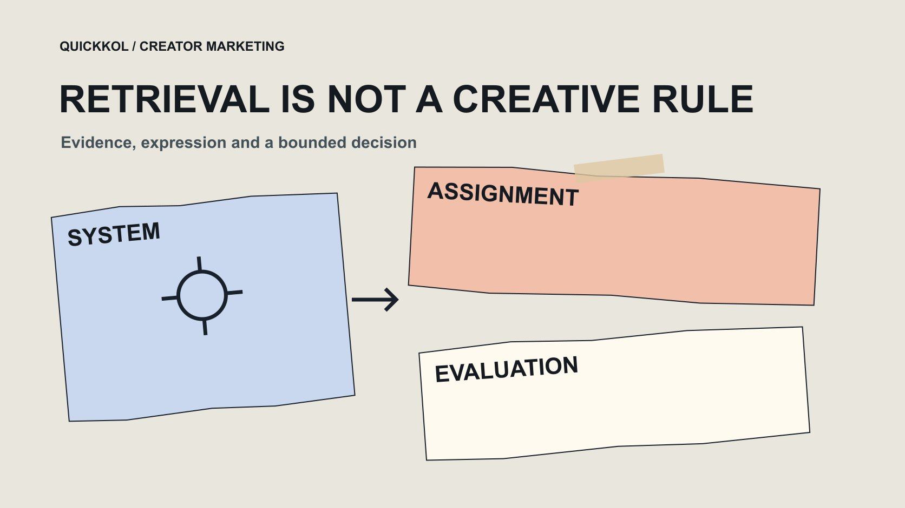
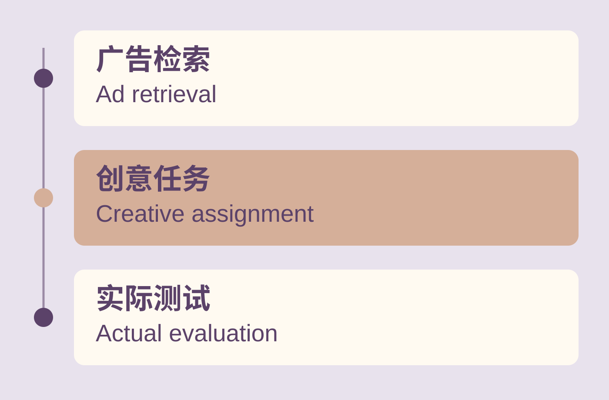

# Meta Andromeda: Interpret Creator Ad Implications

Status: local review draft; confirm the publication date before release.

Andromeda is ads-retrieval technology, not a creator formula. Understand the official scope before commissioning distinct contributions, appropriate permissions and explainable evaluation around audience questions.

QuickKOL editorial graphic; not actual account metrics or a platform interface.

Andromeda Meta refers to Meta’s machine-learning system for personalized ads retrieval. Its 2024 explanation places retrieval early in a multi-stage ads recommendation process; the 2026 update continues model, system and hardware co-design. It is not one universal algorithm for organic Instagram content and does not translate directly into a fixed creator-asset quantity every brand must purchase. For creator marketing, distinguish official technical facts from editorial recommendations before planning audience questions, different contributions, appropriate use and actual evidence.

## Understand what ads retrieval does

[Meta’s 2024 Andromeda engineering article](https://engineering.fb.com/2024/12/02/production-engineering/meta-andromeda-advantage-automation-next-gen-personalized-ads-retrieval-engine/) describes retrieval as the first stage of ads recommendation, narrowing a large candidate pool before more complex subsequent ranking. Retrieval and final display are not the same decision.

A brand need not learn chip implementation to prepare a creator brief. Preserve the technical object: ad candidates, rather than a promise that every creator receives organic distribution.

Nor should the system become an imagined single switch available to an account. The engineering explanation concerns internal platform work; actual advertising arrangements still require checking the account and product functions.

This makes the discussion more accurate. The brand can focus on clear product expression and genuine contributions instead of deriving a universal filming slogan from a technology name. The practical question is how to commission and evaluate appropriate ads, while the platform's retrieval machinery remains one part of the environment in which those ads may be considered.

## Read the 2026 update as system progress, not a purchasing quota

[Meta’s 2026 Andromeda update](https://engineering.fb.com/2026/10/28/ml-applications/meta-andromeda-next-gen-ads-retrieval-gpu-co-design/) continues model, system and GPU co-design, distinguishing production pipelines from component optimization. Processing efficiency and the quantity of assets a brand should purchase are questions at different levels.

Engineering scale, benchmarks and platform-reported effects should not become a promise of the same conversion improvement for this partnership. Observation objects, test scopes and campaign conditions differ.

This article derives no fixed asset quota, minimum creator count or guaranteed-success budget. If a supplier proposes a requirement, ask for the particular source and applicable conditions instead of accepting the name Andromeda as its basis.

The brief methods below are editorial recommendations, not newly issued Meta mandates. Separating technical facts from working implications makes it easier to judge whether a suggestion fits the current assignment. It also lets the team consider a useful idea without pretending the idea has official status merely because it is presented alongside a genuine engineering development.

Engineering capability does not directly create an asset quota; separate official facts, editorial recommendations and campaign evidence.

## Connect creative differences with distinct audience questions

Prepare directions such as an operational demonstration, a specific question response or actual use conditions. A difference should have explanatory meaning rather than merely changing the background, subtitle colour or creator name.

State what each direction helps viewers understand before finding someone who can genuinely contribute. Do not increase volume by asking creators to repeat unexperienced claims or label every edit an independent concept.

This has no guaranteed one-to-one relationship with retrieval technology. It simply makes procurement and evaluation clearer: the team knows why a version exists and which question to observe.

If one explanation is sufficient, complete an accurate version first. Additional work should supply information or a reasonable learning exercise, not automatically expand filming because a technical term is popular. The resulting plan can remain small or become broader according to the assignment; its scope needs a content reason rather than an unsupported claim that a system rewards a particular number of files.

Also distinguish a new concept from a delivery version. Horizontal, vertical or subtitled editions of one explanation may be necessary production without answering a new audience question. Name both kinds of work clearly so procurement understands whether additional files add an idea, adapt an existing expression or merely repeat a format already supplied.

## Select different contributions through actual work

Research actual expression, subject experience and willingness to perform the task. Contributions can complement one another without forcing every candidate into one style or universal score.

Someone explaining construction clearly and someone addressing common questions may supply meaningful differences. Identity, appearance or geography should not establish representation of an entire audience.

Give candidates a specific question and product reference, allowing an expression suited to their work. A reference points toward direction without requiring copied content or another person's use results to be claimed as their own.

Availability, production and actual conditions still need confirmation. Greater system capacity for ad candidates does not create creator time, first-hand experience or willingness to accept. This keeps discovery attached to real people rather than treating them as interchangeable inputs for a technical process. The brief should explain the contribution the brand values, not merely ask the creator to supply another file to increase the count.

## Automation does not change actual experience or commercial context

[FTC’s influencer-disclosure guide](https://www.ftc.gov/business-guidance/resources/disclosures-101-social-media-influencers) emphasizes actual experience, supported expression and material relationships in its United States context. An ads retrieval system cannot make an experience that never occurred factual.

The brand supplies accurate product references while the creator retains personal conditions and feelings. Versions should not express contradictory or unsupported effects merely to appear different.

If material comes from a brand commission, public expression should correspond to the actual arrangement and use. A natural tone should not make the audience think no commercial relationship exists.

Creative variety can arise from genuine questions and expression rather than invented results. Where support is missing, narrow the statement or obtain evidence instead of filming several versions of the same unsupported claim. This is a practical production choice as well as an accuracy principle: the team can spend its time improving an explanation rather than multiplying material that would all require the same factual correction before use.

## Confirm advertising use separately from the creative file

[Meta’s creator-marketplace announcement](https://about.fb.com/news/2024/02/creator-marketplace-for-brands-and-creators-to-collaborate-on-instagram/) in 2024 describes discovery and subsequent arrangements including partnership advertising. A defined workflow does not establish identical availability across all markets and accounts, or every use for a file already received.

The [creator-ad permission guide](https://www.quickkol.com/blog/what-is-whitelisting-creator-ad-permissions/#answer) distinguishes account authorization, asset use and the actual arrangement. Make account, period, channel and version clear to the parties instead of using a system update to justify wider permission.

Music, voice, appearance and other material also have scopes. An organic-publication version need not be ready for every ad use without review by the appropriate owner.

Record content approval and permission to advertise separately. Accuracy does not replace use confirmation, while authorization does not prove every factual claim accurate. Both tasks remain necessary. This gives the eventual media team a usable handoff rather than a folder of attractive files whose identity, commercial context or allowed purpose must be reconstructed after launch planning has already begun.

## Use explainable evaluation instead of attributing everything to the system

Retain version, observation window, distribution and available business information for each direction. Platform conditions, media arrangements, content and product can all affect outcomes; do not attribute every change to Andromeda.

For comparison, state the question and conditions while acknowledging alternatives that cannot be excluded. Routine before-and-after observation is not automatically a randomized experiment, and more assets do not automatically establish incremental sales.

The [Instagram ad-asset preflight method](https://www.quickkol.com/blog/instagram-ads-creator-placement-preflight/#answer) checks particular versions and placements. Evaluation still needs actual evidence; a retrieval-system name cannot replace field definitions, order facts or attribution rules.

With insufficient data, make a limited conclusion and next step: one question needs a closer shot, or a business outcome remains unconfirmed. The algorithm disliked it should not end every analysis. A useful record identifies what the team can change and which evidence would clarify the unresolved point, instead of making an internal system an explanation that cannot be checked from the campaign record.

## Hypothetical case: distinct explanations of a container

Imagine a homeware brand planning creator ads, with one direction demonstrating a locking lid and another explaining accessory compatibility. They address different audience questions instead of putting the same selling point into another person's voice.

This editorial example contains no actual conversions or platform outcome. The brand supplies matching product facts, creators confirm experience and production retains each version's purpose and permission scope.

The media team records actual distribution and evidence before discussing what the observations support. If a version differs in performance, check conditions rather than claiming proof that an algorithm prefers a person or shot.

Before adding a third direction, identify the question and evidence it contributes. Quantity then follows the assignment instead of an invented quota extracted from an engineering article. The brand can commission genuinely distinct work and still leave future performance open, without pretending every additional piece is necessary or that a smaller plan inherently fails to match the platform's technology.

## Translate a technical update into an accurate creator brief

The brand implications of Andromeda Meta require understanding its technical scope before discussing work implications carefully. Keep official facts separate from editorial inference so recommendations have a checkable basis.

Define audience questions, creator contributions, product facts and use arrangements, retaining actual versions and evaluation conditions. Technology terminology should not replace experience, nor should processing capacity become a result guarantee.

When the platform changes again, verify the new source, date and scope, updating affected judgments rather than preserving an unsupported asset-count slogan indefinitely.

This keeps the article centred on creator marketing: how a brand discovers, commissions and evaluates real creator work more clearly. The system environment can change while accurate contribution and an explainable partnership remain tasks the parties must actually complete. A useful brief therefore ends with a question someone can answer, work someone can deliver and evidence someone can review, rather than a promise attributed to a system the campaign does not control.

## Technical facts and working implications

| Layer | Can state | Do not derive directly |
| --- | --- | --- |
| Ads retrieval | Candidates proceed to later ranking | Guaranteed organic distribution |
| System update | Official date and scope | Same uplift for this campaign |
| Creative direction | Distinct audience questions | Fixed asset-count quota |
| Creator work | Genuine contribution and defined use | System replaces permission or experience |
| Evaluation | Actual window, conditions and evidence | One change proves system causality |

Official sources establish the technical scope; brief methods are editorial recommendations, not Meta mandates or performance guarantees.

## Make technical interpretation serve the assignment

Check before using Andromeda to explain a creator-ad plan.

- [ ] Verify official source, date and object.
- [ ] Separate retrieval, ranking and organic content.
- [ ] Give each direction a real question.
- [ ] Confirm experience, facts and commercial context.
- [ ] Handle assets and ad use separately.
- [ ] Evaluate actual evidence without guaranteeing outcomes.

## Research date and limitations

Sources reviewed November 19, 2026. Methods, tables and decision rules are editorial recommendations. Hypothetical examples are not actual client results or industry benchmarks. Source geography and periods are specified where relevant.

## Start creator research with a clear task

Use QuickKOL to interpret a brief, discover relevant creators and research their work and contact routes. Verify data, commercial terms and outcomes at their source.

[Explore QuickKOL](https://www.quickkol.com/#capabilities)

## Sources

- [Meta’s 2024 Andromeda engineering article](https://engineering.fb.com/2024/12/02/production-engineering/meta-andromeda-advantage-automation-next-gen-personalized-ads-retrieval-engine/)
- [Meta’s 2026 Andromeda update](https://engineering.fb.com/2026/10/28/ml-applications/meta-andromeda-next-gen-ads-retrieval-gpu-co-design/)
- [FTC’s influencer-disclosure guide](https://www.ftc.gov/business-guidance/resources/disclosures-101-social-media-influencers)
- [Meta’s creator-marketplace announcement](https://about.fb.com/news/2024/02/creator-marketplace-for-brands-and-creators-to-collaborate-on-instagram/)
