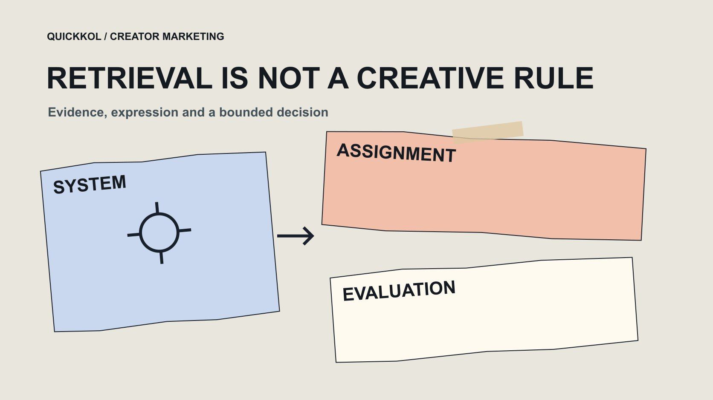
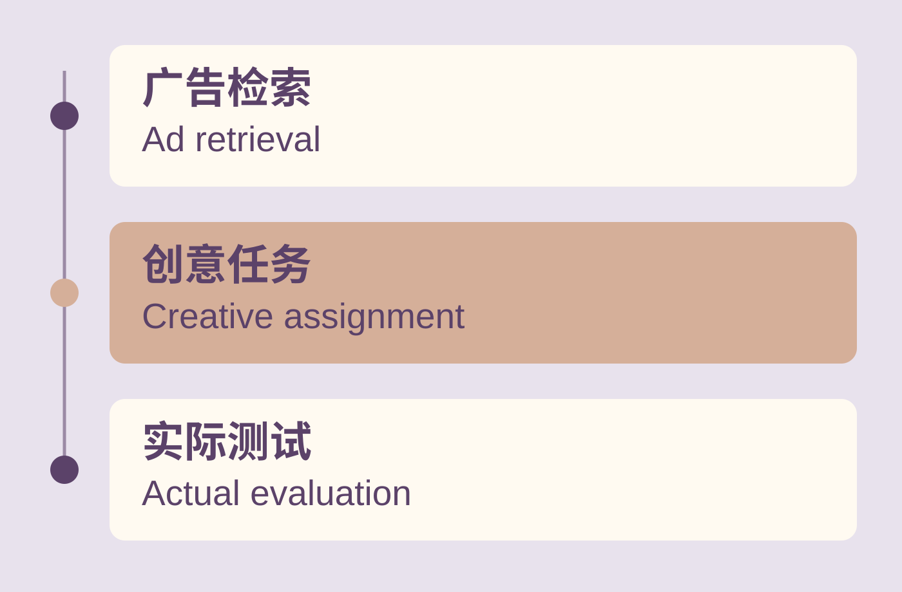

# Andromeda 怎样影响达人广告理解

状态：本地审阅稿；正式发布日期待确认。

Andromeda 是广告检索技术，不是一张达人创意配方。理解官方更新的范围后，再为真实观众问题准备不同贡献、准确许可与可解释测试。

QuickKOL 编辑图形；不呈现真实账号指标或平台界面。

Andromeda Meta 指 Meta 用于个性化广告检索的机器学习系统。官方 2024 年说明将检索放在多阶段广告推荐的前端，2026 年更新继续讨论模型、系统与硬件协同优化。它不是 Instagram 自然内容的统一算法，也不能被直接翻译成每个品牌必须购买固定数量达人素材。对达人营销，更有用的是区分官方技术事实与编辑建议，再围绕真实问题、不同创作者贡献、准确使用范围和实际资料安排广告内容。

## 先理解广告检索在做什么

[Meta 的 2024 年 Andromeda 技术说明](https://engineering.fb.com/2024/12/02/production-engineering/meta-andromeda-advantage-automation-next-gen-personalized-ads-retrieval-engine/)将检索描述为广告推荐的第一阶段，从大量候选中选出更小集合，再交给后续更复杂排序。检索与最终展示不是同一决定。

品牌无需为此学习芯片细节，才能准备达人 Brief。需要保留的是技术对象：它处理广告候选，不是为每位创作者提供必然自然传播的承诺。

同样不要把系统能力当成某个账号可以直接使用的单一开关。官方工程说明解释平台内部工作，具体投放安排仍需按实际广告账户与产品功能核对。

这个区分让后续讨论更准确。品牌可以关注清楚的商品表达与真实贡献，而不是从一个新技术名称猜出不存在的通用拍摄口诀。

## 2026 更新是系统进展，不是采购配额

[Meta 的 2026 年 Andromeda 更新](https://engineering.fb.com/2026/10/28/ml-applications/meta-andromeda-next-gen-ads-retrieval-gpu-co-design/)继续解释模型、系统和 GPU 硬件共同设计，并区分生产管线与组件优化。平台处理效率与某个品牌应采购多少素材，是不同层次的问题。

工程文中的规模、基准或平台报告，不应被直接改写成这次合作会获得同样转化提升。观察对象、测试范围与品牌活动条件并不相同。

本篇不从更新中推导固定素材数量、最低创作者人数或保证成功的预算。若供应商提出某项要求，应说明具体来源与适用条件，不只引用 Andromeda 名称。

以下关于 Brief 的方法是编辑建议，不是 Meta 新发布的强制规则。把技术事实与工作推论分开，品牌才更容易判断建议是否真的适合当前任务。

工程能力不直接变成素材配额；把官方事实、编辑建议与活动证据分别说明。

## 创意差异先对应不同观众问题

品牌可以准备不同解释方向，例如操作演示、具体问题回应或实际使用条件。差异应有内容意义，不只是换背景、字幕颜色或创作者姓名。

先写每个方向希望帮助观众理解什么，再找能够真实完成该贡献的人。不要为增加数量要求达人重复没有体验的主张，也不把每一份剪辑都称为独立概念。

这种安排与检索技术不存在一一保证关系。它只是让采购和评估更清楚：团队知道每个版本为何存在，应该用什么问题观察。

如果一个解释已经足够，可以先完成准确版本。增加内容应对应新的信息或合理试验，不因技术名词流行就无条件扩大拍摄。

也区分新概念与交付版本。同一解释的横竖画幅或字幕版本可能是必要制作，但不必声称它们回答了新的观众问题。给两类工作分别命名，采购才能看清增加的究竟是什么。

## 用实际作品选择不同贡献

研究创作者时看实际表达能力、主题经验与愿意承担的任务。不同角色可以互补，不需要把所有候选压成同一个风格或统一评分。

一个人擅长清楚解释结构，另一个人擅长回应常见疑问，可能形成有意义差异。不要仅凭身份、外貌或地域标签，假定他能代表整个受众。

给候选人具体问题和商品资料，允许提出更适合自己的表达。参考作品说明方向，不要求复制别人的内容或冒认别人使用结果。

品牌仍需确认档期、制作与实际合作条件。系统可以处理更多候选广告，并不会自动创造创作者时间、真实经验或愿意接受任务的意愿。

## 真实体验与商业背景不因自动化改变

[FTC 的达人披露指南](https://www.ftc.gov/business-guidance/resources/disclosures-101-social-media-influencers)在美国语境下强调真实体验、有依据表达和重要商业关系。广告系统如何检索，不会让没有发生的商品经历变成事实。

品牌提供准确产品资料，创作者保留本人条件与感受。不同版本不能为了追求差异，分别说出互相矛盾或未经支持的效果。

若素材来自一次品牌委托，公开表达与实际用途应对应。不能因为内容采用自然语气，就让观众误以为完全没有商业关系。

创意多样性可以建立在真实问题与表达方式上，不需要建立在虚构结果上。缺少依据时，先缩小主张或补资料，比多拍几版同样没有支持的话更有用。

## 广告用途与创意文件分别确认

[Meta 的创作者市场公告](https://about.fb.com/news/2024/02/creator-marketplace-for-brands-and-creators-to-collaborate-on-instagram/)在 2024 年介绍品牌发现创作者与后续合作广告等安排。它说明合作有具体流程，不意味着所有市场、账号或已收到素材都自动获得同样用途。

[达人广告权限指南](https://www.quickkol.com/zh/blog/what-is-whitelisting-creator-ad-permissions/#answer)帮助区分账号授权、素材使用与实际安排。品牌需要哪个账号、时期、渠道与版本，应让合作方明确理解，不把系统更新当作扩大许可理由。

音乐、声音、出镜与其他素材也有范围。一个自然发布版本不一定能够不经核对直接进入所有广告用途，需要由实际负责人确认。

成片通过与允许投放分别记录。创意准确不能替代使用确认，使用获准也不能证明内容事实全部准确；两项都需要完成。

## 用可解释评估代替算法归因

为每个方向保留版本、观察窗口、分发与可得业务资料。平台、投放安排、内容与商品都可能影响结果，不把一次变化全部归因于 Andromeda。

如果需要比较，说明比较问题与条件，承认无法排除的解释。普通前后观察不自动成为随机实验，新增素材也不自动证明产生增量销售。

[Instagram 广告素材预检方法](https://www.quickkol.com/zh/blog/instagram-ads-creator-placement-preflight/#answer)帮助核对具体版本与版位。评估仍需回到实际资料，不能用检索技术名称代替字段定义、订单事实或归属规则。

资料不足时，给出有限结论和下一步。例如某个问题值得补近景，或某项业务结果尚不能确认，不必用“算法不喜欢”结束全部分析。

## 假设案例：容器商品的不同解释方向

假设家居品牌准备达人广告，一个方向演示锁盖，另一个回答配件兼容问题。两者服务不同观众疑问，不只是将同一句卖点换人再说。

这是编辑示例，没有实际转化或平台效果。品牌提供对应商品事实，创作者确认本人体验，制作保留各版目的与许可范围。

投放团队按实际安排记录分发和资料，再讨论观察能支持什么。若某版表现不同，先核对条件，不宣称已经证明某种算法偏爱特定人物或镜头。

需要增加第三个方向时，先说明它补什么问题与证据。内容数量因此由任务决定，而不是从工程文章中编造一个必须达成的采购配额。

## 把技术更新转成准确达人 Brief

Andromeda Meta 的品牌意义，需要先理解技术范围，再谨慎讨论工作影响。官方事实与编辑推论分开，建议才有可检查依据。

把观众问题、创作者贡献、商品事实和使用安排写清楚，保留实际版本与评估条件。不要用技术词替代真实体验，也不把处理能力改写成结果保证。

未来平台继续更新时，核对新来源、日期与适用范围，只更新受到影响的判断。不要让一套已经失去依据的素材数量口诀长期支配采购。

这让文章始终围绕达人营销主旨：品牌怎样更清楚地发现、委托和评价真实创作者工作。系统环境可以变化，准确贡献与可解释合作仍需双方实际完成。

## 技术事实与工作推论

| 层次 | 可以说 | 不能直接推导 |
| --- | --- | --- |
| 广告检索 | 候选进入后续排序 | 自然内容必然传播 |
| 系统更新 | 官方日期与技术范围 | 本次活动同样提升 |
| 创意方向 | 不同观众问题 | 固定素材数量配额 |
| 达人工作 | 真实贡献与具体使用 | 系统替代许可与体验 |
| 评估 | 实际窗口、条件与资料 | 一项变化证明算法因果 |

前两项技术范围以官方来源为准；其余 Brief 方法为编辑建议，不是 Meta 强制规则或效果保证。

## 让技术解读服务实际任务

在用 Andromeda 解释达人广告计划前核对。

- [ ] 核对官方来源、日期与对象。
- [ ] 区分检索、排序与自然内容。
- [ ] 给每个方向一个真实问题。
- [ ] 确认体验、事实与商业背景。
- [ ] 分别处理素材与广告用途。
- [ ] 按实际证据评估，不保证结果。

## 研究日期与使用边界

资料核验于 2026 年 11 月 19 日。文中方法、表格和决策规则为编辑建议，标为假设的示例不是实际客户结果或行业基准。外部资料的适用地区与时期按各段说明。

## 从任务开始达人研究

用 QuickKOL 理解 Brief、发现相关达人并研究作品与联系路径；数据、合作条件和结果仍需核验。

[了解 QuickKOL](https://www.quickkol.com/#capabilities)

## 来源

- [Meta 的 2024 年 Andromeda 技术说明](https://engineering.fb.com/2024/12/02/production-engineering/meta-andromeda-advantage-automation-next-gen-personalized-ads-retrieval-engine/)
- [Meta 的 2026 年 Andromeda 更新](https://engineering.fb.com/2026/10/28/ml-applications/meta-andromeda-next-gen-ads-retrieval-gpu-co-design/)
- [FTC 的达人披露指南](https://www.ftc.gov/business-guidance/resources/disclosures-101-social-media-influencers)
- [Meta 的创作者市场公告](https://about.fb.com/news/2024/02/creator-marketplace-for-brands-and-creators-to-collaborate-on-instagram/)
