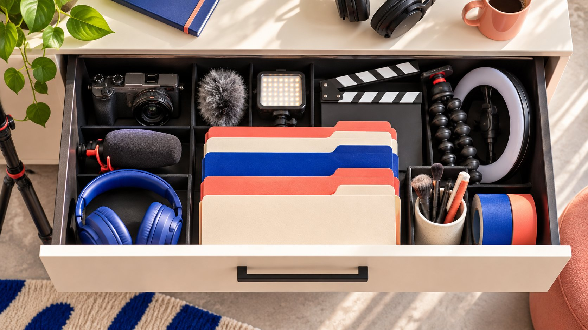
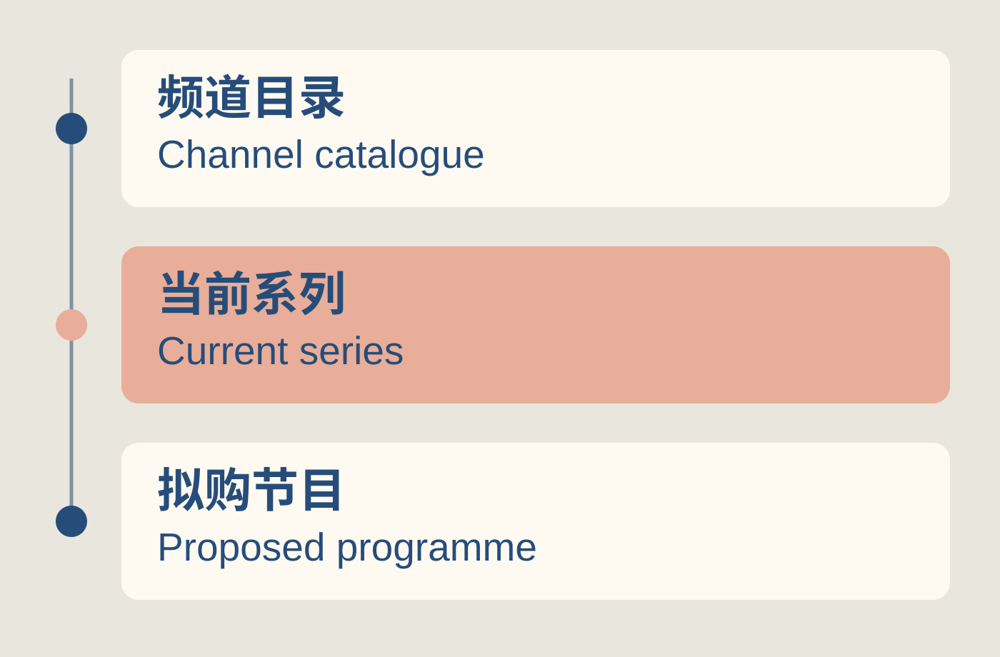

# Most-Subbed YouTube Channels: Review the Catalogue

Status: local review draft; confirm the publication date before release.

Review a highly subscribed channel by separating current series, formats and creator roles, then checking whether the programme relevant to the brand is still being produced.

Most subbed YouTube channels is a starting point for finding channels by subscription scale, not a ranking of brand suitability. YouTube announced MrBeast reaching 500 million subscribers on June 12, 2026; that is a dated milestone, not a live count verified here. A brand should then review the programme catalogue, separating current series, historical hits, Shorts and other versions to identify the continuing work the partnership would join, without assuming the entire subscriber base will watch.

## Use a dated scale reference instead of guessing live counts

[YouTube’s 500-million-subscriber announcement](https://blog.youtube/creator-and-artist-stories/mrbeast-500-million-youtube-subscribers/) records MrBeast reaching that scale in June 2026 and distinguishes earlier milestones for individual and overall channel rankings. Do not replace its date with today and present a historical statement as a live reading.

The brand can use it as scale context without inferring availability, programme status or expected campaign views. Retain the ranking population too, including whether individual and company-operated channels are being compared together.

The [channel purchase-unit guide](https://www.quickkol.com/blog/biggest-youtube-channels-purchase-unit/#answer) discusses which work can ultimately be agreed. This article adds a catalogue review beforehand so the team knows which series contains the work it likes, rather than treating the entire channel as one programme.

Where a complete current ranking has not been verified, state that limitation. A reliable catalogue question can prepare the next discussion better than a top-ten table assembled from inconsistent dates. The research task is not to reproduce a leaderboard at any cost, but to identify a specific body of work worth examining for the assignment.

## Separate the channel, programme and individual piece

A channel is a publishing identity, a programme is an ongoing editorial arrangement and a piece has a particular date and format. They are related but not interchangeable.

[YouTube Data API’s channel definition](https://developers.google.com/youtube/data/reference/rest/v3/channels) provides technical context for a channel resource and its unique identifier. Recording the correct identity helps avoid combining associated accounts, similarly named channels or other-language versions.

A programme name or playlist can provide a catalogue lead without proving that every item shares one production commitment. Review the work, descriptions and recent updates, and ask the channel team to confirm status where needed.

Retain channel, series, representative pieces and observation date in a small catalogue. This is not an exhaustive scraped archive. It lets each research judgment return to the appropriate object instead of expanding one appealing old video into a statement about everything the channel currently produces. Identity precision makes the next content discussion clearer without pretending the public archive reveals internal production plans.

## Understand the programme through recent continuity

Start by checking whether several recognizable pieces from the series appear recently. Record the shared question, expressive approach and on-screen roles instead of selecting only the most-viewed item.

If the series has not updated for a long time, mark its status for confirmation rather than declaring it discontinued. A creator may change cadence, seasonal planning or production methods, and the public catalogue may not explain everything.

Likewise, one past product integration does not establish current willingness to accept the same arrangement. Ask whether the series continues and which facts and expressions belong there, rather than merely whether the channel once carried an advertisement.

Keep specific passages and dates supporting the judgment. Outreach can then ask a grounded question and give the creator room to explain changes the archive does not show, rather than demanding a reproduction of work from years earlier. The catalogue supports an informed conversation without turning public observation into a claim of knowledge about private plans.

## Keep long-form, Shorts and versions in scope

A channel may publish long programmes, Shorts, live work and adapted versions. Different formats offer different encounters and room for product explanation, so all views should not be combined into one purchasing rationale.

[YouTube’s audience guide](https://support.google.com/youtube/answer/9314416?hl=en) distinguishes observation scopes including other channels, other content and viewing formats, and notes that some information can be limited. Confirm the field and period actually available instead of inferring that every format reaches the same people because the channel has many subscribers.

Retain representative work and a purpose for each format in the catalogue. A long video suited to detailed explanation does not establish that the same information can become a short clip without adaptation.

Other-language and regional versions also require separate review. They may share a topic without sharing subtitles, sound, product version or publishing identity. Do not copy one version's suitability judgment across all the others. A clear format boundary helps the team commission the explanation it actually needs rather than a vaguely defined presence somewhere on the channel.

Channel scale supports discovery; current series and specific work support the assignment decision.

## Examine how product information enters the programme

When a product appears, record its role: a demonstration tool, comparison subject, story background or explicit recommendation. A visible brand name does not establish that every kind of integration is available to buy.

Notice whether the explanation retains actual experience conditions and lets viewers understand relationships and limits. [FTC’s influencer-disclosure guide](https://www.ftc.gov/business-guidance/resources/disclosures-101-social-media-influencers) addresses experience, substantiation and commercial relationships in its United States context; channel scale does not remove those questions.

Do not treat a public piece as evidence of a brand's full contract. The work shows the expression without revealing all fees, approval arrangements, permissions or other terms.

Use the review to ask whether these product facts fit the programme's pace, what the creator needs to experience first and which claims remain unsupported. Research then serves a real editorial discussion instead of mechanically filling an old advertising position. It also leaves the creator space to explain how a new assignment would differ from work already visible in the archive.

## Protect the conclusion with a sampling note

State which pieces were reviewed, why they were selected and what remains uncovered. Recent consecutive examples, historical reference work and commercial expressions can each serve a purpose without constituting the whole catalogue.

If the research concerns one series, limit the conclusion to that series. A group of pieces unsuitable for this product does not establish that the entire channel lacks partnership value.

Retain counterexamples and uncertainty. Some work may use a different role or tone, suggesting a question to confirm rather than something to delete so the research table looks consistent.

Catalogue review prepares discovery and outreach; it cannot guarantee an agreement or a programme outcome. An honest sampling note tells later colleagues where to investigate further and prevents limited research from appearing to be a complete audit. It also makes the shortlist easier to update: new work can change the relevant judgment without requiring the team to defend an unsupported statement about the channel as a whole.

## Hypothetical case: locate the current series behind a hit

Imagine a brand discovering a highly subscribed channel through a popular making video from several years ago and wanting to purchase the same expression. Catalogue review finds that recent work emphasizes a shorter explanatory series.

This is not a record of an actual channel change. The researcher marks the old piece as a historical lead, identifies the recent series as the partnership object to confirm and records the different explanation requirements of the two formats.

Outreach no longer asks for a guaranteed reproduction of the old video's views. It asks whether the current series suits this product, which experience materials are needed and who would explain it.

If the channel team confirms that the old programme remains available for discussion, add the relevant samples and scope. If it does not fit, consider another candidate. Catalogue review grounds the decision in work currently open for discussion instead of treating subscription scale as proof that an old programme continues unchanged. It turns admiration for a hit into a question the channel can actually answer.

## Recheck the catalogue when the proposal changes

A suitability conclusion depends on the original assignment. If the brand changes from a simple demonstration to a detailed comparison, or from one market to multilingual versions, recheck whether the samples still support the recommendation.

Approving a candidate name does not establish that every new content request belongs in the same programme. Added work may require another series, on-screen role or production condition, which the channel team needs an opportunity to address.

Retain the reason for the change and the old and new questions so later colleagues know which research remains usable. Scale evidence may still be useful background while the earlier judgment about explanatory room needs more support.

This need not recreate the entire archive. Update the affected conclusion and evidence so the catalogue continues serving the assignment instead of becoming a static list nobody consults after the first selection. The review remains proportionate to the decision that changed, and the channel is not asked to fulfil a different task under assumptions drawn from the original one.

## Hand over a specific programme question

Hand over channel identity, series status, sampling scope and unanswered questions together. The [channel-identity review method](https://www.quickkol.com/blog/youtube-channels-identity-scope-handoff/#answer) helps later colleagues return to the right account without combining similarly named or associated channels.

When recommending contact, explain why this recent body of work relates to the brand task and which fact the channel team must confirm. The channel is large should not replace the recommendation's reasoning.

The brand value of researching most subbed YouTube channels is discovering content organizations worth further examination. Partnership judgment still needs a current programme, specific roles and actual agreement.

Keep scale in the background and use catalogue evidence to ask a better question. The brand can then move from an attention-grabbing ranking lead to a bounded creator-partnership discussion that someone can answer. The resulting brief respects both the programme's editorial shape and the limits of public research, leaving availability, permissions and future performance to be addressed explicitly rather than assumed from size.

## Channel catalogue review

| Layer | Retain | Question to confirm |
| --- | --- | --- |
| Channel | Identity and date | Is this the intended publisher? |
| Series | Recent consecutive work | Is it still being produced? |
| Format | Long-form, Shorts and versions | Which suits the explanation? |
| Product role | Observed expression | What experience is needed? |
| Sampling | Coverage and gaps | What remains to verify? |

Editorial research tool, not a ranking, complete audit or performance forecast.

## Move from ranking lead to programme question

Prepare this bounded catalogue before contact.

- [ ] Retain the date of scale evidence.
- [ ] Confirm channel identity.
- [ ] Locate a recent continuing series.
- [ ] Separate formats and language versions.
- [ ] State sampling scope and limits.
- [ ] Ask a question about the current programme.

## Research date and limitations

Sources reviewed November 19, 2026. Methods, tables and decision rules are editorial recommendations. Hypothetical examples are not actual client results or industry benchmarks. Source geography and periods are specified where relevant.

## Start creator research with a clear task

Use QuickKOL to interpret a brief, discover relevant creators and research their work and contact routes. Verify data, commercial terms and outcomes at their source.

[Explore QuickKOL](https://www.quickkol.com/#capabilities)

## Sources

- [YouTube’s 500-million-subscriber announcement](https://blog.youtube/creator-and-artist-stories/mrbeast-500-million-youtube-subscribers/)
- [YouTube Data API’s channel definition](https://developers.google.com/youtube/data/reference/rest/v3/channels)
- [YouTube’s audience guide](https://support.google.com/youtube/answer/9314416?hl=en)
- [FTC’s influencer-disclosure guide](https://www.ftc.gov/business-guidance/resources/disclosures-101-social-media-influencers)
