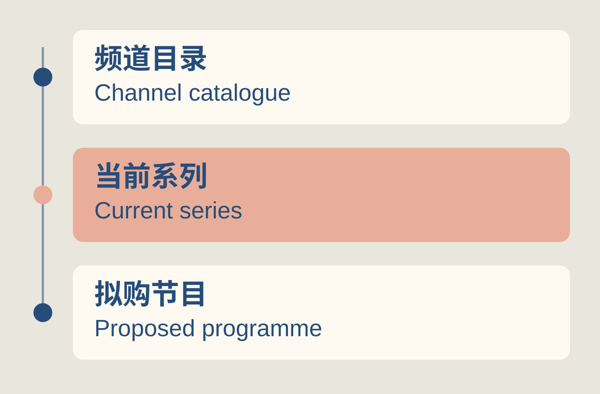

# 高订阅频道怎样核对节目目录

状态：本地审阅稿；正式发布日期待确认。

研究高订阅 YouTube 频道时，先把节目目录拆成近期系列、形式与创作者角色，判断品牌想参与的那部分是否仍在持续制作。

Most subbed YouTube channels 是按订阅规模寻找频道的起点，不是按品牌适配度排序的答案。YouTube 于 2026 年 6 月 12 日公布 MrBeast 达到五亿订阅的里程碑；这是有日期公告，不是本篇核验的实时数量。品牌随后应审阅频道节目目录，区分近期系列、历史爆款、短视频与其他版本，确认本次合作要进入哪一种持续制作的内容，而不是默认频道全部受众都会观看。

## 引用有日期的频道规模

[YouTube 的五亿订阅里程碑公告](https://blog.youtube/creator-and-artist-stories/mrbeast-500-million-youtube-subscribers/)说明 MrBeast 于 2026 年 6 月达到该规模，并回顾个人与全部频道排名的不同节点。不要把公告日期换成今天，再把历史事实写成实时读数。

品牌可以使用这种资料理解频道的规模背景，但不能据此确认当前档期、节目状态或本次合作预计观看。排名人口范围也要保留，例如个人与公司经营频道是否放在同一组。

[频道采购单元指南](https://www.quickkol.com/zh/blog/biggest-youtube-channels-purchase-unit/#answer)讨论最终可以约定哪些工作。本文在此前增加节目目录审阅，让团队知道自己感兴趣的内容属于哪个系列，而不是将整个频道视为单一节目。

没有核验当前完整榜单时，明确保留这个限制。一个可靠的目录问题，比一张没有统一日期的前十表更能帮助品牌准备下一次讨论。

## 区分频道、节目与单条作品

频道是发布身份，节目是编辑上持续的内容安排，单条作品则有具体发布日期与形式。三者相关，却不能互相代替。

[YouTube Data API 的频道定义](https://developers.google.com/youtube/data/reference/rest/v3/channels)提供频道资源与唯一标识的技术背景。记录准确频道身份有助于避免把关联账号、同名频道或其他语言版本的作品混在一起。

节目名称或播放列表可以作为目录线索，但不自动证明每条内容属于同一制作承诺。品牌仍要查看作品、说明与近期更新，必要时向频道方确认状态。

用简洁目录保留频道、系列、代表作品与观察日期。它不是完整抓取档案，而是让每一条研究判断都能回到相应对象，避免把一条有吸引力的旧作品扩写成频道现在的全部工作。

## 从近期连续作品理解节目承诺

先查看近期是否有多个可识别的同系列作品。记录它们共同解决的问题、表达方式与出镜角色，而不只选择观看最多的一条。

如果系列长期没有更新，标为需要确认，不直接断言已经停播。创作者可能调整节奏、季节安排或制作方式，公开目录未必能解释全部情况。

同样避免认为过去的一次商品植入代表现在随时接受同类合作。品牌要问的是，这个系列是否仍存在、适合怎样的事实与表达，而不是对方是否曾经接过广告。

保留能够支持判断的具体片段与日期。这样外联可以提出有根据的问题，也让创作者有机会解释公开目录没有展示的变化，而不是被要求复制几年前的内容。

## 让长视频、Shorts 与版本各自保留范围

一个频道可能同时发布长节目、短视频、直播与改编版本。形式不同，观众接触方式与商品解释空间也不同，不宜将全部观看混成一项采购依据。

[YouTube 的受众说明](https://support.google.com/youtube/answer/9314416?hl=en)区分不同观察范围，包括其他频道、其他内容与观看形式等资料；并提醒部分数据可能有限。团队需要确认实际字段与时期，而不是从频道订阅量推断每种形式都覆盖相同人群。

目录中为每种形式保留代表作品与任务。某个长视频适合详细解释，不代表同样信息可以不经改写直接成为短片。

其他语言或地区版本同样需要单独核对。它们可能共享主题，但字幕、声音、商品版本和发布身份并不因此自动一致；不要把一个版本的适配结论复制给全部版本。

频道总量帮助发现，当前系列与具体作品帮助判断本次任务。

## 查看商品信息怎样进入节目

研究商品出现时，记录它承担什么角色：示范工具、被比较对象、故事背景，还是创作者明确推荐的主体。不能只看到品牌名称就假定各种方式都可采购。

关注解释是否保留实际体验条件，是否允许观众理解关系与限制。[FTC 的达人披露指南](https://www.ftc.gov/business-guidance/resources/disclosures-101-social-media-influencers)在美国语境下说明真实体验、依据与商业关系，频道规模不会取消这些问题。

不要把公开作品当成某个品牌合同的证据。画面能够告诉你表达是什么，却不能完整告诉你背后的费用、审批、许可或其他条款。

品牌可以据此提出适当问题：这次商品事实是否适合节目节奏，创作者需要先体验什么，哪些说法尚无支持。研究因此服务真实内容讨论，而不是照着一个旧广告位置机械填空。

## 用采样说明保护研究结论

说明这次看过哪些作品、为什么选它们，以及没有覆盖什么。近期连续样本、历史代表作品与商业表达样本，可以各有用途，但不能默认为完整目录。

如果只研究某个系列，就将结论限制在该系列。不要因为一组作品不适合这次商品，就说整个频道不具备合作价值。

保留反例与不确定项。某些作品可能采用不同角色或语气，它们可以提示需要进一步确认，而不必被删除来让研究表显得一致。

目录审阅是发现与外联前的准备，不能保证合同成立或节目效果。一个诚实的采样说明能让后续同事知道应补哪里，也避免把有限研究包装成完整审计。

## 假设案例：从热门作品找到当前系列

假设品牌因一条多年前的热门制作视频发现某个高订阅频道，准备购买同样表达。目录审阅发现，近期作品转向一个较短的解释系列。

这不是实际频道变化记录。研究员将旧作品标为历史线索，将近期系列列为待确认合作对象，并记录两个形式对产品解释的不同要求。

外联不再问“能否保证复制旧作品观看”，而是询问当前系列是否适合展示这次商品、需要哪些体验资料，以及由谁参与解释。

如果频道方确认旧节目仍可讨论，团队再补相应样本与范围；如果不再适合，也能转向其他候选。目录审阅让决定建立在当前可讨论工作上，而不是把订阅规模当成旧节目持续存在的证明。

## 在提案变化后重新核对目录

研究的适配结论依赖最初任务。品牌若从简单演示改成深度比较，或从单一市场改成多语言版本，就应重新查看样本是否仍能支持推荐。

不要因为已经批准候选名字，就假设任何新内容都能进入同一节目。新增任务可能需要不同系列、出镜角色或制作条件，需要让频道方实际回应。

保留变更理由与新旧问题，让后续人员知道哪项研究仍可使用。规模资料可能仍是有效背景，而原先关于解释空间的判断已经需要补充。

这样的复核不必重做整个档案。只更新受影响的结论及其证据，就能使目录持续服务任务，而不是成为第一次筛选之后无人再看的静态名单。

## 交接一个明确的节目问题

把频道身份、系列状态、样本范围与未确认问题一起交接。[频道身份核验方法](https://www.quickkol.com/zh/blog/youtube-channels-identity-scope-handoff/#answer)可以帮助后续团队回到正确账号，不把同名或关联频道混为一谈。

建议联系时，写清楚为什么这组近期作品与品牌任务相关，以及哪项事实需要对方确认。不要用“频道很大”代替全部推荐理由。

Most subbed YouTube channels 的品牌价值，在于帮助找到值得进一步研究的内容组织；真正的合作判断仍需要当前节目、具体角色与双方约定。

将规模背景留在背景位置，把目录证据用于提出更好的问题。品牌便能从一个吸引注意的排名线索，走向一项有范围、可回应的达人合作讨论。

## 频道目录审阅表

| 层次 | 保留资料 | 待确认问题 |
| --- | --- | --- |
| 频道 | 唯一身份与日期 | 是否为目标发布方 |
| 系列 | 近期连续作品 | 是否仍在制作 |
| 形式 | 长短视频与版本 | 哪种适合解释 |
| 商品角色 | 实际表达样本 | 需要什么体验依据 |
| 采样 | 覆盖范围与缺口 | 结论还需补什么 |

编辑研究工具，不是频道排名、完整审计或合作效果预测。

## 从榜单线索走到节目问题

联系频道前完成这份有限目录。

- [ ] 给规模资料保留日期。
- [ ] 确认频道唯一身份。
- [ ] 找到近期连续系列。
- [ ] 区分形式与语言版本。
- [ ] 说明采样范围及限制。
- [ ] 提出当前节目可回答的问题。

## 研究日期与使用边界

资料核验于 2026 年 11 月 19 日。文中方法、表格和决策规则为编辑建议，标为假设的示例不是实际客户结果或行业基准。外部资料的适用地区与时期按各段说明。

## 从任务开始达人研究

用 QuickKOL 理解 Brief、发现相关达人并研究作品与联系路径；数据、合作条件和结果仍需核验。

[了解 QuickKOL](https://www.quickkol.com/#capabilities)

## 来源

- [YouTube 的五亿订阅里程碑公告](https://blog.youtube/creator-and-artist-stories/mrbeast-500-million-youtube-subscribers/)
- [YouTube Data API 的频道定义](https://developers.google.com/youtube/data/reference/rest/v3/channels)
- [YouTube 的受众说明](https://support.google.com/youtube/answer/9314416?hl=en)
- [FTC 的达人披露指南](https://www.ftc.gov/business-guidance/resources/disclosures-101-social-media-influencers)
