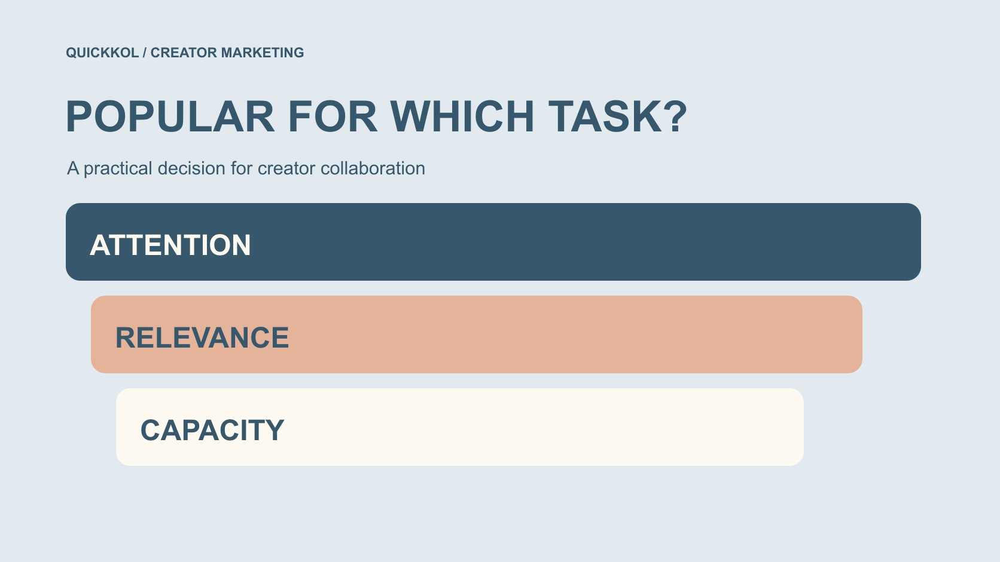
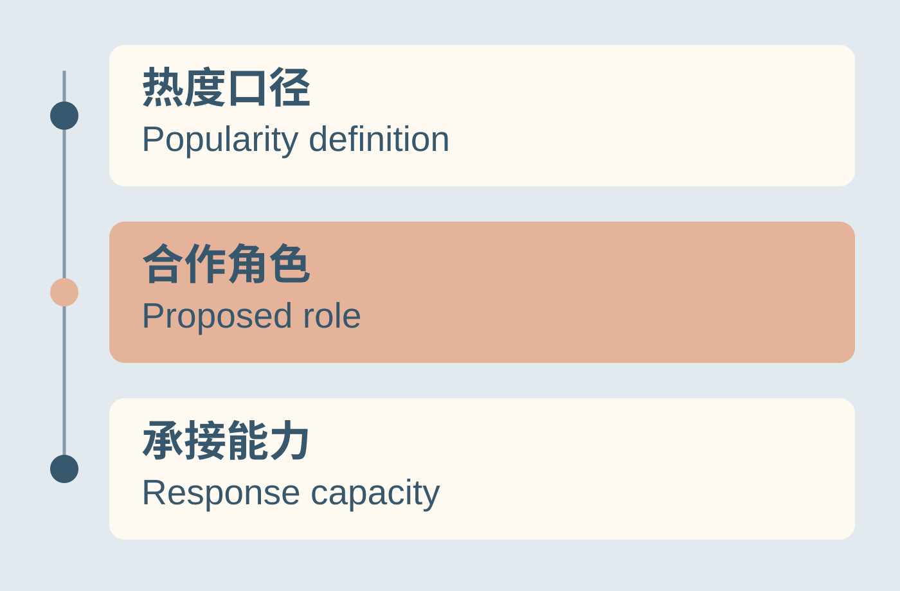

# Popular Instagram Accounts: Check Campaign Fit

Status: local review draft; confirm the publication date before release.

Attention from a popular account needs an operational destination. Check product answers, languages, inquiry routes and response capacity before commissioning the collaboration.

QuickKOL editorial graphic; not actual account metrics or a platform interface.

Instagram most popular accounts can mean the most-followed accounts, those attracting attention recently or influential voices within a subject. Define the measure and date first. For creator marketing, suitability also depends on handling the questions a publication may generate: whether product facts are clear, the intended languages are supported and an inquiry route has an owner. This guide offers no unverified live ranking; it focuses on turning high-attention collaboration into an operational response plan.

## Define popularity instead of assuming one universal ranking

Follower scale, recent circulation and recognition within a specialist subject are not the same form of popularity. State whether the brand needs broad recognition or a voice able to explain a particular issue.

[Guinness World Records’ Instagram record page](https://www.guinnessworldrecords.com/world-records/397515-most-followers-on-instagram) provides a dated record, including an individual observation from February 19, 2024. It cannot simply be rewritten as a live ranking for November 2026.

The [Instagram ranking-scope guide](https://www.quickkol.com/blog/instagram-most-followed-kol-ranking-scope/#answer) further distinguishes individuals, platform accounts and other account populations. Here a ranking is a discovery lead before asking whether the brand can answer the practical questions this content may raise.

Where current information is unavailable, leave it unknown. Selecting a collaborator does not require inventing a precise world top ten. It first requires understanding which attention is relevant to the product, audience and service conditions of this assignment. The distinction prevents a famous name from becoming a substitute for the operational judgment that the campaign still needs.

## Anticipate question types without promising a volume

Examine how a candidate explains products and which subjects viewers ask about afterwards. Use, sizing, supply markets and after-sales questions may require different owners; the creator should not have to guess answers live.

Identify question types rather than deriving guaranteed inquiry volume from follower totals. Responses to one publication depend on content, distribution, product and timing, so account size should not become a fixed multiplier.

Retain the public questions actually observed while limiting personal information to what is necessary. There is no need to compile unrelated viewer profiles or expand one commenter's situation into the needs of an entire audience.

Turn the questions into preparation: which factual reference already exists, which needs product-team confirmation and which should not be answered publicly. Creator research then supports work after publication rather than ending with a candidate name. The brand can assess readiness for the likely subject matter while acknowledging that the number and timing of future requests remain uncertain.

## Assign a reliable owner for product facts

Give the creator a product reference with the version, market and applicable conditions. Price, stock and service coverage can change; an old reference should not become an enduring promise in a creator's voice.

Assign an owner to unresolved questions. The creator's actual experience can remain intact while someone responsible for the facts confirms brand information, rather than every viewer question becoming another improvised claim.

[FTC’s influencer-disclosure guide](https://www.ftc.gov/business-guidance/resources/disclosures-101-social-media-influencers) emphasizes actual experience, appropriate support and commercial relationships in its United States context. Popularity does not make an unsupported effect reliable or replace clear disclosure.

If an answer cannot be confirmed before release, adjust the expression or hold that part. Removing one undeliverable promise is more useful than sending substantial attention into a route where nobody can answer accurately. A factual owner also helps later corrections remain consistent across the creator's publication, the brand's destination and the people handling follow-up, instead of leaving three different answers in circulation.

## Match the inquiry route to language support

Content in a language does not establish that the brand can provide service in that language. Before the collaboration, confirm who receives inquiries, in which languages, during which periods and with which escalation route.

The destination may be a product page, official messaging or another defined channel, but contact us should have a recipient. Tell the creator which invitation can actually be fulfilled rather than promising immediate personal advice when no team is available.

The [creator-inquiry handoff method](https://www.quickkol.com/blog/whatsapp-business-creator-conversation-handoff/#answer) discusses conversation ownership and subsequent routes. Choosing a tool still depends on the market and business; viewers should not automatically need another service to ask a simple question.

Prepare escalation conditions and public-answer boundaries. Order identities or other personal information belong in an appropriate official process, not in a creator's public comment request. Matching the invitation to real support is part of campaign design, even when the team cannot predict how many people will use it or whether those conversations will lead to orders.

## Prepare capacity scenarios without calling them forecasts

The team can imagine low, medium and high workloads to check whether someone could respond under each. These are internal planning scenarios, not guarantees derived from follower counts, and should not become public outcome promises.

Consider question complexity. Ten requests requiring product verification can consume very different work from ten requests with an approved answer. Assigning staff by message count alone misses that condition.

Consider release timing and handover too. If the owner is unavailable, stock information changes or the market team has a holiday, address that in the release plan rather than searching for help after the creator publishes.

Limited capacity need not automatically rule out a candidate. The brand can narrow the invitation, use informational content, stage publication or improve service readiness first. The choice should address the actual problem; reducing the creator's fee does not repair an inquiry-handling gap. A workable response plan is a collaboration condition, not evidence that the creator must guarantee fewer questions or a particular audience reaction.

Prepare around questions and responsible people without deriving guaranteed inquiry volume from followers.

## Review distribution, responses and business outcomes separately

[Meta’s Insights API overview](https://developers.facebook.com/docs/insights/overview) explains that metrics have object and access scopes. Retain the actual source and window rather than combining public likes, backend views and internal inquiries into one reach measure.

A response record can show which questions arrived, whether they were routed appropriately and which answers need improvement. It does not automatically establish that every inquiry came from the creator's content or independently prove sales attribution.

Where the business team has orders or later outcomes, it should supply the relevant rules and evidence. Keep missing stages unknown instead of crediting every contemporaneous result to a popular collaborator.

Use the record to prepare the next assignment: which explanation the product page needs, which detail the creator could demonstrate and which route requires more support. This turns attention into an experience the team can improve. It also gives the creator specific, useful feedback instead of making them responsible for internal response failures or assigning them commercial success that the record cannot substantiate.

## Hypothetical case: prepare homeware questions

Imagine a homeware brand considering a popular lifestyle account for a demonstration of replaceable container components. Similar content has raised questions about compatibility, cleaning and purchase markets.

This is not an actual account audit or an inquiry-volume forecast. The team uses question types to prepare: product staff confirm compatibility conditions, service staff confirm regional destinations and the creator demonstrates the version actually used.

If a market is not supplied, retain that limit rather than having the creator invite everyone to buy. If an order needs private verification, provide an official route instead of asking commenters to publish their details.

After release, keep content performance, received questions and internal handling in separate records. Even without sales outcomes, the brand can identify which product explanation needs improvement and whether the next partnership has better response readiness. The popular account remains relevant because of the attention and expression it can contribute, while the brand remains accountable for what happens in its own response process.

## Agree how answers will be updated after release

Publication does not freeze every fact. When stock, a market destination or a product explanation changes, the brand owner should confirm the updated information before discussing a revised description, comment response or follow-up piece.

Do not assume the creator must monitor every question indefinitely or remake any version without additional discussion. Agree a review period, contact route and work requiring a new agreement so viewer information and production arrangements can both be protected.

Keep earlier answers in an internal version record, noting when new information replaced them. If different screenshots later appear, the team can explain the change instead of treating a previously time-bounded fact as proof that someone deliberately misled people.

Where a response concerns the creator's personal experience, that person must still confirm it. A brand can correct a product fact without rewriting an experience into a result that never happened. A manageable update process therefore has a factual owner, an expressive owner and a defined working period, rather than an unlimited expectation hidden inside the original collaboration fee.

## Make the decision reflect actual readiness

A candidate's subject and expression may fit while response conditions remain incomplete. Give the decision-maker confirmed, missing and currently unpromisable components together, rather than hiding a substantive gap behind a total score.

When contacting the creator, explain the facts and destination already prepared and ask which additional questions viewers might have. This respects the creator's experience without demanding unrelated private-message records.

If the collaboration must wait, identify whether product information, supply, language or service readiness is missing. Do not present the brand's internal problem as an accusation about audience quality.

Researching Instagram most popular accounts therefore gains a practical second layer: popularity supplies a lead worth discussing, while the response plan helps establish whether this assignment is workable now. Both inform the decision without guaranteeing an outcome. The brand finishes with a clear condition for proceeding, and the creator receives an invitation that the business is prepared to support rather than an open-ended request to create attention.

## Response readiness before release

| Question | Owner | Confirm |
| --- | --- | --- |
| How the product is used | Product team and creator | Facts and actual experience |
| Where to buy | Market or commerce team | Market and valid destination |
| Who responds | Service owner | Language, timing and escalation |
| What stays private | Official response team | Appropriate information route |
| What improves next | Campaign owner | Question, evidence and decision |

Editorial readiness checklist, not an account ranking, inquiry forecast or performance guarantee.

## Give attention a workable destination

Prepare these conditions before approaching a popular creator.

- [ ] Define popularity and its observation date.
- [ ] Record relevant questions in actual work.
- [ ] Assign ownership of product facts.
- [ ] Check language, destination and response timing.
- [ ] Check capacity through internal scenarios.
- [ ] Review content, responses and business outcomes separately.

## Research date and limitations

Sources reviewed November 19, 2026. Methods, tables and decision rules are editorial recommendations. Hypothetical examples are not actual client results or industry benchmarks. Source geography and periods are specified where relevant.

## Start creator research with a clear task

Use QuickKOL to interpret a brief, discover relevant creators and research their work and contact routes. Verify data, commercial terms and outcomes at their source.

[Explore QuickKOL](https://www.quickkol.com/#capabilities)

## Sources

- [Guinness World Records’ Instagram record page](https://www.guinnessworldrecords.com/world-records/397515-most-followers-on-instagram)
- [FTC’s influencer-disclosure guide](https://www.ftc.gov/business-guidance/resources/disclosures-101-social-media-influencers)
- [Meta’s Insights API overview](https://developers.facebook.com/docs/insights/overview)
