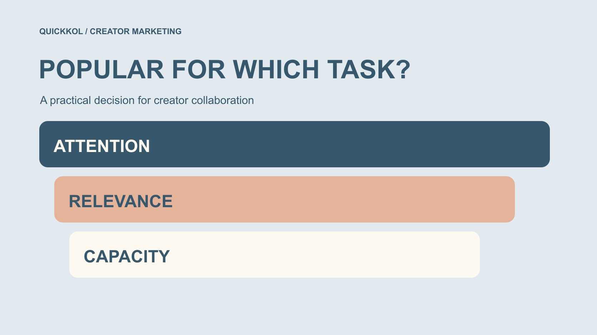
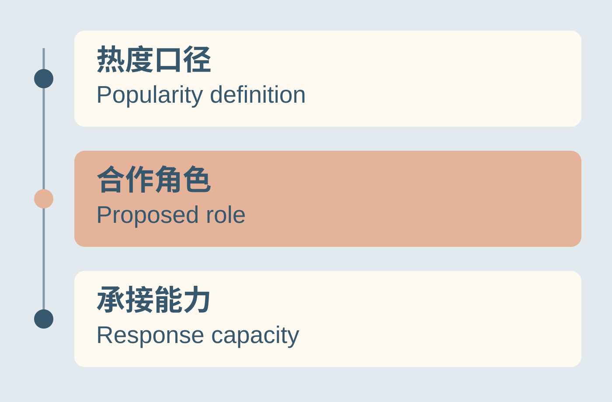

# 热门 Instagram 账号怎样匹配合作

状态：本地审阅稿；正式发布日期待确认。

热门账号带来的注意力需要有人承接。品牌应在达人合作前核对产品问答、语言、咨询路径与接待容量，而不是只研究粉丝榜。

QuickKOL 编辑图形；不呈现真实账号指标或平台界面。

Instagram most popular accounts 可以指粉丝最多、近期最受关注或某个主题中最有影响的账号，必须先说明口径与日期。对达人营销，热门账号是否适合还取决于发布后能否承接相关问题：商品事实是否清楚，目标语言是否有人回应，咨询入口是否有人负责。本篇不提供未经核验的实时榜单，重点是把高关注度合作转成能够实际运作的回应计划。

## 先定义热门，而不是假定有一张通用榜

粉丝规模、近期传播与某个专业主题中的认可度，不是同一项热门。品牌应说明自己寻找的是广泛知名度，还是能解释特定问题的内容声音。

[吉尼斯的 Instagram 纪录页](https://www.guinnessworldrecords.com/world-records/397515-most-followers-on-instagram)给出的是有日期的纪录，其中个人纪录观察时间为 2024 年 2 月 19 日。它不能被直接改写成 2026 年 11 月的实时排名。

[Instagram 粉丝榜口径文章](https://www.quickkol.com/zh/blog/instagram-most-followed-kol-ranking-scope/#answer)进一步区分个人、平台与其他账号范围。这里将榜单作为发现线索，之后转向品牌有没有能力回应这次内容可能引出的实际问题。

没有当前数据时，保留未知即可。为了选择合作对象，并不需要编出一个精确的世界前十；首先需要知道哪类关注与这次商品、受众和服务条件相关。

## 从作品预判问题类型，不预测保证数量

查看候选达人怎样讲产品，以及观众通常围绕什么继续提问。使用方法、尺寸、供应地区与售后，可能需要不同负责人回应，不能统统交给创作者临场猜测。

这里只识别问题类型，不从粉丝总数推算必然咨询量。一次作品引出的回应会受内容、分发、商品与时点影响，不能按账号规模作固定倍数预测。

记录实际看到的公开问题，并将身份信息限制在必要范围。无需整理无关观众档案，也不把一个评论者的情况扩写成全部受众需求。

把这些问题转为准备清单：品牌已有哪份事实，哪些仍需产品团队确认，哪些内容不适合公开回答。达人研究因而服务发布后的实际工作，而不是只留下一个候选名字。

## 给商品事实一个可靠负责人

为达人准备可引用的商品资料，同时明确版本、市场与适用条件。价格、库存和服务范围可能变化，不要让创作者用一份过期资料作长期承诺。

为未解决问题安排负责人。创作者的真实体验可以保留，品牌事实则由掌握资料的人确认，避免把每次观众追问都变成新的口播猜测。

[FTC 的达人披露指南](https://www.ftc.gov/business-guidance/resources/disclosures-101-social-media-influencers)在美国语境下强调真实体验、适当依据与商业关系。热门程度不会让未经支持的效果变得可靠，也不能代替清楚披露。

如果某项商品答案无法在发布前确认，可以调整表达或暂缓该部分。让作品减少一个无法兑现的承诺，比让大量关注进入没人能够准确回答的路径更有用。

## 让咨询入口对应语言支持

内容用一种语言表达，不代表品牌能够用该语言提供后续服务。合作前应确认谁接收咨询、用什么语言、在哪些时间能够回复，以及哪些问题需要转交。

入口可以是商品页、官方消息或另一个明确渠道，但不要只写“联系我们”而没有接收人。让达人知道可以作出的邀请，避免口播承诺即时个别咨询而团队无人值守。

[WhatsApp 合作咨询承接方法](https://www.quickkol.com/zh/blog/whatsapp-business-creator-conversation-handoff/#answer)讨论对话负责人和后续路径。是否采用某个工具仍取决于市场与业务，不应要求全部观众为了提一个简单问题转到新服务。

准备好需要转交的情况与公开答复边界。涉及订单身份或其他个人资料时，适当转入官方流程，不让创作者在公开评论里索取无关信息。

## 用容量情景准备，不把情景当预测

团队可以设想低、中、高三种工作量，检查每种情况下是否有人能回复。这些是内部计划情景，不是从粉丝数得出的保证，也不应写入对外效果承诺。

考虑问题复杂度。十个需要商品核验的问题，与十个已有标准答案的问题，可能消耗完全不同的工作。只按消息总数分人，会遗漏关键条件。

同样考虑发布时点与交接。如果负责人下班、库存资料更改或市场团队休假，应在上线计划里处理，而不是等创作者已经发布才临时找人。

容量不足不必自动否定候选达人。品牌可以缩小邀请、改为信息型内容、分阶段发布，或先补好服务条件。选择应对应实际问题，而不是靠降低达人费用解决接待缺口。

承接准备围绕问题与负责人展开，不从粉丝总数推算保证咨询量。

## 复盘分发、回应和业务结果

[Meta 的 Insights API 概述](https://developers.facebook.com/docs/insights/overview)说明指标具有对象和访问范围。保留实际数据来源与窗口，不把公开点赞、后台观看和内部咨询混成同一项触达。

响应记录可以说明收到哪些问题、是否及时转交，以及哪些答案需要改进。它不自动证明所有询问都由达人内容引起，也不独自建立销售归因。

业务团队若有订单或后续结果，应提供相应规则与资料。没有数据的环节保持未知，不因合作对象热门就把每个同期结果都记到他名下。

将记录用于下一次准备：商品页补哪项说明，创作者下次展示哪个细节，哪条路径需要更多支持。这样才把注意力变成能持续改进的合作经验。

## 假设家居合作的问答准备

假设家居品牌考虑与一个热门生活方式账号合作，作品将演示可替换的容器配件。品牌发现以往类似内容常出现兼容、清洁和购买地区的问题。

这不是实际账号审计或咨询量预测。团队仅用问题类型准备：产品人员确认兼容条件，客服确认地区入口，创作者负责清楚演示自己实际使用的版本。

若某个地区暂不供货，提案就保留该限制，不让达人用“所有人都能购买”来扩大邀请。若需要私下核对订单，提供官方路径而不是让评论者公开资料。

发布后的记录分别保留作品表现、收到的问题与内部处理情况。即使没有销售结果，也能判断商品说明哪里需要改善，以及下一次合作是否已有更好的承接准备。

## 提前约定发布后如何更新答案

发布不是所有事实停止变化的时间。库存、地区入口或某项商品说明改变后，应由品牌负责人确认新资料，再讨论是否更新说明、评论答复或后续内容。

不要默认创作者需要无限期监控所有问题，或免费重做任何版本。约定检查时期、联系路径和需要另行讨论的工作，可以同时保护观众信息与双方制作安排。

把旧答案保留在内部版本记录里，注明何时被新资料替换。这样遇到不同截图时，团队可以解释变化，而不是把原本有时间条件的事实说成任何人故意误导。

若某项答复涉及创作者亲身体验，仍需由本人确认。品牌可以修正商品事实，却不应借更新流程把个人经历改成没有发生过的使用结果。

## 让合作决定反映实际准备

候选账号的主题与表达适合，并不表示所有承接条件已完成。把已确认、需补充和暂不可承诺部分一起交给决策者，避免用一个总分掩盖实质缺口。

决定联系达人时，提案可说明品牌已准备的事实与入口，并询问创作者认为观众还会关心什么。这个问题尊重对方经验，也不要求其泄露无关私信资料。

需要暂缓时，说清是资料、库存、语言或接待条件未准备好。不要把品牌内部问题写成对达人受众质量的指责。

Instagram most popular accounts 的研究因此多出一层实际价值：热门线索帮助找到值得讨论的人，回应计划帮助确认现在是否适合开展这项合作。两者共同支持决定，任何一项都不能单独保证结果。

## 发布前的承接准备

| 问题 | 负责人 | 确认内容 |
| --- | --- | --- |
| 商品如何使用 | 产品团队与创作者 | 事实与实际体验分开 |
| 哪里可以买到 | 市场或电商团队 | 地区与有效入口 |
| 谁来回答 | 服务负责人 | 语言、时间与转交 |
| 哪些不能公开 | 官方接待人员 | 适当信息路径 |
| 怎样继续改进 | 活动负责人 | 问题、资料与决定 |

编辑准备清单，不是热门账号排名、咨询预测或效果保证。

## 让注意力有可兑现的去处

在联系热门达人之前补齐准备条件。

- [ ] 定义热门口径与观察日期。
- [ ] 记录相关作品中的实际问题。
- [ ] 给商品事实安排负责人。
- [ ] 核对语言、入口与接待时间。
- [ ] 用内部情景检查容量。
- [ ] 分别复盘内容、回应与业务结果。

## 研究日期与使用边界

资料核验于 2026 年 11 月 19 日。文中方法、表格和决策规则为编辑建议，标为假设的示例不是实际客户结果或行业基准。外部资料的适用地区与时期按各段说明。

## 从任务开始达人研究

用 QuickKOL 理解 Brief、发现相关达人并研究作品与联系路径；数据、合作条件和结果仍需核验。

[了解 QuickKOL](https://www.quickkol.com/#capabilities)

## 来源

- [吉尼斯的 Instagram 纪录页](https://www.guinnessworldrecords.com/world-records/397515-most-followers-on-instagram)
- [FTC 的达人披露指南](https://www.ftc.gov/business-guidance/resources/disclosures-101-social-media-influencers)
- [Meta 的 Insights API 概述](https://developers.facebook.com/docs/insights/overview)
