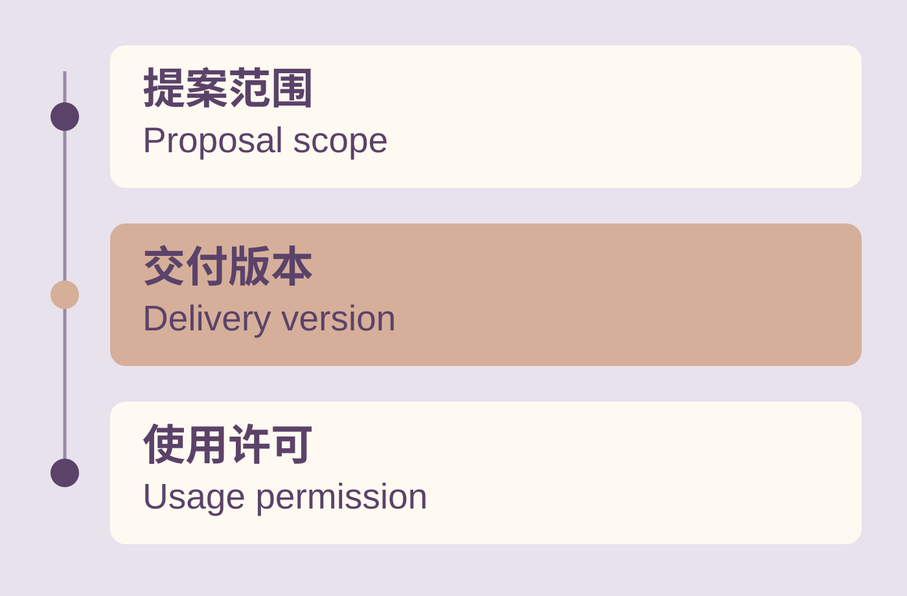

# Popular Pays: Clarify the Creator Assignment

Status: local review draft; confirm the publication date before release.

Popular Pays’ platform description supplies capability leads. Brands still need an acceptable creator assignment with production, publication, revisions, use and outcome evidence defined separately.

Popular Pays offers creator-content and influencer-collaboration services. Its public description includes discovery, collaboration management, content review and performance information; these are supplier descriptions rather than independent tests conducted here. For a particular project, establish whether the purchase concerns production, publication on a creator account or another service, and separate content acceptance from subsequent use. Selecting a creator, receiving a file or approving it should not automatically mean that every fact, permission, publication and business outcome has been confirmed.

## Turn supplier capabilities into project questions

[Popular Pays’ platform overview](https://popularpays.com/) describes discovery, commissioning, collaboration and analysis, distinguishing content production for brands from distribution through influencers' own channels. Use it to prepare questions without copying performance promises.

A public capability does not establish what a proposal includes. Confirm who performs the work, which services are supplied, what the brand must prepare and which conditions remain unpriced or unconfirmed.

The [modular creator-services method](https://www.quickkol.com/blog/influencer-marketing-services-modular-brief/#answer) helps identify the actual missing work. If the team needs filming only, additional platform functions should not automatically create a purchase of discovery, full management and every report.

This article has not logged in, trialled or tested the paid service and supplies no unverified pricing. Its output is a specific discussion list so a demonstration or proposal can answer a real business requirement. That gives a platform review a concrete purpose without pretending a marketing page supplies the evidence an actual project would need to proceed.

## Define production and personal-channel publication separately

Making content for a brand and recommending a product on a creator's own channel are related but different contributions. Specify the work, publishing identity and relationship separately so several videos does not conceal two unstated tasks.

The [UGC production-and-posting role guide](https://www.quickkol.com/blog/ugc-content-creator-on-camera-production-role/#answer) separates appearance, filming, editing and account distribution. For team production, also confirm who participates instead of inferring from a profile that the named person performs every step.

If personal experience is needed, arrange actual use and fact checks. If the requirement is production expression, describe that accurately rather than turning performance into a first-person use story that never happened.

This makes proposals comparable. Two offers listing three videos may differ because one includes publication while the other supplies files only. Review scope before fees instead of treating matching quantities as equivalence. The creator also gains a clearer assignment, knowing whether the brand is commissioning an asset, an audience-facing recommendation or both under separately stated conditions.

## Confirm the assignment after a proposal is selected

Selecting a candidate or expressing interest can start discussion without filling in length, versions, feedback and use arrangements. Put unresolved conditions in the actual assignment record.

The brand supplies a clear product question, facts and references while the creator confirms a feasible contribution. A reference indicates direction rather than authorizing copying another person's work or claiming their experience.

Assign a brand owner and define which responsibilities sit with a platform or service team. The creator then knows whom to ask about product facts, and multiple approvers are less likely to issue contradictory requests.

When the task changes, revisit scope, time and fees. The existence of a collaboration workflow does not automatically include every addition or establish acceptance of a request never clearly made. A usable assignment therefore records both what has been agreed and what remains open, rather than relying on platform participation to supply missing commercial or editorial decisions.

## Separate facts from expression during review

Product accuracy and real experience differ from pacing or tone. Separate these review questions rather than combining every comment into a general rejection.

[FTC’s influencer-disclosure guide](https://www.ftc.gov/business-guidance/resources/disclosures-101-social-media-influencers) emphasizes actual experience and substantiation in its United States context. A platform review cannot make an unexperienced event true or replace relationship wording appropriate to the intended market.

The creator retains personal experience while the brand supplies product facts. If opinions differ, identify the source of disagreement instead of concealing missing support with more confident speech.

Give revision comments a purpose and deliverable scope. Identify which information needs another shot and which fact awaits the product team rather than repeatedly changing adjectives. This makes feedback actionable without turning a style preference into a factual demand. It also helps the service team route a question correctly, since a product-claim issue and a request for a shorter opening need different owners and may have different implications for production.

Confirm which version needs another review too. A small text correction and a new product claim can have different implications; the owner should explain whether earlier approval still applies. This prevents a creator from completing one set of comments only to receive an unexplained contradictory request in the next round, while preserving the reason for any genuinely necessary change.

## Approve the content and intended uses separately

A file can pass expressive review while still needing confirmation of account, period, channel and advertising use. One platform approval should not expand into permission for every future purpose.

The actual agreement determines the arrangement; this article does not interpret a particular contract's legal effect. Find an explicit scope in the proposal and handoff rather than relying on a broad marketing phrase.

The creator's appearance, voice, other participants and source material can also have different applicable scopes. Confirm a new purpose instead of treating a downloaded file as freely adaptable in every way.

Connect usable versions with intended purposes so later teams can proceed. Accurate content and defined use support each other without either replacing the other. A well-organized library should therefore carry enough context for someone who did not attend the initial discussion to understand which version they may consider and which new request must return to the appropriate people for confirmation.

Content approval is one state; define the assignment and use scope separately so the handoff remains actionable.

## Check audio for the actual platform version

For a TikTok version, [TikTok’s commercial-music guide](https://support.tiktok.com/en/business-and-creator/creator-and-business-accounts/commercial-use-of-music-on-tiktok?lang=en) recommends its Commercial Music Library and distinguishes commercial conditions for music outside it. Finding a sound in the app does not establish permission for every brand use.

If other-channel versions are needed, tell the creator and service team early. Retaining or replacing music, speech and environmental sound depends on the actual material and permission scope.

Do not wait until approval to discover that the entire piece depends on an unconfirmed track. A clear spoken version or appropriate alternative may help, without unilaterally changing the meaning of the creator's voice.

A platform accepting a file does not establish that each sound works for advertising or cross-channel distribution. Audio review belongs to the assignment instead of being concealed by a general approved-content state. Planning the versions early can also reduce unnecessary re-editing, since a production decision can account for different destinations before rhythm and explanation depend entirely on one soundtrack.

## Hypothetical case: accepting three content pieces

Imagine a homeware brand discussing three product explanations through a platform, with the proposal not yet stating whether creator-channel publication is included. The team first defines production, publication and subsequent use.

This is not an actual Popular Pays client case. The brand prepares product facts, the creator confirms experience and filming scope, and both arrange feedback and confirmation without assuming the platform supplies every term automatically.

On receipt, review accuracy, expression, commercial context and audio separately. Accepting the film does not expand its uses; confirm the relevant account and usable version when publication is required.

The handover contains files, scope, owners and unresolved questions. The project can have a defined endpoint instead of treating one button state as completion of every responsibility or counting unagreed publication as a purchased outcome. The example illustrates an acceptance method the parties can discuss, not a claim about how the supplier's interface or standard contract behaves for every customer.

## Interpret performance evidence within its actual scope

When the supplier describes reporting or analytics, ask which objects, sources and observation windows are included. Convenient aggregation should not merge content completion, distribution and commercial income into one outcome.

For file production only, creator-channel data availability needs separate confirmation. With publication, distinguish the actual account, advertising, brand reuse and available evidence instead of making profile estimates campaign facts.

Without outcome information, retain the unknown. The brand can evaluate whether the film completed the assignment without inventing sales or causal contribution to make the project seem successful.

Review should inform the next decision: whether scope was clear, feedback was useful and the work remains usable for agreed purposes. Connecting a capability with actual evidence is more meaningful than repeating a supplier's performance slogan. It also lets the brand identify whether the next purchase needs different content, a different service component or simply a clearer handoff, rather than assuming more software automatically resolves the issue.

## Evaluate Popular Pays through a defined assignment

Popular Pays' public capabilities can prepare a supplier conversation, while the actual task, proposal and checkable conditions determine whether it fits.

Confirm production, publication, revisions, use and evidence separately so the brand understands its purchase and the creator understands completion. Keep platform states within what they can establish.

Do not describe supplier copy as independent testing or one approval as every future use and business result. Obtain missing conditions and revisit the agreement when work changes.

This evaluation remains centred on creator marketing: understand the contribution, prepare an accurate brief and turn a proposal into a bounded collaboration. Value needs actual work and evidence rather than being guaranteed by a platform name. A reviewable assignment gives the team something concrete to assess in a demonstration or commercial discussion, with open questions visible instead of hidden inside a broad promise of an end-to-end solution.

## From proposal to acceptance

| State | Can establish | Confirm separately |
| --- | --- | --- |
| Candidate selected | Interest in discussion | Complete assignment scope |
| File received | Material supplied | Facts and usable version |
| Content accepted | Specified review completed | Account, channel and use |
| Piece published | Actual publication state | Metrics and outcomes |
| Project reviewed | Evidence and decision | No automatic future guarantee |

Supplier public information and an editorial assignment framework; no login or independent paid-platform test, pricing claim or performance endorsement.

## Make the platform proposal a clear assignment

Use to prepare demonstration, procurement and handoff questions.

- [ ] Define the missing service.
- [ ] Separate production and personal-channel publication.
- [ ] Confirm product facts and actual experience.
- [ ] Review the film, audio and uses separately.
- [ ] Retain scope for evidence sources.
- [ ] Hand over versions, owners and unknowns.

## Research date and limitations

Sources reviewed November 19, 2026. Methods, tables and decision rules are editorial recommendations. Hypothetical examples are not actual client results or industry benchmarks. Source geography and periods are specified where relevant.

## Start creator research with a clear task

Use QuickKOL to interpret a brief, discover relevant creators and research their work and contact routes. Verify data, commercial terms and outcomes at their source.

[Explore QuickKOL](https://www.quickkol.com/#capabilities)

## Sources

- [Popular Pays’ platform overview](https://popularpays.com/)
- [FTC’s influencer-disclosure guide](https://www.ftc.gov/business-guidance/resources/disclosures-101-social-media-influencers)
- [TikTok’s commercial-music guide](https://support.tiktok.com/en/business-and-creator/creator-and-business-accounts/commercial-use-of-music-on-tiktok?lang=en)
