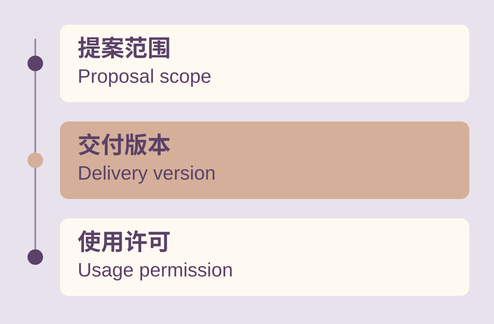

# Popular Pays 怎样核对提案

状态：本地审阅稿；正式发布日期待确认。

Popular Pays 的平台介绍提供能力线索，品牌仍需把具体提案写成可验收的达人任务，分别确认制作、发布、修改、使用和结果资料。

Popular Pays 是提供创作者内容与达人合作服务的平台。其公开介绍包括发现、合作管理、内容审阅与表现资料等能力；这些是供应商说明，不是本篇独立实测结果。品牌评估具体项目时，仍应确认采购的是制作、达人账号发布还是其他服务，并把内容验收与后续用途分别说清。选中创作者、收到素材或点击批准，都不应被默认解释为全部事实、许可、发布与业务结果已经确认。

## 把供应商能力转成项目问题

[Popular Pays 的平台介绍](https://popularpays.com/)描述了发现、委托、协作与分析等流程，并区分品牌内容制作和达人个人频道传播。品牌可以据此准备问题，不直接复制效果承诺。

公开页面上的能力不一定说明具体提案包含什么。核对由谁执行、提供哪些工作、需要品牌准备哪些资料，以及哪些条件还没有报价或确认。

[达人营销服务模块方法](https://www.quickkol.com/zh/blog/influencer-marketing-services-modular-brief/#answer)帮助识别真正缺少的工作。若团队只是缺少拍摄，不必因为平台有更多功能，就默认采购发现、全程管理与全部报表。

本篇没有登录、试用或测试 Popular Pays 的付费服务，也不提供未经核验价格。研究的产出是一份具体讨论清单，让下一步演示或提案能回答真实业务需要。

## 制作与个人频道发布分别写明

创作者为品牌拍摄内容，与在自己频道推荐商品，是相关但不同的贡献。分别写清作品、发布身份与关系，避免“几条视频”同时承担两种未说明任务。

[UGC 制作与发布角色指南](https://www.quickkol.com/zh/blog/ugc-content-creator-on-camera-production-role/#answer)帮助把出镜、拍摄、剪辑和账号传播拆开。团队制作时，也确认谁实际参与，不能只根据候选人的资料页推断全部工作由本人完成。

品牌若需要个人体验，安排相应使用与事实核验。若只需要某种制作表达，也应准确说明，不把演出包装成没有发生的第一人称使用故事。

这一步让提案能够比较。两份都写三个视频的方案，可能一个包含发布，另一个只交文件；先看范围，再讨论费用，而不是用数量表面相同认定等价。

## 选中提案后再确认任务

选中候选或表达兴趣，可以启动讨论，但不自动补齐作品长度、版本、反馈与使用安排。把尚未确认条件放进实际任务记录。

品牌提供清楚商品问题、事实资料与参考，创作者确认能够完成的贡献。参考作品说明方向，不应要求照抄他人内容或冒认原作者经历。

为合作安排一位品牌负责人，同时明确平台或服务团队负责哪部分。这样创作者知道向谁确认产品事实，也避免多个审批者给出互相矛盾要求。

需要变化时，回到范围、时间与费用讨论。平台存在协作流程，并不意味着任何新增工作都自动包含，也不证明创作者已经接受未明确提出的任务。

## 审稿先分清事实与表达

商品信息是否准确、体验是否真实，与镜头节奏或语气是否符合方向，是不同审稿问题。品牌可以分开反馈，避免把所有意见写成一个笼统的“不通过”。

[FTC 的达人披露指南](https://www.ftc.gov/business-guidance/resources/disclosures-101-social-media-influencers)在美国语境下强调真实体验与支持依据。平台里的内容审阅不能让没有发生的体验成立，也不能替代具体市场的关系说明。

创作者保留个人感受，品牌提供产品事实。若双方意见不同，先确认分歧来源，不用更肯定口播掩盖资料缺口。

给修改意见一个具体目的与可执行范围。说明哪个信息需要补镜头、哪项事实待产品团队确认，比不断换形容词更有助于完成准确内容。

也确认哪一版需要再次审阅。轻微文字修改与新增产品说法，影响可能不同；负责人应说明原批准是否仍适用，避免创作者按照一组意见改完，下一轮又收到完全相反要求。

## 批准内容与批准用途分别确认

一段素材可以在表达上通过，但仍需要确认发布账号、时期、渠道与广告用途。不要把一个平台批准动作扩写成所有未来使用都已允许。

具体安排由实际协议确认，本篇不替某份合同作法律判断。品牌应在提案与交接里找到明确范围，而不是依赖供应商宣传中的概括词。

创作者本人形象、声音、其他参与者与素材来源也可能有不同范围。需要新用途时，先确认，不因文件已下载就默认全部可改编。

将可用版本与适用用途对应，后续团队才能继续制作。准确成片与明确使用是互相支持的条件，任何一项都不能代替另一项。

内容批准是一项状态；把具体任务与使用范围分别说明，交接才可继续执行。

## 平台版本的音频需要实际核对

如果作品用于 TikTok，[TikTok 的商业音乐说明](https://support.tiktok.com/en/business-and-creator/creator-and-business-accounts/commercial-use-of-music-on-tiktok?lang=en)推荐商业音乐库，并区分库外音乐的商业使用条件。应用里能找到声音，不代表品牌全部用途都已获许可。

品牌若还需要其他渠道版本，提前向创作者与服务团队说明。音乐、口播与环境声怎样保留或替换，需要根据实际素材与许可范围确认。

不要等批准后才发现作品完全依赖一个未确认可用的音轨。可以准备清楚口述版本或适当替代安排，但不擅自改变创作者声音含义。

平台能接收文件，不证明每项声音都适用于广告或跨渠道传播。音频核对是具体任务的一部分，不应被一个笼统的内容通过状态盖住。

## 假设案例：三条内容怎样完成验收

假设家居品牌通过平台讨论三条商品解释，提案尚未说明是否包含创作者个人频道发布。团队先确认制作、发布与后续使用是哪些工作。

这不是 Popular Pays 实际客户案例。品牌准备商品事实，创作者确认实际体验与拍摄范围，双方安排反馈与确认方式，不预设平台自动提供全部条款。

收到素材后，分别审阅商品准确、表达、商业背景与音频。通过成片不自动扩大用途，需要发布时再确认对应账号和可用版本。

交接留下文件、范围、负责人和待确认问题。项目可以有明确结束点，而不是把一个按钮状态当作所有责任同时完成，或把未约定的发布计入已购买结果。

## 表现资料按照实际范围解读

平台介绍报表或分析能力时，品牌要问包含什么对象、来源与观察窗口。不能因为界面汇总方便，就把内容完成、传播与商业收入合成同一种结果。

若只采购文件制作，是否有创作者频道数据需要另行确认。若有发布，仍区分实际账号、广告、品牌复用与可得资料，不把候选资料页估计当成活动事实。

没有相应结果资料，可以保留未知。品牌可以评价成片是否完成任务，不必为了让项目显得成功而发明销售或因果贡献。

复盘应帮助下一次决定：任务是否清楚、反馈是否有效、作品是否可在已约定用途下继续使用。把工具能力落到实际资料，比重复供应商效果口号更有意义。

## 用明确任务评估 Popular Pays

Popular Pays 的公开能力可以帮助准备供应商讨论，真正决定是否采用的仍是当前任务、实际提案与能够核对的条件。

将制作、发布、修改、用途和资料分别确认，品牌才能看懂购买什么，创作者也知道怎样完成工作。平台状态保留在它能说明的范围里。

不把供应商介绍写成独立实测，也不把一次批准写成全部未来使用和业务结果。缺少条件时补资料，任务改变时重新约定。

这样的评估始终围绕达人营销：理解创作者贡献，准备准确 Brief，再把提案变成有范围的合作。最终价值需要实际工作与证据支持，不由一个平台名称提前保证。

## 从提案到验收的区分

| 状态 | 可以说明 | 另需确认 |
| --- | --- | --- |
| 候选选中 | 愿意继续讨论 | 全部任务范围 |
| 收到文件 | 材料已交付 | 事实与可用版本 |
| 内容通过 | 指定审阅完成 | 账号、渠道与用途 |
| 作品发布 | 实际公开状态 | 数据口径与结果 |
| 项目复盘 | 已得资料与决定 | 不可自动保证未来 |

供应商公开资料与编辑任务框架；未登录或独立测试付费平台，不提供价格或效果背书。

## 把平台提案写成清楚工作

用于准备演示、采购与交接问题。

- [ ] 明确缺少哪项服务。
- [ ] 区分制作与个人频道发布。
- [ ] 确认商品事实与真实体验。
- [ ] 分别审阅成片、音频与用途。
- [ ] 给资料来源保留范围。
- [ ] 交接版本、负责人和未知。

## 研究日期与使用边界

资料核验于 2026 年 11 月 19 日。文中方法、表格和决策规则为编辑建议，标为假设的示例不是实际客户结果或行业基准。外部资料的适用地区与时期按各段说明。

## 从任务开始达人研究

用 QuickKOL 理解 Brief、发现相关达人并研究作品与联系路径；数据、合作条件和结果仍需核验。

[了解 QuickKOL](https://www.quickkol.com/#capabilities)

## 来源

- [Popular Pays 的平台介绍](https://popularpays.com/)
- [FTC 的达人披露指南](https://www.ftc.gov/business-guidance/resources/disclosures-101-social-media-influencers)
- [TikTok 的商业音乐说明](https://support.tiktok.com/en/business-and-creator/creator-and-business-accounts/commercial-use-of-music-on-tiktok?lang=en)
