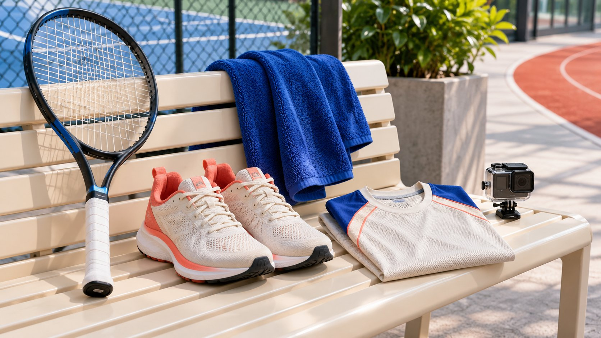
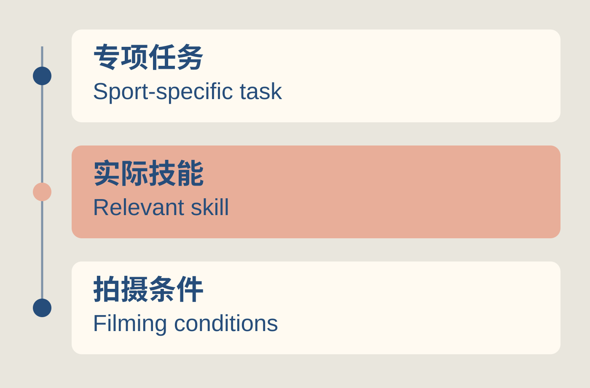

# Sports Clothing Brands: Match the Sport Context

Status: local review draft; confirm the publication date before release.

A sport-specific apparel partnership needs relevant work experience. Define the setting, product role and creator contribution before checking filming conditions instead of using an athletic appearance as evidence.

Sports clothing brands should first define the sporting context, the garment’s role in the explanation and the creator’s actual related work. Appearing on a court or wearing sports clothing does not establish specific skill, coaching qualifications or testing capability. Review genuine work, confirm personal participation and filming conditions, then agree a bounded explanation task. This guide concerns creator-marketing selection, not sports instruction, body outcomes or a promise that a garment necessarily improves performance.

## Turn a sport name into a specific content task

Find a tennis creator is still incomplete. The brand may need a pocket explanation, an account of ordinary venue use or post-session styling; these require different experience and expression.

State what viewers should understand before deciding which contribution is needed. A sport name should not become a complete capability list, nor should every relevant account be assumed willing to recommend a product.

The [apparel content-coverage method](https://www.quickkol.com/blog/fitness-apparel-creator-use-case-coverage/#answer) checks whether assignments complement each other. Here the further question is whether the sport context genuinely serves the explanation instead of acting only as an attention-getting backdrop.

Approach someone with relevant experience to discuss feasible expression without prescribing every shot at the start. A specific question gives the creator room and tells later colleagues why this setting relates to the garment. It also avoids selecting a person for an imagined sporting role when the actual commission is a product explanation that could be better performed through another demonstrated contribution.

## Confirm relevant experience through actual work

Examine how the creator actually participates in and explains the activity, retaining specific work and their role instead of relying only on clothing, equipment or profile labels.

For team-produced work, establish who appears, who explains and who can take part in this assignment. A public video need not reveal every internal arrangement, so ask a defined question when confirmation matters.

Relevant experience can have different depths without placing everyone on one universal scale. Judge whether this contribution is sufficient rather than guessing sporting ability from identity, body type or appearance.

Do not add a professional title unsupported by a qualification. If a task genuinely requires one, check appropriate evidence separately; ordinary product experience and specialist instruction should not silently exchange places in the proposal. This keeps discovery focused on the work being commissioned and allows the creator to describe limits without that honesty being mistaken for a lack of usefulness or interest in the partnership.

Older work does not establish current availability either. A creator may have changed working arrangements or no longer want to make that type of piece. Ask about this assignment rather than treating historical participation as a permanent commitment to accept similar commissions.

## A product explanation needs particular conditions

The same sport across venues, weather or activity stages can raise different product questions. Retain conditions relevant to the explanation rather than writing only a sport name in the record.

[Patagonia’s rainy-running context guide](https://www.patagonia.com/stories/guides/sport/what-to-know-about-running-in-the-rain/story-165147.html) discusses clothing through different conditions. It is an example of manufacturer context material, not this article directing an outdoor activity or independently validating product effects.

Use it to ask which ordinary setting the creator intends to explain, whether the brand reference corresponds and which conditions remain undecided.

If the environment changes, ask whether the expression remains valid. A different filming background should not expand a product claim, and a quiet-venue demonstration should not become a real competition or extreme-condition experience. Context makes a statement more specific; it does not give the brand permission to infer an experience that was never performed. The creator and product owner can confirm what the actual setting supports before production turns it into a broader narrative.

Return a sport label to actual work and the assignment rather than inferring qualifications or effects from appearance.

## Separate apparel experience from sporting performance

How clothing appears during movement can be useful content without proving improved speed, skill or physical condition. Real footage does not automatically establish that the product caused an outcome.

[FTC’s influencer-disclosure guide](https://www.ftc.gov/business-guidance/resources/disclosures-101-social-media-influencers) emphasizes actual experience and supported expression in its United States context. The brand should supply appropriate support for objective claims instead of asking a personal feeling to replace every evidential requirement.

Keep subjective judgment attached to its person, setting and scope. Convenience on one occasion should not become the same inevitable benefit for every participant, or acquire a specialist conclusion the creator never experienced.

Make the commercial relationship understandable too. Sport-specific experience does not erase sponsorship; clear context and actual conditions can coexist with natural expression. This protects the useful contribution of someone familiar with the activity while keeping their role distinct from a laboratory, medical professional or universal authority on how every wearer will perform in the garment.

## Let filming conditions support a genuine contribution

Venue, equipment and participants should fit the planned assignment. Confirm the actual filming arrangement before discussing actions the creator can naturally perform, rather than requesting an unfamiliar difficult feat at the last moment.

An ordinary demonstration or close-up may explain a garment detail without using more intense activity to manufacture credibility. This article supplies neither movement instruction nor a sports-risk assessment.

Separate bystanders and other participants from the actual partnership. Someone appearing in the background should not be edited into an endorsement, and a visible venue identity does not automatically indicate support for the campaign.

These considerations serve accurate content rather than expand the assignment. The creator can propose a better way to film, the brand confirms product facts and production arranges deliverable shots and necessary communication. A plausible sporting scene is useful only if it preserves what the people involved actually did and agreed to contribute, rather than relying on atmosphere to imply a larger collaboration.

## Return sport-specific references to the actual style

A brand may offer similar names with different materials, construction and care conditions. Being sports clothing does not allow one style's reference to be attached to another sample.

[Patagonia’s wool-care guide](https://www.patagonia.com/stories/guides/care-repair/how-to-wash-merino-wool/story-168066.html) emphasizes the specific label and fabric. It illustrates that product references have applicable objects; one specialist brand page is not a universal explanation of everything the manufacturer sells.

For a comparison, confirm the objects and supporting material first. Familiarity with a sport does not establish the ability to identify every fibre by touch or knowledge of internal manufacturer testing.

Assign factual ownership within the brand and preserve actual experience conditions in the piece. If material later serves another product, market or purpose, recheck facts and permission instead of letting sporting context replace version confirmation. This makes the creator’s expertise useful where it applies while leaving technical claims with the sources capable of supporting them. A clear contribution does not require pretending that one person knows every stage of product manufacture.

## Hypothetical case: different contributions beside a court

Imagine a brand needing a sports top's pocket explained and an outer layer styled for everyday use. One creator regularly makes court-related work while another specializes in styling; they may contribute differently.

This is not an actual candidate ranking. Review relevant pieces and confirm interest and conditions rather than assuming a court appearance establishes coaching qualifications or suitability for every claim.

The product owner provides style references, creators describe their actual experience and production confirms the venue and shots. The content claims no improved competition result and does not put background participants on the partner list.

The decision may involve two complementary contributions, a combined assignment or narrower scope. Sporting context helps explain the task instead of requiring one person to embody every identity and guarantee every result. The brand can then approach each candidate with a meaningful reason tied to observed work rather than a broad request that confuses appearance, skill and product endorsement.

## Review sport-context fit through the assignment

First review whether the agreed question was accurately explained, then examine audience response and available business evidence. Truthfulness, relevance to the sport and a high view count should not merge into one total score.

The [creator wear-observation method](https://www.quickkol.com/blog/workout-clothes-creator-wear-test-observation/#answer) retains personal experience and limitations. Sport-context fit likewise needs a statement of what was observed and which conclusions remain unestablished, instead of treating a familiar setting as proof of effectiveness.

For new questions, decide whether the answer needs product information, creator clarification or another expressive task. Replacing the person does not solve every issue, and the creator should not own gaps in brand facts.

Carry the learning into the next brief. The team can specify the contribution, setting and reference needed instead of restarting with a generic sporting label. This lets a partnership decision improve over time without turning one campaign into a permanent verdict on the creator’s skills or the entire category of sports clothing brands.

## Align sporting context with the creator contribution

Selection for sports clothing brands needs real work, a particular assignment and appropriate product facts together. A sport label supplies a lead without automatically establishing capability, qualifications or complete audience suitability.

Explain why the creator is being contacted, hear their proposal for expression and confirm actual conditions. Outreach becomes more specific and scope easier to discuss.

Retain the product version, actual experience and commercial context without expanding a setting into performance certification. Unsupported outcomes remain unknown rather than being concealed by more dynamic footage.

When relevant experience genuinely helps people understand the product, sports apparel content serves the creator-marketing purpose. The deliverable is an accurate, reviewable contribution rather than an expert image assembled from appearance and labels. The next decision can then concern whether that contribution fits the brief, with evidence and open conditions visible to both parties instead of implied by the sporting atmosphere alone.

## What to confirm for sport-context fit

| Question | Appropriate evidence | Avoid inferring |
| --- | --- | --- |
| What is explained? | Specific audience question | A label is an assignment |
| What has the person done? | Actual work and role | A setting proves qualification |
| What is the product context? | Style and supporting reference | Everything from the brand is identical |
| How is it filmed? | Actual arrangement and feasible contribution | Intensity proves credibility |
| What is reviewed? | Assignment, responses and conditions | Views prove product performance |

Editorial selection method, not qualification certification, movement guidance or a product-performance conclusion.

## Move from sport label to contribution

Use when preparing a sport-specific creator list.

- [ ] Define the audience and product question.
- [ ] Review actual relevant work.
- [ ] Confirm the person’s role and interest.
- [ ] Check context and product references.
- [ ] Plan filming the creator can naturally perform.
- [ ] Separate experience, qualifications and effects.

## Research date and limitations

Sources reviewed November 19, 2026. Methods, tables and decision rules are editorial recommendations. Hypothetical examples are not actual client results or industry benchmarks. Source geography and periods are specified where relevant.

## Start creator research with a clear task

Use QuickKOL to interpret a brief, discover relevant creators and research their work and contact routes. Verify data, commercial terms and outcomes at their source.

[Explore QuickKOL](https://www.quickkol.com/#capabilities)

## Sources

- [Patagonia’s rainy-running context guide](https://www.patagonia.com/stories/guides/sport/what-to-know-about-running-in-the-rain/story-165147.html)
- [FTC’s influencer-disclosure guide](https://www.ftc.gov/business-guidance/resources/disclosures-101-social-media-influencers)
- [Patagonia’s wool-care guide](https://www.patagonia.com/stories/guides/care-repair/how-to-wash-merino-wool/story-168066.html)
