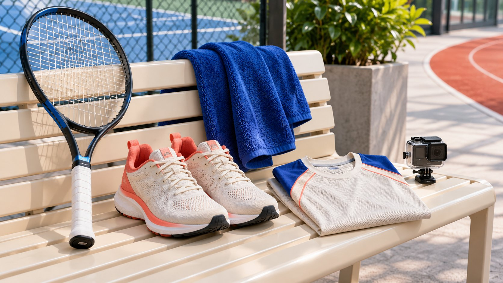
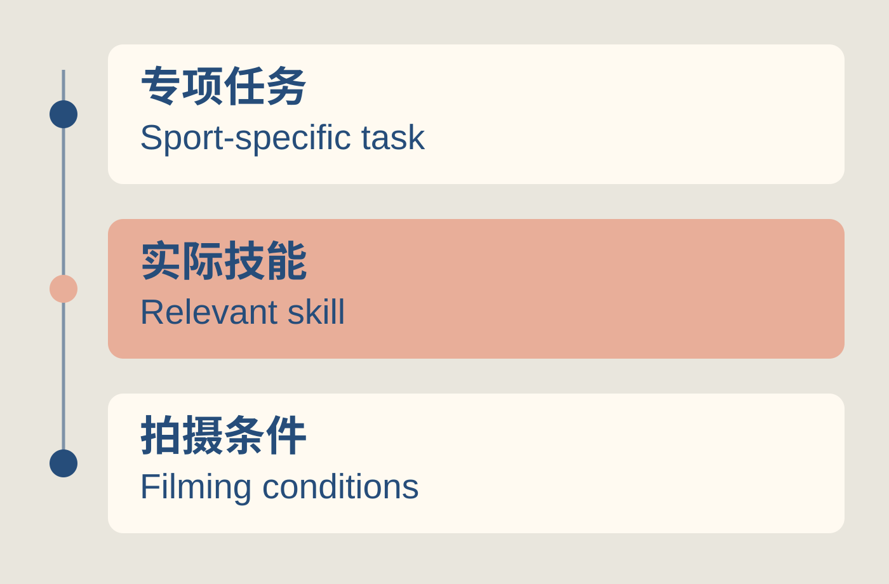

# 运动服品牌怎样核对专项达人

状态：本地审阅稿；正式发布日期待确认。

专项运动服合作需要对应实际内容经验。先定义运动情境、商品角色与创作者贡献，再核对拍摄条件，避免用运动外观代替能力与真实体验。

Sports clothing brands 选择达人时，先确定作品与哪种运动情境有关、衣服在解释中承担什么角色，以及创作者有哪些实际相关内容。出现在球场或穿着运动服，不自动证明具备专项技能、教练资格或产品测试能力。品牌应查看真实作品，确认本人参与与拍摄条件，再约定有范围的解释任务。本篇讨论达人营销选择，不提供运动教学、身体效果或某件衣服必然提升表现的保证。

## 把运动名称补成具体内容任务

写“找网球达人”仍不够。品牌可能需要解释服装口袋、记录普通场地使用，或制作赛后造型内容；三项工作对经验与表达的要求不同。

先说清观众要理解什么，再决定需要怎样的创作者。不要把一个专项名称当成全部能力清单，也不默认所有相关账号都愿意推荐商品。

[运动服内容组合方法](https://www.quickkol.com/zh/blog/fitness-apparel-creator-use-case-coverage/#answer)帮助检查任务之间是否互补。本文则进一步确认某项运动背景是否真实服务内容，而不是仅作为吸引注意的背景板。

品牌可以寻找有适当经验的人讨论可行表达，不必在研究开始时就规定所有镜头。一个明确问题给创作者空间，也让后续团队知道为什么这个运动情境与商品有关。

## 从实际作品确认相关经验

查看创作者近期怎样参与和解释相关活动。保留具体作品与本人角色，不只看服装、器材或自我介绍里的标签。

如果作品由团队完成，说明谁出镜、谁负责讲解以及谁能够参与这次任务。公开视频不必完整展示内部安排，需要时用明确问题确认。

相关经验可以有不同深度，不必将所有人排成统一等级。品牌要判断这项贡献是否足够，而不是凭身份、体型或外貌猜测运动水平。

不要给没有取得的专业资格补上头衔。若任务确实要求某种资格，另行核对适当证据；普通产品体验与专业指导不应该在提案中悄悄互换。

旧作品也不保证当前可用条件。创作者可能改变工作安排或不再愿意制作某类内容，先询问这次任务，不把历史参与当成永久合作承诺。

## 商品解释需要具体环境条件

同一运动在不同场地、天气或活动阶段，可能引出不同商品问题。品牌应保留与解释有关的实际条件，而不是只在表格写一个运动名称。

[Patagonia 的雨天跑步情境说明](https://www.patagonia.com/stories/guides/sport/what-to-know-about-running-in-the-rain/story-165147.html)以不同条件讨论衣物选择。这是制造商的情境资料例子，不是本篇为读者安排户外活动，也不是独立验证其产品效果。

研究者可据此提出更具体问题：创作者准备在哪种普通情境中解释，品牌资料是否对应这种使用，哪些条件尚未确定。

如果环境变化，先判断表达还成立吗。不要让拍摄背景的变化扩大产品主张，也不把一个安静场地的演示写成真实比赛或极端环境体验。

专项标签需要回到作品与任务，不凭运动外观推断资格或效果。

## 区分服装体验与运动表现

衣服在动作中怎样呈现，可以成为有用内容，但不能直接证明提高速度、技巧或身体状态。镜头真实发生，也不自动建立商品带来效果的因果关系。

[FTC 的达人披露指南](https://www.ftc.gov/business-guidance/resources/disclosures-101-social-media-influencers)在美国语境下强调真实体验与有依据表达。品牌应提供客观主张的适当支持，不要求创作者用个人感受代替全部证据。

主观评价保留本人、场景与范围。某次觉得方便，不应被改写成所有运动者都必然获得相同益处，更不能加入本人未体验的专业结论。

相关商业关系也需要让观众理解。出镜者有专项经验，不会让合作背景自动消失；清楚说明关系与真实条件，可以同时存在于自然表达里。

## 拍摄条件应支持真实贡献

场地、器材与参与人员应与计划任务相符。品牌先确认实际允许的拍摄安排，再与创作者讨论能自然完成的动作，不临时要求复制不熟悉的高难表现。

镜头需要说明商品细节时，可以选择普通演示或近景，不必靠更激烈活动制造可信感。文章不提供动作教学或运动风险评估。

将路人、其他参与者与品牌实际合作区分。背景出现的人，不应被剪成在为商品背书；场地标识也不自动代表场地方认可活动。

这些事项服务准确内容，而不是扩大任务。创作者可以提出更合适的拍法，品牌确认商品事实，制作人员再安排能交付的镜头与必要沟通。

## 让专项资料对应具体款式

品牌可能有同类名称但不同面料、结构与护理条件的商品。不要因都属于运动服，就把一个款式资料贴到另一个样品上。

[Patagonia 的羊毛护理说明](https://www.patagonia.com/stories/guides/care-repair/how-to-wash-merino-wool/story-168066.html)提醒按具体标签与面料处理。它说明商品资料有适用对象，不能把一个专项品牌页面当作旗下全部服装的统一说明。

需要比较时，先确认比较对象与支持资料。创作者熟悉某种运动，不等于能够凭触感识别全部成分，也不自动掌握制造商内部测试。

品牌安排事实负责人，作品保留实际体验条件。素材若转用于其他商品、市场或用途，再核对事实与许可，不让专项背景替代具体版本确认。

## 假设球场内容的不同贡献

假设品牌需要解释运动上衣的口袋与一件外套的日常搭配。一位创作者持续制作球场活动内容，另一位擅长服装搭配，两人可能承担不同任务。

这不是实际候选排名。团队查看相关作品，确认本人愿意参与与可用条件，不因某人出现在球场就假定他具备教练资格或适合全部宣传。

商品负责人提供款式资料，创作者各自说明真实体验，制作确认场地与镜头。内容不声称衣服提升比赛成绩，也不把背景参与者写成合作名单。

最终决定可能是两项互补贡献，也可能合并或缩小。专项背景用于解释任务，而不是让品牌必须寻找一个能包办全部身份与结果的人。

## 用任务结果复盘专项匹配

复盘先看约定问题是否得到准确解释，再看观众回应与可得业务资料。不要将内容是否真实、运动是否相关与观看量是否高混成一个总分。

[运动服穿着观察方法](https://www.quickkol.com/zh/blog/workout-clothes-creator-wear-test-observation/#answer)帮助保留个人经历与限制。专项匹配同样需要说明看到了什么，哪些结论仍未建立，而不是把熟悉场景当成效果证明。

有新问题时，判断需要商品资料、创作者补充还是新的表达任务。不是所有问题都通过更换达人解决，也不应让对方为品牌事实缺口负责。

把这次经验写回后续 Brief。团队会更清楚需要哪种贡献、场地与资料，不必每次重新从泛泛的运动标签开始。

## 让运动背景对应达人贡献

Sports clothing brands 的达人选择，需要真实作品、具体任务与适当商品事实一起支持。专项标签只能提供线索，不能自动确认能力、资格或全部受众适配。

品牌应让创作者知道为什么联系他，愿意听取适合的表达建议，并确认实际条件。这样外联更具体，也更容易讨论工作范围。

保留商品版本、真实体验与商业背景，不把场景扩写成性能认证。没有依据的结果保持未知，而不是用更有动感的镜头掩盖。

当相关经验真正帮助观众理解商品，运动服内容才与达人营销主旨相连。最终交付是一项准确、可审阅的贡献，而不是一个靠外观与标签拼成的专家形象。

## 专项达人匹配要确认什么

| 问题 | 适当证据 | 避免推断 |
| --- | --- | --- |
| 要解释什么 | 具体观众问题 | 标签就是任务 |
| 本人做过什么 | 实际作品与角色 | 场景就是资格 |
| 商品适用什么 | 款式与支持资料 | 同品牌全部一样 |
| 怎样拍 | 实际安排与自然贡献 | 更激烈就更可信 |
| 复盘什么 | 任务、回应与条件 | 观看量证明性能 |

编辑选人方法，不是运动资格认证、动作指导或商品性能结论。

## 从运动标签走到具体贡献

在准备专项达人名单时使用。

- [ ] 写清观众与商品问题。
- [ ] 查看实际相关作品。
- [ ] 确认本人角色与意愿。
- [ ] 核对情境与商品资料。
- [ ] 安排能自然完成的拍摄。
- [ ] 分开表达体验、资格与效果。

## 研究日期与使用边界

资料核验于 2026 年 11 月 19 日。文中方法、表格和决策规则为编辑建议，标为假设的示例不是实际客户结果或行业基准。外部资料的适用地区与时期按各段说明。

## 从任务开始达人研究

用 QuickKOL 理解 Brief、发现相关达人并研究作品与联系路径；数据、合作条件和结果仍需核验。

[了解 QuickKOL](https://www.quickkol.com/#capabilities)

## 来源

- [Patagonia 的雨天跑步情境说明](https://www.patagonia.com/stories/guides/sport/what-to-know-about-running-in-the-rain/story-165147.html)
- [FTC 的达人披露指南](https://www.ftc.gov/business-guidance/resources/disclosures-101-social-media-influencers)
- [Patagonia 的羊毛护理说明](https://www.patagonia.com/stories/guides/care-repair/how-to-wash-merino-wool/story-168066.html)
