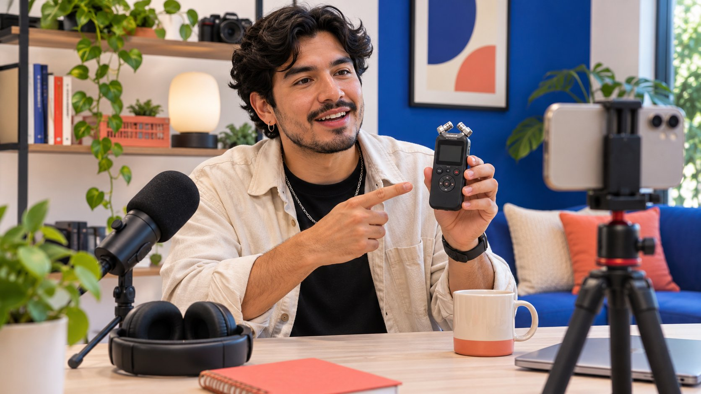
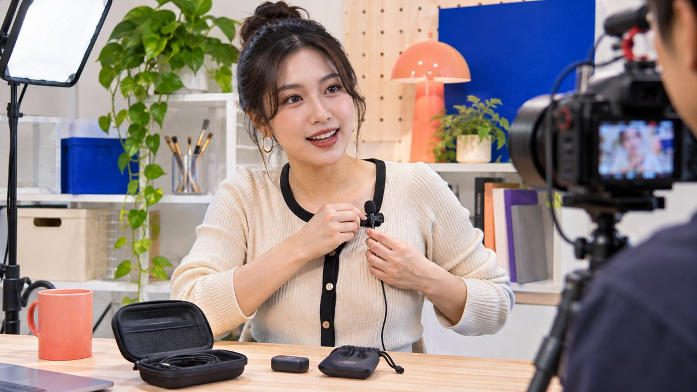

# Become a TikTok Influencer: Build Brand-Ready Work

Status: local review draft; confirm the publication date before release.

Prepare for TikTok creator partnerships by turning a subject contribution into checkable work, then supplying clear evidence and a proposal that identifies the task and conditions.

An actionable starting point for how to become a TikTok influencer is identifying an audience question you can repeatedly help answer and demonstrating that contribution through real work. Then organize samples, appropriate audience evidence and partnership conditions so a brand can propose a concrete task. Follower totals, one popular post or programme eligibility cannot independently establish collaboration capability. This guide concerns creator-marketing readiness and promises no fixed growth speed, admission or income.

## Identify a contribution you can actually make

Start with experience, ability and questions you are willing to keep investigating. The contribution might explain equipment use, document a making process, compare practical choices or clarify a difficult concept, rather than begin with an excessively broad title.

Identify whom the work helps and what someone should understand after a piece. That description should let a brand assess relevance without claiming suitability for every category.

Preserve ability boundaries too. Familiarity with a product does not establish professional qualifications, and personal experience cannot determine conditions for everyone. A supported contribution gives a partnership a better basis than an unverifiable expert identity.

Brand researchers can use this step as well: examine what the creator actually explains before deciding to contact them. A person's presence in a life setting does not establish willingness or ability to endorse every related product. The proposal should connect observable contribution to an audience task, giving the creator room to confirm what they genuinely want to make and what remains outside their work.

## Make the contribution visible in real work

Prepare work that shows a specific capability instead of supplying only an introduction. A clear demonstration, conditional comparison or complete response to an audience question can help a brand understand the expression.

Distinguish experience that occurred from ideas still planned. A self-directed exercise can be labelled a sample without being presented as a client commission, invented brand approval or commercial result.

When choosing examples, explain which parts you handled. Appearance, research, filming and editing may involve different people. Team production need not be hidden, but another person's work should not become a claim of independent execution.

Retain original sources and display scope. Having participated in a production does not necessarily permit publication of every client asset as a case study. Choose material that can appropriately be shared so the portfolio provides reliable evidence. A concise explanation of role and conditions often answers a buyer's practical question better than an impressive montage with no account of who did what or which experience the images represent.

A sample demonstrates actual contribution and production conditions; distinguish self-directed work from a confirmed client commission.

## Understand recommendation factors without promising a formula

[TikTok’s recommendation explanation](https://support.tiktok.com/en/using-tiktok/exploring-videos/how-tiktok-recommends-content) describes factors including user interactions, content information and user information, noting that their relative importance can change. It is not a formula guaranteeing a view total for every account.

Use that context to value relevance to audience questions, observe actual responses and improve expression. One stronger result should not become an absolute technique or a promise of platform distribution to a brand.

When reviewing your work, retain topic, form, observation period and distribution conditions. Which feedback was seen and which part will change should be more specific than the algorithm likes me.

With limited information, record observations and hypotheses. Partnership readiness involves understanding feedback and carrying out a next step, not inventing a secret causal rule or manufacturing engagement to make performance look stable. A buyer can appreciate a creator's learning process without requiring them to predict a recommender system whose outcomes depend on people and conditions beyond the commissioned task.

## Organize evidence relevant to the assignment

Organize public work, channel subject, appropriate audience information and business contact routes in an updateable record. Retain source, period and unit for each number; unverified estimates should not become supposed backend facts.

The [media-kit review method](https://www.quickkol.com/blog/what-is-a-media-kit-brand-review/#answer) helps establish what the brand actually needs. The presentation can be concise while explaining recent work, proposed assignments and conditions not yet confirmed.

Do not supply unrelated audience identities or account credentials to make it look complete. If the brand needs a market or format check, discuss appropriately scoped evidence instead of assuming full account access is required.

Explain production capacity and the communication route too. Additional team members, a location or preparation belong in the proposal when needed. These conditions help shape a deliverable assignment rather than undermine competence. An honest capacity statement allows the brand to plan review and release realistically, and prevents a polished portfolio from being mistaken for a promise that the creator can produce any volume on any deadline.

## Keep experience and the commercial relationship clear

[FTC’s influencer-disclosure guide](https://www.ftc.gov/business-guidance/resources/disclosures-101-social-media-influencers), in its United States context, discusses material relationships and emphasizes that product experience or unsupported effects must not be invented. A gift does not automatically make the relationship non-commercial.

Creators can prepare clear relationship wording within their own expression, while the intended market and form still need appropriate confirmation. A vague profile statement should not be assumed to settle every sponsored publication.

The brand should supply accurate product information and allow actual experience and conditions to remain visible. Readiness is not learning to praise every item; it is completing truthful, useful work within an agreed scope.

Where a fact remains unresolved, retain the question and assign an owner. Explaining the evidence needed is more constructive than adding an overconfident spoken claim after filming. It also makes feedback easier: a disagreement about product fact can be sent to the relevant source, while an expressive choice can remain a discussion with the creator rather than being treated as a demand to change their experience.

## Check audio for the commercial version early

[TikTok’s commercial-music guide](https://support.tiktok.com/en/business-and-creator/creator-and-business-accounts/commercial-use-of-music-on-tiktok?lang=en) recommends the Commercial Music Library for brand, product or service promotion and explains that its existing licenses for music outside that library do not cover commercial use in content. Finding a song in the app is not a complete permission basis.

The [TikTok commercial-audio brief method](https://www.quickkol.com/blog/tiktok-sounds-creator-commercial-audio-brief/#answer) further separates audio purpose, source and cross-channel versions. Before production, the creator should understand whether the work is an ordinary publication, brand commission or asset also intended for advertising reuse.

Speech, environmental sound and music should support the explanation. If the brand later needs another-channel version, platform music should not be assumed to travel with it; retain appropriately adaptable material and confirm the corresponding use.

This does not require every beginner to build a complex recording system. The point is to make expression and commercial conditions work together rather than discover after editing that the audio cannot serve the promised use. Planning a clear spoken version can be more practical than making the entire piece depend on one unconfirmed song.

## Discuss a bounded partnership through a clear proposal

A proposal can begin with real work, explain its connection to the brand's task and offer a specific contribution you can deliver. Avoid a universal promise sent without understanding the product or audience question.

Discuss production, publication, feedback, fees and permission separately. Quantity, use period, other accounts and advertising should not be hidden inside one collaboration.

Without client outcomes, supply samples and hypothetical ideas labelled accordingly. A brand that has not responded or accepted should not appear on a confirmed-partner list.

Platform programmes have their own qualifications and market conditions; one earnings route is not the universal starting mechanism for every brand relationship. Suitability for this assignment depends on work evidence and actual agreement together. A proposal can therefore be modest and professional: it identifies a clear contribution, the conditions needed and what remains open, rather than relying on exaggerated status or promising a result that neither party can establish in advance.

## Rehearse readiness with a hypothetical recording-device sample

Imagine a creator skilled in explaining portable recording equipment who wants to discuss a relevant brand partnership. First make a sample with intelligible demonstration audio and visible essential operation, identifying it as a self-directed exercise.

The portfolio records the explanation and production actually handled, retaining experience conditions instead of extending one device's performance in one setting into a universal result. If numerical evidence is unavailable, do not fill the gap with an invented success case.

The proposal can ask which use question the brand wants explained, which version it needs and whether other publication or advertising uses are planned. The brand supplies facts, the creator confirms expression and working conditions, and both decide whether to proceed.

This example contains no actual brand endorsement, views or earnings. It shows readiness moving from a claimed ability to visible work and then an assignment that can be discussed. The creator is demonstrating a useful contribution while leaving the brand's commercial decision open, rather than treating a sample as proof that a partnership already exists.

## Build a partnership record through deliverable work

After a first defined assignment, deliver within scope and retain versions, feedback and release records. Only work and outcomes appropriately authorized for sharing should enter later case material; internal information is not automatically public.

In review, distinguish completed work, audience response and commercial outcomes. A valuable explanation can be acknowledged while a growth or sales question remains unproven. Inflated numbers are not needed to make the work meaningful.

The creator-marketing answer to how to become a TikTok influencer is a continuing credible contribution that brands can inspect, discuss and commission. Programme eligibility, data, commercial relationships and rights retain their separate scopes.

For the creator, this creates clearer preparation; for the brand, a more dependable basis for discovery and outreach. Starting from real work makes it easier for both parties to move from interested contact to an actual bounded partnership. The strongest next step is therefore something the creator can demonstrate and the brand can evaluate, with the unconfirmed outcome left visible rather than promised away.

## Evidence for TikTok partnership readiness

| Preparation | Evidence to show | Boundary |
| --- | --- | --- |
| Subject contribution | Work addressing an audience question | No invented qualification |
| Production role | Own and team responsibilities | Do not claim others’ work |
| Audience information | Source, period and authorized scope | Unknowns are not facts |
| Commercial expression | Actual experience and clear relationship | No views or earnings guarantee |
| Proposal | Task, fee, publication and rights | No partnership before acceptance |

Editorial readiness framework, not official TikTok eligibility, admission or an earnings promise.

## Make the contribution understandable to a brand

Begin with real work, then confirm conditions.

- [ ] Choose an audience question you can keep explaining.
- [ ] Make and label real work or samples.
- [ ] State your role and experience limits.
- [ ] Organize appropriate audience evidence and contact routes.
- [ ] Check commercial context and audio use early.
- [ ] Propose a bounded task without guaranteeing uncontrollable outcomes.

## Research date and limitations

Sources reviewed November 19, 2026. Methods, tables and decision rules are editorial recommendations. Hypothetical examples are not actual client results or industry benchmarks. Source geography and periods are specified where relevant.

## Start creator research with a clear task

Use QuickKOL to interpret a brief, discover relevant creators and research their work and contact routes. Verify data, commercial terms and outcomes at their source.

[Explore QuickKOL](https://www.quickkol.com/#capabilities)

## Sources

- [TikTok’s recommendation explanation](https://support.tiktok.com/en/using-tiktok/exploring-videos/how-tiktok-recommends-content)
- [FTC’s influencer-disclosure guide](https://www.ftc.gov/business-guidance/resources/disclosures-101-social-media-influencers)
- [TikTok’s commercial-music guide](https://support.tiktok.com/en/business-and-creator/creator-and-business-accounts/commercial-use-of-music-on-tiktok?lang=en)
