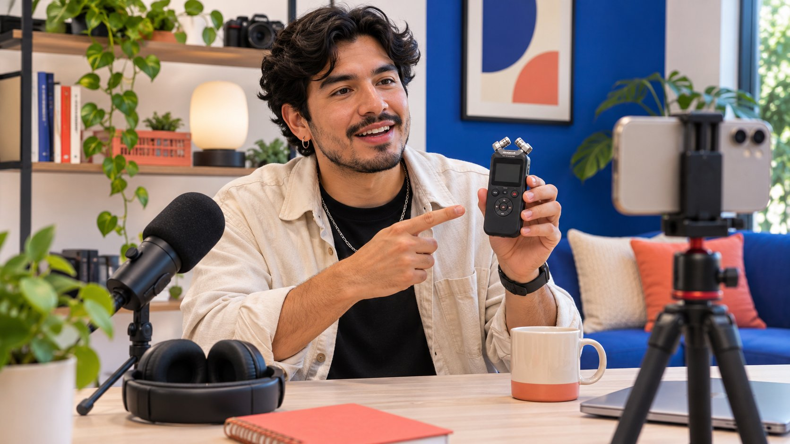
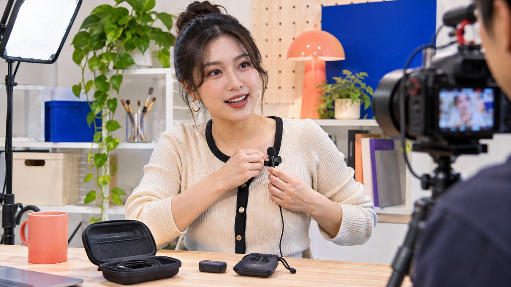

# TikTok 创作者怎样准备合作证据

状态：本地审阅稿；正式发布日期待确认。

想参与 TikTok 达人合作，先把主题贡献做成可核对作品，再准备清楚的资料与提案，让品牌知道你能完成什么、条件是什么。

How to become a TikTok influencer 的可执行起点，是确定你能持续帮助哪类观众解决什么问题，并用真实作品证明这种贡献。随后整理内容样本、适当的受众资料与合作条件，让品牌能够提出具体任务。粉丝数字、一次热门内容或平台项目资格，都不能单独确认合作能力；本篇侧重达人营销准备，不承诺固定涨粉速度、录取或收入。

## 先确定自己的主题贡献

从真实经验、能力与愿意持续研究的问题开始。可以是解释设备使用、记录制作过程、比较生活选择，或把复杂概念讲得清楚，而不是先给自己一个过于宽泛的头衔。

写明希望服务谁，以及他们看完一条作品后能理解什么。这个描述应帮助品牌判断是否有关，不需要宣称自己适合所有品类。

同时保留能力边界。熟悉某个产品，不等于拥有专业资格；个人体验也不能替所有人作结论。把有依据的贡献讲清楚，比加上无法验证的专家身份更能支持长期合作。

品牌研究者也可使用这一步：先看创作者实际解释什么，再决定是否值得联系。不要因为一个人处于某种生活场景，就假定他愿意或有能力为任何相关商品背书。

## 把贡献做成可以查看的作品

准备能展示具体能力的作品，而不只写一份自我介绍。一次清楚演示、一段有条件的比较，或对观众问题的完整回应，都可能帮助品牌理解你的表达。

作品应区分真正发生的体验与计划中的设想。自行练习可以说明是样片，不把它包装成已经完成的客户项目，也不虚构品牌认可或商业结果。

选择代表作品时，说明你负责哪些部分。出镜、研究、拍摄和剪辑可能由不同人完成，团队合作不需要隐藏，但不能把别人的工作直接写成自己独立完成。

保留原始出处与可展示范围。你曾参与制作，不等于可将全部客户素材公开作为案例；选用能适当分享的片段，才让作品集成为可靠的合作依据。

样片展示真实贡献与制作条件；自主练习应与已确认客户项目区分。

## 理解推荐因素与适用范围

[TikTok 的推荐说明](https://support.tiktok.com/en/using-tiktok/exploring-videos/how-tiktok-recommends-content)介绍用户互动、内容信息与用户信息等因素，并指出不同因素的重要性可能变化。它不是一套保证任何账号达到某个观看数的公式。

创作者可以据此重视内容与观众问题的相关性，观察实际回应，再持续改进表达。不能把一次表现较好归结为某个绝对技巧，更不应为品牌承诺平台必然分发。

研究自己的作品时，保留主题、形式、观察期与分发条件。看到了哪些反馈，准备改变哪个部分，都应比“算法喜欢我”更具体。

没有足够资料时，先记录观察与假设。合作准备需要展示你能理解反馈并完成下一步，不需要把尚未建立的因果规律写成秘诀，或通过人为互动来制造看似稳定的表现。

## 整理与任务有关的合作资料

把公开作品、频道主题、适当受众资料与商务路径整理到可更新记录中。每项数字保留来源、观察期和单位，未核验的估计不要混写成账号后台事实。

[媒体包审阅方法](https://www.quickkol.com/zh/blog/what-is-a-media-kit-brand-review/#answer)帮助判断品牌真正需要什么。展示资料可以简洁，但应让对方知道你的近期作品、拟接任务与尚未确认的条件。

不要为了看起来完整而提供无关观众身份或账号凭证。品牌需要核对某个市场或内容形式时，可以讨论适当范围的资料，而不是默认交出全部访问。

也说明制作容量与合作沟通方式。若需要其他团队成员、特定场地或额外准备，把条件放在提案里；这些事实有助于制定可交付任务，而不是对能力的否定。

## 说明真实体验与商业关系

[FTC 的达人披露指南](https://www.ftc.gov/business-guidance/resources/disclosures-101-social-media-influencers)在美国语境下说明重要商业关系的披露，也强调不能虚构未发生的产品体验或没有依据的效果。品牌提供礼品，并不会自动让关系变成与商业无关。

创作者可以准备如何在自己的表达里清楚说明关系，但具体市场与格式需要相应确认。不要只在个人简介里放一句模糊文字，就认为每条合作已处理完整。

品牌则应提供准确产品资料，允许创作者保留实际体验与条件。合作准备不是学会说任何商品都很好，而是能在双方确认范围内完成真实、有用的内容。

如果某项事实还不能确认，就保留问题并安排负责人。清楚说出需要什么依据，比在拍摄后临时补一个过度肯定的口播更有助于合作。

## 为商业版本提前检查音频

[TikTok 的商业音乐说明](https://support.tiktok.com/en/business-and-creator/creator-and-business-accounts/commercial-use-of-music-on-tiktok?lang=en)推荐推广品牌、产品或服务时使用商业音乐库，并说明库外音乐的既有平台许可不覆盖内容中的商业使用。应用里能找到一首歌，不是完整许可依据。

[TikTok 商业音频 Brief 方法](https://www.quickkol.com/zh/blog/tiktok-sounds-creator-commercial-audio-brief/#answer)进一步区分声音任务、来源与跨渠道版本。创作者可以在制作前知道这次是普通作品、品牌委托还是另有广告复用需求。

口述、环境声与音乐也要能支持解释。若品牌后来需要另一渠道版本，不应默认平台音乐可以直接跟随；保留可适当修改的素材范围，并重新确认对应使用。

这不要求每个新创作者建立复杂录音系统。关键是让作品表达与商业条件一起成立，而不是等到全部剪辑完成，才发现声音选择无法服务原先承诺的用途。

## 用清楚提案讨论一项有限合作

提案可以从某条真实作品出发，说明它与品牌任务的关系，再提出你能够完成的具体贡献。不要群发一个没有看过商品与受众问题的万能承诺。

把制作、发布、反馈、费用和许可分别讨论。作品条数、使用时期、其他账号与广告用途，都不应藏在“合作一次”的模糊说法里。

没有实际客户结果时，可以提供样片与假设方案，并明确它们的状态。品牌没有回复或接受前，也不把它的名称放进已合作名单。

平台项目有各自资格与市场条件，不能把一个收入入口当成所有品牌合作的统一开始方式。是否适合这项任务，最终需要作品依据与双方实际约定共同确认。

## 用假设录音设备作品练习准备

假设创作者擅长解释便携录音设备，希望与相关品牌讨论合作。先制作一条能够听清演示、看清关键操作的样片，并说明这是自主练习。

作品集记录本人负责的讲解与制作，保留真实体验条件，不把一个设备在某次环境中的表现扩写成所有人的通用结果。数字资料若未取得，就不填造成功案例。

提案可以询问品牌希望解释哪类使用问题、需要哪个版本，以及是否还有其他发布或广告用途。对方提供事实，创作者确认表达与工作条件，双方再决定是否开展。

这个例子没有真实品牌认可、观看或收入结果。它展示合作准备如何从能力描述走向可查看作品，再走向一项可以继续讨论的明确任务。

## 用持续可交付的工作建立合作记录

获得第一项明确任务后，按实际范围交付并保留版本、反馈与发布记录。只有真正获准分享的内容与结果，才进入后续案例，不把内部资料自动公开。

复盘时分清作品完成、观众回应与商业结果。一次有价值的解释可以成立，同时某个增长或销售问题仍没有足够证据；不必用夸大数字来让工作显得有意义。

How to become a TikTok influencer 的达人营销答案，是持续做出可信贡献，并让品牌能够核对、讨论和采购合适工作。平台资格、数据、商业关系与许可各自有范围。

对创作者而言，这形成更清楚的合作准备；对品牌而言，也形成更可靠的发现与外联依据。双方从真实作品开始，才更容易把一个有兴趣的联系变成范围清楚的实际合作。

## TikTok 达人合作准备的证据

| 准备事项 | 可展示依据 | 保留边界 |
| --- | --- | --- |
| 主题贡献 | 解决具体观众问题的作品 | 不虚构专业资格 |
| 制作角色 | 本人完成与团队负责部分 | 不冒认他人工作 |
| 受众资料 | 来源、时期与获准范围 | 未知不写成事实 |
| 商业表达 | 真实体验与清楚关系 | 不保证观看或收入 |
| 提案 | 任务、费用、发布与许可 | 未接受不算已合作 |

编辑合作准备框架，不是 TikTok 官方资格标准、录取或收入承诺。

## 让品牌能理解你的具体贡献

从真实作品开始，再确认合作条件。

- [ ] 选择能持续解释的观众问题。
- [ ] 制作并标明真实作品或样片。
- [ ] 说明本人角色与体验限制。
- [ ] 整理适当受众资料与商务路径。
- [ ] 提前核对商业关系与音频用途。
- [ ] 提出有范围的任务，不保证不可控结果。

## 研究日期与使用边界

资料核验于 2026 年 11 月 19 日。文中方法、表格和决策规则为编辑建议，标为假设的示例不是实际客户结果或行业基准。外部资料的适用地区与时期按各段说明。

## 从任务开始达人研究

用 QuickKOL 理解 Brief、发现相关达人并研究作品与联系路径；数据、合作条件和结果仍需核验。

[了解 QuickKOL](https://www.quickkol.com/#capabilities)

## 来源

- [TikTok 的推荐说明](https://support.tiktok.com/en/using-tiktok/exploring-videos/how-tiktok-recommends-content)
- [FTC 的达人披露指南](https://www.ftc.gov/business-guidance/resources/disclosures-101-social-media-influencers)
- [TikTok 的商业音乐说明](https://support.tiktok.com/en/business-and-creator/creator-and-business-accounts/commercial-use-of-music-on-tiktok?lang=en)
