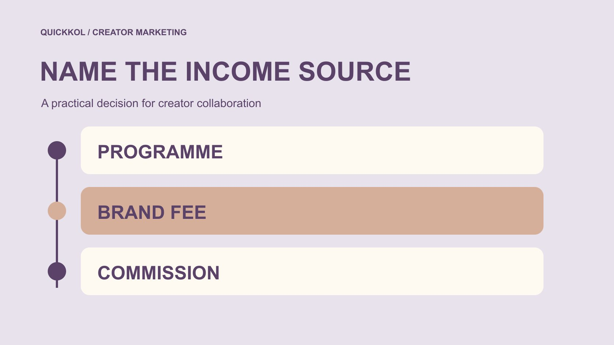
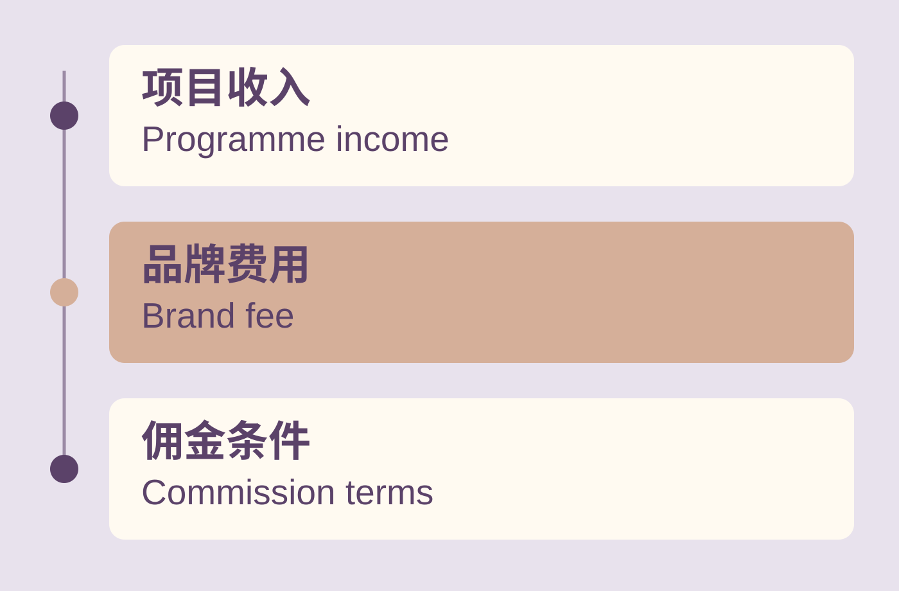

# Cómo Monetizar TikTok Across Markets

Status: local review draft; confirm the publication date before release.

Spanish-language content is not one national market. Discuss TikTok creator income through creator location, audience context, payer and intended use before checking the relevant programme conditions.

QuickKOL editorial graphic; not actual account metrics or a platform interface.

Como monetizar TikTok asks about monetizing TikTok in Spanish, but Spanish expression does not establish an account in Spain or identical programme conditions across Spanish-speaking markets. A brand should distinguish creator location, intended audience, who pays for which work and whether the content is sponsored. Platform rewards, brand production or publishing fees and affiliate commissions are separate arrangements with distinct eligibility and payment conditions. This practical guide prepares specific cross-market creator partnerships without fixed-income promises or inferring availability from language.

## Separate Spanish expression from the national market

A Spanish-language piece may serve people in different places and be made by a creator living elsewhere. Language, creator location and audience origin are three facts to establish separately.

Accent, a name or a flag in a profile should not determine assumptions about programme eligibility. Ask for appropriately relevant information rather than unnecessary identity records.

A cross-market brief should state whom the work helps, the markets in which the product is actually available and who supplies the facts. Language should serve comprehension instead of becoming shorthand for every business condition.

The Chinese and English versions here help a brand address this Spanish search intent without posing as an official programme guide for a country. The owner still confirms account and regional conditions through the appropriate official route. Separating these questions early prevents a Spanish-speaking candidate from being approached under conditions inferred from another creator or another market whose circumstances may be entirely different.

## Identify the payer for each income arrangement

First identify who pays whom and for what. A platform programme may process rewards under its own rules, a brand fee concerns agreed work and a commission requires product and attribution conditions.

The [TikTok revenue-preparation guide](https://www.quickkol.com/blog/tiktok-monetization-sponsored-work-eligibility/#answer) explains these arrangements generally. The focus here is a cross-market brief, where one phrase about monetization can mean very different work and payment expectations to different teams.

A creator's platform-reward screenshot should not establish a standard brand quote, and possible commission should not automatically become an agreed fixed production fee. Each statement needs its own source.

Retain the arrangement name, responsible party and open questions in handover. Even before an amount is confirmed, both sides should know which relationship they are discussing instead of discovering after production that they meant different income routes. This also lets a local market colleague review the right issue without treating every question as a request to interpret the same platform programme.

## Do not infer programme eligibility from a translated page

Being able to read a help page in Spanish does not establish that the programme applies to every Spanish-speaking account. The owner should check the particular programme, location and actual entry point; this guide offers no way to circumvent residence or eligibility conditions.

[TikTok One’s collaboration guide](https://support.tiktok.com/en/business-and-creator/tiktok-one) describes creator, advertiser and brand collaboration while retaining regional differences in eligibility. That concerns a collaboration platform, not one threshold shared by every income programme.

Joining an entry point does not establish that a brand assignment has been secured. Willingness, work capability and an actual agreement need separate confirmation; programme status should not enter a confirmed-partner list.

If the brand is procuring defined content work, discuss scope through the actual route without requiring the creator to claim an unconfirmed qualification. Leave unknown conditions with the appropriate owner for verification. A translated interface can make a question easier to read without answering the geographical or account-specific question itself.

## Assess sponsored work separately from rewards content

[TikTok’s rewards-programme comparison](https://support.tiktok.com/en/business-and-creator/creator-rewards-program/how-is-the-creator-rewards-program-different-from-the-tiktok-creator-fund) distinguishes qualified original work from sponsored content and other exclusions. An account's participation does not make every view of a brand commission reward-eligible.

The brief should identify product promotion, payment or other incentives and the intended publication. The creator then checks actual programme rules instead of letting a short translated income label conceal the content distinction.

Potential platform rewards should not automatically justify reducing an agreed brand fee. The purchased assignment and programme rewards arise from different relationships and must be discussed according to the actual agreement.

This guide supplies no universal amount per thousand views or invented monthly income derived from followers. Account eligibility, piece eligibility, estimates and actual settlement have different conditions, which cross-market discussion particularly needs to retain. A team can identify the relevant arrangement without claiming access to another person's earnings or treating an estimated display as proof of a completed payment.

One language can span different markets; confirm the actual parties and conditions for each arrangement.

## Treat localization as real expressive work

Spanish adaptation is more than replacing subtitles word for word. Product naming, use context and audience conventions may need explanation, and the brand should supply market-specific facts instead of asking the creator to guess.

Define whether the assignment needs speech, subtitles or a new shoot, and who checks facts and language. One market's product, price or supply arrangement should not transfer unconditionally to another merely because the language matches.

Preserve a way the creator can express the idea naturally. The brand can confirm accuracy without treating a market stereotype as every viewer's preference or asking the creator to perform an identity unrelated to actual experience.

Putting localization into scope helps discuss time, fees and feedback. An existing language version does not automatically include every adaptation or authorize anyone to redub it. The work can share a central explanation while requiring new decisions about which conditions the intended audience needs to hear and which product facts remain valid.

The [TikTok commercial-audio brief method](https://www.quickkol.com/blog/tiktok-sounds-creator-commercial-audio-brief/#answer) separates language adaptation from audio use. Confirm a new voiceover, music and other-channel versions independently; using Spanish does not automatically extend the original permission to every market or purpose.

## Make the commercial context understandable to the intended audience

[TikTok’s commercial-content disclosure guide](https://support.tiktok.com/en/business-and-creator/creator-and-business-accounts/promoting-a-brand-product-or-service) distinguishes promoting one's own business from a third-party brand relationship and requires the appropriate disclosure setting. Handle this platform issue separately from reward eligibility, brand fees and asset permissions.

Relationship wording should also be understandable to the people the piece serves. [FTC’s influencer-disclosure guide](https://www.ftc.gov/business-guidance/resources/disclosures-101-social-media-influencers) discusses clear disclosure in its United States context; an obscure foreign-language abbreviation should not be assumed to explain the entire relationship.

Confirm expression appropriate to the format and market while retaining actual experience and support. Translation should not expand I found this convenient in these conditions into a guarantee that everyone obtains the same result.

For multiple regional versions, check the relationship, product facts and destination separately. Approval of one version does not complete review of the others, and a setting label does not replace responsibility for truthful content. Localization needs the commercial meaning to survive along with the words, not merely a fluent sentence disconnected from the arrangement behind it.

## Retain work and payment states across teams

Cross-market work may involve a creator, a regional brand team and production partners. Identify who accepts the deliverable and who answers payment questions instead of confusing translation, approval and settlement responsibilities.

Amounts, currencies and payment states should come from the actual agreement and records. This article supplies no personal tax or financial advice; assign relevant issues appropriately instead of inferring an arrangement from the search phrase.

Where commission exists, confirm the product, window and attribution conditions rather than assuming another market's arrangement applies because the content is Spanish. Without a commitment or record, potential earnings should not be reported as paid income.

Use only facts authorized for sharing in an external case study. A creator supplying an internal record does not permit publication of their entire earnings history or justify promising similar income to someone else. A clear handover preserves the information needed for this assignment while leaving unrelated personal financial records outside the campaign's scope.

## Hypothetical case: prepare a Spanish organization tutorial

Imagine a brand inviting a creator who makes Spanish organization tutorials to explain a homeware product. The language is chosen, but supply covers only some markets and account-programme eligibility remains unverified.

This editorial example contains no actual fee or income. The brand first defines the intended market and available product version, the creator confirms actual use conditions, and both discuss production, publication and adaptation.

The owner still checks platform rewards under the particular rules. The brand neither counts sponsored views as rewards in advance nor substitutes possible commission for an unagreed production fee. Review relationship wording and the actual destination together.

The final record states what is being purchased, whom it serves, who confirms the facts and which income conditions remain unknown. Spanish is one expressive choice, not an explanation of every market and commercial arrangement. The example prepares a conversation the parties can answer without pretending that language alone settles admission, payment or commercial success.

## Turn the Spanish monetization query into a clear partnership question

Brand research into como monetizar TikTok should not end with an income-threshold table. Understand the creator's contribution, then separate language, market, payer and content purpose to ask an appropriate question.

For platform programmes, retain actual account and location conditions. For brand work, confirm scope, relationship and use. For possible commission, confirm the particular arrangement. None establishes that the other income routes already apply.

Hand over localized facts, open conditions and responsible people without treating fluent translation as complete business preparation. When updates occur, review affected versions and markets separately.

This gives cross-market creator work both clear expression and responsibility. The article prepares a real proposal without offering eligibility circumvention, fixed returns or earnings predictions based solely on followers. A useful next step identifies the arrangement that still needs confirmation and the person able to confirm it, rather than promising one universal path to monetization for everyone who publishes in Spanish.

## Five distinctions in a cross-market income brief

| Item | Confirm separately | Do not infer |
| --- | --- | --- |
| Language | Expression and audience question | Language equals country |
| Programme | Actual account and location conditions | Translated page equals eligibility |
| Brand work | Production, publication and use | Platform rewards replace fees |
| Localization | Market facts and version | One language means identical conditions |
| Income state | Agreement, estimate and payment | Potential equals received |

Editorial preparation table, not eligibility confirmation, tax advice or an earnings forecast.

## Confirm the market before discussing income

Use for a specific partnership with a Spanish-speaking creator.

- [ ] Separate language from location.
- [ ] Define the intended market.
- [ ] Identify the payer in each arrangement.
- [ ] Check programme and sponsored-content conditions separately.
- [ ] Confirm localization, context and use.
- [ ] Retain unknowns, states and owners.

## Research date and limitations

Sources reviewed November 19, 2026. Methods, tables and decision rules are editorial recommendations. Hypothetical examples are not actual client results or industry benchmarks. Source geography and periods are specified where relevant.

## Start creator research with a clear task

Use QuickKOL to interpret a brief, discover relevant creators and research their work and contact routes. Verify data, commercial terms and outcomes at their source.

[Explore QuickKOL](https://www.quickkol.com/#capabilities)

## Sources

- [TikTok One’s collaboration guide](https://support.tiktok.com/en/business-and-creator/tiktok-one)
- [TikTok’s rewards-programme comparison](https://support.tiktok.com/en/business-and-creator/creator-rewards-program/how-is-the-creator-rewards-program-different-from-the-tiktok-creator-fund)
- [TikTok’s commercial-content disclosure guide](https://support.tiktok.com/en/business-and-creator/creator-and-business-accounts/promoting-a-brand-product-or-service)
- [FTC’s influencer-disclosure guide](https://www.ftc.gov/business-guidance/resources/disclosures-101-social-media-influencers)
