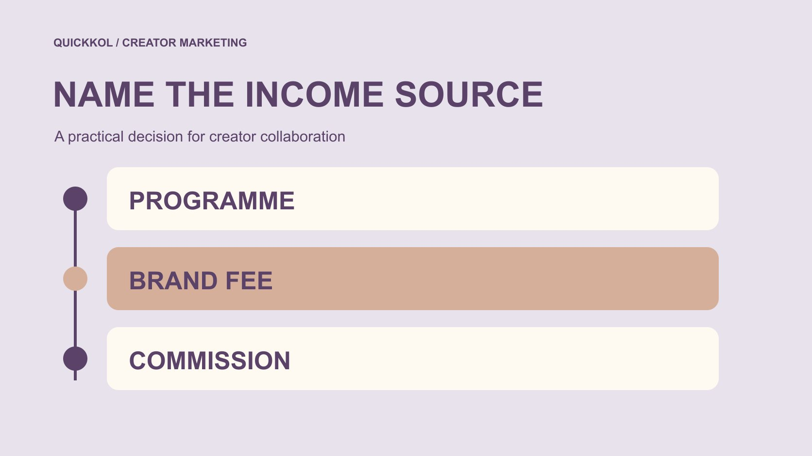
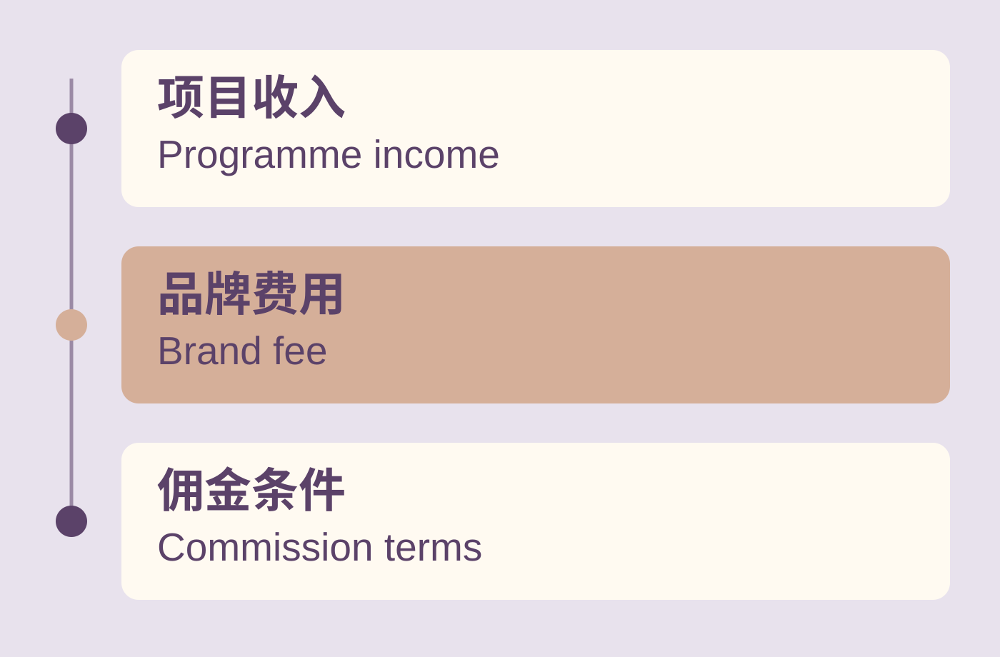

# 西语 TikTok 合作怎样讨论收入来源

状态：本地审阅稿；正式发布日期待确认。

西语内容不等于单一国家市场。品牌讨论 TikTok 达人收入时，应分别确认创作者所在地、受众语境、付款对象与内容用途，再核对相应项目条件。

QuickKOL 编辑图形；不呈现真实账号指标或平台界面。

Como monetizar TikTok 是西语的 TikTok 变现问题，但使用西语不代表账号在西班牙，也不代表所有西语市场共享同一项目条件。品牌应分别确认创作者所在地、作品服务的受众、谁为什么工作付款，以及内容是否属于赞助。平台奖励、品牌制作与发布费用、联盟佣金是不同安排，资格与结算不能互相代替。本篇围绕跨市场达人合作准备，不承诺固定收入，也不以语言推断项目可用性。

## 把西语与国家市场分开

一条西语作品可能服务不同地区的人，也可能由居住在另一个国家的创作者制作。语言、所在地与受众来源是三个需要分别确认的事实。

不要因口音、姓名或简介里的旗帜直接判断账号项目资格。品牌应询问与任务有关的适当信息，避免索取不必要的身份资料。

跨市场 Brief 先写作品希望帮助哪类观众、商品在哪些市场实际可用，以及需要谁提供事实。语言选择应服务理解，而不是被当作全部业务条件的代称。

本篇的中文与英文版本帮助品牌处理这项西语搜索意图，不冒充某个国家的官方项目指引。具体账号与地区条件，仍由所有者在相应官方入口核对。

## 为每种收入安排写明付款对象

先写谁向谁付款，以及对应什么事实。平台项目可能按各自规则处理奖励，品牌费用对应双方约定工作，佣金则需要核对具体产品和归属条件。

[TikTok 收入准备指南](https://www.quickkol.com/zh/blog/tiktok-monetization-sponsored-work-eligibility/#answer)讨论这些安排的一般区分。本篇更关注跨市场 Brief：同一句“可以变现”，在不同团队中可能代表完全不同的工作与付款预期。

不要将某人的平台奖励截图写成品牌应该支付的统一报价，也不把佣金可能性自动当成已经约定的固定制作费。不同资料需要各自来源。

交接时保留安排名称、负责方与待确认项。即便金额尚未确定，双方也应知道正在讨论哪种关系，避免在作品完成后才发现对收入来源理解不同。

## 项目资格不能从翻译页面推断

能用西语阅读帮助页，不等于该项目适用于每个使用西语的账号。应由账号所有者核对具体项目、地区与实际可用入口，不提供规避所在地或资格的建议。

[TikTok One 的合作说明](https://support.tiktok.com/en/business-and-creator/tiktok-one)介绍创作者、广告主与品牌协作，并为资格保留地区差异。这是合作平台的说明，不是所有收入项目共用的门槛。

加入某个入口也不等于已获品牌任务。内容意愿、作品能力与实际约定仍需另外确认，不能把项目状态写进已经合作的名单。

如果品牌只是采购清楚的内容工作，就按实际渠道讨论范围；不要强迫创作者为一项合作声称自己具备尚未确认的项目资格。未知条件应留给适当所有者核验。

## 赞助作品与平台奖励作品分别判断

[TikTok 的奖励项目比较说明](https://support.tiktok.com/en/business-and-creator/creator-rewards-program/how-is-the-creator-rewards-program-different-from-the-tiktok-creator-fund)介绍了合格原创内容与赞助内容等区别。不能因为账号参加奖励项目，就把品牌委托作品的所有观看都当成可获奖励的播放。

品牌 Brief 应说明这条内容是否推广商品、是否有费用或其他激励，以及准备怎样发布。创作者再按实际项目规则核对，不让翻译后的简短“收入”标签掩盖内容差异。

也不要将平台潜在收益当作减少品牌已约定费用的自动理由。品牌购买的工作与项目奖励来自不同关系，必须按实际协议讨论。

本篇不提供统一每千次观看收入，也不根据粉丝数估造月收入。账号资格、作品资格、估计与实际结算各有条件，跨市场讨论更需要保留这些界限。

同一语言可以跨越不同市场；每种安排都需核对实际对象与条件。

## 让本地化成为真实表达工作

西语改编不只是逐字替换字幕。商品名称、使用情境与观众习惯可能需要创作者解释，品牌应提供对应市场事实，而不是让对方自行猜测。

说明需要口播、字幕还是完整重拍，以及谁核对事实与语言。一个地区的商品、价格或供应安排，不应因为语言相同就无条件复制到另一个地区。

也保留创作者能够自然表达的方式。品牌可以确认准确性，但不应把某个市场刻板印象当作所有观众偏好，更不要求创作者表演与自己经验无关的身份。

把本地化工作列入范围，有助于讨论时间、费用与反馈。已有一个语言版本，并不表示所有市场改编都自动包含，也不表示创作者允许任何人重新配音。

[TikTok 商业音频 Brief 方法](https://www.quickkol.com/zh/blog/tiktok-sounds-creator-commercial-audio-brief/#answer)帮助区分语言改编与音频使用。新配音、音乐与其他渠道版本要分别确认；相同西语并不会让原许可自动覆盖所有市场和用途。

## 商业背景需要让目标观众理解

[TikTok 的商业内容披露说明](https://support.tiktok.com/en/business-and-creator/creator-and-business-accounts/promoting-a-brand-product-or-service)区分推广自有业务与第三方品牌合作，并要求适当使用内容披露设置。这个平台事项与奖励资格、品牌费用和素材许可分别处理。

关系说明也应让作品所服务的人能够理解。[FTC 的达人披露指南](https://www.ftc.gov/business-guidance/resources/disclosures-101-social-media-influencers)在美国语境下讨论清楚披露；不能假定一条不易理解的外语简称足够解释全部商业背景。

品牌与创作者确认适合形式和市场的表达，同时保留实际体验与依据。翻译不能把“我这次觉得方便”扩成“所有人都保证得到同样结果”。

若同一作品有多个地区版本，分别检查关系、商品事实与入口。一个版本的通过，不应自动替其他版本完成审阅，更不能让设置标签代替全部真实内容责任。

## 在跨团队交接中保留工作与付款状态

跨市场合作可能经过创作者、品牌地区团队与制作伙伴。写清交付由谁确认、付款问题由谁回答，不让翻译、审批与结算责任彼此混淆。

金额、币种和付款状态应来自实际约定与记录。文章不提供个人税务或金融建议；需要相应事项时由适当负责人处理，不凭搜索词推断适用安排。

佣金若存在，核对具体产品、窗口与归属条件，不因作品是西语就假定与另一个市场相同。没有承诺或记录时，不将潜在收益写为已支付收入。

对外案例仅使用获准分享的事实。创作者提供过某份内部资料，不等于品牌可以公开其全部收入记录，也不代表可以用来承诺其他人的收益。

## 假设案例：西语收纳教程怎样准备合作

假设品牌邀请一位制作西语收纳教程的创作者介绍某个家居商品。作品语言已确定，但商品只在部分市场供应，账号项目资格也尚未核验。

这是编辑示例，没有实际费用或收入。品牌先明确目标市场与可用商品版本，创作者确认真实使用条件，双方讨论内容、发布与改编工作。

平台奖励仍由账号所有者按具体规则核对；品牌不把赞助观看预先算入奖励，也不以可能佣金代替没有约定的制作费。关系说明与实际入口一并审阅。

最后留下明确记录：这次采购什么、面向谁、由谁确认事实，哪些收入条件仍未知。西语只是表达选择之一，不承担解释全部市场与商业安排的任务。

## 把西语变现搜索转成明确合作问题

Como monetizar TikTok 的品牌研究不能停留在一张收入门槛表。先理解创作者贡献，再区分语言、市场、付款对象与内容用途，才能提出合适问题。

对平台项目，保留实际账号与地区条件；对品牌工作，确认范围、关系与使用；对可能佣金，确认具体安排。任何一项都不能证明其他收入已经成立。

交接时保留本地化事实、未确认项与负责人，不把翻译流畅当作业务条件完整。需要更新时，按受影响的版本与市场分别复核。

这让跨市场达人合作既有明确表达，也有清楚责任。文章帮助准备真实提案，不提供绕过资格、固定收益或只凭粉丝数字预测收入的承诺。

## 跨市场收入 Brief 的五项区分

| 事项 | 分别确认 | 不要推断 |
| --- | --- | --- |
| 语言 | 作品表达与受众问题 | 语言等于国家 |
| 项目 | 实际账号与地区条件 | 翻译页等于资格 |
| 品牌工作 | 制作、发布与使用 | 平台收益代替费用 |
| 本地化 | 市场事实与版本 | 同语全部相同 |
| 收入状态 | 约定、估计与付款 | 潜在等于到账 |

编辑合作准备表，不是项目资格确认、税务建议或收入预测。

## 先核对市场与收入安排

用于准备与西语创作者的具体合作。

- [ ] 区分表达语言与所在地。
- [ ] 明确作品服务的市场。
- [ ] 给每项安排写明付款对象。
- [ ] 单独核对项目与赞助条件。
- [ ] 确认本地化、关系与使用。
- [ ] 保留未知、状态与负责人。

## 研究日期与使用边界

资料核验于 2026 年 11 月 19 日。文中方法、表格和决策规则为编辑建议，标为假设的示例不是实际客户结果或行业基准。外部资料的适用地区与时期按各段说明。

## 从任务开始达人研究

用 QuickKOL 理解 Brief、发现相关达人并研究作品与联系路径；数据、合作条件和结果仍需核验。

[了解 QuickKOL](https://www.quickkol.com/#capabilities)

## 来源

- [TikTok One 的合作说明](https://support.tiktok.com/en/business-and-creator/tiktok-one)
- [TikTok 的奖励项目比较说明](https://support.tiktok.com/en/business-and-creator/creator-rewards-program/how-is-the-creator-rewards-program-different-from-the-tiktok-creator-fund)
- [TikTok 的商业内容披露说明](https://support.tiktok.com/en/business-and-creator/creator-and-business-accounts/promoting-a-brand-product-or-service)
- [FTC 的达人披露指南](https://www.ftc.gov/business-guidance/resources/disclosures-101-social-media-influencers)
