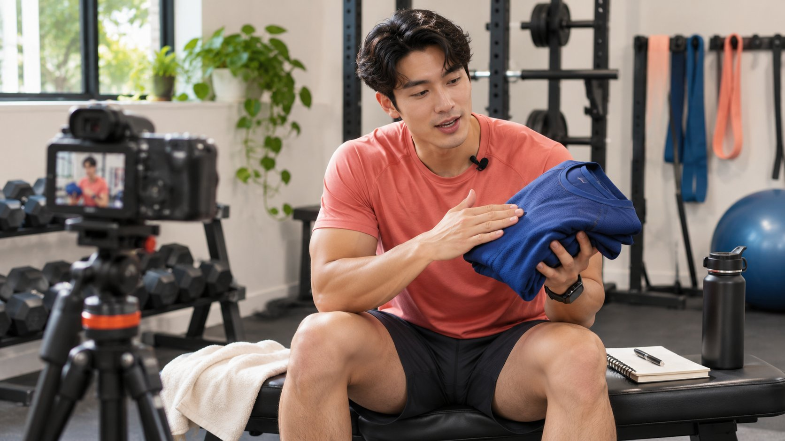
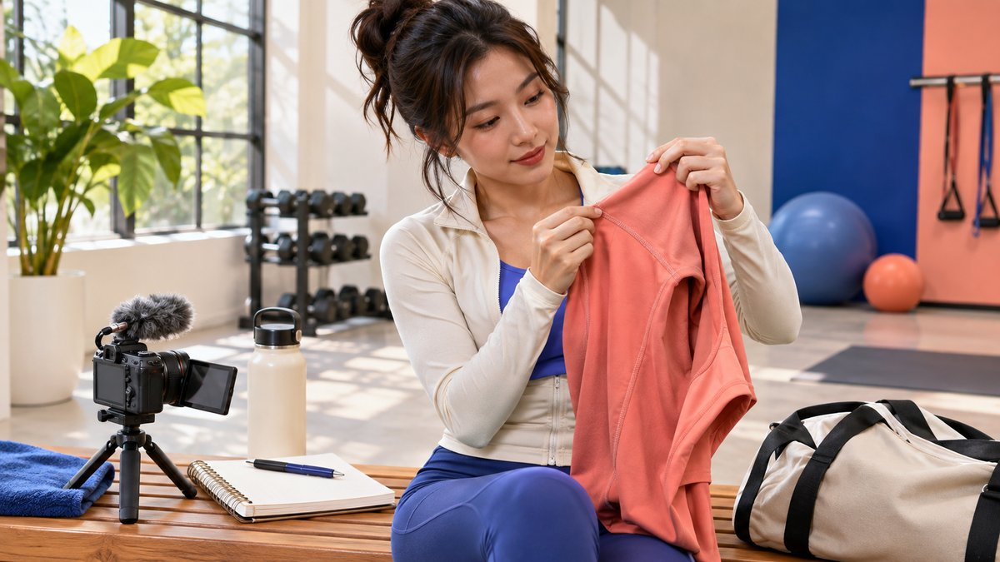

# Workout Clothes Brands: Frame a Wear Observation

Status: local review draft; confirm the publication date before release.

Wear observations can support credible creator content when experience, sample state and limits are explicit. One or several uses do not automatically certify durability, health effects or performance.

Workout clothes brands can commission a bounded observation: which item was worn, in what ordinary context, what was actually noticed and which questions remain unanswered. Immediate feelings, later changes and the state after label-appropriate care need separate records rather than footage assembled into a supposed long-term test. The brand supplies product facts while the creator retains first-hand experience and commercial context. Without appropriate support, personal observations should not become universal performance, durability or health claims.

## Limit the observation to work that can actually be done

Define the wearing question first, such as whether a construction detail can be explained or what deserves another look after ordinary use. Do not ask the creator to prove every performance attribute at once.

Both parties confirm time, context and product conditions. This guide prescribes no standard number of test days or exercise routine; the observation should fit actual experience and agreed work.

The [fitting-conversation method](https://www.quickkol.com/blog/gym-apparel-creator-fit-session-brief/#answer) helps establish private-feedback and publication boundaries. A wear observation can continue from there without gaining unlimited filming or use permission simply because more time passes.

State what the result can be: a record of personal observations, a follow-up question or a conditional explanation. That assignment is more honestly deliverable than give us a positive durability review. The brand and creator can then assess whether the planned experience is sufficient for the question, rather than discovering afterwards that someone expected a conclusion which the agreed work could never establish.

## Retain the actual sequence of experience

Record the actual order of first wearing, later use and appropriate care. Do not invent an unexperienced stage or substitute another sample without explanation to make the story appear complete.

Identify the model and sample state. Mark replacements, adjustments or reshoots so later editing does not turn discontinuous records into one supposed experience.

The record need not reveal private schedules or unrelated locations. Retain the period, context and facts needed to interpret the observation, with sharing scope confirmed separately.

Some changes may remain unexplained. State what was seen before attributing it to fabric, production or the wearer; sequence supports a question without itself establishing causality. A truthful record can be incomplete and its outcome unresolved. That is particularly important when several people handle footage, because chronological editing can make a stronger claim than any single clip or note was intended to make. Give editors the actual sequence rather than expecting them to reconstruct it from attractive images alone. Also distinguish when an experience occurred, when it was filmed and when the piece was released. A later publication date does not extend the duration of the original wearing experience.

Record observed details and the actual sequence; a bounded wear observation is not long-term performance certification.

## Describe immediate feelings and visible changes separately

Comfort, preference and convenience can be genuine personal feelings, provided the setting remains visible. A position, seam or condition seen in footage is another kind of observation; neither substitutes for the other.

Feeling at ease on one occasion should not become improved sporting performance, while one crease should not establish a long-term quality defect. Positive and negative conclusions both need appropriate boundaries.

The brand can ask which conditions affected the feeling to make the explanation more specific. Do not lead the creator into filling an unobserved gap with a pleasing answer or delete every limitation because the opinion is qualified.

If more observation is needed, identify the question instead of repeating use arbitrarily until a preferred review appears. The assignment supports actual expression rather than searches for a result suitable for promotion. This lets a creator report a neutral or mixed experience and still complete useful work, while leaving the brand to decide whether that experience suits the planned public explanation.

## Use care references for the actual garment

[Patagonia’s wool-care guide](https://www.patagonia.com/stories/guides/care-repair/how-to-wash-merino-wool/story-168066.html) emphasizes the garment label and particular fabric. It is a product-reference example, not a universal method for workout clothes or an invitation to experiment with care limits.

The brand should supply information corresponding to the current sample, while the person handling it records what actually occurred. If care history is unknown, retain that state instead of inferring a procedure from ordinary appearance.

If care will be shown publicly, identify its source and applicable item. Do not improvise an unconfirmed method for visual effect or expand one apparently intact result into a long-term durability guarantee.

Where a change appears after care, check conditions and sample identity before discussing expression. The creator can report an observation without completing every technical verification for a manufacturer. A clear sequence and reference make a later question more answerable while preserving the distinction between what the creator did and what the product supplier claims can safely be done.

## Personal observation is not manufacturer substantiation

[FTC’s clothing-care labeling guide](https://www.ftc.gov/business-guidance/resources/clothes-captioning-complying-care-labeling-rule) explains, in its United States manufacturer and importer context, the need for a reasonable basis for care instructions and consideration of the whole garment. It does not award testing qualifications to a creator.

A creator's experience can support bounded content without automatically proving every objective claim. The party holding the evidence remains responsible for care, composition and performance references.

Before expressing breathability, durability or another conclusion, define what the statement means and which support exists. This article offers no formula by which a few wearing occasions certify every property.

Do not turn absent support into pressure on the creator. Narrow the expression, obtain evidence or revise the task instead of using a more confident tone to conceal uncertainty. The distinction preserves the useful role of first-hand work while preventing a personal diary from being treated as a substitute for a technical basis it was never designed to provide.

## Keep experience and relationships in the public story

[FTC’s influencer-disclosure guide](https://www.ftc.gov/business-guidance/resources/disclosures-101-social-media-influencers) emphasizes actual experience and material relationships in its United States context. A brand-supported wear observation should not become an apparently independent long-term review after editing it into a story.

Have the creator confirm that the finished piece still represents the experience. Removing time, conditions or a sample change can expand a limited statement, so review meaning rather than checking subtitles only for spelling.

Confirm commercial context for the actual form and market. Diary or authentic record does not automatically remove the need to explain why the product appears.

Allow the observation to be conditional, mixed or incomplete. The brand can choose not to use a passage as a recommendation without inventing another experience; an absence of public praise does not mean the assignment supplied no useful information. The resulting film should preserve the boundary between a personal account and a generalized product promise, even when a shorter edit would sound more persuasive without that boundary.

## Hypothetical case: a bounded observation of one top

Imagine a creator recording a training top during several ordinary wearing occasions for a bounded product explanation. No actual test schedule, client result or industry standard is supplied here.

The first record concerns feelings about the cuff and pocket; later records identify the actual sample state. If label-appropriate care occurs, retain the source and what was done. If the sample changes, do not call the clips a continuous account of one garment.

The film explains observation scope, the real relationship and unanswered questions. Attractive footage should not become proof of years of durability, nor should one person's preference become a conclusion for every consumer.

Hand details needing further explanation to the product owner. The example shows how content can remain credible without establishing that an actual garment is excellent or defective. A useful result is an accurate account of what happened and a better-defined next question, not a stronger verdict produced by editing away the conditions that limited the experience.

## Use unanswered questions to decide whether to continue

At the end, list what was explained and what remains unknown. Not every unknown requires another session; first decide whether it would change viewer understanding or the collaboration decision.

If continuing, define the question and scope instead of creating unlimited try-ons. Technical evidence should come from the appropriate product owner rather than an ever-growing number of personal experiences.

The [apparel content-coverage method](https://www.quickkol.com/blog/fitness-apparel-creator-use-case-coverage/#answer) helps assess which contexts have been covered. Portfolio coverage and one garment's longer-term state remain different questions; a matrix should not imply that every test was completed.

Hand over original observations, publishable expression and internal follow-up questions separately. Later colleagues can see which statement remains usable, which belongs only to this experience and which needs another source. That is especially useful when the campaign team changes, because a finished film alone may not preserve the conditions that made the original statement accurate or identify why another observation was deliberately left unresolved.

## Build a more credible partnership from bounded observations

Creator work for workout clothes brands can contain real detail without promising a perfect result. Identify the product, experience, conditions and unknowns so viewers understand what the personal observation means.

The brand supplies supported facts, the creator retains actual feelings and production preserves narrative scope. These roles support one another without making footage establish a claim it cannot prove.

The work can inform explanation, discussion or another assignment; whether it becomes a recommendation still needs confirmation. Receiving a sample, completing a record and making a public endorsement should not be silently combined.

Accurate observation serves creator marketing better than a larger-sounding conclusion. If more evidence is needed, the team has a specific source and owner rather than repeating an undefined we tested it. The practical record remains valuable because another person can understand exactly what occurred, what it supports and which question should be addressed next.

## How to express a wear observation

| Evidence | Can describe | Do not expand into |
| --- | --- | --- |
| Immediate feeling | Personal experience in those conditions | Everyone’s result |
| Visible detail | State seen on that occasion | Long-term quality verdict |
| Care record | Actual method and source | Universal care rule |
| Sequence | What happened in order | Causality or durability certification |
| Open question | What is needed next | Invented completed testing |

Editorial observation framework, not a laboratory standard, exercise prescription, care instruction or performance guarantee.

## Keep the observation explainable

Prepare for a bounded creator wear record.

- [ ] Define the question and actual work.
- [ ] Confirm sample and experience sequence.
- [ ] Separate feelings from visible facts.
- [ ] Use matching care references.
- [ ] Review conditions and relationships in the film.
- [ ] Assign unknowns to the appropriate owner.

## Research date and limitations

Sources reviewed November 19, 2026. Methods, tables and decision rules are editorial recommendations. Hypothetical examples are not actual client results or industry benchmarks. Source geography and periods are specified where relevant.

## Start creator research with a clear task

Use QuickKOL to interpret a brief, discover relevant creators and research their work and contact routes. Verify data, commercial terms and outcomes at their source.

[Explore QuickKOL](https://www.quickkol.com/#capabilities)

## Sources

- [Patagonia’s wool-care guide](https://www.patagonia.com/stories/guides/care-repair/how-to-wash-merino-wool/story-168066.html)
- [FTC’s clothing-care labeling guide](https://www.ftc.gov/business-guidance/resources/clothes-captioning-complying-care-labeling-rule)
- [FTC’s influencer-disclosure guide](https://www.ftc.gov/business-guidance/resources/disclosures-101-social-media-influencers)
