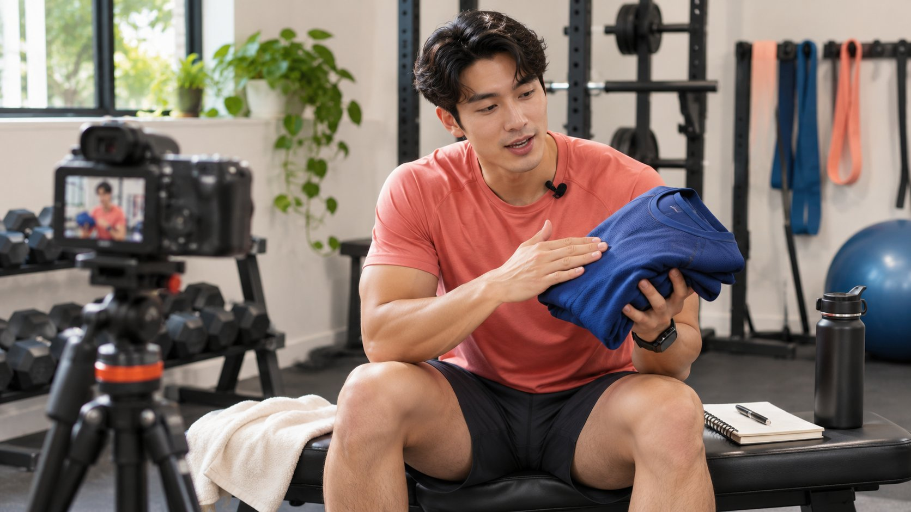

# 运动服体验怎样写成可信达人内容

状态：本地审阅稿；正式发布日期待确认。

穿着观察可以成为可信达人内容，但要写明实际经历、样品状态与观察限制。一次或数次使用，不自动成为长期耐久、健康或性能认证。

Workout clothes brands 想让达人讲真实穿着，可以约定一项有限观察：使用哪件商品、在什么普通情境中穿着、实际注意到什么，以及哪些问题还不能回答。即时感受、后续变化与按标签护理后的状态需要分别记录，不能将几段镜头拼成长期测试。品牌提供商品事实，创作者保留亲身体验与商业关系；没有适当依据时，不把个人观察扩成所有人的表现、耐久或健康效果。

## 把观察问题限定到实际可完成的工作

先确定这次希望了解哪个穿着问题，例如某处结构是否方便展示，或一次普通使用后哪里值得继续查看。不要同时要求创作者证明全部性能。

时间、场景与商品条件由双方确认。文章不规定统一测试天数，也不提供运动安排；需要的观察应与创作者真实生活和已约定工作相符。

[达人试穿沟通方法](https://www.quickkol.com/zh/blog/gym-apparel-creator-fit-session-brief/#answer)帮助先确认私人反馈与公开内容范围。穿着观察可以在此基础上继续，但不因为时间更长就自动取得无限拍摄或使用许可。

把结果可以到达哪里写清楚：记录个人实际观察，提出后续问题，或者准备有条件解释。这样的任务比“给我们一个耐久好评”更容易诚实完成。

## 保留一条真实的经历顺序

记录首次穿着、后续使用与适用护理的实际顺序。没有发生的阶段不填造，也不因为希望叙述完整而用不同样品代替却不说明。

样品型号与状态应可识别。更换商品、调整服装或重新拍摄时，标明变化，避免后续把不连续资料剪成同一次体验。

记录不需要泄露私人日程或无关地点。保留足以解释观察的时间范围、场景与事实即可，分享范围另行确认。

有些变化可能目前无法解释。先写看到了什么，不立即归因于面料、生产或穿着者；顺序帮助提出问题，但本身不能证明因果。真实记录允许故事不完整，也允许结果暂时未知。也区分体验、拍摄与发布日期，后来发布不等于增加了实际穿着时间。

记录实际看到的细节与经历顺序；有限穿着观察不是长期性能认证。

## 即时感受与可见变化分别描述

舒适、喜欢或方便是可以真实表达的个人感受，但需要保留场景。画面中的位置、接缝或状态则是另外一类观察，不能互相代替。

例如创作者觉得某次穿着轻松，不能直接写成运动表现提升；看到一次折痕，也不能直接证明长期质量问题。正面与负面结论都需要适当边界。

品牌可以追问哪种条件影响感受，让解释更具体。不要诱导创作者在没有观察的地方补一个好听答案，也不因意见保留就要求删去全部限制。

需要进一步查看时，写清要回答的问题，而不是随意重复使用直到得到预期评价。观察任务应支持真实表达，不是寻找一个能配合宣传的结果。

## 护理资料来自实际款式

[Patagonia 的羊毛护理说明](https://www.patagonia.com/stories/guides/care-repair/how-to-wash-merino-wool/story-168066.html)提醒按衣物标签和具体面料处理。它是产品资料示例，不是所有运动服的通用方法，更不是让创作者自行试验洗护极限。

品牌应提供当前样品对应的资料，执行者记录实际做过什么。如果护理经历不明，就保留未知，不用普通外观推断已经按某种方法处理。

需要公开展示护理时，明确资料来源与适用对象。不要为了镜头效果临时采用没有确认的方法，也不把一次看起来完好的结果扩成长期耐久保证。

护理前后若有变化，先核对条件与样品身份，再讨论适合怎样表达。创作者可以报告实际观察，但不能仅凭个人体验替制造商完成全部技术验证。

## 区分个人观察与性能依据

[FTC 的服装护理标签指南](https://www.ftc.gov/business-guidance/resources/clothes-captioning-complying-care-labeling-rule)在美国制造商与进口商语境下，说明护理指示需要合理依据，并考虑整件商品。它不是给达人颁发测试资格的文件。

对品牌来说，某位创作者的经历可以支持有条件内容，但不能自动证明所有客观主张。护理、材质或性能资料仍由掌握依据的人负责。

若要表达透气、耐用等结论，先确认主张到底意味着什么，以及有什么适当支持。文章不提供一个用几次穿着就能认证全部性能的公式。

也不要让缺少依据变成对创作者的压力。可以缩小表达、补资料或重新安排任务，而不是要求用更肯定语气掩盖不确定事实。

## 公开故事保留实际体验与关系

[FTC 的达人披露指南](https://www.ftc.gov/business-guidance/resources/disclosures-101-social-media-influencers)在美国语境下强调真实体验和重要商业关系。品牌支持的穿着观察，不应在剪成故事后变成貌似完全独立的长期测评。

让创作者确认成片仍对应自己经历。删掉时间、条件或样品变化，可能让原本有限的话变成更广主张，不能只核对字幕有没有错字。

商业关系按实际形式与市场确认，不能用“日记”或“真实记录”等词自动免除说明。观众需要理解为什么这件商品进入作品。

允许观察有条件、混合或未完成。品牌可以决定不采用某段作为推荐，却不应伪造另一种经历；没有公开好评，也不意味着这次工作没有提供有用信息。

## 假设案例：记录一件上衣的有限观察

假设创作者记录一件训练上衣在几次普通穿着中的感受，品牌希望做一条有条件的商品解释。这里不设真实测试次数、客户结果或行业标准。

第一次记录袖口与口袋的主观感受，后续记录实际样品状态。若按标签护理，保留方法来源与执行事实；如果换了样品，就不把前后片段写成同一件衣服的连续结果。

成片说明观察范围、真实关系与尚不能回答的问题。不能把几段好看镜头剪成已经证明多年耐用，也不能将一个人的偏好扩为所有消费者结论。

最后将需要进一步解释的细节交给品牌负责人。这个例子展示内容怎样保持可信，而不是证明某件实际商品优秀或存在问题。

## 用未回答问题决定是否继续

观察结束后列出已经说明与仍未知部分。不是每项未知都需要重做，先判断它是否会改变观众理解或合作决定。

若要继续，安排具体问题与范围，不让创作者进入无限试穿。品牌需要技术资料时，应向正确产品负责人取得，而不是不断增加个人体验次数。

[运动服内容组合方法](https://www.quickkol.com/zh/blog/fitness-apparel-creator-use-case-coverage/#answer)可以帮助判断哪些情境已覆盖。组合覆盖与单件长期状态仍是不同问题，不让一份矩阵暗示已完成所有测试。

交接时保留原始观察、适合公开的表达与内部补充问题。后续团队才能知道哪个结论可继续使用，哪个只适用于这次经历，以及哪些事项仍需另外核验。

## 以有限观察建立更可信合作

Workout clothes brands 的达人内容可以有真实细节，而无需承诺一个完美结果。清楚写出商品、经历、条件和未知，观众才能理解个人观察的意义。

品牌提供有依据事实，创作者保留真实感受，制作人员维护叙述范围。三个角色互相支持，不让镜头承担它不能证明的主张。

这类内容可用于解释、讨论或下一轮任务准备，是否成为推荐仍需实际确认。不要把收到样品、完成记录与公开背书自动合并。

把观察做准确，比把结论写得更大更能服务达人营销。后续需要补充时，也有明确资料和负责人，而不是重复一个没有边界的“测试过了”。

## 穿着观察怎样表达

| 资料 | 可以说 | 不能直接扩成 |
| --- | --- | --- |
| 即时感受 | 本人在该条件下的体验 | 全部人的结果 |
| 可见细节 | 某次镜头中的状态 | 长期质量结论 |
| 护理记录 | 实际方法与来源 | 通用洗护规则 |
| 连续记录 | 真实发生顺序 | 因果或耐久认证 |
| 未解问题 | 下一步需补什么 | 编造完成测试 |

编辑观察框架，不是实验室标准、运动处方、护理指令或性能保证。

## 让观察保持可解释

为一次有限的达人穿着记录准备。

- [ ] 限定问题与实际工作。
- [ ] 确认样品与经历顺序。
- [ ] 区分感受与可见事实。
- [ ] 使用对应护理资料。
- [ ] 复核成片条件与关系。
- [ ] 将未知交给适当负责人。

## 研究日期与使用边界

资料核验于 2026 年 11 月 19 日。文中方法、表格和决策规则为编辑建议，标为假设的示例不是实际客户结果或行业基准。外部资料的适用地区与时期按各段说明。

## 从任务开始达人研究

用 QuickKOL 理解 Brief、发现相关达人并研究作品与联系路径；数据、合作条件和结果仍需核验。

[了解 QuickKOL](https://www.quickkol.com/#capabilities)

## 来源

- [Patagonia 的羊毛护理说明](https://www.patagonia.com/stories/guides/care-repair/how-to-wash-merino-wool/story-168066.html)
- [FTC 的服装护理标签指南](https://www.ftc.gov/business-guidance/resources/clothes-captioning-complying-care-labeling-rule)
- [FTC 的达人披露指南](https://www.ftc.gov/business-guidance/resources/disclosures-101-social-media-influencers)
