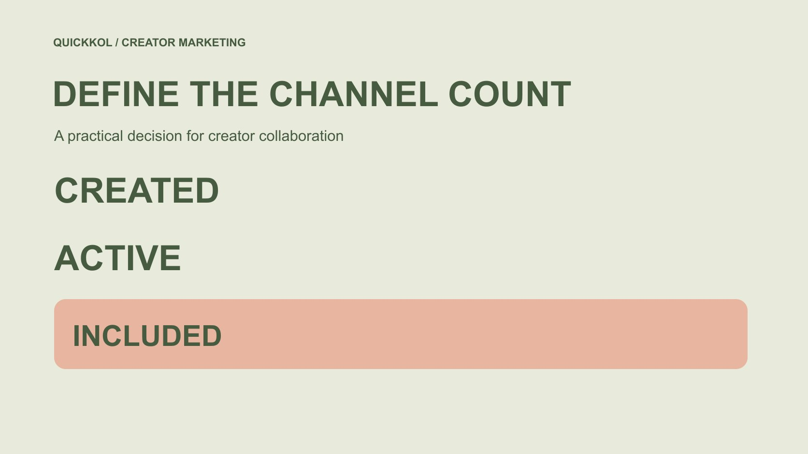
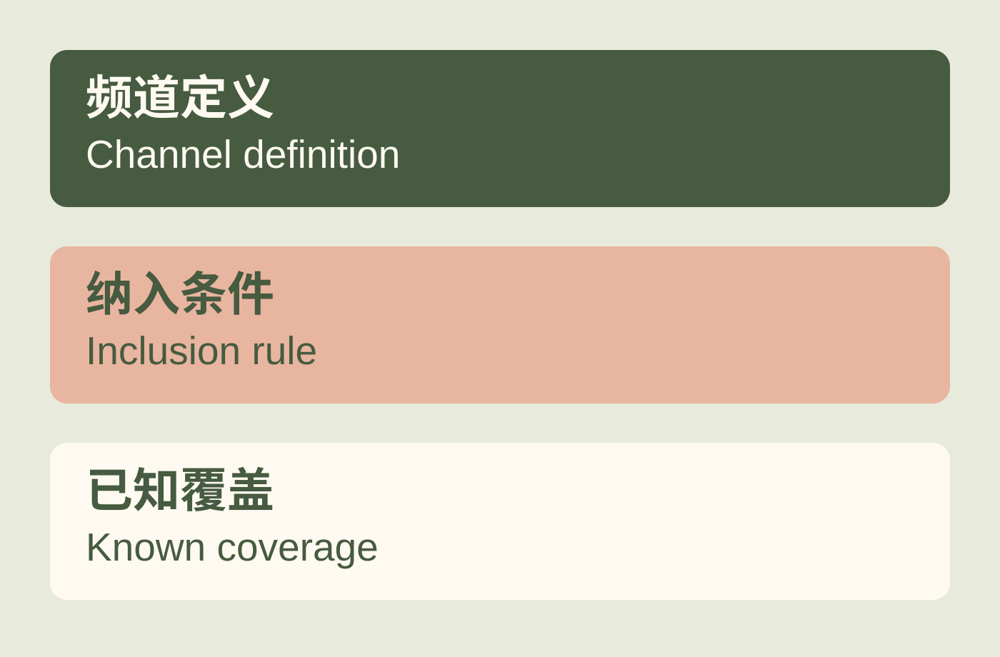

# How Many YouTube Channels Are There?

Status: local review draft; confirm the publication date before release.

A channel total needs a defined population and method. Brands need a bounded, updateable research set rather than treating platform scale as the number of available partners.

QuickKOL editorial graphic; not actual account metrics or a platform interface.

How many YouTube channels are there first requires a definition of channel. In the official sources reviewed for this article on November 19, 2026, we could not verify a real-time total covering every existing channel; video counts, search results and database size are not substitutes. For creator marketing, a more useful question is which channels enter a research set defined by subject, language, recent activity and identity conditions, and what that set leaves out.

## Leave an unverified universal total unresolved

A figure may count all created records, only public channels, channels with uploads, recently active ones or those above a threshold. Without a population definition, even a precise number cannot answer a shared question.

This article has not confirmed a complete real-time channel census. That is the boundary of this research, not a claim that the platform has never published other statistics or proof that every third-party estimate is wrong.

When citing a third-party collection, establish its source, inclusion conditions, deduplication method and date. If those are unavailable, database records should not be presented as the worldwide channel total.

Acknowledging the unknown can prevent a brand from budgeting against the wrong denominator. Platform scale is not the number of creators who can be contacted, want a partnership, fit the product or can deliver the assignment. Each transition requires its own conditions and evidence, so the initial headline quantity cannot carry the entire commercial interpretation.

## A channel resource is not a video or a person

[YouTube Data API’s channel definition](https://developers.google.com/youtube/data/reference/rest/v3/channels) explains the channel resource and its unique identifier. A channel can contain many pieces, while one production team can operate several channels, so channels, videos and creator people are not interchangeable counts.

Matching names do not establish matching identifiers, and a renamed channel does not necessarily become a new channel. Retain the correct identity rather than merging or adding records solely by display name.

The [channel-identity review method](https://www.quickkol.com/blog/youtube-channels-identity-scope-handoff/#answer) helps establish the public account and contact object. A technical identifier alone cannot prove who can contract, appears on screen or handles every production task.

Define the research unit before deduplication. If the brand needs a count of creator teams, organizational relationships require another check: neither count each account as an independent person nor unconditionally merge related accounts into one person. This distinction matters when estimating outreach effort, since a collection of publishing identities may lead to fewer, more complex or differently organized business conversations.

## Video scale cannot fill a channel-count gap

[YouTube’s twentieth-anniversary statistics](https://blog.youtube/news-and-events/happy-birthday-youtube-20/), published in April 2025, describe more than twenty billion uploaded videos and an average of over twenty million uploads daily. They establish content scale, but the units are videos and upload flow.

Dividing that total by an arbitrarily assumed average per channel would not produce an official channel count. Without a verified upload distribution and population scope, such a calculation hides several assumptions.

Users, viewers and participants in a monetization programme should not become substitutes for all channels either. These populations may relate to one another without being the same counting object.

Use a dated content-scale statement as background while making its limits explicit. That retains real evidence without manufacturing accuracy merely to give the keyword an integer answer. A brand can understand that the platform contains extensive content and still recognize that the size of its relevant partnership population remains a separate research question requiring different evidence.

## Search results form a query set, not a census

[YouTube Data API’s search documentation](https://developers.google.com/youtube/data/reference/rest/v3/search/list) states that results match query conditions and that totalResults is approximate and capped. It is not a dependable counter that directly returns every channel worldwide.

Language, wording, filtering and ordering affect what the team discovers. Two researchers using different routes can obtain different sets; this first indicates a methodological difference, not proof that one person worked incorrectly.

Do not treat the last page of one search as the boundary of the platform, or infer from a smaller result set that no other relevant creators exist.

Record the actual queries and inclusion rules. This is an explanation of research limits, not a plan for scraping the entire service. The brand needs an explainable discovery process and an understanding of which omissions matter to this partnership decision. Search can be valuable as one route while its returned quantity remains a statement about the query, not the universe from which the query drew results.

## Build a bounded denominator for this creator study

State the subject, language, observation period and required content form, then explain what qualifies a channel for consideration. Rules should follow the assignment rather than treating a follower threshold as the only relevance condition.

For a brand researching channels able to demonstrate repair processes clearly, review actual work rather than searching only for a product word. Titles, descriptions and footage can provide different clues.

Retain reasons for discovered channels not being included, such as unconfirmed identity, unrelated subject matter or unclear recent status. Unknown and unsuitable should be separate states so a missing record does not automatically become a negative judgment.

Call the collection candidates for this study rather than the complete global population of similar channels. With that scope, the team can explain the list size and the discovery routes to add next. It can also tell whether a later change reflects a new rule, new evidence or a genuine change in a previously reviewed channel.

Agree when to update the set too. A snapshot can support the next step at that time without remaining current months later. Retain additions, removals and reclassifications with reasons so a changed quantity remains explainable rather than appearing to be an unexplained movement in the market.

Report the coverage of this study without presenting the discovered set as a complete global population.

## Use coverage checks to identify omissions

View candidates by subject subcategory, language or format to see whether one need depends entirely on one query term. These categories expose research gaps; they do not claim that the platform's audience follows the same distribution.

Use different discovery routes and deduplicate by consistent channel identity. Simply adding lists together can count the same channel repeatedly and exaggerate scale.

The [channel editorial-promise guide](https://www.quickkol.com/blog/youtube-channel-editorial-promise-brand-fit/#answer) returns the team to actual work. A channel may rarely use the industry's preferred terminology while repeatedly explaining a relevant problem, so examine the pieces rather than relying only on labels.

Record what supplementary discovery changed. Coverage checks should make the next research step more sensible, not maximize list size or claim to eliminate discovery bias completely. The brand can decide that an overlooked content role deserves more investigation without asserting that it now knows the exact share of all YouTube channels represented by that role.

## Report a hypothetical research set accurately

Imagine a team finding forty channel records through three routes, retaining thirty-two distinct identities after deduplication. Twenty have relevant work confirmed, while twelve await review. These are hypothetical quantities, not market-size evidence.

Report original records, distinct channels and confirmed relevance separately. Forty records should not become forty creator people, and twenty reviewed matches should not become a statement that only twenty suitable partners exist worldwide.

If more channels are discovered later, update the set and observation date. Do not imply that those accounts were created on the discovery day: research discovery and channel creation are different facts.

The next step might prioritize the twelve unreviewed objects or add a missing language route. Quantity then supports work planning instead of appearing to be an unsupported industry census. This also makes progress explainable to a stakeholder who wants to know why the list changed, without requiring the team to pretend that every change measures growth in the underlying platform.

## Do not turn candidate counts directly into budgets or outcomes

Channels on the list may not yet have confirmed business routes, availability or interest. Subject relevance does not establish that the same deliverable is available everywhere, or that all candidates charge one fee.

Budget from actual scope and valid proposals rather than multiplying a research quantity by an imagined standard price. A research set and a purchasing commitment require different evidence.

Nor should channel count predict views, sales or market coverage. Channels may share audiences, and each piece has distribution and response conditions. Where information is missing, retain what cannot be established.

This does not diminish discovery work. A collection explaining identity, relevance and gaps helps the team ask appropriate questions sooner while reserving commercial discussions for actual bounded partnerships. The count becomes one description of the research process, useful for assigning follow-up and tracking coverage, rather than an unsupported shortcut to price, audience uniqueness or commercial return.

## Give the channel-count question an honest useful answer

A reliable answer to how many YouTube channels are there should identify the population, source, method and date. When a universal real-time total cannot be verified, say so rather than borrowing another unit to fill the gap.

For creator marketing, asking which publishing identities deserve further research under the current assignment produces a more actionable result. Retain rules and omissions so later colleagues can update the set rather than recreate an opaque list.

Take the conclusion only as far as the evidence supports: what was reviewed, what needs confirmation and which contact or discovery route comes next. A tool's visible collection is not the boundary of the world.

This keeps QuickKOL discovery and research connected to practical work. Platform scale supplies background; specific creator work and partnership conditions support decisions. The two relate without replacing one another, and the final research record should make that distinction easy for the next person to understand and use.

## Count-definition check

| Quantity | Ask first | Do not rewrite as |
| --- | --- | --- |
| Videos | Cumulative or new? | All channels |
| Search results | Which query and limits? | Complete census |
| Database records | How included and deduplicated? | All creator people |
| Candidate channels | Study inclusion rules? | Immediately purchasable partners |
| Reviewed relevance | Which work was reviewed? | Guaranteed partnership result |

Editorial research framework; no unverified real-time worldwide channel total is supplied.

## Define the research quantity

Check before adding a quantity to the brief.

- [ ] Define channels, videos or people.
- [ ] State source and observation date.
- [ ] Retain inclusion and exclusion conditions.
- [ ] Deduplicate by the correct identity.
- [ ] Separate unknown from irrelevant.
- [ ] Explain omissions and next work.

## Research date and limitations

Sources reviewed November 19, 2026. Methods, tables and decision rules are editorial recommendations. Hypothetical examples are not actual client results or industry benchmarks. Source geography and periods are specified where relevant.

## Start creator research with a clear task

Use QuickKOL to interpret a brief, discover relevant creators and research their work and contact routes. Verify data, commercial terms and outcomes at their source.

[Explore QuickKOL](https://www.quickkol.com/#capabilities)

## Sources

- [YouTube Data API’s channel definition](https://developers.google.com/youtube/data/reference/rest/v3/channels)
- [YouTube’s twentieth-anniversary statistics](https://blog.youtube/news-and-events/happy-birthday-youtube-20/)
- [YouTube Data API’s search documentation](https://developers.google.com/youtube/data/reference/rest/v3/search/list)
