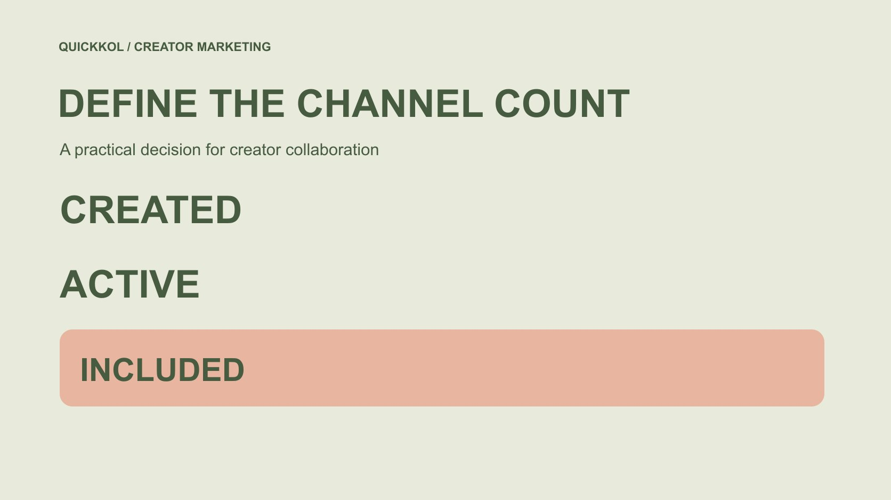
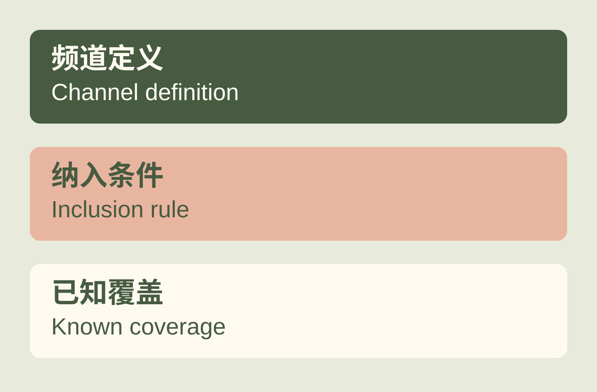

# YouTube 频道总数怎样用于研究

状态：本地审阅稿；正式发布日期待确认。

频道总数只有在对象与方法清楚时才有意义。品牌更需要一个有范围、可更新的候选研究集合，而不是把全站规模当成可合作达人数量。

QuickKOL 编辑图形；不呈现真实账号指标或平台界面。

How many YouTube channels are there 需要先定义“频道”。截至本篇 2026 年 11 月 19 日的资料核验，我们引用的官方来源不能提供一个可验证、覆盖全部现存频道的实时总数；不会用视频数量、搜索结果或第三方数据库规模代替。对达人营销，更有用的问题是：在指定主题、语言、近期活动与身份条件下，研究集合包含哪些频道，以及这个集合遗漏了什么。

## 把没有核验的总数明确留空

一个数字可能统计所有创建记录，也可能只包含公开、有上传、近期活跃或达到某种门槛的频道。没有人口范围，精确数字也无法回答同一个问题。

本篇没有确认一个完整实时频道普查。这个结论是本次研究边界，不是声称平台从来没有其他统计，也不是证明任何第三方估计必然错误。

引用第三方集合时，需要知道来源、收录条件、去重方法与日期。若资料没有提供这些说明，不能把数据库记录数写成全球频道总数。

对品牌而言，承认未知可以避免错误预算。全站规模并不等于可联系、愿意合作、适合商品或能够交付的创作者规模；每一步都需要另外的条件与证据。

## 频道资源不等于视频或个人

[YouTube Data API 的频道定义](https://developers.google.com/youtube/data/reference/rest/v3/channels)说明频道资源与唯一标识。一个频道可以关联多条内容，一个制作团队也可能经营多个频道，因此频道数、视频数和创作者人数不能直接互换。

同名不是同一个标识，改名也不一定产生新频道。研究记录应保留正确身份，而不是只用展示名称进行合并或累加。

[频道身份核验方法](https://www.quickkol.com/zh/blog/youtube-channels-identity-scope-handoff/#answer)可以帮助确认公开账号与联系对象。它不能仅凭技术标识证明谁有权签约、谁实际出镜或谁负责全部制作。

先说明研究单位，后续去重才有依据。品牌若需要统计创作者团队，应另行核对组织关系，不能把每个账号算成独立个人，也不能将相关账号无条件合成一人。

## 视频规模不能补成频道总数

[YouTube 的二十周年数据公告](https://blog.youtube/news-and-events/happy-birthday-youtube-20/)于 2025 年 4 月介绍超过二百亿条已上传视频，以及平均每天超过两千万条上传。这些说明平台内容规模，但统计单位是视频与上传流量。

不能将视频总量除以一个随意设定的每频道平均值，就宣称获得官方频道总数。频道上传分布与研究范围没有核验时，这种推算会隐藏多个假设。

也不要把用户、观看者或会员项目参与者直接换成全部频道。不同人口之间可能相关，却不是同一个计数对象。

可以引用有日期的内容规模作为背景，同时明确它不能回答什么。品牌研究因此保留真实资料，也避免为了给关键词一个整数答案而制造不存在的准确性。

## 搜索结果是查询集合，不是完整普查

[YouTube Data API 的搜索说明](https://developers.google.com/youtube/data/reference/rest/v3/search/list)指出，结果对应查询条件，totalResults 是近似值且有上限。它不是一个直接返回全球全部频道的可靠计数器。

语言、词语、筛选与排序会影响团队找到什么。两个研究者采用不同入口，可能得到不同集合；这首先提示方法差异，不证明其中一人一定做错。

不要把某次搜索的最后一页当成平台全部内容边界，也不将返回较少记录直接解释为没有更多合适创作者。

记录实际查询和纳入规则。这里只说明研究限制，不提供全站抓取方案；品牌真正需要的是可解释的发现过程，以及知道哪些遗漏会影响本次合作判断。

## 为本次达人研究建立有范围的分母

先写明目标主题、语言、观察期和所需内容形式，再解释什么情况纳入候选。规则应对应任务，不把粉丝门槛当作唯一相关性条件。

例如品牌要研究能清楚展示维修过程的频道，就应核对实际作品，而不是只搜索某个商品词。标题、说明与画面可能提供不同线索。

记录找到但未纳入的原因，如身份待确认、主题不相关或近期状态不明。未知与不合格应分开，避免资料缺口自动变成负面判断。

这个集合可称为本次研究候选，而不是全球同类频道全集。范围清楚后，团队才能解释名单数量与下一轮需要补充的渠道。

也约定何时更新。一次研究快照可以支持当时的下一步，不应在数月后仍被当作当前覆盖。更新时保留新增、移除与重新分类的理由，避免数量变化失去解释。

报告本次研究覆盖什么；不要把发现集合写成完整全球人口。

## 用覆盖检查发现遗漏

将候选按主题子类、语言或形式查看，判断是否某类需求只依赖一个查询词。分类用于发现研究空白，不用于声称平台受众都按这些类别分布。

可采用不同入口交叉寻找，再以统一频道身份去重。不要简单相加多份名单，否则同一频道反复出现会扩大规模印象。

[YouTube 频道内容承诺指南](https://www.quickkol.com/zh/blog/youtube-channel-editorial-promise-brand-fit/#answer)帮助团队回到实际编辑工作。某个频道很少使用品牌偏好的行业词，也可能持续解释相关问题，因此需要查看作品而非只看标签。

记录补充发现改变了什么。覆盖检查的目标是让下一步研究更合理，不是把名单做得越大越好，也不是声称已经完全消除发现偏差。

## 假设研究集合怎样报告数量

假设团队通过三个入口找到四十条频道记录，按唯一身份合并后剩三十二个，其中二十个已有相关作品，十二个仍待查看。这些是假设数字，不是实际市场规模。

报告应分别保留原记录、去重频道与已核验相关数量。不能把四十写成四十位创作者，也不能把二十写成全球只有二十个适合合作的对象。

若接下来又找到新频道，更新集合和观察日期即可，不需要把新增解释成平台当天出现了这些账号。研究发现时间与频道创建时间是不同事实。

决定下一步时，可以优先核对十二个待查看对象，或补充遗漏语言入口。数量因而服务工作安排，而不是被包装成没有依据的行业普查。

## 不要从候选数量直接推算预算或结果

名单中的频道可能尚未确认商务路径、档期或意愿。即便主题相关，也不等于能够购买同一种交付，更不能默认所有候选使用相同报价。

规划预算时，应根据实际范围与有效提案，而不是将研究数量乘一个想象中的统一费用。研究集合与采购承诺需要不同证据。

同样不能用频道数预测观看、销售或市场覆盖。多个频道可能共享观众，且每次作品的分发与回应都有条件；缺少数据时，保留不能确认的部分。

这不会降低发现工作的价值。一个清楚说明身份、相关性与缺口的集合，能帮助团队更快提出合适问题，并把采购讨论留给有范围的实际合作。

## 给频道总数一个诚实且有用的回答

How many YouTube channels are there 的可靠回答应包括人口范围、来源、方法与日期。无法核验全部实时总量时，明确说明，不借用另一个单位填空。

对达人营销，把问题改成当前任务下找到了哪些可继续研究的内容身份，更容易产生可执行结果。保留规则与遗漏，后续团队就能更新，而不必重做不透明名单。

研究结论应写到证据能够支持的位置：已查看什么，尚需确认什么，下一步准备联系或补充哪里。不要把发现工具的可见范围当成世界边界。

这让 QuickKOL 的发现与研究工作保持实用主旨。平台规模帮助理解背景，具体创作者作品与合作条件帮助作决定，两者有联系，但不应互相代替。

## 数量口径核对表

| 数量 | 先问 | 不要改写成 |
| --- | --- | --- |
| 视频 | 累计还是新增 | 频道总数 |
| 搜索结果 | 什么查询与限制 | 完整普查 |
| 数据库记录 | 如何收录与去重 | 全部创作者 |
| 候选频道 | 本次纳入规则 | 可直接采购人数 |
| 已核验相关 | 看过什么作品 | 保证合作结果 |

编辑研究框架，不提供未经验证的实时全球频道总量。

## 为研究数量补齐定义

在把数量放入 Brief 之前核对。

- [ ] 明确对象是频道、视频还是人。
- [ ] 写清来源与观察日期。
- [ ] 保留纳入和排除条件。
- [ ] 按正确身份去重。
- [ ] 区分未知与不相关。
- [ ] 说明遗漏与下一步工作。

## 研究日期与使用边界

资料核验于 2026 年 11 月 19 日。文中方法、表格和决策规则为编辑建议，标为假设的示例不是实际客户结果或行业基准。外部资料的适用地区与时期按各段说明。

## 从任务开始达人研究

用 QuickKOL 理解 Brief、发现相关达人并研究作品与联系路径；数据、合作条件和结果仍需核验。

[了解 QuickKOL](https://www.quickkol.com/#capabilities)

## 来源

- [YouTube Data API 的频道定义](https://developers.google.com/youtube/data/reference/rest/v3/channels)
- [YouTube 的二十周年数据公告](https://blog.youtube/news-and-events/happy-birthday-youtube-20/)
- [YouTube Data API 的搜索说明](https://developers.google.com/youtube/data/reference/rest/v3/search/list)
