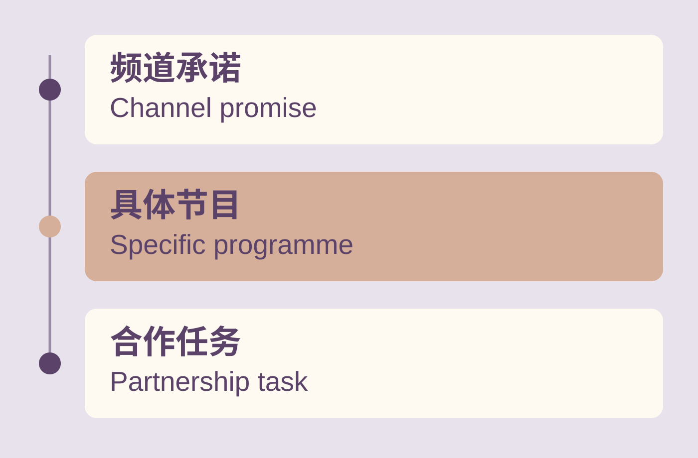

# Channels of YouTube: Match the Editorial Promise

Status: local review draft; confirm the publication date before release.

Compare YouTube channels through the editorial promise they repeatedly fulfil, then decide whether a brand assignment fits a particular programme rather than only a category or audience total.

When researching channels of YouTube for creator partnerships, ask which audience question a channel repeatedly serves rather than grouping it only under technology, lifestyle or entertainment. Editorial promise is an analytical concept used here: value repeatedly supplied across programmes and supported by the work. A brand is buying a suitable contribution. Channel scale, a matching name or one popular upload cannot make that decision alone.

## Describe the recurring promise in one sentence

Observe how the channel introduces itself, then compare that description with the work. A useful sentence might identify the audience, recurring question and main mode of expression, without forcing every channel into an identical formula.

A technology channel might explain product choices, a lifestyle channel document practical experience and an entertainment channel provide a shared viewing occasion. These are content-task examples, not proof that every channel using a category has the same abilities.

Mark your description as a research judgement rather than a positioning statement the creator has accepted. If the channel introduction differs from recent programmes, retain the discrepancy and ask which direction they intend to continue when making contact.

A useful description is specific enough to exclude an unsuitable partnership. If the sentence could be copied unchanged onto dozens of unrelated channels, it probably remains a broad label. It has not yet explained why viewers return to this person's work, or how that recurring expectation would help the brand frame a respectful proposal.

## Look across several uploads for recurring value

Select a set of work that helps explain the recent direction instead of only the most-viewed upload. Retain the sampling date, selection reason and programme types so another person understands what was reviewed and what the sample did not cover.

Look for recurring explanatory behaviour: comparing conditions, demonstrating a process or acknowledging limits of experience. One strong excerpt supplies a lead but cannot prove that an ability will appear consistently in every commission.

Examine connections between uploads too. Does the next programme answer another related question or merely repeat a formerly popular form? That is an editorial judgement to illustrate with work, not an unsupported conclusion about algorithmic punishment.

Place evidence beside the assignment it supports. The work shows a clear explanation of steps is more discussable than highly professional. Past performance of an explanation still does not mean the creator has agreed to repeat it for a brand or grant rights to existing footage. Research identifies a possible fit; the commercial conversation establishes whether that fit can become an assignment.

## Distinguish the channel, programme and playlist

[YouTube Data API’s channel definition](https://developers.google.com/youtube/data/reference/rest/v3/channels) treats a channel as a resource with its own identifier. Retain the actual channel URL and identity when checking the subject rather than relying on a similar display name.

A channel can contain different programmes and playlists that do not share identical production requirements. A long demonstration, short excerpt and live discussion from the same person need separate research into expression and delivery.

The brand proposal should identify the programme or form it wants to discuss. Suitability in one part of the channel does not make the whole catalogue, every host or all language versions available for purchase.

Conversely, a playlist should not be treated automatically as an independent creator business. Establish who makes the work, who can discuss a partnership and which assets are needed before handing the lead to the next operator. This prevents a clearly identified channel from being mistaken for a fully confirmed commercial unit and gives the creator a concrete request to consider.

Topic fit at channel level does not confirm every programme or publication scope.

## Do not merge a channel family by appearance

Some brands or creators operate several channels. Similar design, related names or cross-recommendations can suggest a relationship worth checking without establishing the same team, audience or commercial permissions.

The [channel-identity handoff method](https://www.quickkol.com/blog/youtube-channels-identity-scope-handoff/#answer) helps record each subject. Today's task goes further by distinguishing what each channel promises, so a judgement about the main channel is not copied automatically onto another programme.

For a proposed cross-channel partnership, identify the task and confirming owner for each channel. Shared assets, different languages and additional publications need discussion as actual work rather than being hidden inside one umbrella label.

Cross-channel counts also should not be added and called independent people. A viewer can watch several channels. Without deduplication evidence, retaining each scale figure and period provides honest context without manufacturing a larger total audience. The resulting shortlist may look less simple, but it lets the buyer understand which programme contributes what and which parts of the proposal are still assumptions.

## Check the promise against available viewing evidence

[YouTube’s audience guide](https://support.google.com/youtube/answer/9314416?hl=en) describes information about other channels, content and formats viewers watch, with periods specific to the reports. A brand can request task-relevant information within an authorized scope.

Such information does not establish purchase intent for every viewer or justify guessing private identities from public comments. Observed topic interest remains different from verified market, age or commercial outcomes.

The [creator-media-kit proposal method](https://www.quickkol.com/blog/media-kits-creator-proposal-version-fit/#answer) helps bound the use of supplied material. State the proposed programme, market and question rather than requesting all backend information.

If information cannot be obtained, retain the uncertainty. Work can support a judgement about expression while audience evidence supports a differently scoped fit judgement. They should not become the same guarantee because one is missing. A useful shortlist states which conclusion relies on observable content and which requires additional evidence, allowing the buyer to consider a bounded pilot without pretending the remaining audience questions have already been answered.

## Keep commercial work within the channel promise

When the brand enters a programme, explain the product's role in its question. It might be the object of experience, material for an explanation or partnership context; the original format need not become a complete sales presentation every time.

[FTC’s influencer-disclosure guide](https://www.ftc.gov/business-guidance/resources/disclosures-101-social-media-influencers), in its United States context, calls for clear material-relationship disclosure and truthful, supported experience and product statements. Natural integration should not make the commercial relationship difficult to see.

Let the creator retain expressive judgement while the brand confirms product facts and the actual assignment. Do not request an experience that did not occur or use the channel's familiar voice as a reason to skip factual review.

If the proposed work is far from the channel promise, revise the task or consider another candidate. A larger fee cannot automatically change audience expectations or establish commercial effect. The negotiation can instead ask what contribution the creator believes they can make accurately and whether that contribution still answers the brand's original need.

## Retain counterexamples and unknowns

Researchers can be tempted to retain only excerpts supporting their preferred choice. Keep counterexamples, unconfirmed conditions and whether the sample covers only one form.

A channel that explains concepts clearly may not suit a task requiring a live physical demonstration. Someone skilled in long programmes does not automatically supply equally clear short-form production. This is not a label of personal deficiency; it bounds the evidence currently available.

Turn unknowns into questions for the creator rather than negative facts invented by the researcher. Unrelated private information is not needed to explain a commercial condition that simply remains unverified.

A candidate record can say both strong editorial fit and production condition to confirm. That helps the owner choose a discussion, narrower assignment or alternative arrangement more effectively than an unsupported total score. It also allows a creator to supply relevant examples the first sample missed, improving the research without pretending that the original observation was a complete account of their abilities.

## Apply the method to a hypothetical technology brief

Imagine a brand needing to explain the working situations suited to a new device. The team reviews three channels: one strong in extended conditional comparisons, one centred on entertainment challenges and one documenting professional practice.

Category labels or subscriber totals cannot decide the purchase alone. Define whether the assignment explains selection conditions, demonstrates actual operation or brings a concept to relevant people's attention. Different tasks may call for different contributions.

Retain work evidence, check programme and audience information, then discuss experience, production and publishing scope. Until participation is confirmed, a channel should not be recorded as an appointed partner.

This example contains no real channel scores or outcomes. It shows how researching channels of YouTube can move from broad categories to a concrete proposal rather than turning large attention into suitability for every brand. The buyer can also choose to commission complementary roles, provided each role is justified and the extra complexity serves the task rather than merely making the roster look more impressive.

## Hand over a choice that can become a discussion

The final record should identify the channel, editorial promise, supporting work, proposed programme, information scope and open conditions. State what the next outreach should ask rather than forwarding only an account link.

If the channel direction changes after the review date, revisit the sample before a new proposal. Older work is not a permanent description, and confirmed facts should remain distinguishable from the editorial judgement made at that time.

QuickKOL can help a brand interpret a brief, discover relevant creators and research work and contact routes. That does not replace the creator's acceptance of an assignment or verification of data and permissions.

Good channel research makes the discussion more specific: the brand understands the contribution it wants, the creator understands why they were approached and both see what remains undecided. That is progress from a list to an executable creator partnership. Preserve the reasoning with the shortlist so a colleague can continue the conversation without recreating the research or presenting an unconfirmed idea as an agreed commercial commitment.

## Compare channel promises with partnership tasks

| Dimension | Research evidence | Next confirmation |
| --- | --- | --- |
| Recurring promise | Several relevant uploads | Creator’s intended direction |
| Specific form | Demonstration, short or discussion samples | Actual production scope |
| Channel family | Separately confirmed identities | Owner for each channel |
| Audience fit | Authorized information and period | Information not obtained |
| Commercial expression | Product role and actual experience | Disclosure, delivery and rights |

Editorial research method, not a confirmed partnership, live ranking or deduplicated audience total.

## Prepare this evidence before outreach

Build the proposal from content evidence.

- [ ] Retain actual channel identity and review date.
- [ ] Describe the recurring editorial promise.
- [ ] Select supporting work and counterexamples.
- [ ] Identify the programme and form to discuss.
- [ ] Separate audience evidence and unknowns.
- [ ] Propose a contribution without assuming acceptance.

## Research date and limitations

Sources reviewed November 19, 2026. Methods, tables and decision rules are editorial recommendations. Hypothetical examples are not actual client results or industry benchmarks. Source geography and periods are specified where relevant.

## Start creator research with a clear task

Use QuickKOL to interpret a brief, discover relevant creators and research their work and contact routes. Verify data, commercial terms and outcomes at their source.

[Explore QuickKOL](https://www.quickkol.com/#capabilities)

## Sources

- [YouTube Data API’s channel definition](https://developers.google.com/youtube/data/reference/rest/v3/channels)
- [YouTube’s audience guide](https://support.google.com/youtube/answer/9314416?hl=en)
- [FTC’s influencer-disclosure guide](https://www.ftc.gov/business-guidance/resources/disclosures-101-social-media-influencers)
