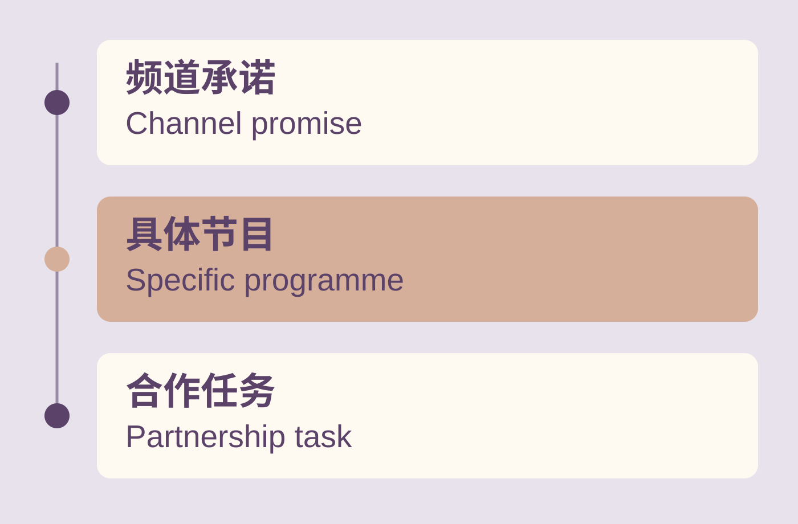

# YouTube 频道怎样按内容承诺筛选

状态：本地审阅稿；正式发布日期待确认。

比较 YouTube 频道时，不只按标签和规模分类。先识别它持续为观众提供的内容承诺，再判断品牌任务能否自然进入具体节目。

搜索 channels of YouTube 来寻找达人合作对象时，先问频道持续解决什么观众问题，而不是只按科技、生活或娱乐标签分组。频道承诺是本文的编辑分析概念：创作者在多个节目里反复提供、并有作品可以支持的价值。品牌要采购的是合适的具体贡献；频道规模、同名账号或一条热门视频，都不能单独完成这个判断。

## 用一句话写出频道的持续承诺

先观察频道怎样向观众介绍自己，再用作品验证。可以写成“帮助某类观众理解某类问题，主要通过某种表达”，但不要把所有频道强行套成同一个格式。

科技频道可能解释产品选择，生活频道可能记录实践经验，娱乐频道可能提供某种共同观看体验。这些只是内容任务示例，不代表每个使用该标签的频道都具备相同能力。

把你写出的承诺标为研究判断，而不是创作者已经认可的定位。若频道介绍与近期节目不同，保留差异，后续联系时询问对方希望延续哪种方向。

好的描述足够具体，能帮助决定什么合作不适合。若一句话可以原样用于几十个互不相关频道，它多半仍是宽泛标签，还没有说明观众为什么会继续看这个人的作品。

## 从多条作品寻找持续价值

选择能说明近期方向的一组作品，而不是只挑最高观看。保留抽样日期、挑选理由和节目类型，让别人知道你看到了什么，也知道样本没有覆盖什么。

观察反复出现的解释方式：是否比较选择条件，是否展示过程，是否承认体验限制。单个精彩片段可以提供线索，但不足以证明这种能力会稳定出现在所有委托中。

也看内容之间的连接。后续节目是在回答新的相关问题，还是只重复一个曾经热门的形式？这是编辑判断，应通过具体作品说明，不能写成无依据的算法惩罚结论。

把证据写到对应任务旁。例如“作品中展示了如何解释步骤”，比“非常专业”更容易讨论；但曾经做过某种说明，不代表已经同意为品牌重复制作或交出素材许可。

## 区分频道、节目与播放列表

[YouTube Data API 的频道定义](https://developers.google.com/youtube/data/reference/rest/v3/channels)把频道作为具有独立 ID 的资源。团队核对对象时，应保存实际频道地址与身份，而不只依靠相似显示名。

频道内部可能有不同节目和播放列表，它们不一定共享相同制作要求。长篇演示、短片摘要和直播讨论，即使来自同一个人，也需要分别研究表达与交付。

品牌提案应指出具体希望讨论的节目或内容形式。不要因为频道某个部分适合，就默认整个目录、全部主持人或所有语言版本都可采购。

也不要反过来把一个播放列表当成独立创作者主体。先确认谁负责内容、谁能够讨论合作，以及这次需要的作品范围，才能把研究线索交给合适的人继续处理。

频道适合某个主题，不代表全部节目与发布范围都已确认。

## 同一品牌的频道家族不能直接合并

有些品牌或创作者拥有多个频道。视觉相似、名称相关或互相推荐，可以提示研究关系，但不能自动证明相同团队、相同受众或共同商业权限。

[频道身份交接方法](https://www.quickkol.com/zh/blog/youtube-channels-identity-scope-handoff/#answer)帮助记录各个对象。今天的任务还要进一步区分每个频道承诺什么，避免把主频道的内容判断直接复制到其他节目上。

若确实准备跨频道合作，就分别写出每个频道的任务与需要确认的负责人。涉及共同素材、不同语言或额外发布时，也分别讨论实际工作，不靠一个总称涵盖所有义务。

跨频道数字更不能直接相加成独立人数。同一观众可能观看多个频道；没有去重依据时，保留各自规模与观察时期，就能提供真实背景，而不需要制造一个看起来更大的总受众。

## 用受众资料核对承诺与观看

[YouTube 的受众说明](https://support.google.com/youtube/answer/9314416?hl=en)提供观众关注的其他频道、内容与格式等资料，并对不同报告给出相应时期。品牌可以在获准范围内提出与任务有关的请求。

这些资料不证明每位观众都具有某种购买意图，也不让品牌从公开评论猜测私人身份。观察到的主题兴趣，与已核验的市场、年龄或商业结果仍是不同信息。

[达人媒体包提案方法](https://www.quickkol.com/zh/blog/media-kits-creator-proposal-version-fit/#answer)帮助限定资料用途。请求时说清拟讨论的节目、地区和需要回答的问题，而不是笼统要求“全部后台”。

如果资料无法取得，就保留不确定性。作品可以支持表达能力判断，受众证据可以支持另一个范围的匹配判断，两者不应因为某一项缺失就被混写成同一种保证。

## 商业内容也要符合频道承诺

品牌进入节目时，先说明产品在该问题里承担什么角色。可以是体验对象、解释材料或合作背景，不必每次都把原节目改造成完整销售演讲。

[FTC 的达人披露指南](https://www.ftc.gov/business-guidance/resources/disclosures-101-social-media-influencers)在美国语境下要求清楚说明重要商业关系，也强调体验与产品说法应真实、有依据。自然融入内容，不等于让合作关系变得难以看见。

让创作者保留表达判断，品牌确认产品事实与实际任务。不要要求对方宣称未发生的体验，也不要把频道一贯语气当成无需审阅事实的理由。

如果拟购内容与频道承诺差距太大，可以调整任务或另找合适对象。用更高费用强行填补匹配问题，不会自动改变观众对节目的期待，也不能证明合作一定有商业效果。

## 也记录不适合的证据与未知

研究者容易只留下支持自己选择的片段。也保留与拟购任务不一致的作品、尚未确认的条件，以及样本是否只覆盖某一种形式。

例如，一个频道能把概念讲得清楚，却未必适合需要现场演示的任务；擅长长节目的人，也不自动具备同样清晰的短片制作。这里不是给创作者贴上能力缺陷，而是在限定当前证据。

把未知写成问题，联系时由对方说明。不要自行补成否定事实，也不需要用无关私人资料解释某项尚未核验的商业条件。

候选表中可以同时出现“内容很适合”与“某项制作条件待确认”。这比一个没有依据的总分更能帮助负责人决定，下一步应该继续讨论、缩小任务，还是选择其他合作方式。

## 用假设科技 Brief 演练选择

假设品牌需要解释一种新设备适用于哪些工作情形。团队研究三个频道：一个擅长长篇条件比较，一个主要制作娱乐挑战，一个持续记录专业使用过程。

不能仅凭标签或订阅数决定。先写拟购任务，是解释选择条件、展示真实操作，还是让更多相关人注意到概念；不同任务可能对应不同贡献。

随后保存具体作品证据，核对节目与受众资料，再讨论体验、制作和发布范围。没有确认某个频道的参与，就不把它写成已选合作方。

这个例子没有真实频道评分或结果。它说明 channels of YouTube 的研究可以从广泛分类走向明确提案，而不是把某个频道拥有大量关注，直接变成适合所有品牌的结论。

## 交接一份可以继续讨论的选择

最终记录应包括频道身份、内容承诺、支持作品、拟购节目、资料范围和待确认条件。写清下一步联系要问什么，不只发出一个账号链接。

如果研究日期之后频道方向变化，就在新的提案前复核，不把旧样本当作永久说明。已经确认的事实与当时的编辑判断也应分开保存。

QuickKOL 可帮助品牌理解 Brief、发现相关达人并研究作品与联系路径；这些工作不会替代创作者对具体任务的接受，也不能替代数据与许可核验。

好的频道研究会让合作讨论更具体：品牌知道希望得到什么，创作者知道为什么被联系，双方也能看见哪些事情还未决定。这才是从频道名单走向可执行达人合作的进展。

## 频道承诺与合作任务的比较

| 维度 | 研究证据 | 后续确认 |
| --- | --- | --- |
| 持续承诺 | 多条相关作品 | 创作者拟延续方向 |
| 具体形式 | 演示、短片或讨论样本 | 实际制作范围 |
| 频道家族 | 分别确认的身份 | 各频道负责人 |
| 受众匹配 | 获准资料及其时期 | 未取得的范围 |
| 商业表达 | 产品角色与真实体验 | 披露、交付与许可 |

编辑研究方法，不是已确认合作、实时排名或独立受众总量。

## 联系频道前整理这些依据

让提案从内容事实出发。

- [ ] 保存真实频道身份与研究日期。
- [ ] 用一句话描述持续内容承诺。
- [ ] 挑选能支持任务的作品与反例。
- [ ] 明确拟讨论的节目与形式。
- [ ] 分开记录受众证据与未知。
- [ ] 提出具体贡献，不预设对方已接受。

## 研究日期与使用边界

资料核验于 2026 年 11 月 19 日。文中方法、表格和决策规则为编辑建议，标为假设的示例不是实际客户结果或行业基准。外部资料的适用地区与时期按各段说明。

## 从任务开始达人研究

用 QuickKOL 理解 Brief、发现相关达人并研究作品与联系路径；数据、合作条件和结果仍需核验。

[了解 QuickKOL](https://www.quickkol.com/#capabilities)

## 来源

- [YouTube Data API 的频道定义](https://developers.google.com/youtube/data/reference/rest/v3/channels)
- [YouTube 的受众说明](https://support.google.com/youtube/answer/9314416?hl=en)
- [FTC 的达人披露指南](https://www.ftc.gov/business-guidance/resources/disclosures-101-social-media-influencers)
