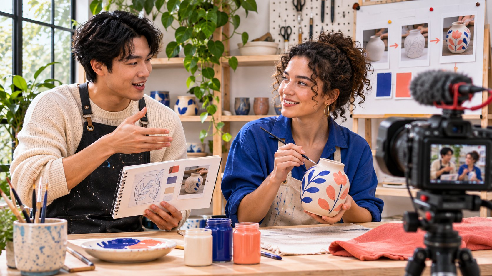
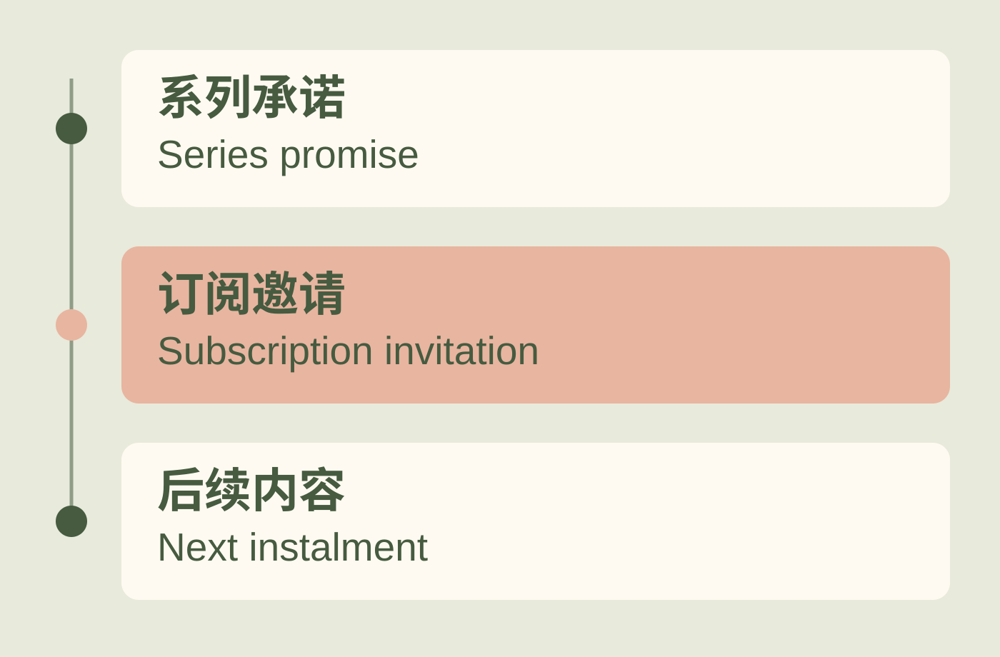

# Get YouTube Subscribers With a Clear Series Promise

Status: local review draft; confirm the publication date before release.

A brand-supported YouTube series needs a reason to return before a creator asks for a subscription. Match the invitation to future work without turning growth into a guaranteed deliverable.

An actionable approach to how to get subscribers on YouTube is giving people a reason to return: which question the creator keeps addressing, what a later instalment will explain and which channel the subscription concerns. A brand partnership should support that series promise before adding a relevant, truthful invitation. Avoid exchanges, purchases and misleading actions, and promise no fixed subscriber gain. Subscription sources, viewing activity and commercial outcomes are separate evidence requiring scoped review.

## Make the subscription reason useful to the viewer

Begin with a question people may want to explore further. A making series can progressively explain materials, operation and maintenance; an interview series can keep examining a specialist subject without repeating one product slogan every episode.

Describe the series promise concretely instead of asking people to follow for more great content. Viewers should understand the continuing subject, and the creator should be able to fulfil it through actual work.

The [YouTube editorial-promise guide](https://www.quickkol.com/blog/youtube-channel-editorial-promise-brand-fit/#answer) helps brands examine what a channel repeatedly explains. Connect the partnership with that work rather than requiring a creator to promise an unfamiliar continuing programme for one advertisement.

A valuable standalone piece is also legitimate. If no continuation exists, do not manufacture a series merely to support a subscription request. Complete the real contribution first and discuss whether continuing makes sense. This keeps the invitation tied to something a viewer can reasonably expect rather than a vague future benefit used only to increase a visible count.

## Plan the next instalment before writing the invitation

Identify the question planned for the next instalment, the responsible role and conditions not yet confirmed. Plans can remain changeable without presenting undecided work as a certain release.

Creators and brands should distinguish an editorial promise from contracted deliverables. Buying several pieces does not necessarily give a brand control over the channel's entire future schedule; the agreed assignment still defines the work.

An invitation can explain which question the next piece continues, provided that plan is genuine and feasible. Do not use an unclear reward or undeliverable exclusive information to pressure people into subscribing.

Create a natural continuation. Viewers should receive the current piece's complete value before learning what later work may help them understand. Withholding an essential step merely to force another click makes the invitation depend on an artificial information gap. A continuing promise works better as an extension of a useful explanation than as a condition for understanding what the first piece was supposed to explain.

## Make the subscribed identity clear

A brand channel, creator channel and joint project can appear in the same piece. Identify which publishing identity the invitation concerns so viewers do not think they are following another account.

Where several creators appear, explain their respective continuing work without transferring one person's promise to an unconfirmed team member. A multi-person programme needs actual coordination.

The [YouTube playlist-maintenance method](https://www.quickkol.com/blog/youtube-playlist-multi-creator-release-maintenance/#answer) helps preserve continuation routes across creators. A playlist organizes content without automatically sharing subscribers or publishing responsibilities among participating channels.

Before release, match the channel name, destination and spoken invitation. The brand then supports clear navigation instead of making subscription choice part of an ambiguous commercial prompt. This check also avoids crediting one channel with another's growth in later reporting, because the team has already recorded the identity to which the invitation and intended continuation belong.

Point the invitation toward a genuine continuation without treating subscriber gains as a controllable deliverable.

## Distinguish an ordinary invitation from manufactured actions

[YouTube’s fake-engagement policy](https://support.google.com/youtube/answer/3399767?hl=en) prohibits artificial metric inflation and reciprocal subscription arrangements while allowing ordinary encouragement to subscribe, like, share or comment. These should not be treated as the same conduct.

A brand can invite people interested in the series to continue following without demanding purchased people or exchanges to complete acceptance. A hired promoter's conduct can also affect the account; outsourcing does not automatically separate the channel from that issue.

This is not an investigation of a creator, and a growth event alone is not procurement evidence. The focus is designing the brand's assignment and incentives so delivering work does not become pressure to fill a manufactured-number target.

Specify controllable work such as production, publication and appropriately scoped review. Subscriber gains can be observed without disguising them as an unconditional result entirely within the creator's control. That makes the commercial agreement clearer while preserving the viewer's independent choice about whether to follow the continuing work.

## Keep the brand relationship clear within the series

A sponsored series still needs to make the brand relationship understandable. [FTC’s influencer-disclosure guide](https://www.ftc.gov/business-guidance/resources/disclosures-101-social-media-influencers) discusses material connections in its United States context; repeated brand appearance does not establish that every new viewer already knows.

Each piece should retain actual experience and applicable facts instead of turning continuity into an obligation to repeat identical praise. The explanation's value comes from a genuine contribution rather than unlimited endorsement.

The subscription invitation should not imply that following guarantees a product, income or specialist outcome. Any additional activity needs separately confirmed conditions instead of being hidden inside an ordinary editorial promise.

A supporting brand can provide factual references, workable production conditions and a response route. Making that support's relationship to the creator's expression clear is more understandable than assuming the programme's continued existence explains the commercial context. Viewers can then decide whether the subject is useful while also knowing why the brand participates in the work.

## Subscription sources explain where actions occurred

[YouTube’s subscription-source guide](https://support.google.com/youtube/answer/9717879?hl=en) helps examine where subscription actions occurred, such as a watch page, channel homepage or another scope. With limited information, some dimensions may be unavailable.

A source location is not a psychological reason, nor can it independently establish that every new action resulted from one invitation. Other publications or distribution arrangements may occur at the same time, so retain those conditions.

For series review, record the observation window and work version before deciding whether source information addresses the question. Do not allocate an entire channel change unconditionally to the sponsored instalment.

If only a total is known, report only the corresponding fact rather than inventing its sources. This lets the team observe what happened after an invitation while leaving unsupported causality open. A precise location label can improve a question without proving why a person chose to act or how much credit the brand should receive for that choice.

## Observe continuing viewing separately from subscribing

[YouTube’s audience guide](https://support.google.com/youtube/answer/9314416?hl=en) gives specific scopes for measures such as monthly audience and notes that some information can be limited. Subscriber totals do not directly represent unique people who actually watched during a period.

Deciding whether to continue a series requires actual work, relevant questions and available activity evidence. Limited subscriber gains do not automatically make an explanation worthless, while a growing total does not establish that people keep returning.

Review which questions deserve another instalment, whether the opening is clear and whether viewers can find the continuation. Where information is insufficient, limit the conclusion to what was observed.

This brings growth research back to continuing contribution. A creator need not guarantee every subscriber's future behaviour, and a brand should not treat channel stock as the inevitable audience for each piece. The series can be improved through evidence of actual viewing and feedback without pretending that every useful editorial decision must first produce a larger subscription total.

## Hypothetical example: invite viewers to a pottery series

Imagine a tool brand supporting two pottery creators across three explanations: choosing materials, completing a painted design and everyday care. Each instalment should provide complete value, with the continuation actually confirmed by both parties.

The first ending can identify the painting step planned next and clarify that the subscription concerns the creator channel. This is not an actual client campaign and assumes no subscriber gains or sales.

The brand supplies tool facts while creators retain actual operational experience and applicable conditions. Explain the commercial relationship with the work rather than leaving a new viewer to infer it from recurring appearances.

Review the pieces, questions and available source evidence before deciding whether a closer shot or clearer continuation route is needed. Even when attribution cannot be established, production can improve on a supported basis. The invitation points toward real work already planned, giving viewers a choice to continue without making their response a condition the creator must manufacture to complete the commission.

## Support subscriptions with a credible continuation

For a brand partnership, the answer to how to get subscribers on YouTube is aligning work worth continuing with a clear invitation, rather than purchasing a number as an independent commodity.

Hand over the series promise, next assignment, publishing identity and evidence scope so later colleagues understand what the invitation points toward. If plans change, update the explanation instead of leaving an outdated promise in place.

For example, a delayed shoot should prompt the responsible people to consider updating the explanation and continuation route, rather than inventing content to preserve one spoken line. A feasible arrangement is more useful than retaining a release promise that the team already knows it cannot fulfil.

Preserve the boundary between ordinary invitations and manufactured engagement, and distinguish subscriptions, active viewing and business outcomes. No one measure explains the entire value of the partnership.

Creators keep addressing real questions, brands provide appropriate support and viewers independently choose whether to continue. That is a basis for a continuing collaboration discussion. Growth can be observed and researched without using invented results, exchanges or undeliverable guarantees to complete the assignment. A clear next piece is a more useful starting point than a demand for a predetermined count.

## Prepare a series subscription invitation

| Question | Retain | Boundary |
| --- | --- | --- |
| Why return? | Continuing audience question | No invented continuation |
| Whom to subscribe to? | Defined channel identity | Do not mix accounts |
| Brand role? | Facts and commercial context | No distribution guarantee |
| Where did the action occur? | Source and window | Location is not motive |
| Did people keep watching? | Actual activity evidence | Stock is not viewing |

Editorial partnership framework, not a growth formula, subscriber promise or complete causal experiment.

## Match the invitation with continuing work

Confirm together in the series brief.

- [ ] State the continuing question.
- [ ] Plan a feasible next instalment.
- [ ] Confirm the channel being invited to.
- [ ] Avoid exchanges and manufactured totals.
- [ ] Retain context, sources and windows.
- [ ] Improve the continuation with real feedback.

## Research date and limitations

Sources reviewed November 19, 2026. Methods, tables and decision rules are editorial recommendations. Hypothetical examples are not actual client results or industry benchmarks. Source geography and periods are specified where relevant.

## Start creator research with a clear task

Use QuickKOL to interpret a brief, discover relevant creators and research their work and contact routes. Verify data, commercial terms and outcomes at their source.

[Explore QuickKOL](https://www.quickkol.com/#capabilities)

## Sources

- [YouTube’s fake-engagement policy](https://support.google.com/youtube/answer/3399767?hl=en)
- [FTC’s influencer-disclosure guide](https://www.ftc.gov/business-guidance/resources/disclosures-101-social-media-influencers)
- [YouTube’s subscription-source guide](https://support.google.com/youtube/answer/9717879?hl=en)
- [YouTube’s audience guide](https://support.google.com/youtube/answer/9314416?hl=en)
