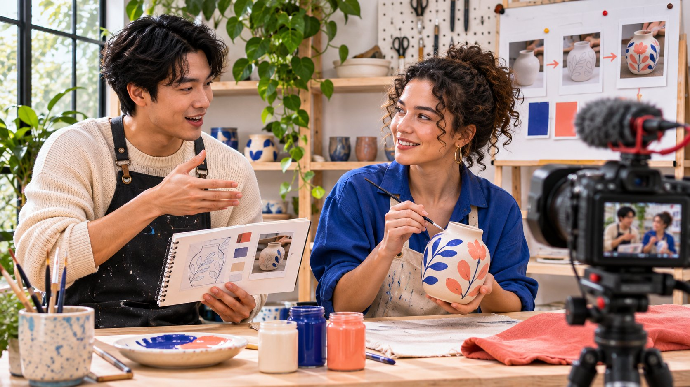
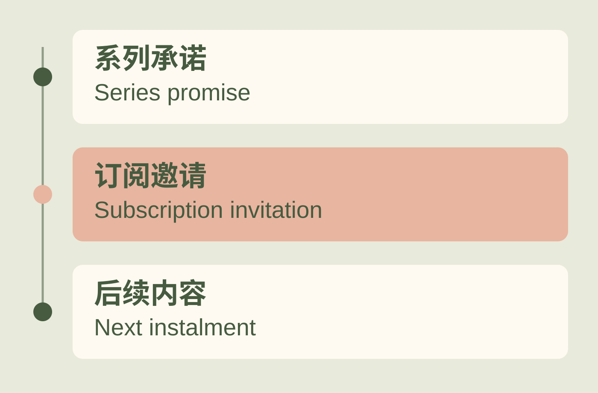

# YouTube 达人系列的订阅邀请

状态：本地审阅稿；正式发布日期待确认。

品牌支持的 YouTube 系列应先给观众一个继续观看的理由，再让创作者提出与后续内容一致的订阅邀请，避免把粉丝增长变成不受控制的交付保证。

How to get subscribers on YouTube 的可执行方向，是让观众知道为什么值得继续回来：创作者持续解决什么问题，下一期会接着讲什么，以及订阅对应哪个频道。品牌合作应支持这个系列承诺，再在合适位置提出真实邀请。不要通过互订、购买或误导制造动作，也不要承诺固定新增人数。订阅来源、观看活动与商业结果是不同证据，需要按各自范围复盘。

## 让订阅理由属于观众需要

先从观众愿意继续了解的问题开始。一个制作系列可以逐步解释材料、操作与维护，一个访谈系列可以持续提出某类专业问题，不必每期重复同一句商品口号。

把系列承诺写成具体描述，而不是“关注我获取更多精彩”。观众应能理解继续观看的主题，同时创作者能够在真实工作中履行这个承诺。

[YouTube 内容承诺指南](https://www.quickkol.com/zh/blog/youtube-channel-editorial-promise-brand-fit/#answer)帮助品牌查看频道长期解释什么。合作应与这些工作相连，不要求创作者为一次广告突然承诺自己不会持续制作的内容。

有价值的单期作品也可以成立。若目前没有后续安排，就不要为了订阅邀请制造一个虚假的系列；可以先完成真实贡献，再讨论是否适合继续。

## 先安排下一期，再写邀请句

明确下一期预计解决的问题、负责角色与尚未确认条件。计划可以保留变动，但不能把未决定的内容写成一定发布的事实。

创作者与品牌需要区分系列内容承诺和合同交付。品牌买了几条作品，不一定拥有整个频道未来编辑安排；具体工作仍按双方约定执行。

邀请可以说明下一期会继续哪项解释，前提是这项安排真实可行。不要用模糊奖励或无法兑现的独家信息迫使观众订阅。

给内容留一个自然的继续点。观众先得到本期完整价值，再知道后续可能帮助什么；不要故意省略必要步骤，只为让人点击下一条才看懂基本信息。

## 让观众知道订阅的是哪个身份

品牌频道、达人频道与联合项目可能出现在同一作品中。明确邀请对应哪个发布身份，避免画面让观众误以为正在关注另一个账号。

如果作品同时介绍多个创作者，可以说明各自后续内容，但不把一个人的承诺转给没有确认的团队成员。多人项目的节目安排需要实际协调。

[YouTube 播放列表维护方法](https://www.quickkol.com/zh/blog/youtube-playlist-multi-creator-release-maintenance/#answer)可帮助多位创作者保留后续路径。播放列表只是组织内容的一种方式，不自动让所有参与频道共享粉丝或发布责任。

发布前核对频道名称、链接与口播对应。这样品牌能够支持清楚导航，而不是将观众的订阅选择变成一段含混的商业引导。

邀请应指向真实可讨论的后续内容，不把新增人数当作可控制交付。

## 区分正常邀请与人为制造动作

[YouTube 的虚假互动政策](https://support.google.com/youtube/answer/3399767?hl=en)禁止人为增加指标与互订等做法，同时说明正常鼓励订阅、点赞、分享或评论可以成立。不要把两种行为混为一谈。

品牌可以邀请对系列感兴趣的人继续关注，但不应要求购买人数或用互相订阅达成验收。第三方推广行为也可能影响账号，不因外包就自动脱离责任。

这里不是检测某位创作者，也不把一次增长当成采购证据。重点是品牌怎样设计自己的任务和激励，避免让完成作品变成补齐虚假数字的压力。

将可交付工作写清楚，例如制作、发布与适当复盘。新增订阅可以被观察，但不应伪装成创作者完全可控制、无条件必须达到的结果。

## 让品牌关系在系列里保持清楚

赞助系列仍需要让观众理解品牌关系。[FTC 的达人披露指南](https://www.ftc.gov/business-guidance/resources/disclosures-101-social-media-influencers)在美国语境下讨论重要商业联系，不能因为同一品牌多次出现，就假定所有新观众已经知道。

每条作品应保留真实体验与适用事实，不让连续合作变成必须重复相同赞美。创作者解释的价值，来自实际贡献而不是无限认可。

订阅邀请也不要暗示观众关注后必然获得商品、收入或专业结果。若有额外活动，条件与规则需要独立确认，而不是混在普通内容承诺里。

品牌支持系列，可以提供事实资料、合理制作条件与回应路径。让观众知道这种支持与创作者表达的关系，比把合作藏在节目长期存在的背景里更清楚。

## 订阅来源说明动作发生位置

[YouTube 的订阅来源说明](https://support.google.com/youtube/answer/9717879?hl=en)可以帮助查看订阅动作发生在哪类入口，例如观看页、频道主页或其他范围。资料不足时，部分维度可能不可用。

来源位置不等于心理原因，也不能单独证明新增动作全部由某句邀请造成。品牌同期还可能发布其他作品或安排不同分发，需要保留条件。

在系列复盘中，记录观察窗口与作品版本，再看来源资料是否足以回答问题。不要把频道总体变化无条件分配给本期赞助作品。

如果只知道总数，就只报告总数对应事实；缺少来源时不补造。这个方法让团队看见邀请之后发生了什么，同时保持不能确认的因果关系开放。

## 继续观看与订阅动作分别观察

[YouTube 的受众说明](https://support.google.com/youtube/answer/9314416?hl=en)为月度受众等资料提供具体范围，也提醒部分数据可能有限。订阅人数并不直接代表这一时期实际观看的独立人群。

系列是否值得继续，需要结合实际作品、相关问题与可得活动资料。不要只因新增订阅较少就认定解释没有价值，也不因总数增长就确认观众持续回来。

复盘可以问下一期哪些问题仍值得讲、开头是否清楚、观众是否找到后续路径。没有足够资料时，将结论限制在已观察内容。

这让增长研究回到持续贡献。创作者不需要为每一个订阅者今后的行为作保证，品牌也不应把频道存量当作每条作品必然触达的人数。

## 假设陶艺系列怎样提出邀请

假设工具品牌支持两位陶艺创作者制作三期解释：选材料、完成绘制与日常维护。每一期都应有完整价值，后续安排由双方实际确认。

第一期结尾可以说明下一期将演示哪项绘制步骤，并指出订阅的是创作者频道。这不是实际客户活动，也没有预设新增订阅或销量。

品牌提供工具事实，创作者保留实际操作体验与适用条件。商业关系随作品清楚表达，不能因为连续出现就让新观众自行猜测。

复盘时看作品、问题与可得来源资料，再决定下一期是否需要更清楚近景或路径说明。即便资料不支持因果归属，仍能完成有依据的制作改进。

## 以可信的后续内容支持订阅

How to get subscribers on YouTube 的品牌合作答案，是让值得继续的内容与清楚邀请对应，而不是把数字当作独立商品采购。

交接系列承诺、下一期任务、发布身份与资料范围，让后续团队知道邀请究竟指向什么。计划改变时，更新相关说明，不让旧承诺继续误导观众。

例如后续拍摄延迟，应让负责人确认是否调整说明与路径，而不是为了守住一句口播临时编造内容。保留真正可履行的安排，比维持一个已经失效的发布日期更有用。

保留正常邀请与人为互动的界限，也保留订阅、活跃观看与业务结果的区别。没有哪项单独能够解释全部合作价值。

创作者持续解决真实问题，品牌提供适当支持，观众自主决定是否继续，这才是可长期讨论的达人合作基础。增长可以观察与研究，但不应通过虚构、互换或不可兑现保证来完成。

## 系列订阅邀请的准备

| 问题 | 保留记录 | 边界 |
| --- | --- | --- |
| 为什么回来 | 持续观众问题 | 不虚构后续 |
| 订阅谁 | 明确频道身份 | 不混合账号 |
| 品牌角色 | 事实与商业背景 | 不保证分发 |
| 动作发生在哪 | 来源与窗口 | 位置不是动机 |
| 是否继续看 | 实际活动资料 | 存量不是观看 |

编辑合作框架，不是增长公式、订阅承诺或完整因果实验。

## 让邀请与后续工作一致

在系列 Brief 中一起确认。

- [ ] 写清持续解决的问题。
- [ ] 安排可履行的下一期。
- [ ] 确认邀请对应频道。
- [ ] 拒绝互订与人为补数。
- [ ] 保留关系、来源与窗口。
- [ ] 用真实反馈改进后续。

## 研究日期与使用边界

资料核验于 2026 年 11 月 19 日。文中方法、表格和决策规则为编辑建议，标为假设的示例不是实际客户结果或行业基准。外部资料的适用地区与时期按各段说明。

## 从任务开始达人研究

用 QuickKOL 理解 Brief、发现相关达人并研究作品与联系路径；数据、合作条件和结果仍需核验。

[了解 QuickKOL](https://www.quickkol.com/#capabilities)

## 来源

- [YouTube 的虚假互动政策](https://support.google.com/youtube/answer/3399767?hl=en)
- [FTC 的达人披露指南](https://www.ftc.gov/business-guidance/resources/disclosures-101-social-media-influencers)
- [YouTube 的订阅来源说明](https://support.google.com/youtube/answer/9717879?hl=en)
- [YouTube 的受众说明](https://support.google.com/youtube/answer/9314416?hl=en)
