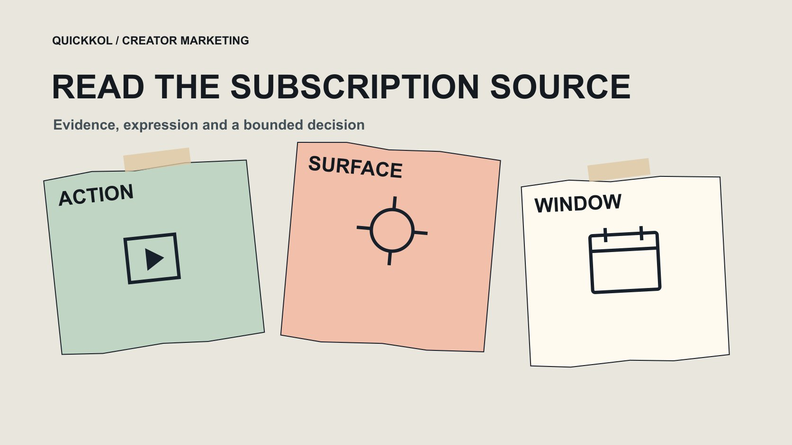
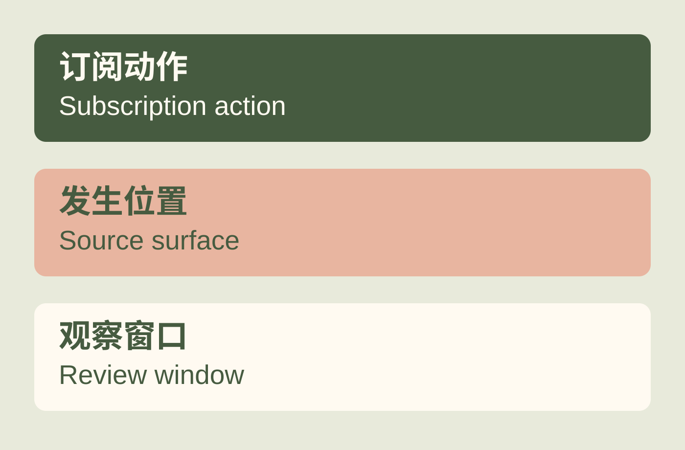

# YouTube Subscriber Tracker: Review a Creator Series

Status: local review draft; confirm the publication date before release.

Review where subscription actions occurred and the observation window before changing a creator series. Public totals cannot explain every change or independently establish brand effect.

QuickKOL editorial graphic; not actual account metrics or a platform interface.

A YouTube subscriber tracker should do more than draw a channel-total curve. When reviewing a continuing creator series, a brand can examine authorized subscription-source information, concurrent publishing and a defined period to identify an editorial question worth investigating. A source describes where an action occurred; it does not automatically establish that a sponsored video caused it or that the action represents a loyal viewer. Define the question before choosing the record.

## Give the series owner a specific tracking question

How many subscribers did we gain provides scale context but does not say what to change in the next instalment. Establish whether the team is discussing the series invitation, channel introduction, programme continuity or suitability for the intended audience.

Yesterday's [subscriber-count reconciliation method](https://www.quickkol.com/blog/youtube-subscriber-tracker-campaign-reconciliation/#answer) addresses differences between public abbreviations, authorized information and sampling times. This article goes further: even after records align, what can subscription sources contribute to an editorial decision, and what remains unanswered?

For example, the team might ask whether a new series makes the channel's continuing promise easier to understand. That requires the actual publications, invitation wording and available source records, rather than only subtracting totals before and after the partnership.

A question the owner can answer also limits unnecessary requests. The brand need not obtain an entire account or unrelated information for a bounded review. The creator should know which decision the supplied record serves, who will read it and why the requested level of detail is proportionate. This keeps tracking connected to the commissioned work.

## Read subscription source as the location of an action

[YouTube’s subscription-source guide](https://support.google.com/youtube/answer/9717879?hl=en) distinguishes locations including video watch pages, the channel homepage, other channels, interactive features, search and advertising, as well as unspecified sources. It helps explain where viewers clicked Subscribe.

The platform also says the dimension may be unavailable when selected-period traffic is insufficient. Unavailable is not zero, and the absence alone cannot show that the creator concealed information.

Compare relevant surfaces with the series' actual routes. If the programme contains an end-screen invitation, interactive features may be worth inspecting. An action there does not establish that the invitation was its only cause or that the person had never encountered the channel before.

Retain source names and available scope rather than dividing Other into guessed audience groups. A source table primarily classifies actions; it should not become a list of new customers supposedly delivered by the brand. The useful next question is what part of the published experience corresponds to that surface and whether the team has evidence to examine it.

## Keep channel and video reports within their scopes

[YouTube Analytics’ metric definitions](https://developers.google.com/youtube/analytics/metrics) describe subscriptions gained and lost as separate actions. Channel reports include the relevant locations, whereas a video dimension or filter limits the corresponding metric to that video's watch page.

Figures for a group of sponsored videos therefore do not represent the same total as channel-wide subscription changes across all sources. A gap after adding video results need not indicate a broken report; the comparison scopes may simply differ.

Retain channel, video, metric, period and filtering conditions. If calculating net actions, subtract losses from gains within the same scope and label the result as descriptive arithmetic.

Do not allocate growth from other channel sources across individual episodes merely to make two tables agree. Without evidence supporting the allocation, an equal split is an administrative choice rather than new attribution evidence. A reviewer should be able to reconstruct the calculation and see exactly which actions entered it, instead of discovering later that several unlike report types were combined under a single subscriber-growth heading.

The source locates an action and the window bounds observation; neither alone establishes brand attribution.

## Interpret losses with their source context

Do not present only the rows that increased. A period can include unsubscriptions, reductions associated with closed accounts or other platform-recorded changes. Begin with the explanation actually supplied for the source.

[YouTube’s subscription-source guide](https://support.google.com/youtube/answer/9717879?hl=en) separately describes reductions from the subscriptions feed, subscriptions channel list and closed accounts. They should not all be renamed audience dissatisfaction with this brand's content.

A reduction close to a publication can raise a review question without proving its cause. Concurrent work, publishing cadence or outside events may also affect the observation, and the available information may still be insufficient.

When asking the creator, describe a specific report period and source row rather than using a downward arrow to demand proof that nothing is wrong. An answerable question supports collaboration better than an accusation. Preserve the creator's explanation as an explanation until it is supported, just as the initial concern remains an observation rather than a finding. The review should make both evidence states visible.

## Record the editorial changes alongside the series

When one source changes between instalments, check whether the editorial arrangements are comparable. Topic, length, partner, placement and subscription invitation may all change. There is no need to assign everything to one sentence.

The brand and creator can each document what they actually control. The brand confirms product facts and project arrangements; the creator describes programme expression and channel context; the analyst retains window and source definitions.

If testing a clearer series invitation, state the understanding problem it should improve in advance. Do not wait for a better number and then describe every difference in that version as the reason for success.

This is an editorial review method, not a claim that one before-and-after comparison establishes causation. Proving incremental effect requires a measurement design that can support that conclusion. Extending a source table beyond its purpose cannot supply it. Even a limited comparison remains useful when the team explains what changed, what stayed comparable and which conclusions it deliberately leaves open.

## Practise a limited conclusion with hypothetical records

Imagine a creator series revising its end-screen introduction while the team retains two observation periods of equal length. The later report shows more subscription actions from interactive features, but another prominent programme was also published during that period.

The team can state that the source recorded more actions within the specified window and document the introduction change. It cannot say the brand caused the entire increase or promise that repeating the same invitation next time will reproduce the result.

If the earlier record lacks the same source dimension, retain the inability to compare directly. A public counter screenshot should not be inserted into an authorized source table just to produce a growth rate.

This is a hypothetical exercise without client data. Its value lies in showing what the owner should collect next, rather than using an unsupported precise percentage to make an unanswered question look resolved. It also gives the creator a fair explanation of why useful work can be recognized while the narrower subscription-effect claim remains unconfirmed.

## Examine actual viewing separately from subscription actions

[YouTube’s audience guide](https://support.google.com/youtube/answer/9314416?hl=en) defines monthly audience as an estimate of unique viewers over the preceding 28 days and describes its rolling calculation. Subscription sources and this metric answer different questions.

More subscription actions in one period do not guarantee those viewers watch later episodes. Conversely, people who have not subscribed can continue watching, so subscription status cannot replace every measure of content participation.

Where authorized information permits, use relevant audience evidence as separate context without claiming that two aggregate tables identify the same cohort. A rolling 28-day window is not automatically an arbitrarily chosen calendar month.

A brand review should distinguish where subscription actions occurred, which content was watched and whether the series fulfilled its assignment accurately. Keeping those questions separate prevents one impressive-looking counter from covering the entire partnership decision. It also avoids requesting personal subscriber identities when aggregated information is sufficient for the editorial question and no person-level linkage has been established or needed.

## Schedule checks around the decision

More frequent recording does not necessarily bring the team closer to an explanation. Ask which decision the next check can affect: revising an introduction, renewing a series or completing a project archive.

If nothing requires an immediate change, the creator need not repeatedly supply screenshots. Agree proportionate observation points that retain the periods needed for comparison while reducing unrelated interruptions to production.

Identify who preserves information, who interprets it and who decides an action. When one observation cannot answer the original question, continue collecting comparable information rather than switching metrics repeatedly just to obtain a conclusion sooner.

This is not a platform-prescribed checking interval or a promise that every backend refresh is already final. It is an editorial working arrangement: collection frequency should serve the partnership decision instead of allowing a second-by-second counter to dominate the review. The owner can then explain why a further observation is needed and what additional evidence would actually change the recommendation.

## Turn the review into a deliverable next step

A conclusion should correspond to something the next operator can do. It might clarify the series introduction, improve channel-homepage context or preserve the expression while observing further. Optimize growth alone is not an executable assignment.

The [creator-series release-maintenance method](https://www.quickkol.com/blog/youtube-playlist-multi-creator-release-maintenance/#answer) helps connect the next instalment with existing programmes. If invitations or programme organization change, check whether older routes still explain them accurately. A revised document does not automatically update published work.

Give each action a reason, owner and condition for another observation. List information not obtained separately rather than letting it block content corrections that already have support.

Subscriber tracking remains one part of the review. It should help the brand arrange a creator series more clearly rather than label every increase a success and every decrease a failure. A useful handoff retains the underlying report scope, the actual editorial decision and the unresolved measurement question, so the next team can continue without mistaking a proposal for an established result.

## Records for a creator-series subscription review

| Question | Retain | Does not directly establish |
| --- | --- | --- |
| Where it happened | Actual source label | Why it happened |
| What scope is compared | Channel, video and filters | All sources are interchangeable |
| When observed | Matching window and release record | Causal effect |
| Whether viewing continued | Separately checked audience information | Subscription means loyalty |
| What changes next | Assignment, owner and reason | Guaranteed repeat result |

Editorial review framework; hypothetical examples are not client results and source records are not person-level attribution.

## Hand off a subscription-source review

Make the basis and next step clear.

- [ ] Define the series’ editorial question.
- [ ] Retain actual source and authorized scope.
- [ ] Distinguish channel, video and net actions.
- [ ] Record the common window and concurrent releases.
- [ ] Separate viewing context from subscription actions.
- [ ] Hand over a limited conclusion, owner and open questions.

## Research date and limitations

Sources reviewed November 19, 2026. Methods, tables and decision rules are editorial recommendations. Hypothetical examples are not actual client results or industry benchmarks. Source geography and periods are specified where relevant.

## Start creator research with a clear task

Use QuickKOL to interpret a brief, discover relevant creators and research their work and contact routes. Verify data, commercial terms and outcomes at their source.

[Explore QuickKOL](https://www.quickkol.com/#capabilities)

## Sources

- [YouTube’s subscription-source guide](https://support.google.com/youtube/answer/9717879?hl=en)
- [YouTube Analytics’ metric definitions](https://developers.google.com/youtube/analytics/metrics)
- [YouTube’s audience guide](https://support.google.com/youtube/answer/9314416?hl=en)
