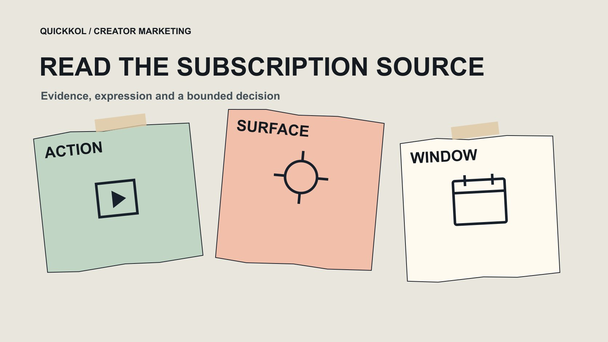
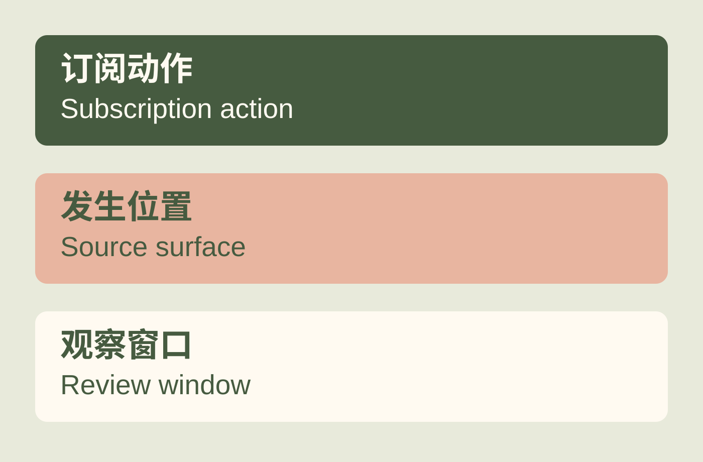

# 订阅来源怎样帮助复盘达人系列

状态：本地审阅稿；正式发布日期待确认。

复盘达人系列时，先看订阅动作发生的位置与观察窗口，再讨论内容安排；公开总数不能解释所有变化，也不能独立证明品牌效果。

QuickKOL 编辑图形；不呈现真实账号指标或平台界面。

YouTube subscriber tracker 不应只是一条频道总数曲线。品牌复盘连续达人内容时，可以在获准资料范围内核对订阅来源、同期发布和具体观察期，判断哪项内容安排值得继续研究。来源说明动作在哪里发生，不会自动证明某条赞助内容造成了订阅，更不能把订阅动作当成忠诚观众。先定义问题，再决定需要哪份记录。

## 先把追踪问题写给系列负责人

“订阅涨了多少”可以提供规模背景，却没有说明下一期应该改变什么。先明确团队在讨论的是系列邀请、频道介绍、节目连续性，还是作品本身是否适合目标观众。

昨天的[订阅数字对账方法](https://www.quickkol.com/zh/blog/youtube-subscriber-tracker-campaign-reconciliation/#answer)处理公开缩写、授权资料与取样时间的差异。本篇继续往下看：即使数字已经对齐，订阅来源能为内容决策提供什么，仍有哪些问题无法回答。

例如，团队希望知道新系列是否让观众更容易理解频道接下来会提供什么。需要收集实际发布、邀请表达与可用来源记录，而不只是把合作前后总数相减。

把决策写成可回答的问题，也能限制不必要的数据请求。品牌不需要为了一个简单系列复盘而索取整个账号或无关资料；创作者应清楚这份资料用于哪项判断。

## 订阅来源先描述动作位置

[YouTube 的订阅来源说明](https://support.google.com/youtube/answer/9717879?hl=en)将视频观看页、频道主页、其他频道、互动功能、搜索和广告等位置分开，也包含未指定来源。它帮助理解观众在哪个入口点击订阅。

平台还说明，选定时期的流量不足时，可能无法显示该维度。缺失不是零，也不能据此判断创作者刻意隐藏资料。

品牌可把相关位置与实际系列入口相对照。例如，节目里有片尾邀请时，互动功能值得核对；但动作发生在该位置，不证明邀请是唯一原因，也不表示这些人此前从未接触频道。

记录来源名称及实际可用范围，不自行将“其他”拆成猜测的群体。来源表首先是一种动作分类，不能直接改名为品牌带来的新客户名单。

## 频道报告与单条视频不要混算

[YouTube Analytics 的指标定义](https://developers.google.com/youtube/analytics/metrics)将新增与取消订阅分别作为动作。频道报告纳入相应位置的动作，而限定视频维度或筛选时，范围只包含该视频观看页的相关动作。

因此一组赞助视频的数字，与频道全部来源的订阅变化不是同一份总数。把视频结果相加后缺少一部分，不一定是报表错误，可能是比较范围本来不同。

报告里保留频道、视频、指标、时期及筛选条件。若计算净动作，就在同一范围内使用新增减去取消，并明确这只是描述性算术。

不要为让两张表看起来一致，把频道其他来源的增长分摊到每一期节目。没有支持分配的资料，平均分配只是人为安排，不会产生新的归因证据。

来源定位动作，窗口限定观察；两者都不能单独证明品牌归因。

## 把订阅减少也放回来源语境

不要只展示增加的行。某个时期也可能出现取消订阅、关闭账户相关减少，或其他平台记录的变化；先查看实际提供的来源说明。

[YouTube 的订阅来源说明](https://support.google.com/youtube/answer/9717879?hl=en)将订阅信息流、订阅频道列表和关闭账户等减少来源分别解释。它们不应被统一写成观众对本次品牌内容不满。

如果减少与发布期相邻，可以提出需要复核的问题，却不能仅凭时间相近证明原因。同期内容、发布节奏或外部事件也可能影响观察，现有资料可能仍不够回答。

向创作者询问时描述具体范围，例如某个报告时期与某一来源行，而不是用一个下降箭头要求对方证明自己没有问题。可回答的问题，比带有指控的结论更有助于合作复盘。

## 比较系列时同时记录内容变化

同一个来源在两期节目间变化，先检查内容安排是否可比。节目主题、时长、合作对象、发布位置和订阅邀请都可能变化，不必把一切归给某一句话。

品牌与创作者可各自记录实际控制的部分：品牌确认产品事实与项目安排，创作者说明节目表达与频道语境，分析者保留窗口和来源口径。

如果决定测试更清楚的系列邀请，就事先写出要改善的理解问题。不要在看到较好数字后，才把那一版所有差异都称为成功原因。

这里只提供编辑复盘方法，不宣称一次前后比较就能建立因果。若真正需要证明某项变化带来的增量，应另行设计能支持该结论的测量，而不是扩大现有来源表的用途。

## 用假设记录练习一个有限结论

假设一组达人节目更新了片尾的系列介绍，团队也保留了相同长度的两个观察期。后一期报告显示互动功能来源增加，但同期又发布了另一个较受关注的节目。

这时可以说，该来源在指定窗口里出现更多订阅动作，并记录系列介绍变化。不能直接说增加全部来自品牌，或承诺下一期使用同一句邀请就会重复结果。

如果旧记录没有相同来源维度，就保留无法直接比较的状态。不要为了凑出增长率，用一张公开计数截图补进授权来源表。

这是假设演练，没有实际客户数据。它的价值是让负责人知道下一步该继续收集什么，而不是用没有依据的精确百分比，让一项尚未回答的问题看起来已经解决。

## 订阅动作之外还要看实际观看

[YouTube 的受众说明](https://support.google.com/youtube/answer/9314416?hl=en)将月度受众定义为过去 28 天的独立观众估计，并说明它按滚动窗口计算。订阅来源与这一指标回答不同问题。

一个时期有更多订阅动作，不保证这些观众继续观看后续节目。反过来，未订阅的人也可能持续观看，因此不能用订阅状态代替全部内容参与。

如果获准资料允许，可以把相关受众资料作为独立背景，但不要声称两张聚合表已经匹配到同一批人。滚动 28 天也不自动等于任意选择的日历月。

品牌复盘应分别说明：订阅动作发生在哪里、什么内容有人观看、系列交付是否准确完成任务。保留这些问题的差别，能避免用一个看起来重要的计数覆盖整个合作判断。

## 按决策安排复查频率

记录越频繁，不代表越接近解释。先问下一次复查会影响什么：是否决定下一期介绍、续订一个系列，还是只补齐项目档案。

如果没有需要即时改变的事项，不必让创作者不断提供截图。约定合理的观察时点，既保留真正要比较的时期，也减少对内容制作的无关打断。

提前说明谁保存资料、谁解读、谁决定行动。若一个观察还不能回答原问题，可以继续收集相同口径的资料，而不是为了尽快有结论不断更换指标。

这不是平台推荐的固定检查周期，也不承诺后台每次刷新已经完全稳定。它是编辑工作安排：让收集频率服务实际合作决定，避免一条每秒跳动的曲线占据了整个复盘。

## 把复盘变成下一期任务

结论应对应下一位执行者能做的事。例如，让系列介绍更清楚、补充频道主页语境，或保持现有表达并继续观察，而不是只留下“优化增长”。

[达人系列发布维护方法](https://www.quickkol.com/zh/blog/youtube-playlist-multi-creator-release-maintenance/#answer)帮助把下一期与既有节目连接。若更新邀请或节目组织，也检查旧入口是否仍提供准确说明，不默认文档变化会同步改掉已发布作品。

给每个行动保留理由、负责人和需要再次观察的条件。未取得的资料单独列出，不让它阻塞那些已经有依据的内容修正。

订阅追踪只是复盘的一部分。它应该帮助品牌更清楚地安排达人系列，而不是让团队把每一个可见增长都写成成功、每一次减少都写成失败。

## 达人系列订阅复盘的记录

| 问题 | 需要保留 | 不能直接推导 |
| --- | --- | --- |
| 发生在哪里 | 实际来源名称 | 为什么发生 |
| 比较什么范围 | 频道、视频和筛选 | 所有来源可相加 |
| 何时观察 | 共同窗口与发布记录 | 因果效果 |
| 是否继续观看 | 另行核对的受众资料 | 订阅就是忠诚 |
| 下一期改变什么 | 任务、负责人和理由 | 结果必然重复 |

编辑复盘框架；假设示例不是客户结果，来源记录不是个人级别归因。

## 交接订阅来源复盘

让负责人知道结论依据与下一步。

- [ ] 明确系列要回答的内容问题。
- [ ] 保留实际来源与授权范围。
- [ ] 区分频道、视频与净动作。
- [ ] 记录共同窗口与同期发布。
- [ ] 把观看背景与订阅动作分开。
- [ ] 交付有限结论、负责人和未解问题。

## 研究日期与使用边界

资料核验于 2026 年 11 月 19 日。文中方法、表格和决策规则为编辑建议，标为假设的示例不是实际客户结果或行业基准。外部资料的适用地区与时期按各段说明。

## 从任务开始达人研究

用 QuickKOL 理解 Brief、发现相关达人并研究作品与联系路径；数据、合作条件和结果仍需核验。

[了解 QuickKOL](https://www.quickkol.com/#capabilities)

## 来源

- [YouTube 的订阅来源说明](https://support.google.com/youtube/answer/9717879?hl=en)
- [YouTube Analytics 的指标定义](https://developers.google.com/youtube/analytics/metrics)
- [YouTube 的受众说明](https://support.google.com/youtube/answer/9314416?hl=en)
