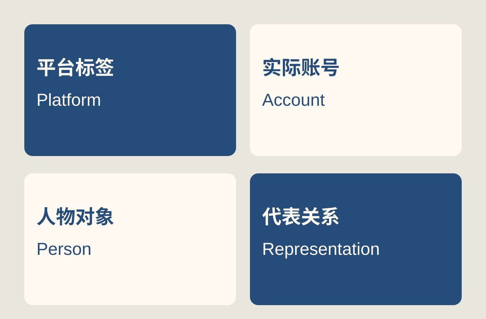

# Blueskt: Fix Creator Contact Records

Status: local review draft; confirm the publication date before release.

When Blueskt appears in a partnership record, correct the platform field while checking account and contact identity separately.

“Blueskt” may be a misspelling of Bluesky, but correcting a platform label does not verify an account, person or representative. Preserve the original entry, check the actual source and decide whether to change a label, connect evidence or keep records separate. Then update affected briefs and outreach preparation. A spelling correction should not silently merge two creators or authorize contact with an unconfirmed representative. The aim is a reliable working record that another team member can understand, including what changed and what the correction did not establish.

## Locate the error before correcting it

A near spelling can appear in a keyword list, platform selector, contact note or beside a copied link. Identify the field first. A search term may need to remain as received; a database classification may need the team’s agreed platform label.

[Bluesky’s platform and domain explanation](https://bsky.social/about/blog/09-04-2024-welcome) can establish the basic app and network reference. A similar word alone is not evidence of another independent service.

Retain the original input with its source document, date and provider when the correction affects later decisions. This does not require preserving every keystroke indefinitely. It means another owner can understand why a meaningful record changed, especially if a quotation still refers to the earlier label.

Make the smallest necessary correction. The platform field may change while person, account, representative and contracting party remain separate verification questions. An obvious spelling mistake is not proof that all neighbouring fields are correct. Keeping this distinction at the start prevents an administrative cleanup from turning into an unsupported identity judgment, and gives reviewers a clear stopping point before any outreach or commercial commitment depends on the revised record.

## Anchor the account to an actual link

Check what the link identifies: a platform homepage, public profile, individual work or a third-party screenshot. These provide different information and should not all be reduced to a single Bluesky label in the sheet.

Retain the exact public profile route and observation date. Display names can coincide or change, and screenshots can lose their context. The team needs a path back to the actual record. Do not guess private email addresses, home addresses or unrelated personal information to compensate for a weak source.

[Bluesky’s verification explanation](https://bsky.social/about/blog/04-21-2025-verification) describes domain and badge identity signals. Record the specific basis when using them, rather than treating the presence of a graphic as proof of representation.

If a link no longer resolves, unverified is a legitimate state. Do not fill the gap with a similar-looking account. Start from the creator’s already established public channels and have the appropriate communication owner ask a bounded question if necessary. This keeps the contact file useful without turning missing information into invented certainty or requiring a researcher to decide identity from resemblance alone.

## Separate a correction from a merge

Changing a label, linking one person’s cross-platform records and merging duplicates are different actions. The first mainly changes classification. The others affect ownership of work samples, contact history and future tasks, so they require stronger support.

Keep suspected duplicates side by side while recording the reason for the suspicion and the missing evidence. One record may concern a creator and another their studio. Both can be useful; tidying the table does not justify forcing them into one identity.

The [Bluesku source-verification method](https://www.quickkol.com/blog/bluesku-brand-source-disambiguation/#answer) addresses provenance problems caused by similar spellings. This article continues at the team-record level: who can approve a merge, what information must survive and where existing tasks should point.

Before merging, check quotations, usage discussions and unresolved questions already in progress. If those concern different entities, preserve their relationship instead of overwriting one side. A neat sheet is not the only objective. Accurate responsibility matters more, particularly when the same person appears publicly under several professional roles or when an agency represents only some of their work. A correction should make those distinctions easier to use, not erase them.

Correcting one label does not verify the other relationships.

## Keep the contact’s identity separate

The account holder, public business email, manager, agency and payment recipient may be different entities. Correcting a platform name does not answer those relationships or expand a contact’s representative scope.

In outreach preparation, specify whom the team intends to ask and what the request concerns. For new work, discuss commissioning through the appropriate business route. For an existing-work quotation, separately identify the author and required permission. Do not combine the two requests in wording that leaves the recipient guessing.

Record the representative explanation supplied by an agency and the project scope it covers. Resolve inconsistent information instead of allowing an email signature or familiar avatar to decide payment and contracting authority.

Useful internal fields include public account, contact for this assignment and representative scope awaiting confirmation. These are working records, not legal certifications. The relevant owner still completes the necessary contracting and payment confirmation. Keeping the fields separate also makes later updates manageable: a creator can change representation without losing the history of their original work, and a corrected platform label can propagate without implying that every existing commercial relationship has changed.

## Retain information relevant to the decision

In the UK data-protection context, [the ICO’s data-minimisation guidance](https://ico.org.uk/for-organisations/uk-gdpr-guidance-and-resources/data-protection-principles/a-guide-to-the-data-protection-principles/data-minimisation/) calls for information that is relevant, sufficient and limited to the stated purpose. The page notes that guidance is under review. It is not a complete legal conclusion for every jurisdiction.

Creator research may need only public account details, work provenance, a business contact route and the status of the current conversation. Do not collect private family details, addresses or unrelated life information merely to distinguish two similar names.

Insufficient information can also produce mistakes. A label with no recoverable source may be inadequate for outreach. Minimisation is not the deletion of every contextual field; it means retaining what is necessary to fulfil a defined purpose.

Assign responsibility for sharing and retention. A correction record should not spread indefinitely to unrelated teams, and information that no longer serves its purpose should be handled under the team’s applicable rules. This is a working method, not a substitute for jurisdiction-specific review. Its practical value is that researchers can explain why each field exists instead of keeping an expanding personal dossier simply because the source material happened to be publicly visible.

## Update the brief and outreach preparation

After confirming the correction, check materials that reference the old record: shortlists, briefs, draft inquiries, media links and assigned tasks. A database change does not automatically revise an exported document.

Tell relevant colleagues the scope of the change. If only the platform field was confirmed, state that no new conclusion was reached about account identity or representation. This prevents corrected from being read as fully verified.

For an unsent message, update the draft before it follows the established sending process. Whether a sent conversation needs clarification depends on whether the error affects the recipient’s understanding. Let the communication owner decide rather than repeatedly disturbing the creator over an inconsequential label.

Preserve version relationships so a reply returns to the correct assignment instead of another record created by a mistaken merge. The practical check is simple: can a colleague identify which source informed the current brief, which recipient the draft addresses and what remains unresolved? If not, the cleanup has improved spelling without improving the workflow. Complete that connection before the corrected label is used to justify a new commercial next step.

The [creator contact-record method](https://www.quickkol.com/blog/whatsapp-business-creator-conversation-handoff/#answer) helps route subsequent replies to the correct owner.

## Test the workflow with a hypothetical duplicate

Imagine two entries: Blueskt / Alex and Bluesky / Alex Studio. Both use a similar avatar, but one links to personal work and the other to a studio. This is a hypothetical editorial example, not an allegation about named accounts.

The team can standardize the platform label while preserving person and studio as separate objects. If the studio is later confirmed as responsible for this production, record that representative and production relationship. Do not reassign all historical personal work to the studio.

If the entries are duplicates of the same record, preserve source provenance and unfinished tasks before an authorized owner approves the merge. A quotation sent to one contact does not automatically transfer to another because the research database changed.

The scenario illustrates the difference between a minimal correction and a complete identity conclusion. It does not require a complicated system. A small sheet can use clear status, sources and relationships. What matters is that an automated replacement does not make the team’s substantive judgment invisibly, or turn an uncertain resemblance into the basis for contacting, contracting or paying the wrong party.

## Hand over a bounded correction

Record original value, replacement, evidence, owner and affected scope. Keep unresolved identity or commercial questions in an open field instead of hiding them behind handled.

Give the next colleague a route back to the actual material and state whether any exported files still need updating. A research-record correction is not evidence that the creator accepted a partnership.

QuickKOL can help interpret a brief, discover relevant creators and prepare personalized contact. Sources and counterparties must still confirm account identity, representation, usage and commercial conditions.

A small error such as Blueskt deserves attention because it can travel through lists and messages. A good correction preserves established facts while making the next step clearer. It does not invent another platform, merge a person or complete verification that the team has not performed. Close the task only when another owner can tell which part of the record is now reliable and which decision still needs evidence. That makes the cleanup useful beyond the person who noticed the spelling, without adding unnecessary friction to an otherwise legitimate creator conversation.

## Scope of a correction

| Action | Needed | Keep separate |
| --- | --- | --- |
| Correct platform label | Standard label and source | Person identity |
| Connect platform records | Verifiable connection | Audience counts |
| Merge duplicates | Provenance and task ownership | Person and studio roles |
| Update outreach | Recipient and request scope | Interest and acceptance |

Editorial workflow, not identity or legal certification.

## Complete the contact-record correction

Show the next colleague what was actually checked.

- [ ] Retain the original input relevant to the decision.
- [ ] Confirm the field and actual link.
- [ ] Separate label correction from merging.
- [ ] Check representative scope separately.
- [ ] Update affected briefs and drafts.
- [ ] List unresolved questions.

## Research date and limitations

Sources reviewed November 20, 2026. Methods, tables and decision rules are editorial recommendations. Hypothetical examples are not actual client results or industry benchmarks. Source geography and periods are specified where relevant.

## Start creator research with a clear task

Use QuickKOL to interpret a brief, discover relevant creators and research their work and contact routes. Verify data, commercial terms and outcomes at their source.

[Explore QuickKOL](https://www.quickkol.com/#capabilities)

## Sources

- [Bluesky’s platform and domain explanation](https://bsky.social/about/blog/09-04-2024-welcome)
- [Bluesky’s verification explanation](https://bsky.social/about/blog/04-21-2025-verification)
- [the ICO’s data-minimisation guidance](https://ico.org.uk/for-organisations/uk-gdpr-guidance-and-resources/data-protection-principles/a-guide-to-the-data-protection-principles/data-minimisation/)
