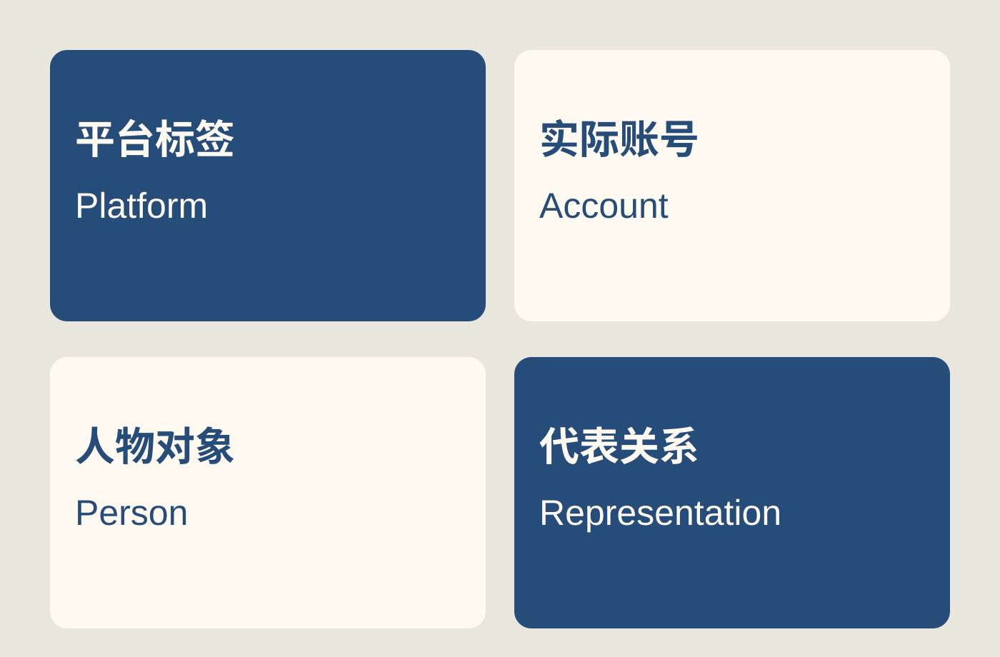

# Blueskt 拼写怎样校准合作记录

状态：本地审阅稿；正式发布日期待确认。

合作表出现 Blueskt 等近似拼写时，先修正平台字段，再核对账号与联系对象，避免把行政更正变成错误合并。

“Blueskt” 可能是 Bluesky 的拼写变体，但更正平台名称不等于确认账号、本人或代理关系。达人合作记录应保留原始输入、核对实际来源，再决定只改标签、连接资料还是维持分开。修正后还要同步相关 Brief 与外联准备，不能让一次自动替换把两位创作者合并，或让团队向未经确认的联系人发送提案。

## 先看错误出现在哪里

近似拼写可能出现在关键词、平台选项、联系人备注或复制的链接旁边。先判断它属于哪种字段。如果只是搜索词，不一定需要把它改成正式平台名称；如果是数据库分类，则应使用团队确认的标准标签。

[Bluesky 平台与域名说明](https://bsky.social/about/blog/09-04-2024-welcome)可用于确认应用和网络的基本对象，不应由一个相似词自行推断存在另一个独立平台。

保留原始输入和它来自的文件、日期、提供方。这不需要把每次打字都永久保存，而是让影响后续决定的更正可追溯。若一份报价引用了旧标签，下一位负责人应能理解它为何变化。

先做最小必要修正：平台字段可以改，但人名、账号、代表和合同对象仍分别核对。不要把明显的拼写错误当作其他字段也已经正确的证明。

## 用实际链接固定账号

核对链接指向什么：平台首页、公开资料、单条作品还是第三方截图。它们提供的信息不同，不能只在表格里统一写“Bluesky”。

保留准确的公开账号路径和观察日期。显示名可以相同或改变，截图也可能失去上下文，因此需要能回到实际资料的来源。不猜私人邮箱、真实住址或其他与任务无关的信息。

[Bluesky 认证说明](https://bsky.social/about/blog/04-21-2025-verification)介绍域名与认证标记的不同身份线索。使用这些信号时记录具体依据，不因为看见某种图形就直接认定代理关系。

如果链接已经失效，状态可以是待核验，而不是复制一个相似账号来填空。先从创作者自己已经确认的公开渠道查找，必要时由负责沟通的人提出明确问题。

## 分清更正与合并

改标签、连接同一人的跨平台资料、合并重复记录，是三种不同动作。第一种主要改变分类，后两种会影响作品、联系历史和后续任务的归属，需要更强依据。

可以先并列保留疑似重复项，并标明为什么怀疑、还差什么。若一个是创作者本人、另一个是工作室，两条都可能有用，不应为了“去重”强制压成一条。

[Bluesku 来源核对方法](https://www.quickkol.com/zh/blog/bluesku-brand-source-disambiguation/#answer)处理近似拼写带来的资料出处问题。本篇继续到团队记录层：谁能够决定合并，哪些信息必须保留，原有任务将指向哪里。

合并前检查是否存在进行中的报价、用途讨论或未解决问题。若这些内容属于不同对象，应保留关系，而不是覆盖其中一方。整洁表格不是唯一目标，准确分工才是。

纠正一个标签，不自动核验其他关系。

## 让联系对象保留自己的身份

账号本人、公开业务邮箱、经纪人、代理机构和付款对象可能不是同一个主体。平台名称更正不能替这些关系作答，也不能自动扩大某个联系人代表的范围。

在外联准备中，写清打算向谁询问什么。若需要新作品，向合适的商业渠道讨论新委托；若需要引用旧作，另核对作者和相关许可，不把两种请求混在一句话里。

记录代理提供的代表说明以及适用的项目范围。信息不一致时先澄清，不让团队靠邮件签名或熟悉头像作出付款与签约判断。

对内可以使用清楚的关系字段，例如“公开账号”“本次联络”“待确认代表范围”。它们是工作记录，不是法律认证。真正需要的合同与付款确认仍由相应负责人完成。

## 只保留与决定有关的信息

[ICO 数据最小化说明](https://ico.org.uk/for-organisations/uk-gdpr-guidance-and-resources/data-protection-principles/a-guide-to-the-data-protection-principles/data-minimisation/)在英国数据保护语境中强调资料与目的相关、足够且限于必要范围。该页也说明指导正在审查中，不能把它当成所有地区的完整法律结论。

对达人研究，实际任务可能只需要公开账号、作品出处、业务联系路径和本次沟通状态。不要为了区分两个相似名字，顺手收集私人家庭、住址或无关生活信息。

同时，资料太少也会造成错误。一个无法核对出处的标签，可能不足以支持外联。最小化不是把所有背景删光，而是保留能完成明确目的的必要信息。

为共享与保留设定负责人。更正记录不应该无限扩散到无关团队，已经失去用途的信息也应按团队规则处理。本文提供工作方法，不替代适用地区的具体审阅。

## 同步 Brief 与外联准备

更正成功后，检查哪些材料引用旧记录：候选名单、Brief、询价草稿、素材链接和负责人任务。不要假设数据库变更会自动修改已经导出的文件。

给相关人员说明改动范围。例如，只确认平台字段，应明确没有新确认账号身份或代表关系。这样下一位同事不会把“已更正”理解成整个人已经核验。

若消息尚未发出，可以先更新草稿再由既定流程处理。已经发送的沟通是否需要补充说明，取决于错误是否影响接收方理解，由负责沟通的人判断，不为小标签错误反复打扰对方。

[达人联系记录方法](https://www.quickkol.com/zh/blog/whatsapp-business-creator-conversation-handoff/#answer)可用于继续维护谁收到什么、何时收到和还需要什么。版本间保持关联，让对方回复能回到正确的任务，而不是落入另一条被误合并的记录。

达人联系记录方法帮助把后续回复交给准确的负责人。

## 用假设重复项检查流程

假设表里有“Blueskt / Alex”和“Bluesky / Alex Studio”。两条都使用相似头像，但一个链接指向个人作品，另一个指向工作室。这里是编辑假设，不是具名账号指控。

团队可以先统一平台标签，同时保留个人与工作室两个对象。如果后来确认工作室负责本次制作，就记录代表与制作关系，不把个人历史作品全部改归工作室。

若两条其实是同一资料的重复输入，也先保留原始来源与尚未完成的任务，再由有权负责人确认合并。已经发给某个联系人的报价不会因为合并而自动转给另一人。

这个场景说明最小修正和完整身份判断的区别。它不要求复杂系统；小表格也可以用清楚的状态、来源和关系做到，关键是不要让自动化替团队猜测。

## 交接明确的更正结论

最终写清原值、新值、依据、负责人和影响范围。没有解决的身份或商业问题放在未解栏，不用“已处理”掩盖。

对继续工作的同事，提供能回到实际资料的路径，并说明是否还有待更新的导出文件。若只是研究记录变化，不要声称创作者已经接受合作。

QuickKOL 可以帮助理解 Brief、发现达人和准备个性化联系；账号本人、代表关系、用途与商业条件仍需来源与合作方确认。

Blueskt 这种小错误值得处理，是因为它可能沿着名单和消息传播。好的修正保留原有事实，让下一步更清楚；它不会凭空增加一个平台、合并一个人，或替团队完成尚未做过的核验。

## 更正动作的范围

| 动作 | 需要 | 保持分开 |
| --- | --- | --- |
| 改平台标签 | 标准名称与来源 | 人物身份 |
| 连接跨平台资料 | 可核对的连接 | 受众数字 |
| 合并重复项 | 来源与任务归属 | 个人与工作室角色 |
| 更新外联 | 接收人及请求范围 | 兴趣与接受 |

编辑工作流程，不是身份或法律认证。

## 完成联系记录更正

让下一位同事知道实际核对了什么。

- [ ] 保留影响决定的原始输入。
- [ ] 确认字段与真实链接。
- [ ] 区分标签修改与记录合并。
- [ ] 单独核对代理范围。
- [ ] 同步受影响的 Brief 和草稿。
- [ ] 列出尚未解决的问题。

## 研究日期与使用边界

资料核验于 2026 年 11 月 20 日。文中方法、表格和决策规则为编辑建议，标为假设的示例不是实际客户结果或行业基准。外部资料的适用地区与时期按各段说明。

## 从任务开始达人研究

用 QuickKOL 理解 Brief、发现相关达人并研究作品与联系路径；数据、合作条件和结果仍需核验。

[了解 QuickKOL](https://www.quickkol.com/#capabilities)

## 来源

- [Bluesky 平台与域名说明](https://bsky.social/about/blog/09-04-2024-welcome)
- [Bluesky 认证说明](https://bsky.social/about/blog/04-21-2025-verification)
- [ICO 数据最小化说明](https://ico.org.uk/for-organisations/uk-gdpr-guidance-and-resources/data-protection-principles/a-guide-to-the-data-protection-principles/data-minimisation/)
